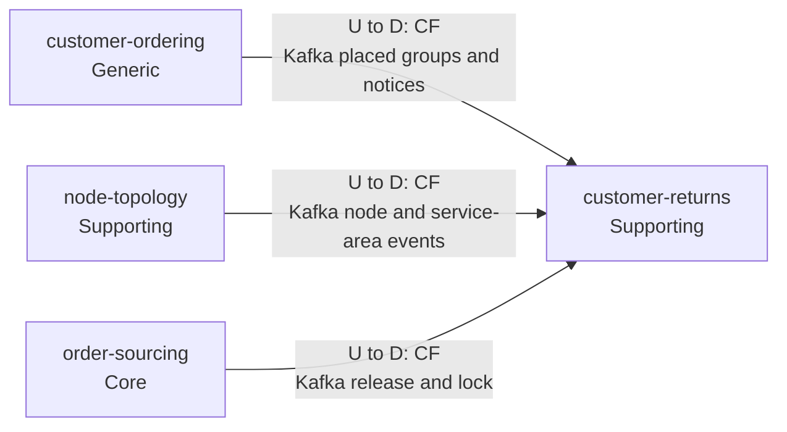
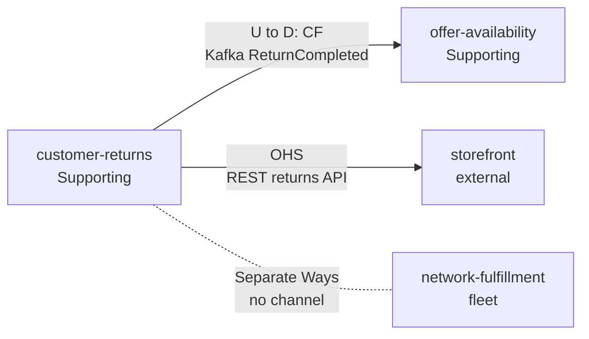

# Context Map

:::info[As built]
Derived from [`network/model/model.yaml`](https://github.com/IQVO/warehouse-docs/blob/main/network/model/model.yaml). This context's service is built ([`IQVO/customer-returns`](https://github.com/IQVO/customer-returns), decided by [ADR 0012](/network/adr/0012-customer-returns-is-a-bounded-context)); the model carries its as-built contracts, and identifiers (`Err...` names, routes, CloudEvents types) are the names the service uses. Where the model left a choice open, the service's own ADRs 0001 to 0005 record what it does.
:::

Following ddd-crew [Context Mapping](https://github.com/ddd-crew/context-mapping).
This is **customer-returns' slice** of the
[network-wide context map](/network/strategic-design/context-map). Arrows point from
upstream to downstream.

### Upstream: what customer-returns conforms to

### Downstream: who depends on customer-returns

Derived from: model.yaml → contexts[customer-returns].inbound, .publishes,
.consumes; contexts[offer-availability].consumes; meta.hard_boundary.

Omitted: the contexts with no edge to this one in the model:
`delivery-promise`, `linehaul-transportation`, `last-mile-delivery`,
`node-performance`, `seller-inbound`, and the two below.

## Relationships

| Neighbour | Direction | Pattern | Channel | Messages | Why this pattern |
| --- | --- | --- | --- | --- | --- |
| `customer-ordering` | U → D | Conformist | Kafka `retailnetwork.customer-ordering.events` | `CustomerOrderPlaced`, `ShopperNoticeDecided` | Whether a group is shipped or delivered is `customer-ordering`'s fact. Kept in `OrderGroupView`; never asked back. |
| `node-topology` | U → D | Conformist | Kafka `retailnetwork.node-topology.events` | `NodeRegistered`, `NodeActivated`, `NodeSuspended`, `NodeRetired`, `ServiceAreaAssigned` | Which returns centre is `ACTIVE` and which region a prefix belongs to are `node-topology`'s facts. Kept in `ReturnsNetworkView`. |
| `order-sourcing` | U → D | Conformist | Kafka `retailnetwork.order-sourcing.events` | `FulfillmentReleasedToNode`, `FulfillmentLocked` | Which node fulfilled the group, and whose stock each line took, are sourcing facts. Kept in `ReturnsNetworkView`. |
| `offer-availability` | U → D (CR upstream) | Conformist (`offer-availability` conforms) | Kafka `retailnetwork.customer-returns.events` | `ReturnCompleted` | The restock is a fact about what came back; `offer-availability` applies it to the owner listing. |
| Storefront (external) | U → D | Open Host Service | REST (no auth) | authorize, label, cancel, read | A published returns API; the storefront is the only caller. |
| `network-fulfillment` (warehouse-systems fleet) | none | Separate Ways | none | none | The hard boundary: the fleet reaches the network through the Vendor API of `vendor-connectivity` only. |

## The two seams the model does not draw

Both are built in this service and decided in the neighbour's ADRs. Neither
is in the neighbour's `develop` contract, and the model draws an edge only
when both ends carry it.

| Neighbour | What this service does | What is missing | Effect today |
| --- | --- | --- | --- |
| `shipping-and-tracking` | `IssueLabel` calls its reverse-label route (`/return-labels`) before the transaction, with an idempotency key of the authorization id and the package number. The call is config-gated and off by default. | The route is decided in `shipping-and-tracking` ADR 0017 and is not in its OpenAPI on `develop`. | A label request answers 422 `label-unavailable`; no `ReturnLabelIssued` is raised. |
| `vendor-connectivity` | Publishes `ReturnAuthorized`, `ReturnLabelIssued` and `ReturnCancelled` for the vendor's return advices, and consumes the graded outcome (`VendorReturnOutcomeSubmitted`) to complete an authorization. | The advices, the outcome route and the event are decided in `vendor-connectivity` ADR 0014 and are not in its OpenAPI or AsyncAPI on `develop`. | No authorization reaches `RECEIVED` and no `ReturnCompleted` is raised. |

## Notes on the patterns

- **No Shared Kernel.** `orderId`, `nodeId`, `catalogItemId` and `ownerRef`
  are values copied from events.
- **Conformist upstream, three times.** The context decides from local
  copies; a view that lags refuses the command instead of calling the
  producer.
- **One synchronous call, not drawn.** The reverse-label call is the only
  one the service makes; see the table above.
