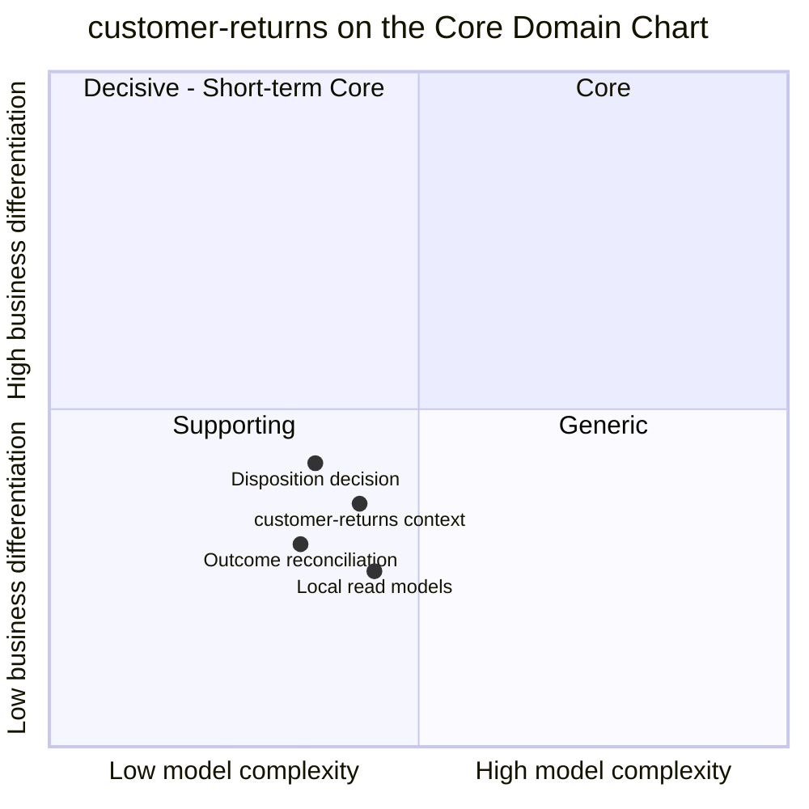

# Core Domain Chart

:::info[As built]
Derived from [`network/model/model.yaml`](https://github.com/IQVO/warehouse-docs/blob/main/network/model/model.yaml). This context's service is built ([`IQVO/customer-returns`](https://github.com/IQVO/customer-returns), decided by [ADR 0012](/network/adr/0012-customer-returns-is-a-bounded-context)); the model carries its as-built contracts, and identifiers (`Err...` names, routes, CloudEvents types) are the names the service uses. Where the model left a choice open, the service's own ADRs 0001 to 0005 record what it does.
:::

Following the ddd-crew [Core Domain Charts](https://github.com/ddd-crew/core-domain-charts):
business differentiation (y) against model complexity (x).

Derived from: model.yaml → contexts[customer-returns].chart,
.classification, .aggregates, .policies.

Omitted: the other eleven contexts (their positions are on the
[network-wide chart](/network/strategic-design/core-domain-chart)). The three slices
are placed by this page; the model gives only the context point, and that
point is a modelling judgement of this documentation, not a figure from the
service.

## Classification: Supporting

The context sits at complexity 0.42, differentiation 0.36: **quadrant 3,
Supporting**.

**Differentiation is low (y = 0.36).** Authorizing a return, routing it to a
returns centre and restocking what is sellable is common practice. The
disposition rule is this network's own, but it is three ordered checks, and
it decides no promise and no path, which is what sets the network apart
([ADR 0002](/network/adr/0002-promise-and-assignment-are-separate)). It
protects the shopper's experience and recovers stock; it does not
differentiate.

**Model complexity is moderate (x = 0.42).** One aggregate with six states,
nine consumed event types from three producers and three local read models,
one of which must tolerate events arriving in either order. The hardest part
is deciding from views that may lag, and saying so honestly
(`ErrGroupNotShipped`, `ErrNoReturnDestination`) instead of blocking.

| Axis | Verdict |
| --- | --- |
| **Business model** | Experience protector and stock recoverer: a return is authorized without money, address or free text, and sellable units come back as a fact. |
| **Evolution** | Custom-built. The disposition rule is the network's own; label issuing and grading stay with their owners. |

## Why it is its own context

1. **It is the shopper's contract, not the vendor's.** The vendor protocol
   speaks of purchase orders and receipts; a return authorization has a
   different actor, lifecycle and clock.
2. **It keeps PII and money out.** A separate context with an enum reason, a
   postal prefix and caller-declared prices that never leave it can state
   that rule and test it.
3. **It owns the one decision nobody else should.** Where a return goes
   depends on the order, the topology and the sourcing facts together; no
   single upstream context sees all three.

**Movement to watch.** If the returnless threshold becomes a policy that
varies by item, seller or reason, or if the pickup leg is activated, the
decision grows and the context moves up and right.
