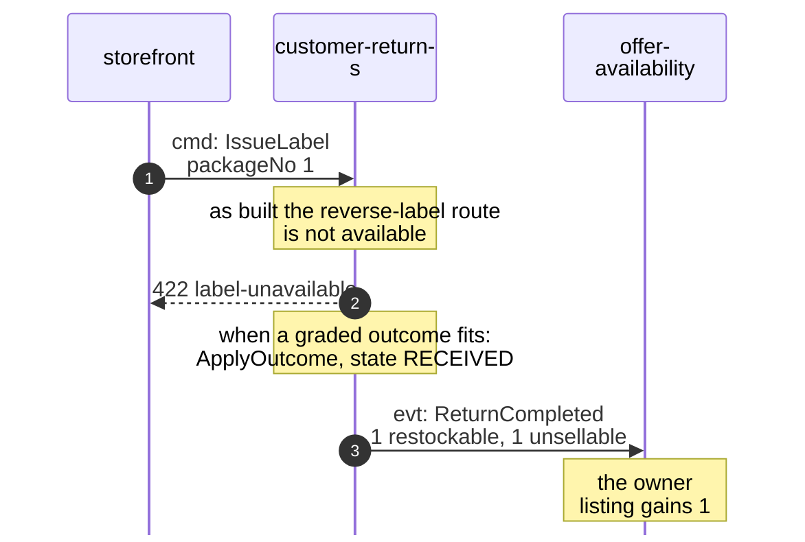
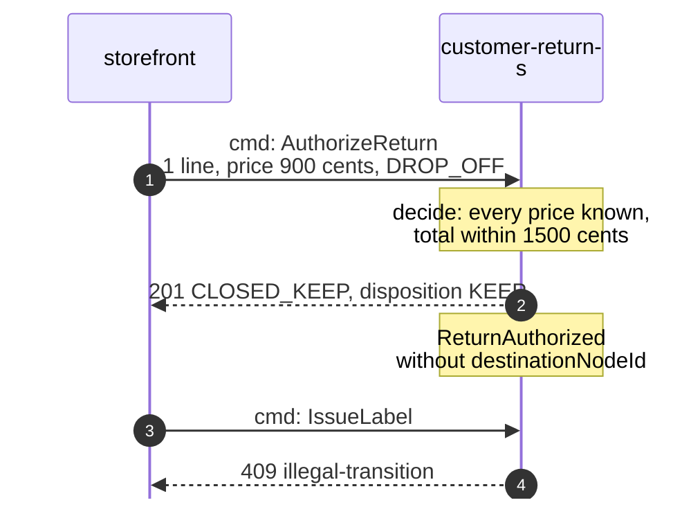
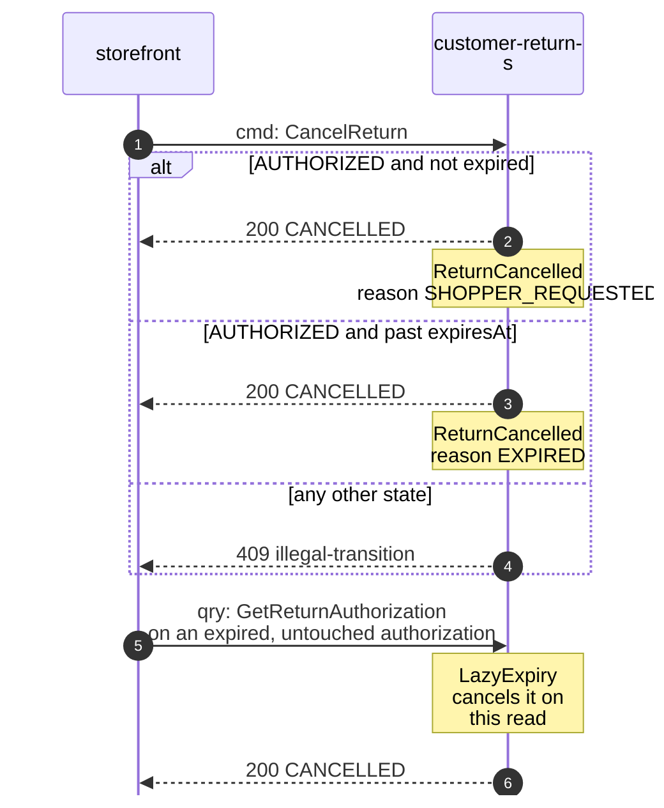

# Domain Message Flow

:::info[As built]
Derived from [`network/model/model.yaml`](https://github.com/IQVO/warehouse-docs/blob/main/network/model/model.yaml). This context's service is built ([`IQVO/customer-returns`](https://github.com/IQVO/customer-returns), decided by [ADR 0012](/network/adr/0012-customer-returns-is-a-bounded-context)); the model carries its as-built contracts, and identifiers (`Err...` names, routes, CloudEvents types) are the names the service uses. Where the model left a choice open, the service's own ADRs 0001 to 0005 record what it does.
:::

Following ddd-crew [Domain Message Flow Modelling](https://github.com/ddd-crew/domain-message-flow-modelling).
Every arrow is a message from the model, prefixed `cmd:`, `evt:` or `qry:`.
Quantities and identifiers in the notes are illustrative. Full types are on
[Domain Events](/network/contexts/customer-returns/domain-events).

## 1. A physical return

### 1a. The facts arrive, then the shopper asks

```mermaid
%%{init: {"sequence": {"wrap": true, "width": 120, "actorMargin": 24, "messageMargin": 28, "boxMargin": 6, "noteMargin": 6, "mirrorActors": false}}}%%
sequenceDiagram
    autonumber
    participant SF as storefront
    participant CO as customer-<br/>ordering
    participant NT as node-<br/>topology
    participant OS as order-<br/>sourcing
    participant CR as customer-returns
    CO->>CR: evt: CustomerOrderPlaced<br/>group PROMISED, prefix, lines
    NT->>CR: evt: NodeRegistered, NodeActivated<br/>a returns centre is ACTIVE
    NT->>CR: evt: ServiceAreaAssigned<br/>the region of the prefix
    OS->>CR: evt: FulfillmentReleasedToNode<br/>owner per item
    OS->>CR: evt: FulfillmentLocked<br/>the fulfilling node
    CO->>CR: evt: ShopperNoticeDecided<br/>family GROUP_DELIVERED
    SF->>CR: cmd: AuthorizeReturn<br/>2 lines, reason DEFECTIVE, prices declared
    Note over CR: decide: total above the threshold,<br/>the region has a returns centre
    CR-->>SF: 201 AUTHORIZED<br/>NEAREST_RETURNS_CENTER
    Note over CR: ReturnAuthorized
```

### 1b. Label and restock

The first three steps are what happens today: the label route of
`shipping-and-tracking` is not in its `develop` contract. The last three
show the model's edge to `offer-availability`; nothing triggers `ApplyOutcome`
until `vendor-connectivity` publishes the graded outcome.

## 2. A returnless return

## 3. Cancellation and expiry

Derived from: model.yaml → contexts[customer-returns].policies
(`DispositionDecidedAtAuthorization`, `ReturnlessKeep`, `ReverseLabelCall`,
`FirstFittingOutcomeCompletes`, `LazyExpiry`), .publishes, .consumes;
contexts[offer-availability].policies[RestockOnReturnCompleted].
