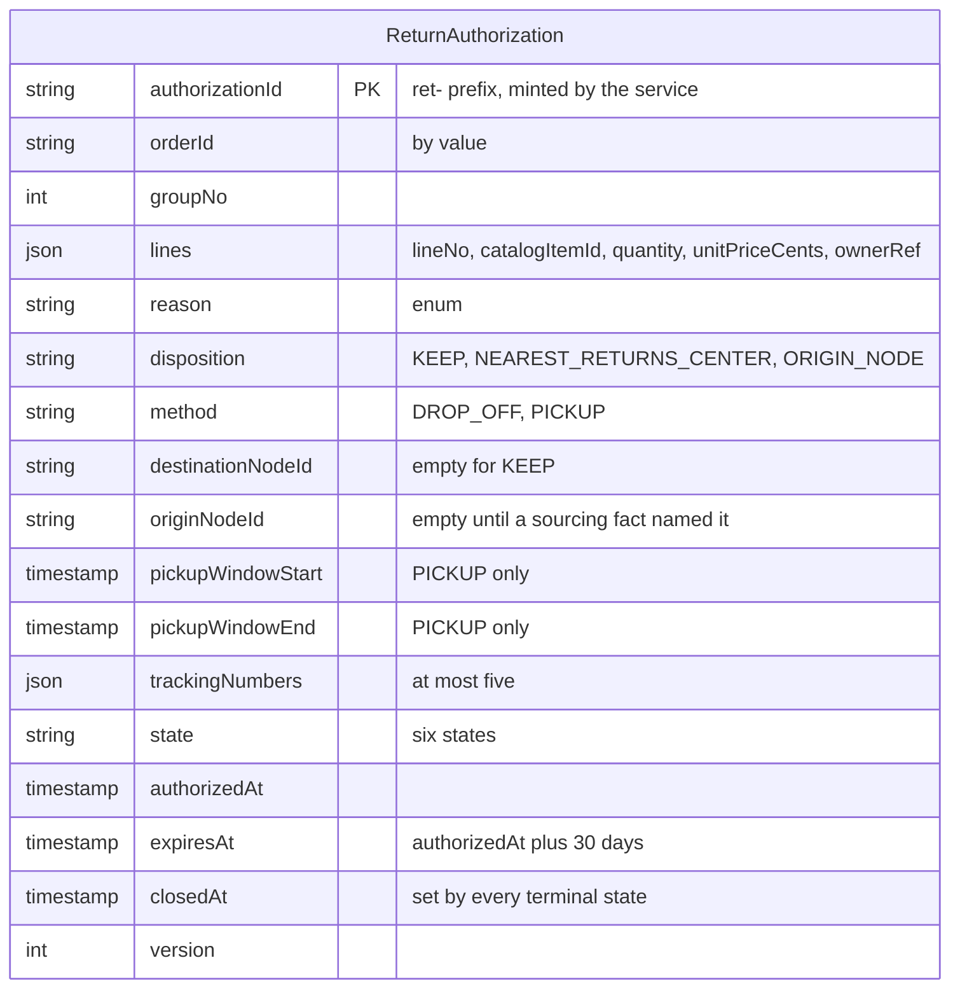
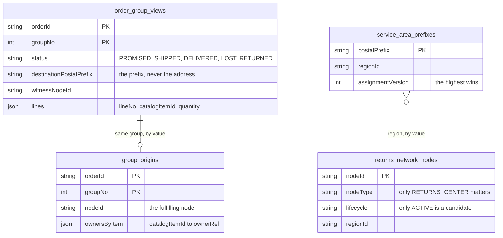
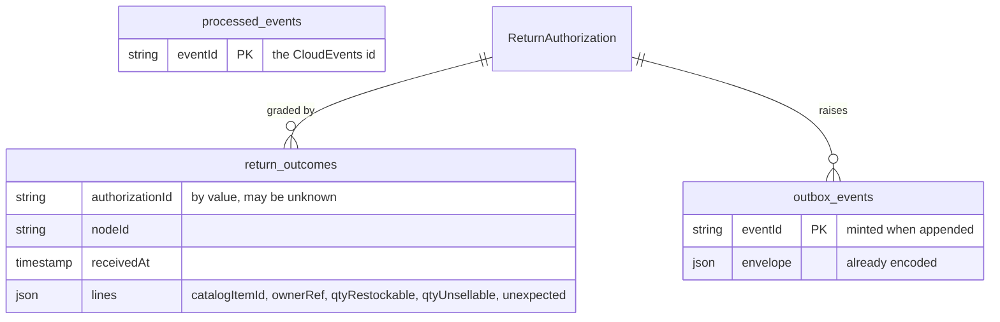

# Entity Relationship

:::info[As built]
Derived from [`network/model/model.yaml`](https://github.com/IQVO/warehouse-docs/blob/main/network/model/model.yaml). This context's service is built ([`IQVO/customer-returns`](https://github.com/IQVO/customer-returns), decided by [ADR 0012](/network/adr/0012-customer-returns-is-a-bounded-context)); the model carries its as-built contracts, and identifiers (`Err...` names, routes, CloudEvents types) are the names the service uses. Where the model left a choice open, the service's own ADRs 0001 to 0005 record what it does.
:::

This context owns its Postgres database ("every context owns its database;
no shared tables"). This page is a **logical view**: it shows the tables the
service's ADRs 0002 to 0004 name and the fields the model lists for them.
Physical column names and types live in the service's migrations (`0001`
the schema, `0002` the outbox) and are not copied here. Ids of other
contexts' aggregates are held by value; there are no foreign keys to them.

The aggregate. The ADRs do not name its table, so the entity carries the
aggregate's name:

Schema checks mirror three invariants (service ADR 0002): a `KEEP` has no
destination, a `PICKUP` has a window inside the validity interval and is not
a `KEEP`, and a terminal state has `closedAt`.

Read models fed by consumed events (service ADR 0003):

Outcome facts and infrastructure:

Derived from: model.yaml → contexts[customer-returns].aggregates[ReturnAuthorization],
.read_models; the table names from the service's ADRs 0002, 0003 and 0004.

Omitted: the idempotency table every context keeps
(`conventions.idempotency`), and every physical detail (indexes, check
constraint names, column types).
