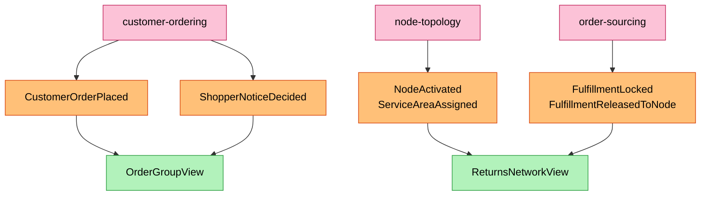
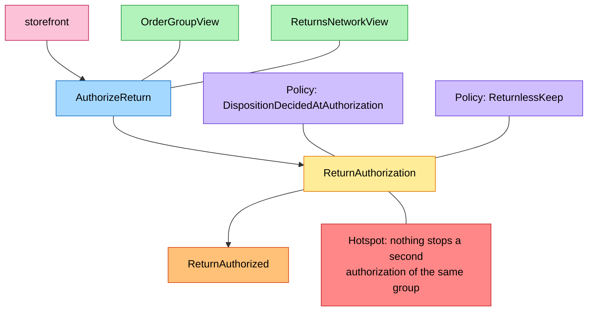
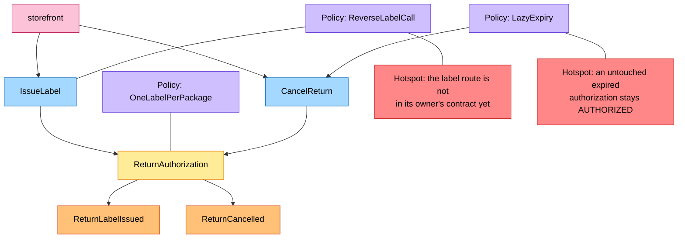
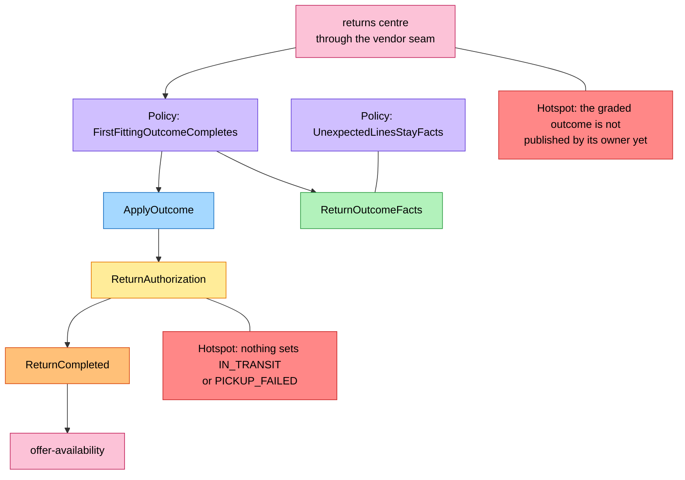

# EventStorming

:::info[As built]
Derived from [`network/model/model.yaml`](https://github.com/IQVO/warehouse-docs/blob/main/network/model/model.yaml). This context's service is built ([`IQVO/customer-returns`](https://github.com/IQVO/customer-returns), decided by [ADR 0012](/network/adr/0012-customer-returns-is-a-bounded-context)); the model carries its as-built contracts, and identifiers (`Err...` names, routes, CloudEvents types) are the names the service uses. Where the model left a choice open, the service's own ADRs 0001 to 0005 record what it does.
:::

Process-level boards in the ddd-crew
[EventStorming glossary & cheat sheet](https://github.com/ddd-crew/eventstorming-glossary-cheat-sheet)
notation. Every sticky comes from `model.yaml`; every hotspot is a residual
the model states in a policy or a note. The network-wide
board is [EventStorming big picture](/network/strategic-design/eventstorming-big-picture).

| Sticky | Colour | Meaning here |
| --- | --- | --- |
| Command | blue `#a5d8ff` | `AuthorizeReturn`, `IssueLabel`, `CancelReturn`, `ApplyOutcome` |
| Aggregate | yellow `#ffec99` | `ReturnAuthorization` |
| Domain Event | orange `#ffc078` | an event published or consumed |
| Policy | lilac `#d0bfff` | a rule from `policies` |
| Read Model | green `#b2f2bb` | `OrderGroupView`, `ReturnsNetworkView`, `ReturnOutcomeFacts` |
| External System | pink `#fcc2d7` | another context or an actor |
| Hotspot | red `#ff8787` | an open question |

## 1. The facts arrive

## 2. Authorize and decide

## 3. Label, cancel, expire

## 4. Outcome and restock

## Hotspots

| Hotspot | Where it comes from |
| --- | --- |
| Nothing stops a second authorization of the same group | Aggregate note: two authorizations of one group are distinct aggregates (service ADR 0002 A3) |
| The label route is not in its owner's contract yet | Policy `ReverseLabelCall`: decided in `shipping-and-tracking` ADR 0017, not in its OpenAPI on `develop` |
| An untouched expired authorization stays `AUTHORIZED` | Policy `LazyExpiry`: there is no sweeper (service ADR 0002 A4) |
| The graded outcome is not published by its owner yet | Policy `FirstFittingOutcomeCompletes`: decided in `vendor-connectivity` ADR 0014, not in its contracts on `develop` |
| Nothing sets `IN_TRANSIT` or `PICKUP_FAILED` | Aggregate note: `MarkInTransit` and `MarkPickupFailed` have no caller; policy `PickupIsRecordedNotRun` |
