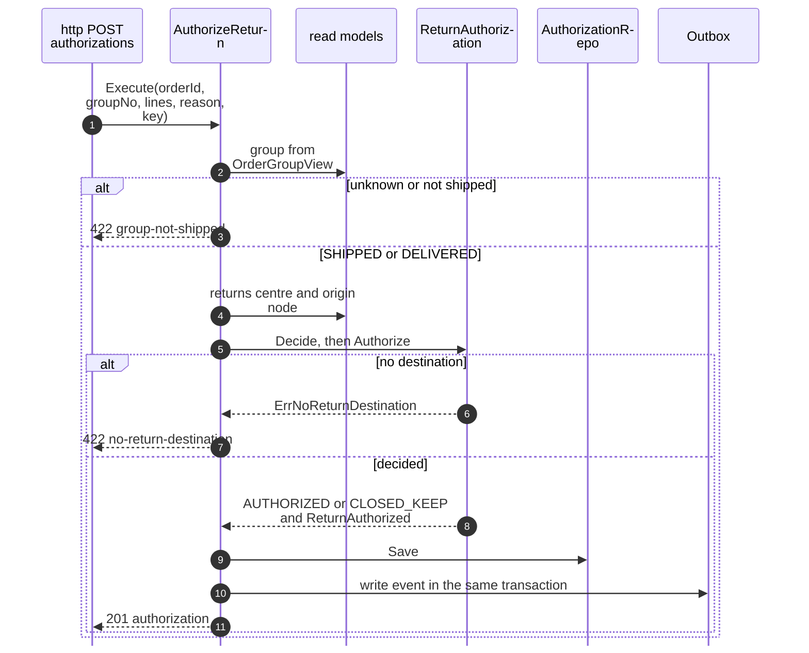
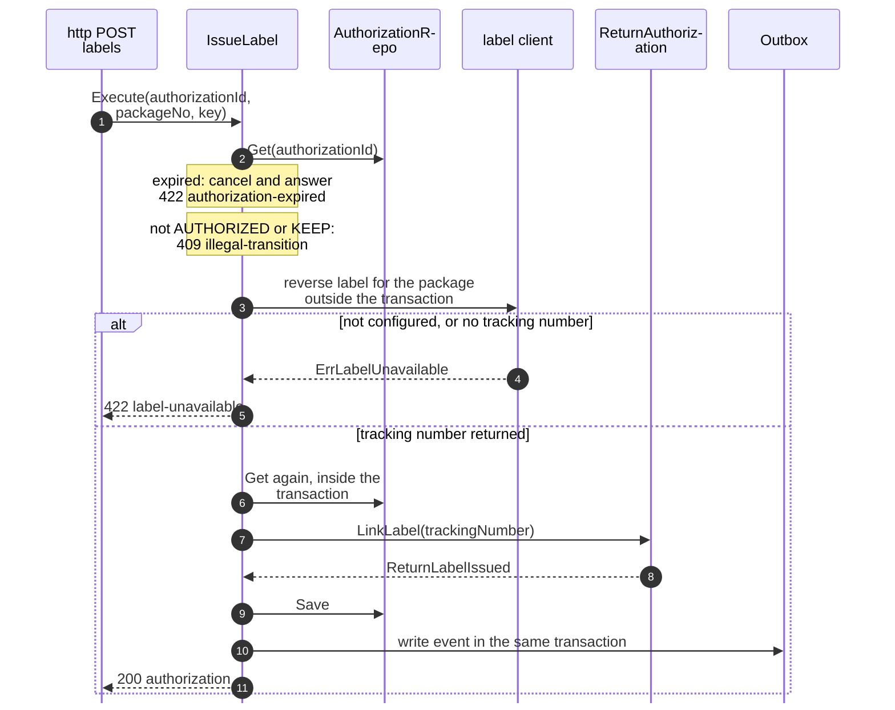
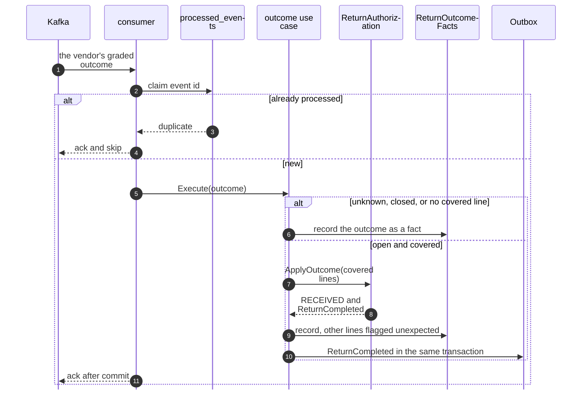
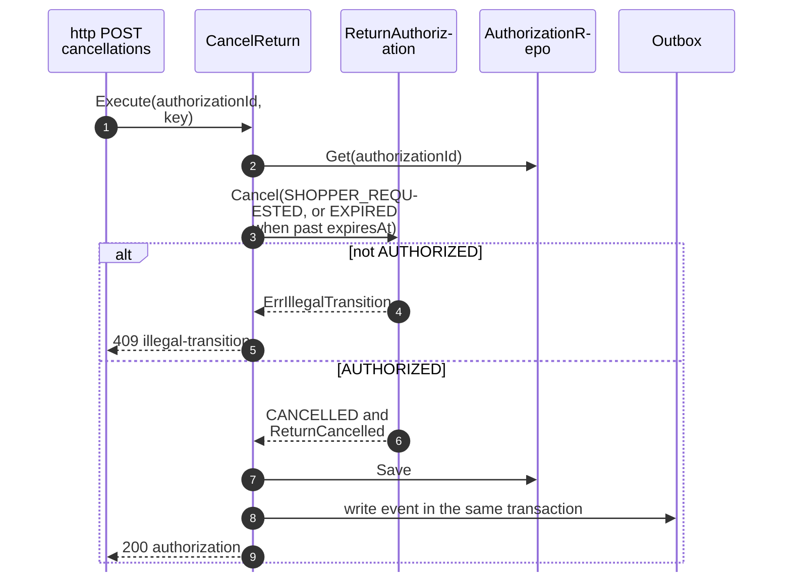

# Sequence Diagrams

:::info[As built]
Derived from [`network/model/model.yaml`](https://github.com/IQVO/warehouse-docs/blob/main/network/model/model.yaml). This context's service is built ([`IQVO/customer-returns`](https://github.com/IQVO/customer-returns), decided by [ADR 0012](/network/adr/0012-customer-returns-is-a-bounded-context)); the model carries its as-built contracts, and identifiers (`Err...` names, routes, CloudEvents types) are the names the service uses. Where the model left a choice open, the service's own ADRs 0001 to 0005 record what it does.
:::

Shared conventions: `Repo` saves with an optimistic version check; `Outbox`
rows are written in the same database transaction as the aggregate; a relay
produces them to Kafka `retailnetwork.customer-returns.events`. Consumers claim
the CloudEvents `id` in `processed_events` in the same transaction as their
effect. Event names are short; the full types are on
[Domain Events](/network/contexts/customer-returns/domain-events).

## 1. AuthorizeReturn

## 2. IssueLabel

As built the first branch is the one taken: the route is not in
`shipping-and-tracking`'s `develop` contract (policy `ReverseLabelCall`).

## 3. ApplyOutcome (consumer)

Not triggered today: the producer of the graded outcome is not on `develop`
(policy `FirstFittingOutcomeCompletes`).

## 4. CancelReturn

Derived from: model.yaml → contexts[customer-returns].aggregates[ReturnAuthorization]
(`commands`, `invariants`), .policies, .publishes; `conventions.integration_rules`.
