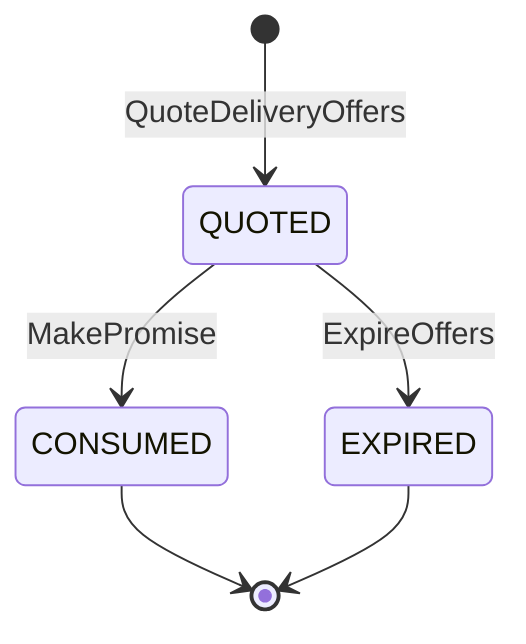
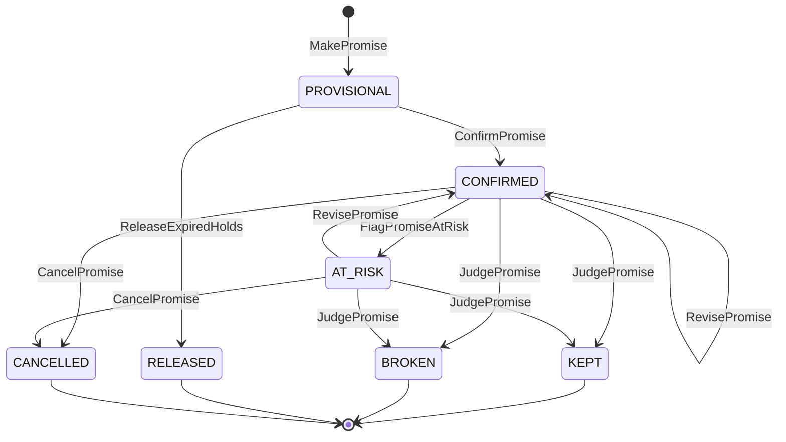
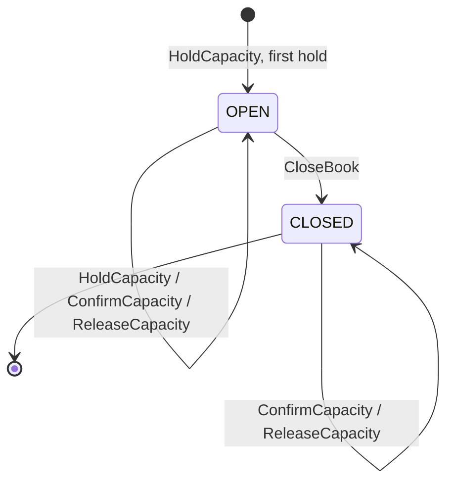

# Aggregate Design Canvas

:::info[Proposed design]
Derived from [`model/model.yaml`](https://github.com/IQVO/retail-network-docs/blob/main/model/model.yaml). Nothing in this context is built yet; identifiers (`Err...` names, routes, CloudEvents types) are the names an implementation must use.
:::

Following the ddd-crew [Aggregate Design Canvas v1.1](https://github.com/ddd-crew/aggregate-design-canvas).
The context has three aggregate roots: **DeliveryOffer** (a quote),
**Promise** (a commitment) and **PromiseBook** (a capacity ledger). They are
deliberately small: a promise does not contain its book, and a book does not
list its promises, because one book is shared by every promise on the same node
pickup cutoff and is the most contended row in the context.

## DeliveryOffer

### 1. Name

`DeliveryOffer` (proposed package `internal/domain/offer`, code
`offer.DeliveryOffer`), identified by `offerId`.

### 2. Description

A short-lived quote for (catalogue item, quantity, destination postal prefix,
tier) with a delivery window, the **witness path** that proves it, and an
expiry. It is the result of the promise search, persisted with a TTL so that
checkout can honour exactly the window the shopper saw. It holds no capacity.

Value objects: `DeliveryWindow{earliest, latest}`,
`WitnessPath{nodeId, pickupDepartureId, legs[departureId], deliveryWaveId}`,
`OfferConstraint(DESTINATION_NOT_SERVED | ITEM_QUANTITY_NOT_AVAILABLE |
DELIVERY_SLA_UNAVAILABLE | NODE_CAPACITY_EXHAUSTED)`. A constraint is returned
for a tier that has **no** offer; it is never stored on an offer.

### 3. State Transitions

Derived from: `model.yaml → contexts[delivery-promise].aggregates[DeliveryOffer].states`,
`.transitions`, `.commands`.

Omitted: nothing. The initial edge is labelled with the command that creates
the offer (`QuoteDeliveryOffers`), which the model lists among the aggregate's
commands but not as a transition.

### 4. Enforced Invariants

| Invariant | Enforced by |
| --- | --- |
| `expiresAt <= min(quotedAt + offerTtl, the latest instant the witness pickup cutoff can still be met)` | `ErrOfferExpiryTooLate` |
| An expired or consumed offer cannot back a promise | `ErrOfferNotQuotable` |

### 5. Corrective Policies

- **Expiry sweep** (`ExpireOffers`): `QUOTED` offers past `expiresAt` move to
  `EXPIRED`. The read path also treats an offer past `expiresAt` as not
  quotable even before the sweep reaches it.
- **Re-quote at checkout** (owned by `customer-ordering`, policy
  `CheckoutPromising`): if the offer expired, checkout re-quotes and shows the
  new window before placing.

### 6. Handled Commands

| Command | Issued by | Effect |
| --- | --- | --- |
| `QuoteDeliveryOffers` | REST `POST /delivery-offers:quote` (storefront, `customer-ordering`) | Runs `PromisePolicy` per tier; creates one `QUOTED` offer per feasible tier |
| `MakePromise` | REST `POST /promises` (`customer-ordering`) | `QUOTED` → `CONSUMED` (the offer backs exactly one promise) |
| `ExpireOffers` | internal sweep | `QUOTED` → `EXPIRED` |

### 7. Created Events

None on the integration topic. Quotes are high-volume query results; the model
names one analytics-only event, `DeliveryOfferQuoted`, on
`retailnetwork.delivery-promise.analytics`. The model gives it no data fields;
see [the domain events page](/network/contexts/delivery-promise/domain-events).

### 8. Throughput

*Estimate (model).* Very high: every product page and cart view. Writes are
inserts only (no contention); the only update is the single `CONSUMED` or
`EXPIRED` transition.

### 9. Size

*Estimate (model).* TTL minutes; partitioned by day. A handful of lines and
legs per offer.

## Promise

### 1. Name

`Promise` (proposed package `internal/domain/promise`, code `promise.Promise`),
identified by `promiseId`.

### 2. Description

The network's commitment for one shipment group of one customer order: tier,
ship-by at the witness node, deliver-by window, witness path, basis and policy
version. It is created `PROVISIONAL` at checkout with a capacity hold, becomes
`CONFIRMED` when the order is placed, may go `AT_RISK` and be revised, and ends
judged `KEPT` or `BROKEN`, or `RELEASED` / `CANCELLED`.

Value objects: `ShipmentGroup{lines[{catalogItemId, quantity}]}`,
`PromiseTerms{tier, shipBy, deliverByEarliest, deliverByLatest, basis(SCHEDULED|NOMINAL), policyVersion}`,
`WitnessPath{nodeId, pickupDepartureId, legs[departureId], deliveryWaveId}`,
`Revision{revisionNo, previousTerms, reason, revisedAt}`. Scalar fields carried
on its events: `offerId`, `orderId`, `groupNo`, `holdExpiresAt`.

### 3. State Transitions

Derived from: `model.yaml → contexts[delivery-promise].aggregates[Promise].states`,
`.transitions`, `.commands`.

Omitted: nothing. A `PROVISIONAL` promise cannot be cancelled or revised: it
either becomes `CONFIRMED` or is `RELEASED` when its hold expires.

### 4. Enforced Invariants

| Invariant | Enforced by |
| --- | --- |
| `deliverByEarliest <= deliverByLatest` and `shipBy < deliverByEarliest` | `ErrInvalidPromiseTerms` |
| A fast-tier promise (`SAME_DAY`, `NEXT_DAY`, `TWO_DAY`) has basis `SCHEDULED` | `ErrNominalBasisNotAllowedForTier` |
| A provisional promise is confirmed only before `holdExpiresAt` | `ErrPromiseHoldExpired` |
| A revision never moves `deliverByLatest` earlier | `ErrRevisionMovesEarlier` |
| `KEPT`, `BROKEN`, `RELEASED` and `CANCELLED` are terminal | `ErrPromiseClosed` |
| A promise covers lines shippable from one node (ship-complete group) | `ErrGroupSpansNodes` |
| Concurrent writers do not overwrite each other (proposed, infrastructure) | optimistic `version` check in the repository, surfaced as a stale-write conflict |

### 5. Corrective Policies

- **`ReleaseExpiredHolds`** (sweep): a `PROVISIONAL` promise past
  `holdExpiresAt` becomes `RELEASED` and its provisional hold is returned to the
  book (`ReleaseCapacity`).
- **`RepromiseOnRisk`**: on `FulfillmentUnsourceable`, `PackageExceptionRaised`
  or a `DepartureCancelled` on the witness path, flag the promise at risk,
  recompute and `RevisePromise`; if nothing is feasible even at `STANDARD`, the
  promise stays `AT_RISK` and is reported `PromiseBroken` at judgement time.
- **`JudgeOnDelivery`**: on `PackageDelivered`, judge every promise of the
  package's group: `KEPT` if `deliveredAt <= deliverByLatest`, else `BROKEN`
  with `lateByMinutes`.
- **Cancellation** (this pack's reading of the `CustomerOrderCancelled`
  consumer; the model names no policy): cancel the promises of the cancelled
  groups and release their confirmed capacity.
- **Neighbours' reactions**: `customer-ordering` updates the group's window on
  `PromiseRevised` (`UpdateGroupPromise`) and may cancel the group when no
  revised promise is feasible (`CancelOnUnfulfillable`); `order-sourcing`
  re-queues an `UNSOURCEABLE` assignment on `PromiseRevised`
  (`ApplyRevisedPromise`); `node-performance` counts `PromiseKept` /
  `PromiseBroken` into `promiseKeptRate`.

### 6. Handled Commands

| Command | Issued by | Transition |
| --- | --- | --- |
| `MakePromise` | REST `POST /promises` (`customer-ordering` checkout) | `[*]` → `PROVISIONAL` |
| `ConfirmPromise` | Kafka consumer of `CustomerOrderPlaced` | `PROVISIONAL` → `CONFIRMED` |
| `FlagPromiseAtRisk` | `RepromiseOnRisk` (consumers of `FulfillmentUnsourceable`, `PackageExceptionRaised`, `DepartureCancelled`) | `CONFIRMED` → `AT_RISK` |
| `RevisePromise` | `RepromiseOnRisk`, after a successful recompute | `AT_RISK` → `CONFIRMED`, `CONFIRMED` → `CONFIRMED` |
| `JudgePromise` | `JudgeOnDelivery` (consumer of `PackageDelivered`) | `CONFIRMED` / `AT_RISK` → `KEPT` / `BROKEN` |
| `CancelPromise` | Kafka consumer of `CustomerOrderCancelled` | `CONFIRMED` / `AT_RISK` → `CANCELLED` |
| `ReleaseExpiredHolds` | internal sweep | `PROVISIONAL` → `RELEASED` |

### 7. Created Events

All on `retailnetwork.delivery-promise.events`, subject = `promiseId`.

| Event | Raised when | Full CloudEvents type |
| --- | --- | --- |
| `PromiseMade` | `MakePromise` saved (`PROVISIONAL`) | `com.retailnetwork.commerce.delivery-promise.promise.PromiseMade` |
| `PromiseConfirmed` | `ConfirmPromise` saved | `com.retailnetwork.commerce.delivery-promise.promise.PromiseConfirmed` |
| `PromiseAtRisk` | `FlagPromiseAtRisk` saved | `com.retailnetwork.commerce.delivery-promise.promise.PromiseAtRisk` |
| `PromiseRevised` | `RevisePromise` saved | `com.retailnetwork.commerce.delivery-promise.promise.PromiseRevised` |
| `PromiseKept` | `JudgePromise` saved with `KEPT` | `com.retailnetwork.commerce.delivery-promise.promise.PromiseKept` |
| `PromiseBroken` | `JudgePromise` saved with `BROKEN` | `com.retailnetwork.commerce.delivery-promise.promise.PromiseBroken` |
| `PromiseReleased` | `ReleaseExpiredHolds` saved | `com.retailnetwork.commerce.delivery-promise.promise.PromiseReleased` |
| `PromiseCancelled` | `CancelPromise` saved | `com.retailnetwork.commerce.delivery-promise.promise.PromiseCancelled` |

Every transition raises exactly one event.

### 8. Throughput

*Estimate (model).* Medium-high: one per shipment group at checkout. Each
promise is written a few times over its life (make, confirm, perhaps flag and
revise, judge), minutes to days apart. Contention on one promise is rare (a
re-promise racing a judgement); an optimistic `version` resolves it.

### 9. Size

*Estimate (model).* One row per group plus revisions. A handful of lines, one
to four witness legs, and typically zero or one `Revision`. Events per
instance: 3 on the happy path (`PromiseMade`, `PromiseConfirmed`,
`PromiseKept`), 2 when released, more when re-promised.

## PromiseBook

### 1. Name

`PromiseBook` (proposed package `internal/domain/book`, code
`book.PromiseBook`), identified by `bookId = nodeId + ':' + pickupDepartureId`.

### 2. Description

The promise-side capacity ledger of one node pickup cutoff: how many orders the
network has promised onto it against the node's declared share. Value object:
`Capacity{share, provisional, confirmed}`. It counts orders, not packages
(packages on the truck belong to `linehaul-transportation`'s `Departure`).

### 3. State Transitions

Derived from: `model.yaml → contexts[delivery-promise].aggregates[PromiseBook].states`,
`.transitions`, `.commands`, `.invariants`.

Omitted: the model's only transition is `OPEN → CLOSED: CloseBook`. The
creating edge and the self-loops are this pack's reading: the model names no
command that opens a book. `ConfirmCapacity` and `ReleaseCapacity` on a
`CLOSED` book are needed because closing only stops new holds: an order placed
after the close must still confirm a hold made before it, and a promise
cancelled or released after the close must still return its count (see Open Questions on
[the canvas page](/network/contexts/delivery-promise/bounded-context-canvas)).

### 4. Enforced Invariants

| Invariant | Enforced by |
| --- | --- |
| `provisional + confirmed <= share` | `ErrPromiseCapacityExhausted` |
| No hold after the pickup cutoff minus handling time | `ErrBookClosed` |
| A release never makes `provisional` or `confirmed` negative | `ErrCapacityUnderflow` |
| Concurrent holds do not overbook (proposed, infrastructure) | optimistic `version` check, retried by the use case |

### 5. Corrective Policies

- **Exhaustion signal**: the hold that brings `provisional + confirmed` to
  `share` raises `PromiseBookExhausted`; `order-sourcing` adds book pressure to
  its `AssignmentCost` (`bookPressurePenalty`).
- **Holds expire**: `ReleaseExpiredHolds` returns provisional capacity of
  promises never confirmed.
- **Close at the cutoff**: `CloseBook` at pickup cutoff minus handling time
  (the instant behind `ErrBookClosed`). The model names no trigger; this pack
  proposes a clock sweep.
- **A full book is not a dead end**: the search moves on to the next pickup
  cutoff of the same node, or another node (constraint
  `NODE_CAPACITY_EXHAUSTED` only when every candidate book is full).

### 6. Handled Commands

| Command | Issued by | Effect |
| --- | --- | --- |
| `HoldCapacity` | `MakePromise`; `RevisePromise` on a new book (this pack's reading) | `provisional + 1` |
| `ConfirmCapacity` | `ConfirmPromise` | `provisional - 1`, `confirmed + 1` |
| `ReleaseCapacity` | `ReleaseExpiredHolds` (provisional), `CancelPromise` and `RevisePromise` on the old book (confirmed) | `provisional - 1` or `confirmed - 1` |
| `CloseBook` | clock sweep | `OPEN` → `CLOSED` |

### 7. Created Events

| Event | Raised when | Full CloudEvents type |
| --- | --- | --- |
| `PromiseBookExhausted` | a `HoldCapacity` makes `provisional + confirmed = share` | `com.retailnetwork.commerce.delivery-promise.promisebook.PromiseBookExhausted` |

Subject = `bookId`. Data: `bookId`, `nodeId`, `pickupDepartureId`, `share`.

### 8. Throughput

*Estimate (model).* High and contended: one hold per promise, one row per
(node, cutoff). Every checkout for the same node and cutoff writes the same
row, so the book is the hot spot of the context. Keeping it a three-counter
aggregate (no list of promises inside) keeps each write a single-row update.

### 9. Size

*Estimate (model).* Nodes × cutoffs × horizon days. Three integers and a state
per row; at most one `PromiseBookExhausted` per book.

## Read models

Seven local projections, each fed only by events (no synchronous call). They
are not aggregates: this context enforces no invariant on them, it never
changes them by command, and their owner can overwrite any row at any time. The
promise search reads them; the aggregates never contain them.

| Read model | Source events (producer) | Used for | Why it is not an aggregate |
| --- | --- | --- | --- |
| `NodeProfileView` | `NodeRegistered`, `NodeOperationalProfileDeclared`, `NodeActivated`, `NodeSuspended`, `NodeRetired` (`node-topology`) | candidate nodes (`ACTIVE`, type, subtype, region), `readyAt` (handling time, operating hours, holidays, time zone), cutoffs, sort dwell, book share | The node is `node-topology`'s aggregate; DP keeps the latest `profileRevision` it has seen. |
| `RegionAndServiceAreaView` | `ServiceAreaAssigned`, `RegionDefined` (`node-topology`) | destination postal prefix → delivery station and region; in-region tie-break | Versioned by `assignmentVersion` upstream; DP keeps the highest. |
| `LaneView` | `LaneOpened`, `LaneClosed` (`node-topology`) | nominal transit for the `STANDARD` fallback; lane open check | `node-topology` owns lanes. |
| `AvailabilityView` | `ListingCreated`, `ListingAvailabilityChanged`, `ListingSuppressed`, `ListingRestored`, `CatalogItemCreated`, `CatalogItemDiscontinued` (`offer-availability`) | which `ACTIVE` nodes can ship the quantity of every line | `offer-availability` owns listings; DP keeps the newest `asOf` per listing. |
| `DepartureView` | `DepartureScheduled`, `DepartureCapacityChanged`, `DepartureCancelled` (`linehaul-transportation`) | pickup departures (cutoff), the time-expanded graph of scheduled departures with `remainingPackages` | `linehaul-transportation` books packages; DP only reads remaining capacity. |
| `DeliveryWaveView` | `DeliveryWaveScheduled`, `DeliveryWaveCapacityChanged` (`last-mile-delivery`) | first wave with `inductCutoffAt >= arrival` and `remainingStops > 0`; the promise window | `last-mile-delivery` assigns stops. |
| `ScorecardView` | `NodeScorecardUpdated` (`node-performance`) | `ScorecardHandicap`; grade tie-break | `node-performance` computes grades. |

Derived from: `model.yaml → contexts[delivery-promise].read_models`, `.policies`.

Not shown as read models: the PromiseBook is an aggregate, not a view of
departures. `DepartureView` says how many **packages** a truck can still take;
the book says how many **orders** the network has promised onto the node's
cutoff. The two can disagree, and the search requires both to have room.
