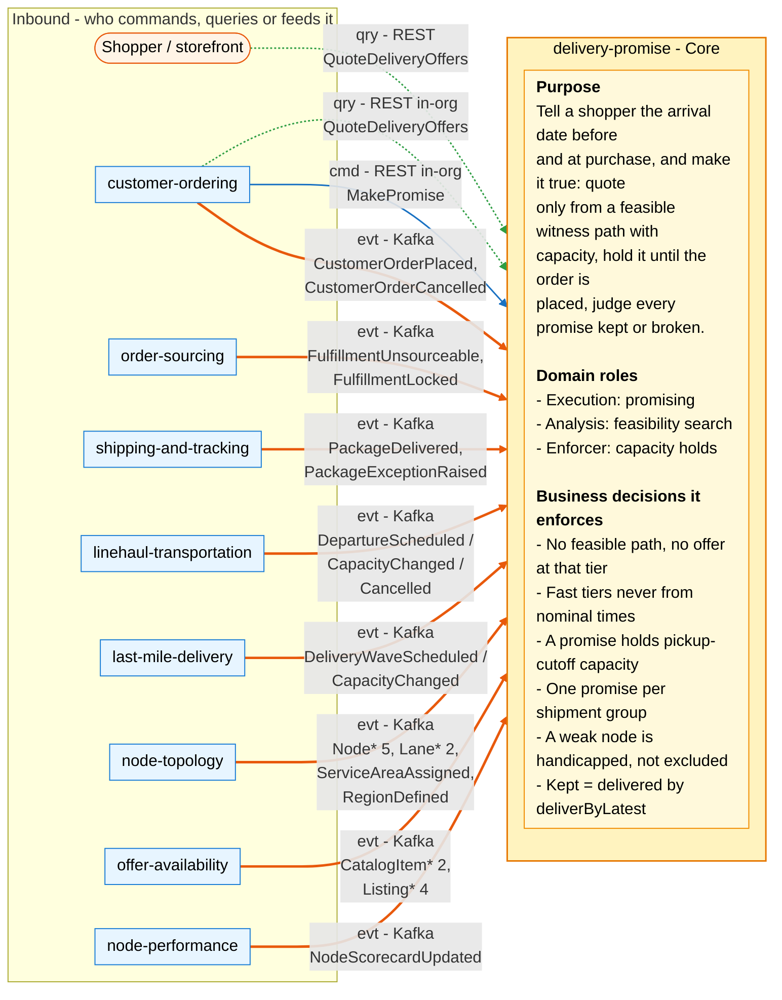
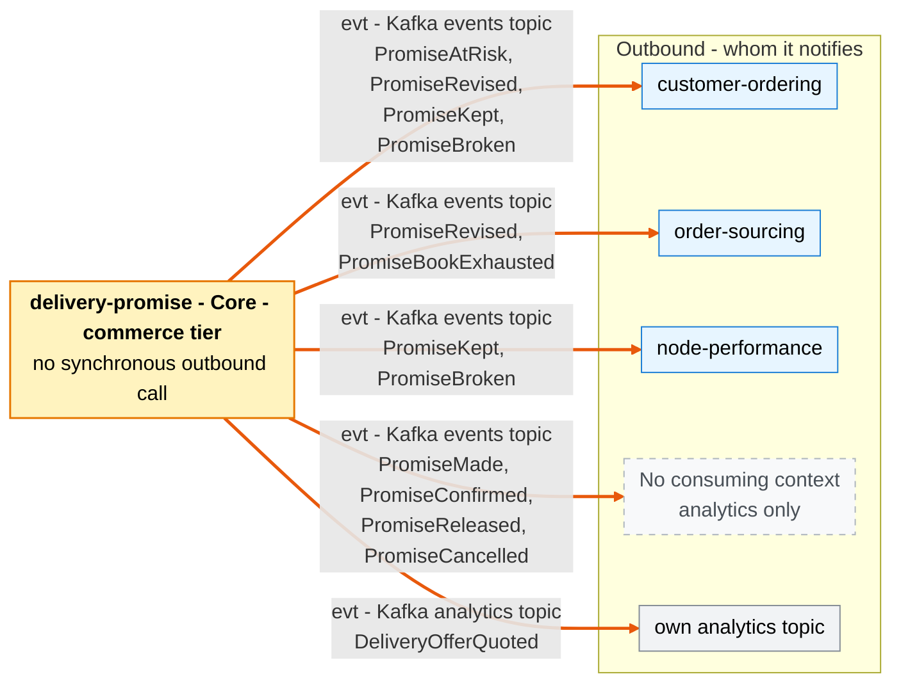

# Bounded Context Canvas

:::info[Proposed design]
Derived from [`model/model.yaml`](https://github.com/IQVO/retail-network-docs/blob/main/model/model.yaml). Nothing in this context is built yet; identifiers (`Err...` names, routes, CloudEvents types) are the names an implementation must use.
:::

Following the ddd-crew [Bounded Context Canvas v5](https://github.com/ddd-crew/bounded-context-canvas).
Every message row maps to an entry of `contexts[delivery-promise].inbound`,
`.publishes`, `.consumes` or `.rest` in the model.

## Canvas at a glance

Two pictures of the sections below, laid out like the ddd-crew canvas: first
the inbound collaborators feeding this context (with its purpose, domain roles
and the business decisions it enforces), then the outbound collaborators it
notifies. Arrows follow the message type: **solid blue** commands (`cmd`),
**dotted green** queries (`qry`), **thick orange** events (`evt`); each arrow
names its channel and the messages it carries. Box shapes mark the collaborator
kind: rounded = people, UI or any client; blue = sibling bounded context; grey
= this context's own analytics stream; dashed = published with no consuming
context ("analytics only" in the model). Channel names on the arrows are
abbreviated; the tables below carry the exact route, topic and CloudEvents type
for every message.

### Inbound

### Outbound

Derived from: `model.yaml → contexts[delivery-promise].inbound`,
`.publishes[*].consumers`, `.aggregates[DeliveryOffer].notes`, `.sync_calls`
(empty). The diagrams omit assumptions, verification metrics, open questions
and the ubiquitous language (sections below), the relationship pattern per
message (see the tables), the REST read routes with no named caller, and the
replies to the two REST calls. `Node* 5` stands for `NodeRegistered`,
`NodeOperationalProfileDeclared`, `NodeActivated`, `NodeSuspended`,
`NodeRetired`; `Lane* 2` for `LaneOpened`, `LaneClosed`; `CatalogItem* 2`
for `CatalogItemCreated`, `CatalogItemDiscontinued`; `Listing* 4` for
`ListingCreated`, `ListingAvailabilityChanged`, `ListingSuppressed`,
`ListingRestored`.

## Name

**Delivery Promise** (`delivery-promise`, code `DP`, CloudEvents tier
`commerce`).

## Purpose

To tell a shopper, before and at purchase, the date a package will arrive, and
to make that date true by construction:

- a delivery offer is quoted only from a feasible **witness path** (node
  cutoff, scheduled departures, delivery wave) that has remaining capacity;
- a promise holds that capacity on the witness node's pickup cutoff until the
  order is placed or the hold expires;
- when the path breaks, the promise is revised to a later window, never an
  earlier one;
- every promise is judged **kept** or **broken** at delivery.

## Strategic Classification

| Axis | Verdict |
| --- | --- |
| **Domain** | **Core** (model `classification: Core`; chart differentiation 0.92, complexity 0.85). See [the core domain chart page](/network/contexts/delivery-promise/core-domain-chart). |
| **Business Model** | Revenue generator (conversion) and cost reducer (no promise the network cannot keep). |
| **Evolution** | Custom-built. |

## Domain Roles

| Role | Applies? | Evidence in the model |
| --- | --- | --- |
| **Execution (promising)** | **Yes, primary** | `MakePromise`, `ConfirmPromise`, `RevisePromise`, `JudgePromise`; the `Promise` lifecycle. |
| **Analysis (feasibility search)** | **Yes** | `QuoteDeliveryOffers` and `PromisePolicy`: the earliest feasible witness path over seven read models. |
| **Enforcer (capacity holds)** | **Yes** | `PromiseBook`: `provisional + confirmed <= share` (`ErrPromiseCapacityExhausted`); `ReleaseExpiredHolds`. |
| Gateway / ACL | No | It conforms to every upstream's published language; it translates nothing at its boundary. |
| Specification | No | It publishes promise facts, not capability specifications. |

## Inbound Communication

| Collaborator | Message | Type | Channel | Relationship |
| --- | --- | --- | --- | --- |
| Shopper / storefront | `QuoteDeliveryOffers` | Query | REST `POST /delivery-offers:quote` | Open Host |
| `customer-ordering` | `QuoteDeliveryOffers` | Query | REST `POST /delivery-offers:quote` (in-org) | Customer/Supplier (DP is the Supplier) |
| `customer-ordering` | `MakePromise` | Command | REST `POST /promises` (in-org) | Customer/Supplier (DP is the Supplier) |
| `customer-ordering` | `CustomerOrderPlaced` | Event | Kafka `retailnetwork.customer-ordering.events`, `com.retailnetwork.commerce.customer-ordering.customerorder.CustomerOrderPlaced` | Customer/Supplier |
| `customer-ordering` | `CustomerOrderCancelled` | Event | Kafka `retailnetwork.customer-ordering.events`, `com.retailnetwork.commerce.customer-ordering.customerorder.CustomerOrderCancelled` | Customer/Supplier |
| `order-sourcing` | `FulfillmentUnsourceable` | Event | Kafka `retailnetwork.order-sourcing.events`, `com.retailnetwork.commerce.order-sourcing.assignment.FulfillmentUnsourceable` | Customer/Supplier |
| `order-sourcing` | `FulfillmentLocked` | Event | Kafka `retailnetwork.order-sourcing.events`, `com.retailnetwork.commerce.order-sourcing.assignment.FulfillmentLocked` | Customer/Supplier |
| `shipping-and-tracking` | `PackageDelivered` | Event | Kafka `retailnetwork.shipping-and-tracking.events`, `com.retailnetwork.logistics.shipping-and-tracking.journey.PackageDelivered` | Conformist |
| `shipping-and-tracking` | `PackageExceptionRaised` | Event | Kafka `retailnetwork.shipping-and-tracking.events`, `com.retailnetwork.logistics.shipping-and-tracking.journey.PackageExceptionRaised` | Conformist |
| `linehaul-transportation` | `DepartureScheduled` | Event | Kafka `retailnetwork.linehaul-transportation.events`, `com.retailnetwork.logistics.linehaul-transportation.departure.DepartureScheduled` | Conformist |
| `linehaul-transportation` | `DepartureCapacityChanged` | Event | Kafka `retailnetwork.linehaul-transportation.events`, `com.retailnetwork.logistics.linehaul-transportation.departure.DepartureCapacityChanged` | Conformist |
| `linehaul-transportation` | `DepartureCancelled` | Event | Kafka `retailnetwork.linehaul-transportation.events`, `com.retailnetwork.logistics.linehaul-transportation.departure.DepartureCancelled` | Conformist |
| `last-mile-delivery` | `DeliveryWaveScheduled` | Event | Kafka `retailnetwork.last-mile-delivery.events`, `com.retailnetwork.logistics.last-mile-delivery.wave.DeliveryWaveScheduled` | Conformist |
| `last-mile-delivery` | `DeliveryWaveCapacityChanged` | Event | Kafka `retailnetwork.last-mile-delivery.events`, `com.retailnetwork.logistics.last-mile-delivery.wave.DeliveryWaveCapacityChanged` | Conformist |
| `node-topology` | `NodeRegistered` | Event | Kafka `retailnetwork.node-topology.events`, `com.retailnetwork.logistics.node-topology.node.NodeRegistered` | Conformist |
| `node-topology` | `NodeOperationalProfileDeclared` | Event | Kafka `retailnetwork.node-topology.events`, `com.retailnetwork.logistics.node-topology.node.NodeOperationalProfileDeclared` | Conformist |
| `node-topology` | `NodeActivated` | Event | Kafka `retailnetwork.node-topology.events`, `com.retailnetwork.logistics.node-topology.node.NodeActivated` | Conformist |
| `node-topology` | `NodeSuspended` | Event | Kafka `retailnetwork.node-topology.events`, `com.retailnetwork.logistics.node-topology.node.NodeSuspended` | Conformist |
| `node-topology` | `NodeRetired` | Event | Kafka `retailnetwork.node-topology.events`, `com.retailnetwork.logistics.node-topology.node.NodeRetired` | Conformist |
| `node-topology` | `LaneOpened` | Event | Kafka `retailnetwork.node-topology.events`, `com.retailnetwork.logistics.node-topology.lane.LaneOpened` | Conformist |
| `node-topology` | `LaneClosed` | Event | Kafka `retailnetwork.node-topology.events`, `com.retailnetwork.logistics.node-topology.lane.LaneClosed` | Conformist |
| `node-topology` | `ServiceAreaAssigned` | Event | Kafka `retailnetwork.node-topology.events`, `com.retailnetwork.logistics.node-topology.servicearea.ServiceAreaAssigned` | Conformist |
| `node-topology` | `RegionDefined` | Event | Kafka `retailnetwork.node-topology.events`, `com.retailnetwork.logistics.node-topology.region.RegionDefined` | Conformist |
| `offer-availability` | `CatalogItemCreated` | Event | Kafka `retailnetwork.offer-availability.events`, `com.retailnetwork.commerce.offer-availability.catalogitem.CatalogItemCreated` | Conformist |
| `offer-availability` | `CatalogItemDiscontinued` | Event | Kafka `retailnetwork.offer-availability.events`, `com.retailnetwork.commerce.offer-availability.catalogitem.CatalogItemDiscontinued` | Conformist |
| `offer-availability` | `ListingCreated` | Event | Kafka `retailnetwork.offer-availability.events`, `com.retailnetwork.commerce.offer-availability.listing.ListingCreated` | Conformist |
| `offer-availability` | `ListingAvailabilityChanged` | Event | Kafka `retailnetwork.offer-availability.events`, `com.retailnetwork.commerce.offer-availability.listing.ListingAvailabilityChanged` | Conformist |
| `offer-availability` | `ListingSuppressed` | Event | Kafka `retailnetwork.offer-availability.events`, `com.retailnetwork.commerce.offer-availability.listing.ListingSuppressed` | Conformist |
| `offer-availability` | `ListingRestored` | Event | Kafka `retailnetwork.offer-availability.events`, `com.retailnetwork.commerce.offer-availability.listing.ListingRestored` | Conformist |
| `node-performance` | `NodeScorecardUpdated` | Event | Kafka `retailnetwork.node-performance.events`, `com.retailnetwork.partner.node-performance.scorecard.NodeScorecardUpdated` | Conformist |

**REST read routes with no named caller.** The model's `rest` list also has
`GET /delivery-offers/{offerId}`, `GET /promises/{promiseId}`,
`GET /promises?orderId=` and `GET /promise-books?nodeId=&date=`. No `inbound`
row names who calls them, so this canvas shows no collaborator for them (see
Open Questions). They are in the
[OpenAPI contract](/network/api-reference).

## Outbound Communication

Every event leaves through the transactional outbox on topic
`retailnetwork.delivery-promise.events`, source `/retailnetwork/delivery-promise`,
subject and Kafka key = the aggregate root id.

| Collaborator | Message | Type | Channel | Relationship |
| --- | --- | --- | --- | --- |
| none (analytics only) | `PromiseMade` | Event | Kafka `retailnetwork.delivery-promise.events`, `com.retailnetwork.commerce.delivery-promise.promise.PromiseMade` | Published Language |
| none (analytics only) | `PromiseConfirmed` | Event | Kafka `retailnetwork.delivery-promise.events`, `com.retailnetwork.commerce.delivery-promise.promise.PromiseConfirmed` | Published Language |
| `customer-ordering` | `PromiseAtRisk` | Event | Kafka `retailnetwork.delivery-promise.events`, `com.retailnetwork.commerce.delivery-promise.promise.PromiseAtRisk` | Customer/Supplier (DP is the Supplier) |
| `customer-ordering`, `order-sourcing` | `PromiseRevised` | Event | Kafka `retailnetwork.delivery-promise.events`, `com.retailnetwork.commerce.delivery-promise.promise.PromiseRevised` | Customer/Supplier |
| `node-performance`, `customer-ordering` | `PromiseKept` | Event | Kafka `retailnetwork.delivery-promise.events`, `com.retailnetwork.commerce.delivery-promise.promise.PromiseKept` | OHS + PL (node-performance is Conformist); Customer/Supplier with customer-ordering |
| `node-performance`, `customer-ordering` | `PromiseBroken` | Event | Kafka `retailnetwork.delivery-promise.events`, `com.retailnetwork.commerce.delivery-promise.promise.PromiseBroken` | OHS + PL (node-performance is Conformist); Customer/Supplier with customer-ordering |
| none (analytics only) | `PromiseReleased` | Event | Kafka `retailnetwork.delivery-promise.events`, `com.retailnetwork.commerce.delivery-promise.promise.PromiseReleased` | Published Language |
| none (analytics only) | `PromiseCancelled` | Event | Kafka `retailnetwork.delivery-promise.events`, `com.retailnetwork.commerce.delivery-promise.promise.PromiseCancelled` | Published Language |
| `order-sourcing` | `PromiseBookExhausted` | Event | Kafka `retailnetwork.delivery-promise.events`, `com.retailnetwork.commerce.delivery-promise.promisebook.PromiseBookExhausted` | Customer/Supplier |
| own analytics | `DeliveryOfferQuoted` | Event (analytics only) | Kafka `retailnetwork.delivery-promise.analytics` | Internal |
| — | — | Synchronous call | none: `sync_calls: []`; the promise hot path makes no synchronous call | — |

Full message details: [the domain events page](/network/contexts/delivery-promise/domain-events).
Relationship reasons: [the context map page](/network/contexts/delivery-promise/context-map).

## Ubiquitous Language

Full glossary: [the ubiquitous language page](/network/contexts/delivery-promise/ubiquitous-language).
Top terms: **Delivery Offer**, **Service Tier**, **Promise**, **Ship-By**,
**Deliver-By Window**, **Witness Path**, **Promise Basis** (`SCHEDULED` /
`NOMINAL`), **Promise Book**, **Capacity Hold**, **Handicap**, **Re-promise**,
**Promise Kept / Broken**, **Shipment Group**.

## Business Decisions

1. **No path, no offer.** A delivery offer exists only if at least one feasible
   path exists now. Otherwise that tier returns no offer and the constraint that
   blocked it (`OfferConstraint`).
2. **Fast tiers are never quoted from nominal lane times.** Only `STANDARD` may
   fall back to nominal transit, and the promise records basis `NOMINAL`
   (`ErrNominalBasisNotAllowedForTier`, [ADR 0008](/network/adr/0008-capacity-held-at-promise-time)).
3. **A promise holds capacity.** It reserves capacity on the node's pickup
   cutoff (`PromiseBook`); provisional holds expire if the order is not placed
   (`ReleaseExpiredHolds`).
4. **One promise per shipment group.** A multi-node order gets one promise per
   group (`ShipmentGrouping`, `ErrGroupSpansNodes`).
5. **Handicap, never silent exclusion.** A poorly performing node gets a later
   ship-by by its scorecard grade (`ScorecardHandicap`).
6. **Kept means on time.** Delivered on or before `deliverByLatest`
   (`JudgeOnDelivery`).
7. **Dates only move later.** A revision never moves `deliverByLatest` earlier
   (`ErrRevisionMovesEarlier`).
8. **Peak control by deadline.** Per tier and region, a policy-versioned local
   order deadline (`TierOrderDeadline`) stops new workable demand for that tier.

## Assumptions

- Upstream events arrive within seconds. The read models are only as fresh as
  the slowest topic; a stale `DepartureView` can quote a departure that is
  already full.
- `linehaul-transportation` keeps a 14-day horizon of departures
  (`HorizonRoll`), including one pickup departure per declared cutoff of every
  `ACTIVE` vendor fulfillment node; without it there is no witness path.
- `last-mile-delivery` publishes waves ahead of time for every delivery station
  with a service area.
- Every postal prefix the storefront sends maps to one delivery station
  (`node-topology`: one station per prefix per assignment version).
- A cancelled departure is announced before its cutoff wherever possible
  (`linehaul-transportation` business decision), so re-promising has time to
  act.
- Customer-ordering places the order before the hold expires in the normal
  case; the hold is a guard, not the main path.

## Verification Metrics

| Metric | Definition | Source |
| --- | --- | --- |
| Promise-kept rate | `PromiseKept / (PromiseKept + PromiseBroken)` per tier, per region, per week | own events topic |
| Re-promise rate | `PromiseRevised / PromiseConfirmed` per tier | own events topic |
| At-risk rate | `PromiseAtRisk / PromiseConfirmed` | own events topic |
| Hold leakage | `PromiseReleased / PromiseMade`; a high value means checkout abandons or the hold is too short | own events topic |
| No-offer share by constraint | share of quotes per tier with no offer, split by `OfferConstraint` | analytics topic (`DeliveryOfferQuoted`) |
| Quote latency | p99 of `POST /delivery-offers:quote`; a target to set before build | HTTP metrics |
| Read-model lag | `now - time` of the last applied CloudEvent, per consumed topic | inbox (`processed_events`) |
| `NOMINAL` share | share of `STANDARD` promises with basis `NOMINAL` | own events topic |
| Book exhaustion | `PromiseBookExhausted` per node per day | own events topic |
| Broken by cause | `PromiseBroken` grouped by `cause` and `nodeId` | own events topic |

## Open Questions

Each one is a gap or an unstated rule in the model, reported to the model
owner, not decided here.

1. **Offer shape for a multi-line group.** `DeliveryOffer` is described per
   (catalogue item, quantity, destination, tier), yet a `Promise` covers a
   multi-line `ShipmentGroup` and `PromiseMade` carries a single `offerId`.
   This pack lets an offer carry the group's lines (one line on a product page).
2. **Basis and policy version on the offer.** `PromiseMade` needs `basis` and
   `policyVersion`; `DeliveryOffer` stores neither, and `WitnessPath` does not
   say how a `NOMINAL` path (no scheduled departures) is written.
3. **What `FulfillmentLocked` is for.** It is consumed, but no policy or read
   model says what this context does with it. It is the only consumed event
   that carries `assignmentId` with `orderId` and `groupNo`, which judgement
   needs (question 4), and it names the node that really ships, which the
   witness book does not count.
4. **Finding the promise of a delivered package.** `PackageDelivered` and
   `PackageExceptionRaised` carry `assignmentId` and `orderId`, not
   `promiseId` or `groupNo`. For a group shipped in several packages, the model
   does not say which delivery judges it.
5. **A package that never arrives.** `PackageLost` and `PackageReturned` are
   analytics-only, so a lost package's promise is never judged.
6. **A cancelled delivery wave.** `DeliveryWaveCancelled` is analytics-only.
   `DeliveryWaveView` cannot drop a cancelled wave, and `RepromiseOnRisk` cannot
   react to one on a witness path.
7. **Where a book comes from.** `PromiseBook` has no creating command, the
   `share` formula (cutoff `maxOrders`, throughput cap, proportional share) is
   not given, and no policy triggers `CloseBook`.
8. **Who owns `TierOrderDeadline`.** No aggregate, route or event carries the
   deadlines or `policyVersion`, and no `OfferConstraint` names "past the
   order deadline".
9. **Handicap edge cases.** `ScorecardHandicap` in the model does not map
   grade `PROVISIONAL` (the [promise model](/network/network-model/promise-model) page
   reads it as no handicap), and does not say which scorecard window (7-day or
   30-day) applies.
10. **A late `CustomerOrderPlaced`.** Confirmation is asynchronous. If the hold
    expires first, the order exists with a `RELEASED` promise; no recovery is
    named.
11. **Capacity on revision and cancellation.** The model does not say whether
    `RevisePromise` moves the hold to a new book, or that `CustomerOrderCancelled`
    maps to `CancelPromise` and releases confirmed capacity. This pack assumes
    both.
12. **The read routes' callers.** Four `GET` routes have no named caller.
13. **Transaction boundary of `MakePromise`.** Consuming the offer, creating the
    promise and holding capacity touch three aggregates. This pack commits them
    in one local transaction (see the use cases page).
14. **Vocabularies.** `PromiseBroken.cause`, `PromiseAtRisk.reason` and
    `PromiseReleased.reason` have no enumerated values; `offerTtl` and the hold
    TTL have no values.
