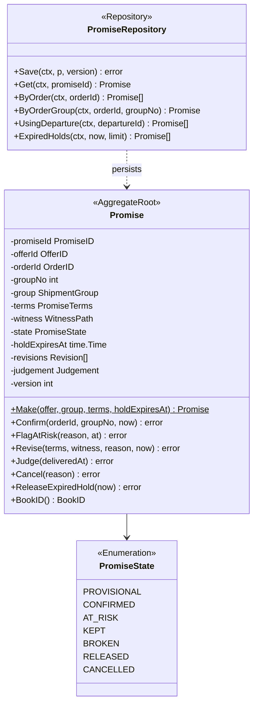
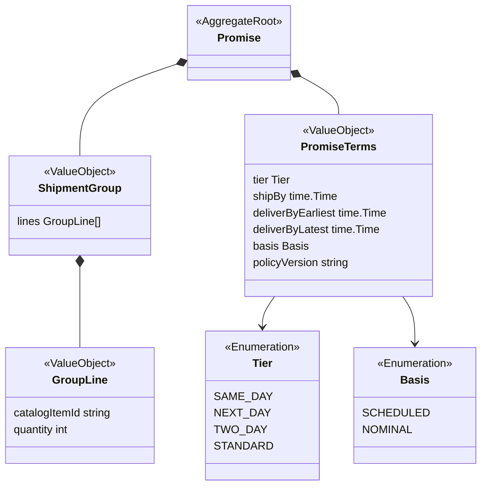
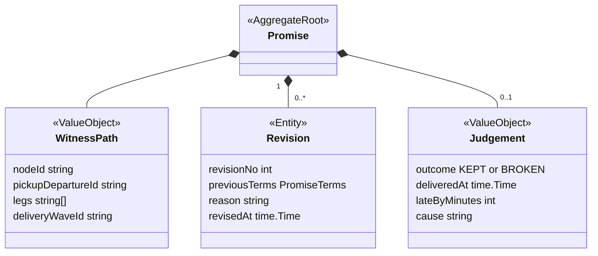
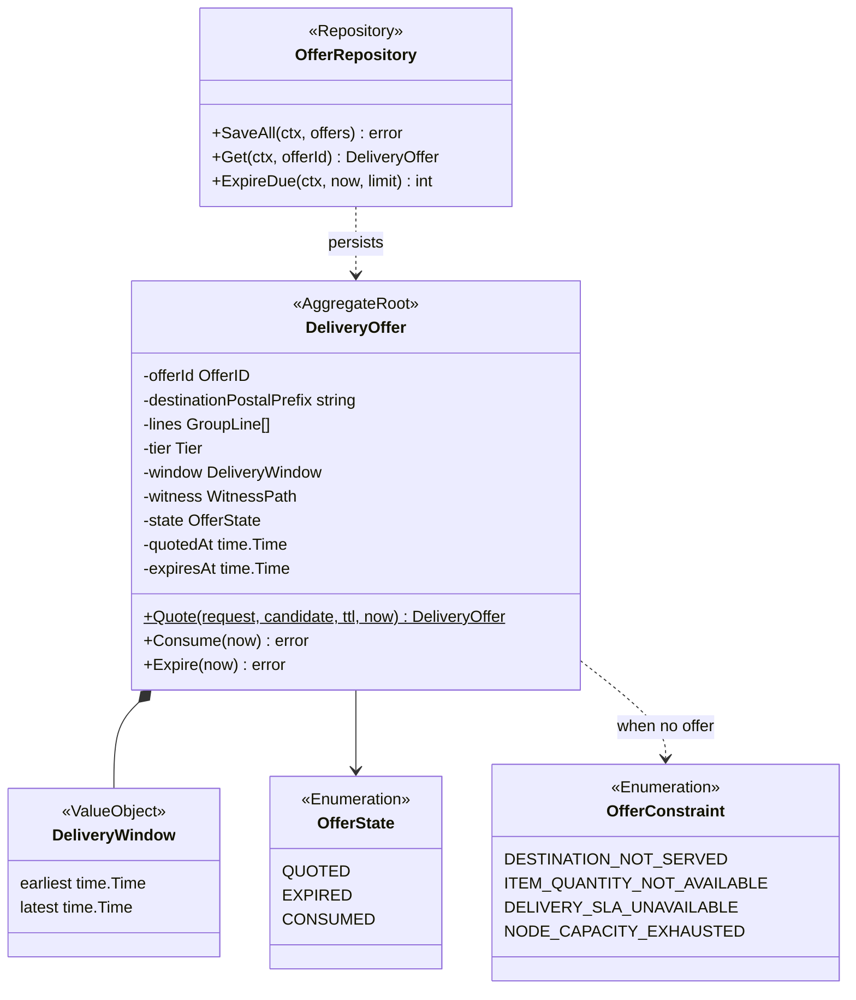
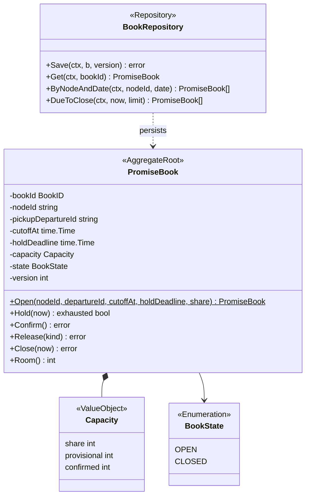
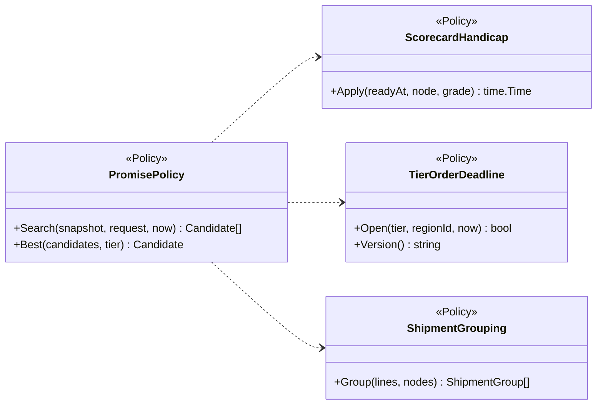
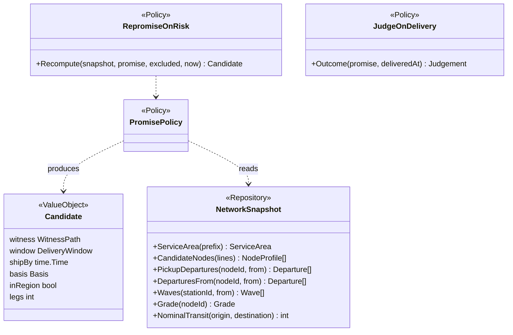
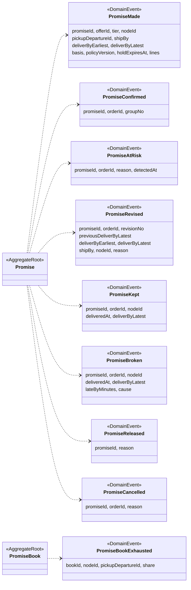
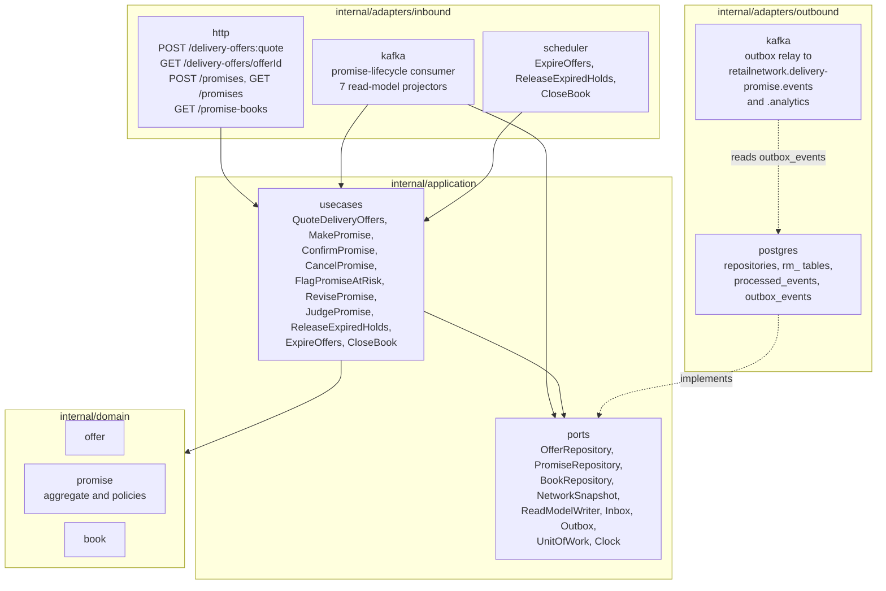

# Class Diagram

:::info[Proposed design]
Derived from [`model/model.yaml`](https://github.com/IQVO/retail-network-docs/blob/main/model/model.yaml). Nothing in this context is built yet; identifiers (`Err...` names, routes, CloudEvents types) are the names an implementation must use.
:::

UML class diagrams of the **proposed** Go packages under `internal/domain`.
Type names, value objects, states and commands are the model's; method
signatures, Go field types and package names are this pack's proposal. Fields
are unexported in Go and shown with `-`; exported methods with `+`; a `$` marks
a constructor. Read accessors are omitted.

## 1. Promise aggregate

### 1a. Root, state and repository

### 1b. Group and terms

### 1c. Witness, revisions and judgement

Derived from: `model.yaml → contexts[delivery-promise].aggregates[Promise]`
(`states`, `value_objects`, `commands`), `.publishes[PromiseConfirmed, PromiseKept, PromiseBroken].data`
(`orderId`, `groupNo`, `deliveredAt`, `lateByMinutes`, `cause`), `.ul`
(`promise.Judgement`, `promise.WitnessPath`, `promise.ShipmentGroup`).

Omitted: the error variables (on
[the aggregate design canvas](/network/contexts/delivery-promise/aggregate-design-canvas)).
The aggregate is split over three diagrams to stay within the page width.
`orderId` and `groupNo` are empty until `Confirm`; `judgement` is empty until
`Judge`. `Revision` is drawn as an entity because `revisionNo` identifies it
inside its promise.

## 2. DeliveryOffer and PromiseBook aggregates

### 2a. DeliveryOffer

### 2b. PromiseBook

Derived from: `model.yaml → contexts[delivery-promise].aggregates[DeliveryOffer]`,
`.aggregates[PromiseBook]` (`root_id`, `value_objects`, `states`, `commands`,
`invariants`).

Omitted: `GroupLine`, `Tier` and `WitnessPath`, shared with diagram 1.
`destinationPostalPrefix`, `quotedAt` and `expiresAt` on the offer come from its
description and invariant. `lines` on the offer is this pack's reading for a
multi-line group (open question 1 on
[the canvas page](/network/contexts/delivery-promise/bounded-context-canvas)).
`cutoffAt` and `holdDeadline` on the book are the model's `BookTimes`:
`ErrBookClosed` needs the instant "pickup cutoff minus handling time", which the
book must know. `Open` is the constructor behind the model's `OpenBook` command
(policy `LazyBookOpening`).
`Hold` reports whether the book became exhausted, so the use case can raise
`PromiseBookExhausted`.

## 3. Policies and the network snapshot

### 3a. The search policies

### 3b. Re-promise, judgement and the snapshot port

Derived from: `model.yaml → contexts[delivery-promise].policies`, `.read_models`,
`.ul` (`promise.ScorecardHandicap`). All six policies live in package
`internal/domain/promise`.

Omitted: the read-model row types (`NodeProfile`, `ServiceArea`, `Departure`,
`Wave`, `Grade`), which mirror the consumed events' fields. `NetworkSnapshot` is
a read-only port over the seven read models (stereotyped `Repository` because
it is a query port); it has no write method. `Candidate` is a proposed internal
value object of the search.

## 4. Domain events

Derived from: `model.yaml → contexts[delivery-promise].publishes[*].data`.

Omitted: Go field types (on [the domain events page](/network/contexts/delivery-promise/domain-events)).
`DeliveryOffer` raises no integration event.

## 5. Hexagonal ports and adapters

Derived from: `model.yaml → contexts[delivery-promise].rest`, `.consumes`,
`.read_models`, `.aggregates[*].commands`; `conventions.integration_rules`
(outbox, inbox); the fleet's Go hexagonal layout.

Omitted: `cmd/` wiring and configuration. Proposed packages:
`internal/domain/offer`, `internal/domain/promise` (the aggregate, and the six
policies and `Candidate`, matching the model's code identifiers such as
`promise.ScorecardHandicap`), `internal/domain/book`;
`internal/application/usecases`, `internal/application/ports`;
`internal/adapters/inbound/http`, `internal/adapters/inbound/kafka`,
`internal/adapters/inbound/scheduler`; `internal/adapters/outbound/postgres`,
`internal/adapters/outbound/kafka`. There is **no** outbound HTTP client
package: the context makes no synchronous call. Dependencies point inward;
`internal/domain` imports nothing from `application` or `adapters`.
