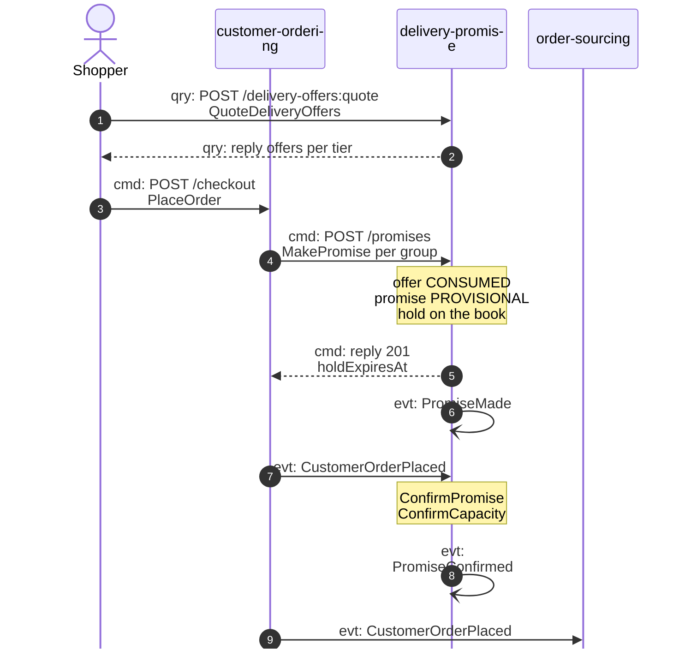
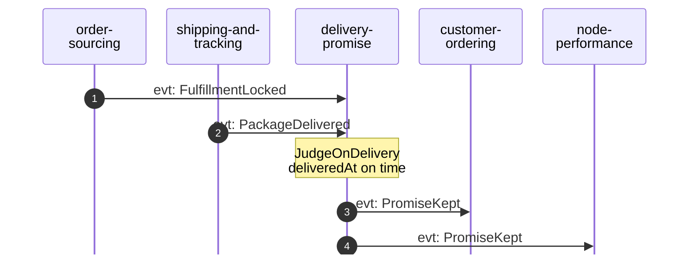
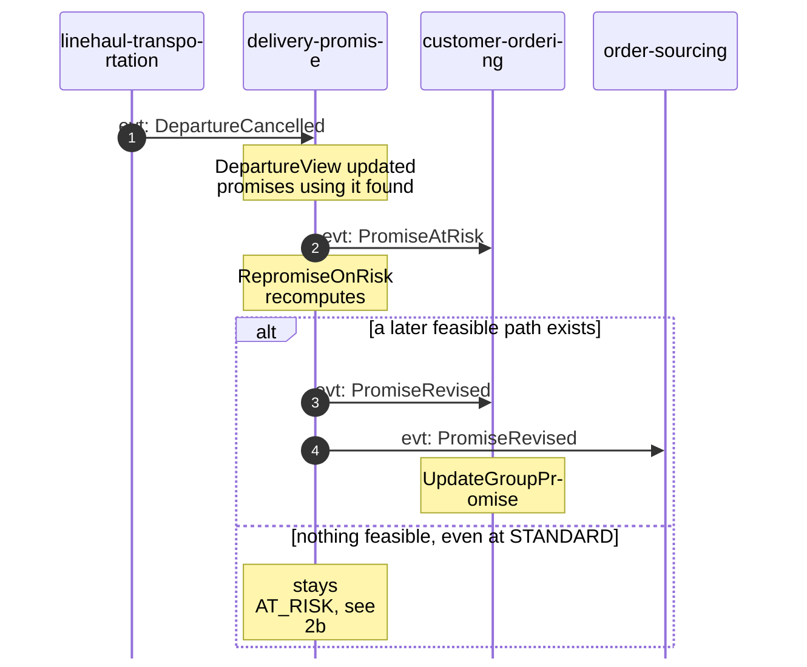
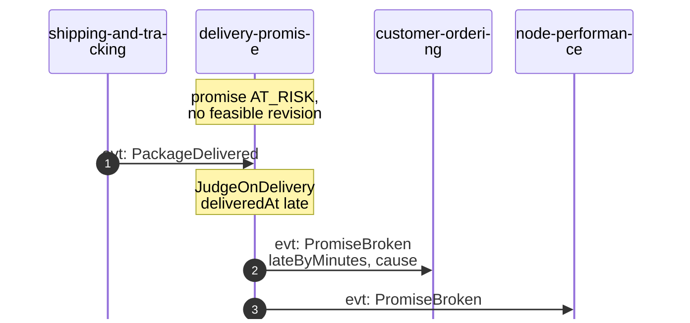
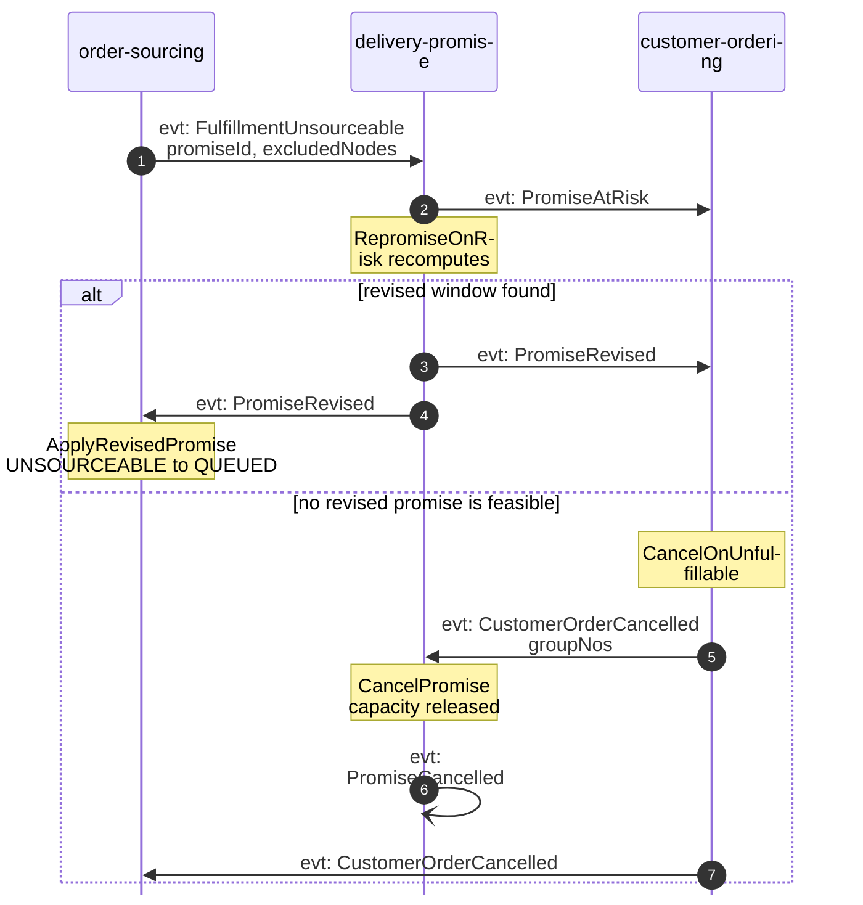
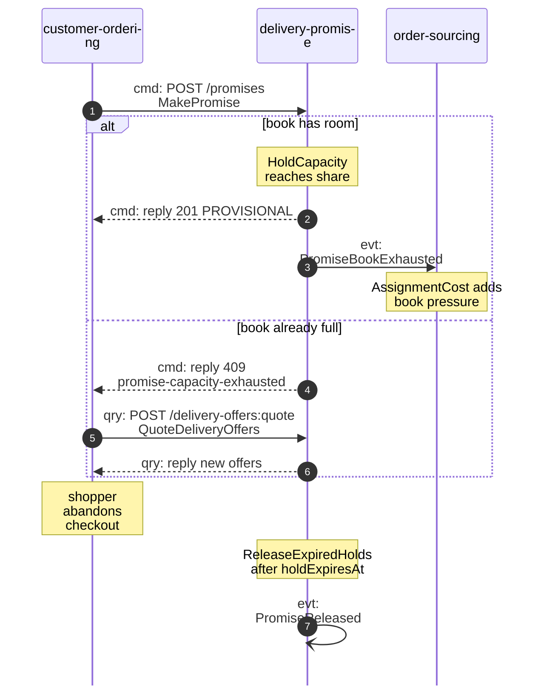

# Domain Message Flow

:::info[Proposed design]
Derived from [`model/model.yaml`](https://github.com/IQVO/retail-network-docs/blob/main/model/model.yaml). Nothing in this context is built yet; identifiers (`Err...` names, routes, CloudEvents types) are the names an implementation must use.
:::

Following ddd-crew [Domain Message Flow Modelling](https://github.com/ddd-crew/domain-message-flow-modelling).
Four business scenarios. Participants are bounded contexts and actors. Every
arrow is a message from the model, prefixed `cmd:` (command), `qry:` (query) or
`evt:` (event). Events travel over Kafka through each producer's outbox; the
diagrams draw them straight from producer to consumer. Event names are short;
full CloudEvents types are on [the domain events page](/network/contexts/delivery-promise/domain-events).
A self-arrow on `delivery-promise` marks an event the model publishes with no
consuming context (analytics only).
The domain-wide flows are on [the domain message flows page](/network/strategic-design/domain-message-flows).

## 1. Quote, promise, confirm, keep (happy path)

### 1a. Quote and checkout

### 1b. Judged at delivery

Derived from: `model.yaml → contexts[delivery-promise].inbound`, `.publishes`,
`.policies[JudgeOnDelivery]`; `contexts[customer-ordering].sync_calls`,
`.policies[CheckoutPromising]`, `.inbound[POST /checkout]`.

Omitted: the read-model feeds that make the quote possible (board 1 of
[the EventStorming page](/network/contexts/delivery-promise/eventstorming)); a checkout
re-quote when the offer expired (`CheckoutPromising`); everything
`order-sourcing`, `vendor-connectivity` and the logistics contexts do between
the order and the delivery. What this context does with `FulfillmentLocked` is
not stated by the model (open question on
[the canvas page](/network/contexts/delivery-promise/bounded-context-canvas)). The
scenario is split in two to stay within the page width.

## 2. A cancelled departure breaks the witness path (main failure path)

### 2a. At risk, then revised

### 2b. Nothing feasible: judged broken

Derived from: `model.yaml → contexts[delivery-promise].policies[RepromiseOnRisk]`,
`.policies[JudgeOnDelivery]`, `.publishes[PromiseAtRisk, PromiseRevised, PromiseBroken]`;
`contexts[linehaul-transportation].business_decisions` (cancel announced before
the cutoff); `contexts[customer-ordering].aggregates[CustomerOrder].commands`.

Omitted: the case where the departure belongs to the assigned path but not to
the witness path (the model only triggers on the witness path); a promise that
is still `PROVISIONAL` (it is not re-promised; its hold expires or is
confirmed first). An `AT_RISK` promise whose package arrives on time is judged
`KEPT`. `RevisePromise` keeps `deliverByLatest` equal or later
(`ErrRevisionMovesEarlier`).

## 3. Order sourcing cannot meet the promise

Derived from: `model.yaml → contexts[order-sourcing].business_decisions`
("sourcing never breaks a promise silently"), `.policies[ReassignOnRefusal]`,
`.aggregates[FulfillmentAssignment].transitions`;
`contexts[delivery-promise].policies[RepromiseOnRisk]`;
`contexts[customer-ordering].policies[CancelOnUnfulfillable]`.

Omitted: why the group became unsourceable (purchase-order rejections and
expiries on the vendor side). Excluding `excludedNodes` from the recompute is
this pack's reading of the event's fields; the model does not say it.

## 4. A full pickup cutoff, and a hold nobody confirmed

Derived from: `model.yaml → contexts[delivery-promise].aggregates[PromiseBook].invariants`,
`.publishes[PromiseBookExhausted, PromiseReleased]`,
`.aggregates[Promise].transitions[PROVISIONAL, RELEASED]`;
`contexts[customer-ordering].policies[CheckoutPromising]`;
`contexts[order-sourcing].policies[AssignmentCost]`.

Omitted: the `ErrBookClosed` branch (the cutoff minus handling time has passed;
same reply shape, `409 book-closed`). The re-quote after a refusal is
`customer-ordering`'s `CheckoutPromising` policy applied to a refused promise as
well as to an expired offer, which the model states only for the expired offer.
