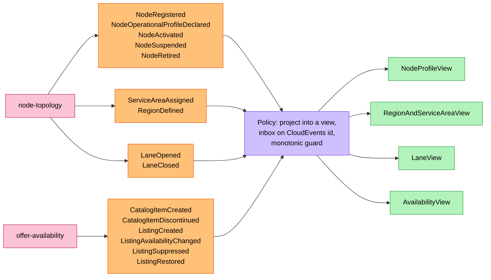
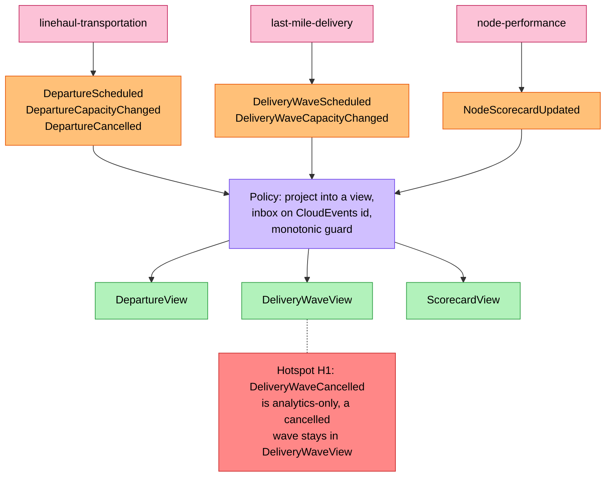
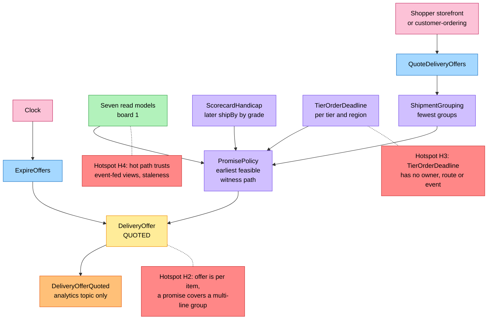
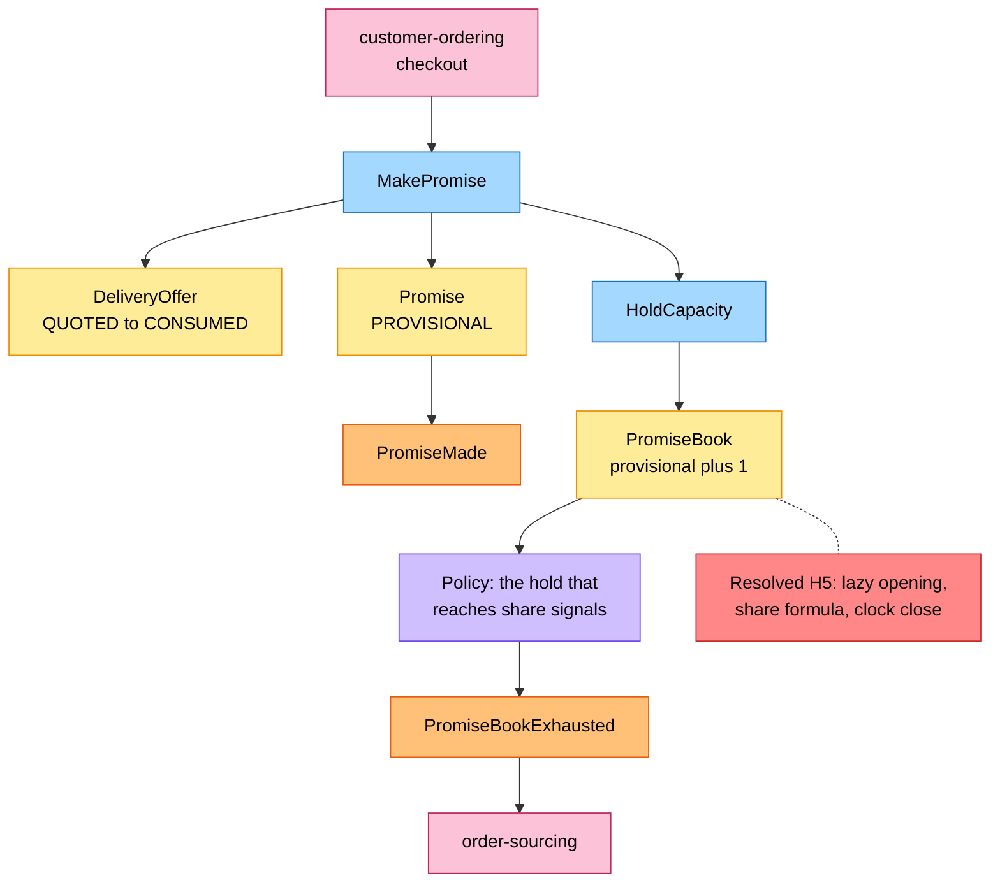
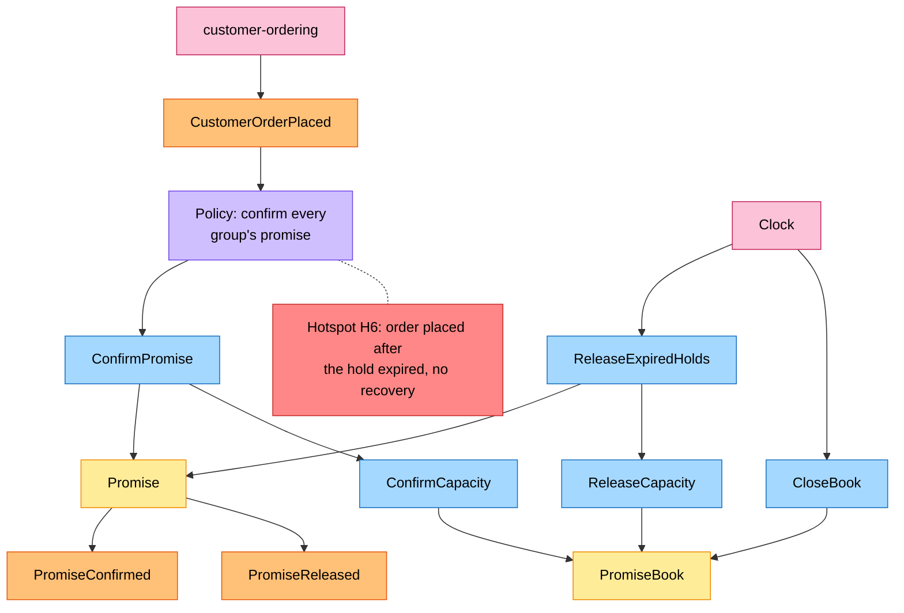
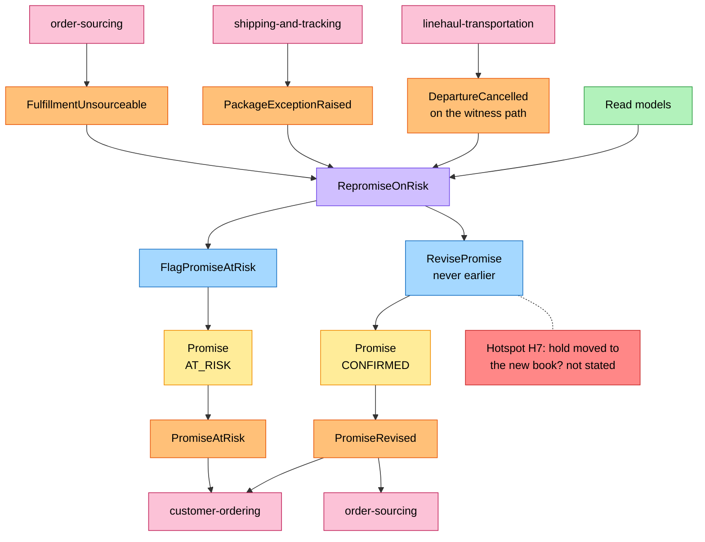
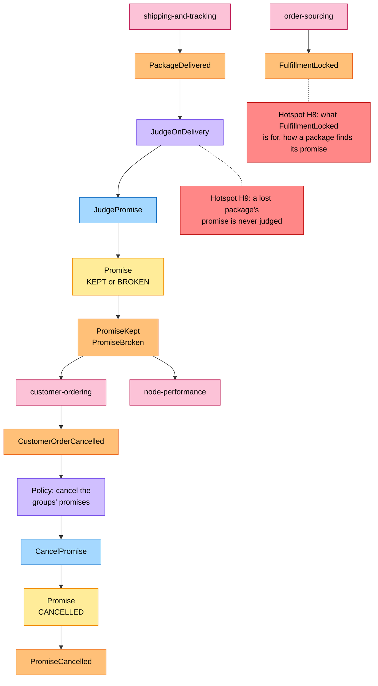

# EventStorming

:::info[As built]
Derived from [`network/model/model.yaml`](https://github.com/IQVO/warehouse-docs/blob/main/network/model/model.yaml). This context's service is built; the model carries its as-built contracts, and identifiers (`Err...` names, routes, CloudEvents types) are the names the service uses.
:::

Process-level EventStorming in the ddd-crew
[EventStorming glossary & cheat sheet](https://github.com/ddd-crew/eventstorming-glossary-cheat-sheet)
notation. Every sticky is a command, aggregate, event, policy or read model of
the model. Events of other contexts appear as orange stickies next to the
pink system that publishes them. Hotspots are real open questions or risks of
the model; each says where it comes from. The domain-wide board is
[the big-picture EventStorming](/network/strategic-design/eventstorming-big-picture).

## Legend

| Sticky | Colour | Meaning here |
| --- | --- | --- |
| Command | blue `#a5d8ff` | a command of `DeliveryOffer`, `Promise` or `PromiseBook` |
| Aggregate | yellow `#ffec99` | `DeliveryOffer`, `Promise`, `PromiseBook` |
| Domain Event | orange `#ffc078` | an event this context publishes, or one it consumes |
| Policy | lilac `#d0bfff` | a policy of the model (`PromisePolicy`, `RepromiseOnRisk`, ...) or a reaction to an event |
| Read Model | green `#b2f2bb` | one of the seven event-fed views |
| External System | pink `#fcc2d7` | another bounded context, the shopper's storefront, or the clock |
| Hotspot | red `#ff8787` | an open question or risk in the model |

## 1. Feeding the read models

### 1a. Topology and availability

### 1b. Departures, waves and scorecards

Derived from: `model.yaml → contexts[delivery-promise].read_models`, `.consumes`;
`conventions.integration_rules`; H1 from
`contexts[last-mile-delivery].publishes[DeliveryWaveCancelled].consumers`
(`analytics only`).

Omitted: `DepartureCancelled`'s second effect, the re-promise (board 5). Board
1 is split in two, and boards 2 to 6 are drawn top to bottom, to stay within
the page width.

## 2. Quoting a delivery offer

Derived from: `model.yaml → contexts[delivery-promise].aggregates[DeliveryOffer]`
(`commands`, `notes`), `.policies`; H2 from `.aggregates[DeliveryOffer].description`
against `.aggregates[Promise].value_objects[ShipmentGroup]` and
`.publishes[PromiseMade].data` (one `offerId`); H3 from `.policies[TierOrderDeadline]`
(no aggregate, route or event carries it); H4 from
`conventions.integration_rules` (the promise hot path makes no synchronous call).

Omitted: the four `OfferConstraint` values returned for a tier with no offer,
and the search steps (on [the use cases page](/network/contexts/delivery-promise/use-cases)
and in [the promise model](/network/network-model/promise-model)).

## 3. Making a promise and holding capacity

Derived from: `model.yaml → contexts[delivery-promise].aggregates[Promise]`,
`.aggregates[PromiseBook]`, `.aggregates[DeliveryOffer].transitions`,
`.publishes[PromiseBookExhausted].consumers`; H5
(resolved by G9) from `.aggregates[PromiseBook]` (`OpenBook`, `BookTimes`) and
`.policies[LazyBookOpening, BookShare, CloseBooksAtCutoff]`.

Omitted: the refusals (`ErrOfferNotQuotable`, `ErrPromiseCapacityExhausted`,
`ErrBookClosed`, `ErrGroupSpansNodes`), listed on
[the use cases page](/network/contexts/delivery-promise/use-cases).

## 4. Confirming, releasing and closing

Derived from: `model.yaml → contexts[delivery-promise].aggregates[Promise].transitions`
(`PROVISIONAL → CONFIRMED`, `PROVISIONAL → RELEASED`),
`.aggregates[PromiseBook].commands`, `.consumes[CustomerOrderPlaced]`; H6 from
`.aggregates[Promise].invariants` (`ErrPromiseHoldExpired`) with confirmation
arriving asynchronously by event and no recovery policy in the model.

Omitted: nothing about the trigger. A clock job closes every `OPEN` book at its
`cutoffAt` (`policies[CloseBooksAtCutoff]`); holds are already refused from the
`holdDeadline`, the cutoff minus handling time.

## 5. Re-promising when the path breaks

Derived from: `model.yaml → contexts[delivery-promise].policies[RepromiseOnRisk]`,
`.aggregates[Promise].transitions`, `.publishes[PromiseAtRisk, PromiseRevised].consumers`;
H7 from `.aggregates[PromiseBook].commands` (no rule ties `RevisePromise` to
`HoldCapacity` / `ReleaseCapacity`).

Omitted: `CONFIRMED → CONFIRMED: RevisePromise` (a revision without passing
through `AT_RISK`, which the model allows but no policy uses); the case where
nothing is feasible even at `STANDARD` (the promise stays `AT_RISK`, board 6).

## 6. Judging and cancelling

Derived from: `model.yaml → contexts[delivery-promise].policies[JudgeOnDelivery]`,
`.publishes[PromiseKept, PromiseBroken, PromiseCancelled]`, `.consumes`; H8 from
`.consumes[FulfillmentLocked]` with no policy or read model using it, and
`contexts[shipping-and-tracking].publishes[PackageDelivered].data` (no
`promiseId`, no `groupNo`); H9 from
`contexts[shipping-and-tracking].publishes[PackageLost, PackageReturned].consumers`
(`analytics only`).

Omitted: the capacity release on cancellation (`ReleaseCapacity`, board 4). The
cancellation policy sticky is this pack's reading: the model consumes
`CustomerOrderCancelled` and has `CancelPromise`, but names no policy joining
them.

## Hotspot inventory

| Id | Hotspot | Where it comes from in the model | Board |
| --- | --- | --- | --- |
| H1 | A cancelled delivery wave is invisible to this context | `DeliveryWaveCancelled` consumers: analytics only | 1 |
| H2 | An offer is per item; a promise covers a multi-line group with one `offerId` | `DeliveryOffer.description` vs `ShipmentGroup`, `PromiseMade.data` | 2 |
| H3 | `TierOrderDeadline` has no owner, route or event | `policies[TierOrderDeadline]` | 2 |
| H4 | The hot path is only as fresh as its slowest topic | `conventions.integration_rules` | 2 |
| H5 | Resolved (G9): the first hold opens the book (`OpenBook`), `share` has a formula, a clock job closes the book at `cutoffAt` | `aggregates[PromiseBook]`, `policies[LazyBookOpening, BookShare, CloseBooksAtCutoff]` | 3 |
| H6 | A `CustomerOrderPlaced` that arrives after hold expiry | `ErrPromiseHoldExpired`, asynchronous `ConfirmPromise` | 4 |
| H7 | Capacity on revision is unspecified | `aggregates[PromiseBook].commands`, `policies[RepromiseOnRisk]` | 5 |
| H8 | `FulfillmentLocked` has no stated use; packages carry no `promiseId` | `consumes[FulfillmentLocked]`, `PackageDelivered.data` | 6 |
| H9 | A lost or returned package's promise is never judged | `PackageLost`, `PackageReturned` consumers | 6 |
