# Sequence Diagrams

:::info[As built]
Derived from [`model/model.yaml`](https://github.com/IQVO/retail-network-docs/blob/main/model/model.yaml). This context's service is built; the model carries its as-built contracts, and identifiers (`Err...` names, routes, CloudEvents types) are the names the service uses.
:::

One UML sequence diagram per command use case of
[the use cases page](/network/contexts/delivery-promise/use-cases): inbound adapter →
use case → aggregate → repository and outbox in the **same transaction** →
relay → Kafka. `Postgres tx` stands for the repositories, the inbox
(`processed_events`) and the outbox (`outbox_events`) inside one transaction.
`alt` blocks show error branches, optimistic-concurrency version checks
(`UPDATE ... WHERE version = :read`) and idempotency. Participants are proposed
Go components, not built code.

Common rules, shown once here and abbreviated below:

- Every Kafka-driven use case first inserts the CloudEvents `id` into
  `processed_events`; a conflict means a duplicate and the transaction rolls
  back with no effect.
- Every event is written to `outbox_events` in the aggregate's transaction; the
  relay (diagram 0) publishes it. "relay to Kafka" in a diagram stands for
  diagram 0.
- A lost version check rolls back; the use case reloads and retries (three
  times, proposed) or leaves the row to the next tick.

## 0. Outbox relay (shared)

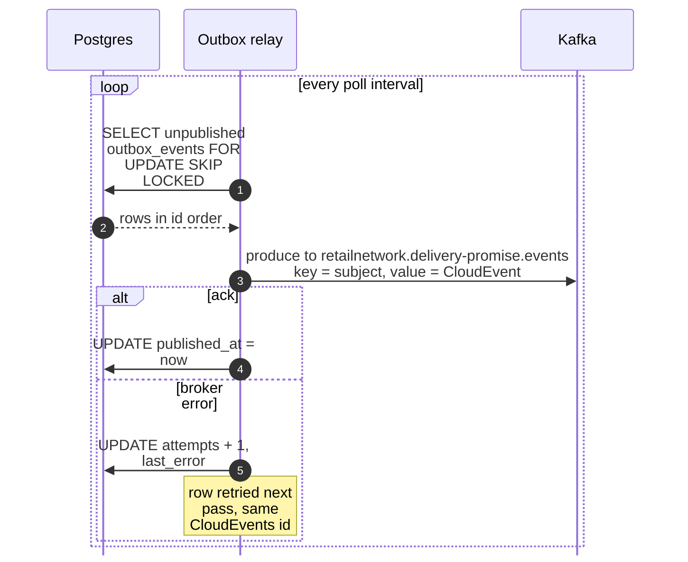

Derived from: `model.yaml → conventions.integration_rules` ("every published event
leaves through a transactional outbox"), `conventions.cloudevents` (topic,
subject = key).

Omitted: the analytics topic (`retailnetwork.delivery-promise.analytics`), which
the same relay drains for `DeliveryOfferQuoted` rows.

## 1. QuoteDeliveryOffers (REST)

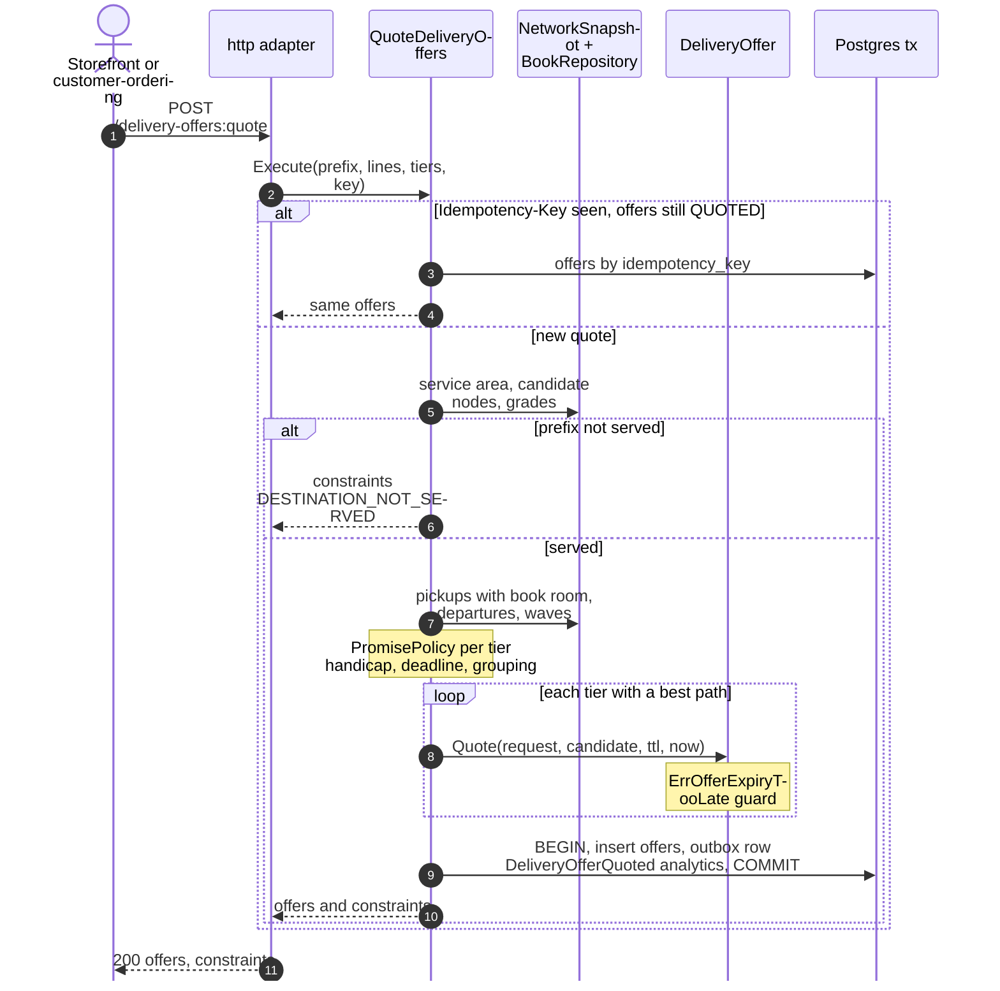

Derived from: `model.yaml → contexts[delivery-promise].rest[POST /delivery-offers:quote]`,
`.aggregates[DeliveryOffer]`, `.policies`, `.read_models`.

Omitted: the search steps (listed on the use cases page and worked through in
[the promise model](/network/network-model/promise-model)); a malformed body returns
`422 invalid-request` before the use case runs. No synchronous call leaves the
context: `NetworkSnapshot` reads local `rm_` tables. The quote reads books but
never writes them.

## 2. MakePromise (REST)

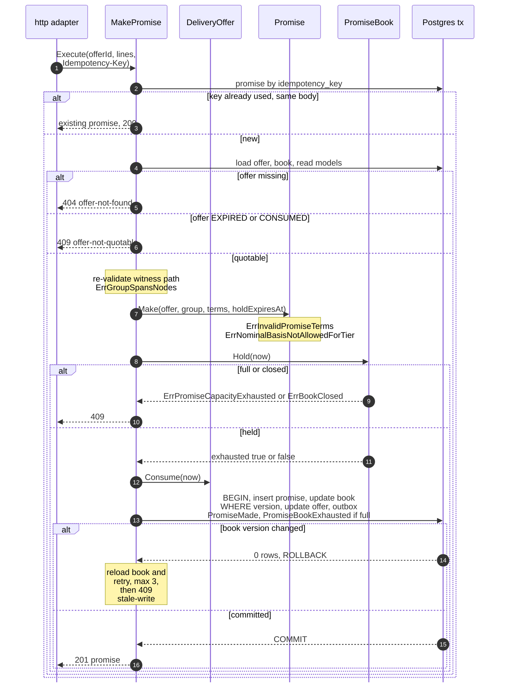

Derived from: `model.yaml → contexts[delivery-promise].rest[POST /promises]`,
`.aggregates[Promise].invariants`, `.aggregates[PromiseBook].invariants`,
`.aggregates[DeliveryOffer].transitions`, `.publishes[PromiseMade, PromiseBookExhausted]`.

Omitted: the relay (diagram 0) publishing `PromiseMade` and, when the book
filled, `PromiseBookExhausted`; the `422 idempotency-key-reused` branch (same key,
different body). The three aggregates change in one local transaction (see
the use cases page).

## 3. ConfirmPromise (Kafka: CustomerOrderPlaced)

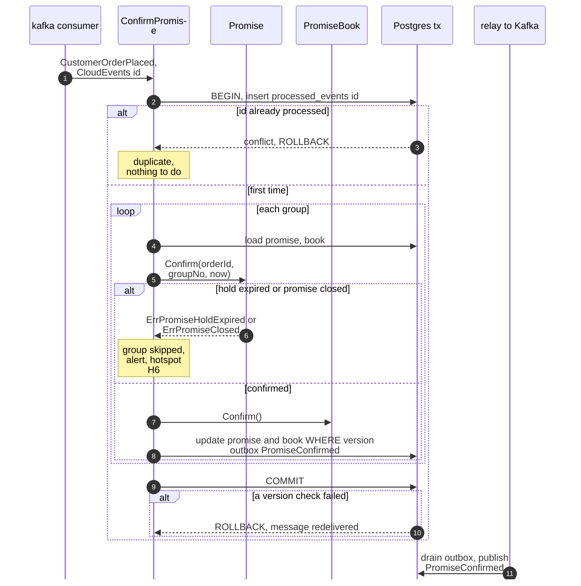

Derived from: `model.yaml → contexts[delivery-promise].consumes[CustomerOrderPlaced]`,
`.aggregates[Promise].transitions[PROVISIONAL, CONFIRMED]`,
`.aggregates[PromiseBook].commands[ConfirmCapacity]`.

Omitted: nothing else. All groups of one order commit in one transaction with
the inbox row, so a failure redelivers the whole event and a success can never
be half applied.

## 4. CancelPromise (Kafka: CustomerOrderCancelled)

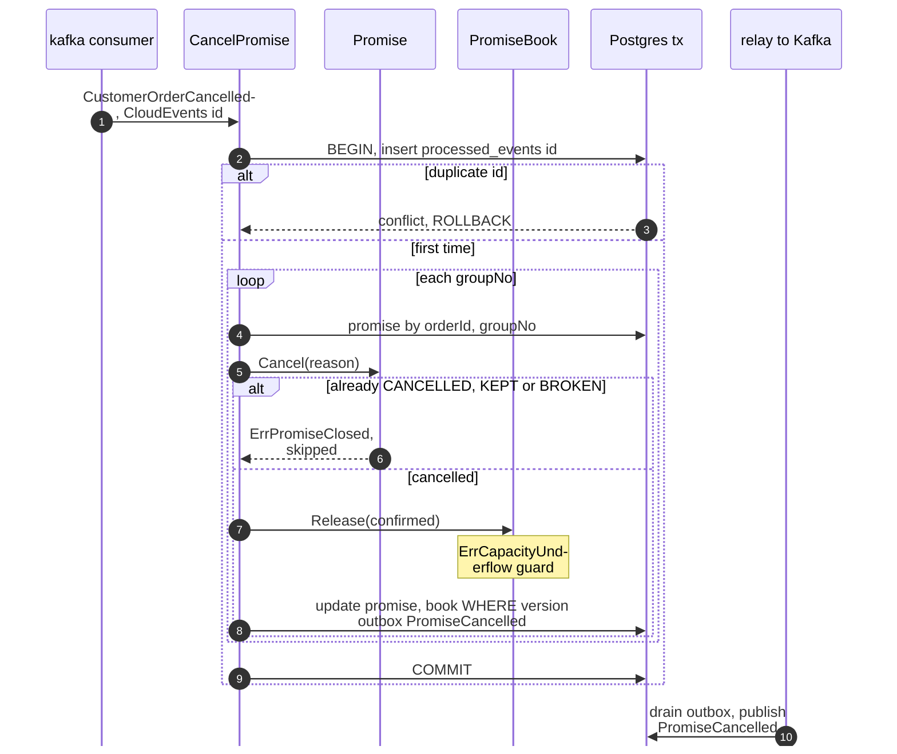

Derived from: `model.yaml → contexts[delivery-promise].consumes[CustomerOrderCancelled]`,
`.aggregates[Promise].transitions` (`CANCELLED`), `.publishes[PromiseCancelled]`.

Omitted: nothing else. Joining this event to `CancelPromise` is this pack's
reading; the model names no policy for it.

## 5. FlagPromiseAtRisk (Kafka: RepromiseOnRisk triggers)

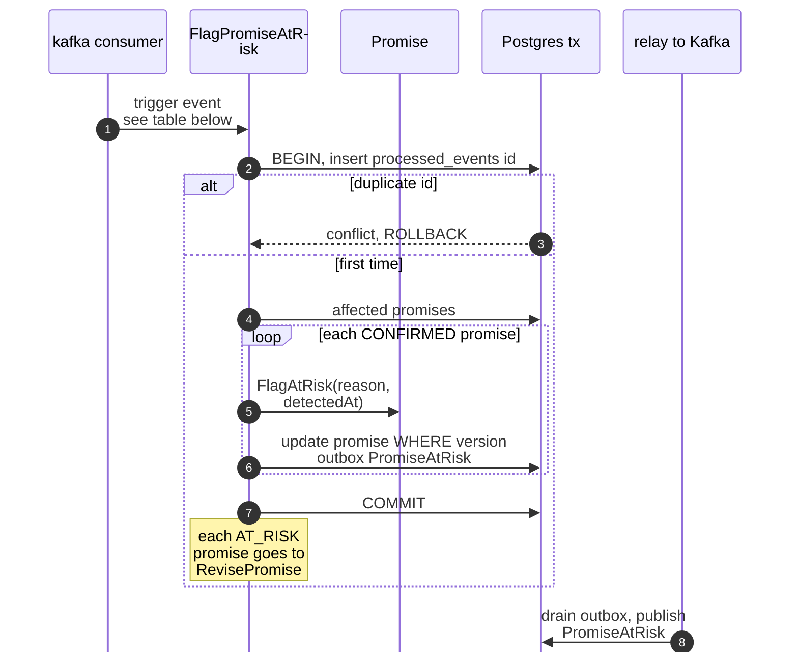

Derived from: `model.yaml → contexts[delivery-promise].policies[RepromiseOnRisk]`,
`.aggregates[Promise].transitions[CONFIRMED, AT_RISK]`.

The trigger events: `FulfillmentUnsourceable` (finds the promise by
`promiseId`), `PackageExceptionRaised` (by `assignmentId`, open question 3) and
`DepartureCancelled` (every `CONFIRMED` promise whose witness pickup or legs use
the departure; the same consumer also updates `rm_departure`). An `AT_RISK`
promise is not flagged again.

## 6. RevisePromise

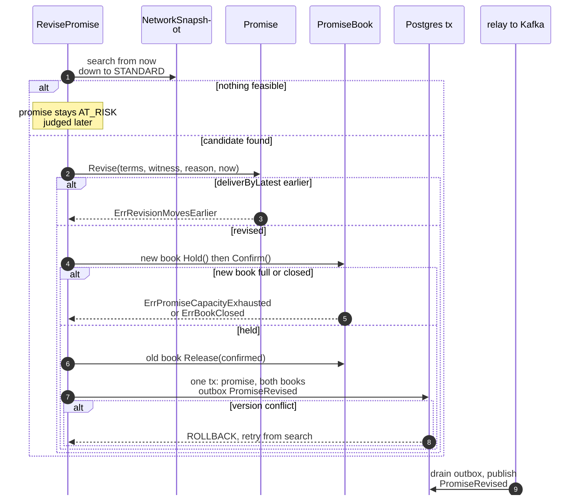

Derived from: `model.yaml → contexts[delivery-promise].policies[RepromiseOnRisk]`,
`.aggregates[Promise].invariants[ErrRevisionMovesEarlier]`,
`.publishes[PromiseRevised]`.

Omitted: the book moves (hold and confirm on the new book, release on the old)
are this pack's reading (open question 11); when the witness book does not
change, no book is touched. The trigger's CloudEvents `id` is stored with the
revision so a redelivered trigger does not revise twice.

## 7. JudgePromise (Kafka: PackageDelivered)

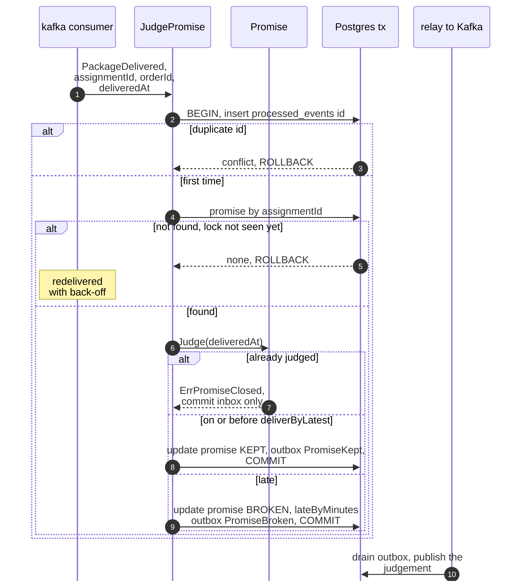

Derived from: `model.yaml → contexts[delivery-promise].policies[JudgeOnDelivery]`,
`.business_decisions` ("kept means delivered on or before deliverByLatest"),
`.publishes[PromiseKept, PromiseBroken]`.

Omitted: the lookup by `assignmentId` relies on the correlation recorded from
`FulfillmentLocked`, which the model does not name (open questions 3 and 4 on
[the canvas page](/network/contexts/delivery-promise/bounded-context-canvas)).

## 8. ReleaseExpiredHolds (scheduler)

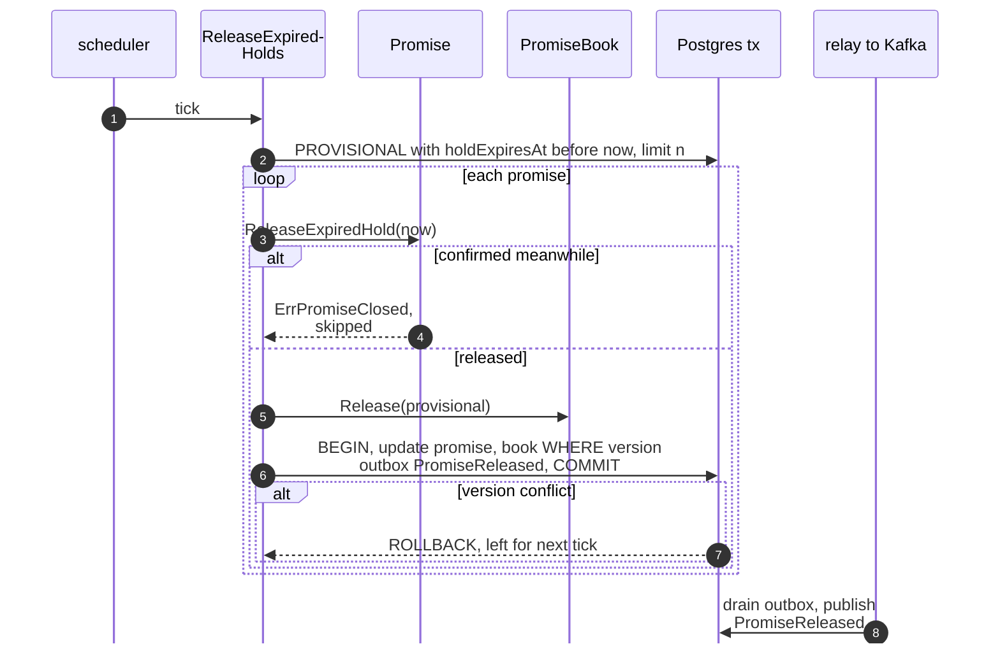

Derived from: `model.yaml → contexts[delivery-promise].aggregates[Promise].transitions[PROVISIONAL, RELEASED]`,
`.aggregates[PromiseBook].commands[ReleaseCapacity]`, `.publishes[PromiseReleased]`.

Omitted: the batch size and tick interval (proposed: every minute).

## 9. ExpireOffers (scheduler)

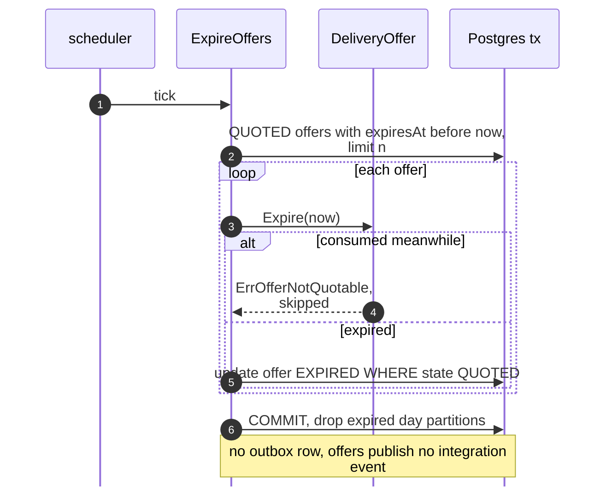

Derived from: `model.yaml → contexts[delivery-promise].aggregates[DeliveryOffer]`
(`transitions[QUOTED, EXPIRED]`, `size_estimate`).

Omitted: nothing. The offer has no version column: the conditional update on
`state` is its concurrency check against a racing `MakePromise`.

## 10. CloseBook (scheduler)

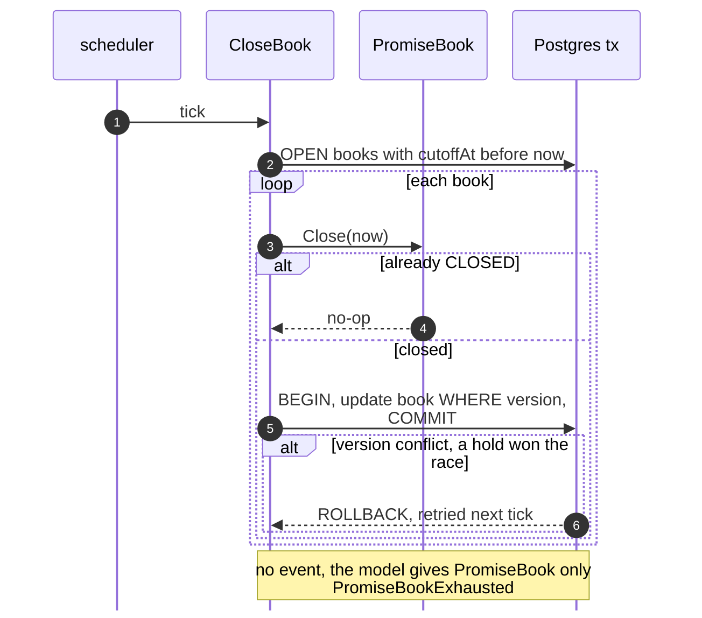

Derived from: `model.yaml → contexts[delivery-promise].aggregates[PromiseBook]`
(`transitions[OPEN, CLOSED]`, `invariants[ErrBookClosed]`).

Omitted: nothing. The trigger is the policy `CloseBooksAtCutoff`: a clock job at `cutoffAt`.
