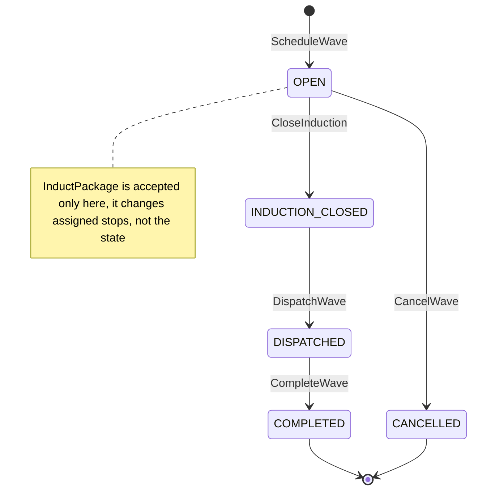
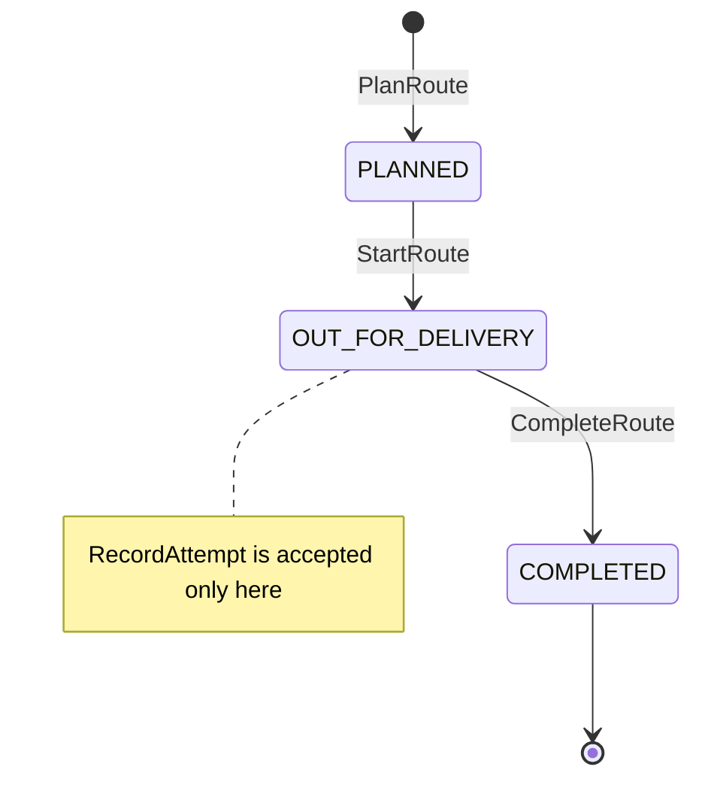
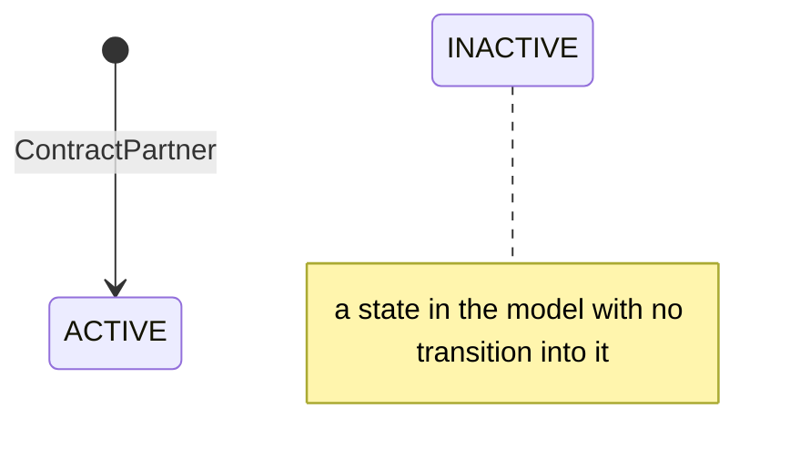

# Aggregate Design Canvas

:::info[As built]
Derived from [`network/model/model.yaml`](https://github.com/IQVO/warehouse-docs/blob/main/network/model/model.yaml). This context's service is built; the model carries its as-built contracts, and identifiers (`Err...` names, routes, CloudEvents types) are the names the service uses.
:::

Following the ddd-crew [Aggregate Design Canvas v1.1](https://github.com/ddd-crew/aggregate-design-canvas).
The model gives this context three aggregate roots: **DeliveryWave**,
**Route** and **DeliveryServicePartner**. The proposed Go packages are
`internal/domain/wave`, `internal/domain/route` and
`internal/domain/partner` (from the `ul` code identifiers).

## DeliveryWave

### 1. Name

`DeliveryWave` (`wave.DeliveryWave`), identified by `waveId`.

### 2. Description

One dispatch wave of one delivery station on one service date. It carries
the induct cutoff (`inductCutoffAt`), the delivery window
(`Window{start, end}`) and the stop capacity (`StopCapacity{stops, assigned}`).
`delivery-promise` and `order-sourcing` plan the last leg of every path on
it, so its capacity is published on every change.

### 3. State Transitions

Derived from: model.yaml → `contexts[last-mile-delivery].aggregates[DeliveryWave].states`,
`.transitions`, `.commands`, `.invariants`.

Omitted: nothing in the model. The creation edge (`ScheduleWave`) and the
`InductPackage` note come from `commands`; they are not rows of
`transitions`.

### 4. Enforced Invariants

| Invariant | Enforced by |
| --- | --- |
| `inductCutoffAt < windowStart < windowEnd` | `ErrInvalidWaveTimes` |
| assigned stops `<=` stops | `ErrWaveFull` |
| no package joins after induction closes | `ErrInductionClosed` |

### 5. Corrective Policies

- **`InductOnArrival`**: on `LoadArrived` at a delivery station, induct every
  package into the earliest eligible wave. A package rejected by
  `ErrWaveFull` or `ErrInductionClosed` is tried against the next wave.
- **`RetryNextWave`**: a `FAILED` attempt on a route re-inducts the package
  into the next wave; three failures return it to sender.
- **Neighbour reactions**: `delivery-promise` updates `DeliveryWaveView`, and
  `order-sourcing` updates `NetworkGraphView`, on `DeliveryWaveScheduled` and
  `DeliveryWaveCapacityChanged`. A wave with no remaining stops stops being
  offered as a witness or candidate wave.
- **No reaction to `DeliveryWaveCancelled`**: it is analytics only in the
  model (see the open questions on the
  [Bounded Context Canvas](/network/contexts/last-mile-delivery/bounded-context-canvas)).

### 6. Handled Commands

| Command | Transition | Issued by |
| --- | --- | --- |
| `ScheduleWave` | creates `OPEN` | Station planner, REST `POST /waves` |
| `InductPackage` | `OPEN` (assigned stops +) | policies `InductOnArrival` and `RetryNextWave` |
| `CloseInduction` | `OPEN` → `INDUCTION_CLOSED` | Station planner, REST `POST /waves/{waveId}/induction-closures` |
| `DispatchWave` | `INDUCTION_CLOSED` → `DISPATCHED` | Station planner, REST `POST /waves/{waveId}/dispatches` |
| `CompleteWave` | `DISPATCHED` → `COMPLETED` | no trigger in the model |
| `CancelWave` | `OPEN` → `CANCELLED` | no trigger in the model |

### 7. Created Events

| Event | Raised when | Full CloudEvents type |
| --- | --- | --- |
| `DeliveryWaveScheduled` | `ScheduleWave` is saved | `com.retailnetwork.logistics.last-mile-delivery.wave.DeliveryWaveScheduled` |
| `DeliveryWaveCapacityChanged` | assigned stops change (`InductPackage`) | `com.retailnetwork.logistics.last-mile-delivery.wave.DeliveryWaveCapacityChanged` |
| `DeliveryWaveCancelled` | `CancelWave` is saved | `com.retailnetwork.logistics.last-mile-delivery.wave.DeliveryWaveCancelled` |

`CloseInduction`, `DispatchWave` and `CompleteWave` raise no event in the
model.

### 8. Throughput

*Estimate (model: "medium").* One write per inducted package, in bursts with
each `LoadArrived`. All packages of one load usually target the same one or
two waves, so the wave row is contended during a burst. Use an optimistic
`version` column and retry, or process one wave per partition.

### 9. Size

*Estimate (model: "stations x waves/day x horizon").* Small: a handful of
scalar fields per wave and no child collection. The packages inducted are
recorded per wave (see the
[Entity Relationship](/network/contexts/last-mile-delivery/entity-relationship) page)
so that induction is idempotent. A wave produces one `DeliveryWaveScheduled`,
one `DeliveryWaveCapacityChanged` per induction, and at most one
`DeliveryWaveCancelled`.

## Route

### 1. Name

`Route` (`route.Route`), identified by `routeId`.

### 2. Description

One delivery service partner's van route within one wave: ordered stops.
Each `Stop{stopNo, trackingNumbers[], outcome}` is an entity of the route.
The route records each delivery attempt (`route.Attempt`) as `DELIVERED` or
`FAILED` with a reason and an optional `outcomeDetail` category, and at
`StartRoute` it assigns each stop a day-of ETA window (ADR 0013) without
persisting anything about it: the events and the analytics read side are the
record.

### 3. State Transitions

Derived from: model.yaml → `contexts[last-mile-delivery].aggregates[Route].states`,
`.transitions`, `.entities`, `.invariants`.

### 4. Enforced Invariants

| Invariant | Enforced by |
| --- | --- |
| stops `<=` van capacity of the partner | `ErrRouteOverCapacity` |
| an attempt is recorded only on an `OUT_FOR_DELIVERY` route | `ErrRouteNotStarted` |
| a package is delivered at most once | `ErrAlreadyDelivered` |
| `outcomeDetail`, when reported, pairs with the outcome: `FAILED` carries `NOT_HOME`, `ACCESS_PROBLEM` or `OTHER`, `DELIVERED` carries `SAFE_PLACE_USED`; empty means not reported and never replaces `failureReason` | `ErrValidation` (422) |

The van capacity belongs to another aggregate (`DeliveryServicePartner`).
`PlanRoute` reads it when the route is created and checks the stop count
against that value. A later change to the partner does not re-check
planned routes.

### 5. Corrective Policies

- **`RetryNextWave`**: on a `FAILED` attempt, re-induct the package into the
  next wave of the same station; after three failures, return it to sender.
- **`EtaWindowAtRouteStart`**: `StartRoute` raises one `StopEtaWindowAssigned`
  per stop, after every `PackageOutForDelivery`, in the same transaction —
  the stops spread linearly over what is left of the wave's delivery window,
  each stop a window of at most two hours; with less than 30 minutes left no
  event is raised and the route starts normally.
- **`DeliveryPointProfileLearns`**: `RecordAttempt` also folds the attempt
  into the `DeliveryPointProfile` of the stop in the same unit of work
  (see that aggregate's canvas below).
- **Neighbour reaction**: `shipping-and-tracking` turns
  `PackageOutForDelivery` and `DeliveryAttempted` into scans on the
  `PackageJourney` (`AT_STATION` → `OUT_FOR_DELIVERY`, then `DELIVERED` or
  back to `AT_STATION`), and relays `StopEtaWindowAssigned` and
  `DeliveryPointFlagged` per package. Its `ExceptionOnSilence` raises an
  exception if no scan follows in time.

### 6. Handled Commands

| Command | Transition | Issued by |
| --- | --- | --- |
| `PlanRoute` | creates `PLANNED` | Station planner, REST `POST /routes` |
| `StartRoute` | `PLANNED` → `OUT_FOR_DELIVERY` | DSP driver app, REST `POST /routes/{routeId}/starts` |
| `RecordAttempt` | `OUT_FOR_DELIVERY` (stop outcome set) | DSP driver app, REST `POST /routes/{routeId}/attempts` |
| `CompleteRoute` | `OUT_FOR_DELIVERY` → `COMPLETED` | no trigger in the model |

### 7. Created Events

| Event | Raised when | Full CloudEvents type |
| --- | --- | --- |
| `RoutePlanned` | `PlanRoute` is saved | `com.retailnetwork.logistics.last-mile-delivery.route.RoutePlanned` |
| `PackageOutForDelivery` | `StartRoute` is saved, once per tracking number on the route | `com.retailnetwork.logistics.last-mile-delivery.route.PackageOutForDelivery` |
| `StopEtaWindowAssigned` | `StartRoute` is saved, once per stop, after every `PackageOutForDelivery` | `com.retailnetwork.logistics.last-mile-delivery.route.StopEtaWindowAssigned` |
| `DeliveryAttempted` | `RecordAttempt` is saved | `com.retailnetwork.logistics.last-mile-delivery.route.DeliveryAttempted` |

### 8. Throughput

*Estimate (model: "high (per stop)").* One write per attempt, from one
driver app per route. Contention on a route is low because a route has one
driver, but the attempt rate across a station peaks inside the delivery
window.

### 9. Size

*Estimate (model: "routes per wave").* One route holds up to the van
capacity in stops, each with one or more tracking numbers. A route produces
one `RoutePlanned`, one `PackageOutForDelivery` per package, one
`StopEtaWindowAssigned` per stop and one `DeliveryAttempted` per attempt.

## DeliveryServicePartner

### 1. Name

`DeliveryServicePartner` (`partner.DeliveryServicePartner`), identified by
`dspId`.

### 2. Description

An independent delivery business contracted to a station, with its vans.
The only rule the model gives it is a positive van capacity, which
`PlanRoute` reads.

### 3. State Transitions

Derived from: model.yaml → `contexts[last-mile-delivery].aggregates[DeliveryServicePartner].states`,
`.commands` (no `transitions`).

### 4. Enforced Invariants

| Invariant | Enforced by |
| --- | --- |
| van capacity `> 0` | `ErrInvalidVanCapacity` |

### 5. Corrective Policies

None in the model.

### 6. Handled Commands

| Command | Transition | Issued by |
| --- | --- | --- |
| `ContractPartner` | creates `ACTIVE` | REST `POST /partners` (caller not named in the model) |

### 7. Created Events

None (`events: []`).

### 8. Throughput

*Estimate (model: "rare").* A few writes per station per year.

### 9. Size

*Estimate (model: "small").* One row per partner.

## DeliveryPointProfile

### 1. Name

`DeliveryPointProfile` (`deliverypoint.DeliveryPointProfile`), identified by
the `stopKey` (the opaque keyed hash of the address; never an address).

### 2. Description

The learning record of one delivery point (last-mile-delivery ADR 0014):
outcome tallies and a ring of at most five counted-failure strikes. It has no
states and no command route of its own — `RecordAttempt` folds every attempt
into the profile of its stop inside the same unit of work, so there is no lag
and no second consumer group. A key starting with `pkg:` (a package with no
label data) has no address key and gets no profile.

### 3. State Transitions

None: the profile is a tally, not a state machine.

### 4. Enforced Invariants

| Invariant | Enforced by |
| --- | --- |
| `attempts = delivered + failedNotHome + failedAccess + failedOther`, where `OTHER` and not reported both tally as `failedOther` | `ErrValidation` on `Observe`, `ErrInvalidSnapshot` on `Restore` |
| `safePlaceUsed <= delivered` | `ErrValidation` / `ErrInvalidSnapshot` |
| at most five strikes, each a counted category (`NOT_HOME` or `ACCESS_PROBLEM`), no two with one `routeId` | `ErrValidation` / `ErrInvalidSnapshot` |
| `flaggedAt` is non-zero exactly when two or more strikes are open inside the 60-day window | `ErrValidation` / `ErrInvalidSnapshot` |
| the `stopKey` is valid and does not start with `pkg:` | `ErrValidation` |

### 5. Corrective Policies

- **Strike decay is lazy**: strikes older than 60 days are dropped at the
  next observation, and the flag clears when fewer than two remain. A point
  never visited again keeps its row and its open flag.
- **A `DELIVERED` attempt ends the episode** (clears strikes and flag) unless
  the delivering visit itself has a strike.
- **Dormant until activated**: until the driver client reports
  `outcomeDetail`, every attempt is tallied as not reported, no strike is
  counted and no event is raised.
- **No influence**: a flagged point changes no route, no ETA and no promise;
  `PlanRoute` gains no error and no status from it. The read-only exposure
  decided in the ADR (a delivery-point route and a summary on the wave stops)
  is not built yet.

### 6. Handled Commands

| Command | Transition | Issued by |
| --- | --- | --- |
| `Observe` | no state (tally) | `RecordAttempt`, in the same unit of work as the attempt |

### 7. Created Events

| Event | Raised when | Full CloudEvents type |
| --- | --- | --- |
| `DeliveryPointFlagged` | two or more strikes are open and packages not yet told exist (one event, only their tracking numbers, `failures` = open strikes) | `com.retailnetwork.logistics.last-mile-delivery.deliverypointprofile.DeliveryPointFlagged` |

The `reason` is `ACCESS_PROBLEM` when any open strike has it, else
`NOT_HOME`. A later parcel of another order failing at an already flagged
point is told too, once. There is no "cleared" event.

### 8. Throughput

*Estimate (model: "one Observe per attempt").* One extra write inside every
`RecordAttempt`.

### 9. Size

*Estimate (model: "one small row per distinct delivery point").* About 300
bytes per distinct address key; no retention job in this slice.

## Read models

| Read model | Source events | Used by | Why it is not an aggregate |
| --- | --- | --- | --- |
| `StationView` | `node-topology` `NodeRegistered`, `ServiceAreaAssigned` | `ScheduleWave` (is the node a delivery station?), `InductOnArrival` (is the load's `destinationNodeId` a station?) | It is a copy of another context's facts. Nothing here can change it, and it enforces no rule of its own. |
| `InboundPackagesView` | `linehaul-transportation` `LoadArrived` | `InductOnArrival` (which packages arrived when, at which station), the uninducted-packages metric | It records arrivals as told by `linehaul-transportation`. Induction decisions live on `DeliveryWave`. |

Both views are fed through the inbox (`processed_events`), so a redelivered
event is applied once.
