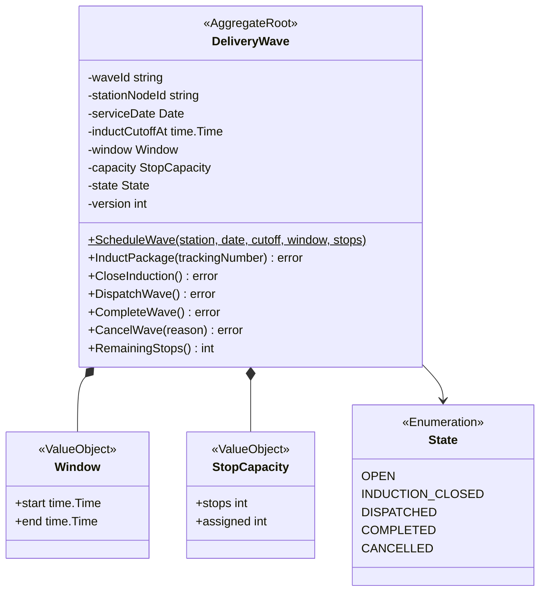
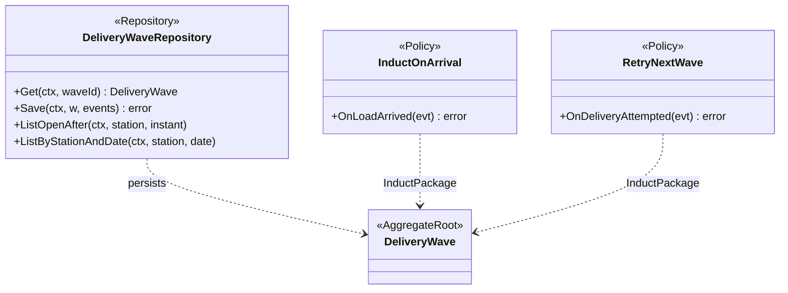
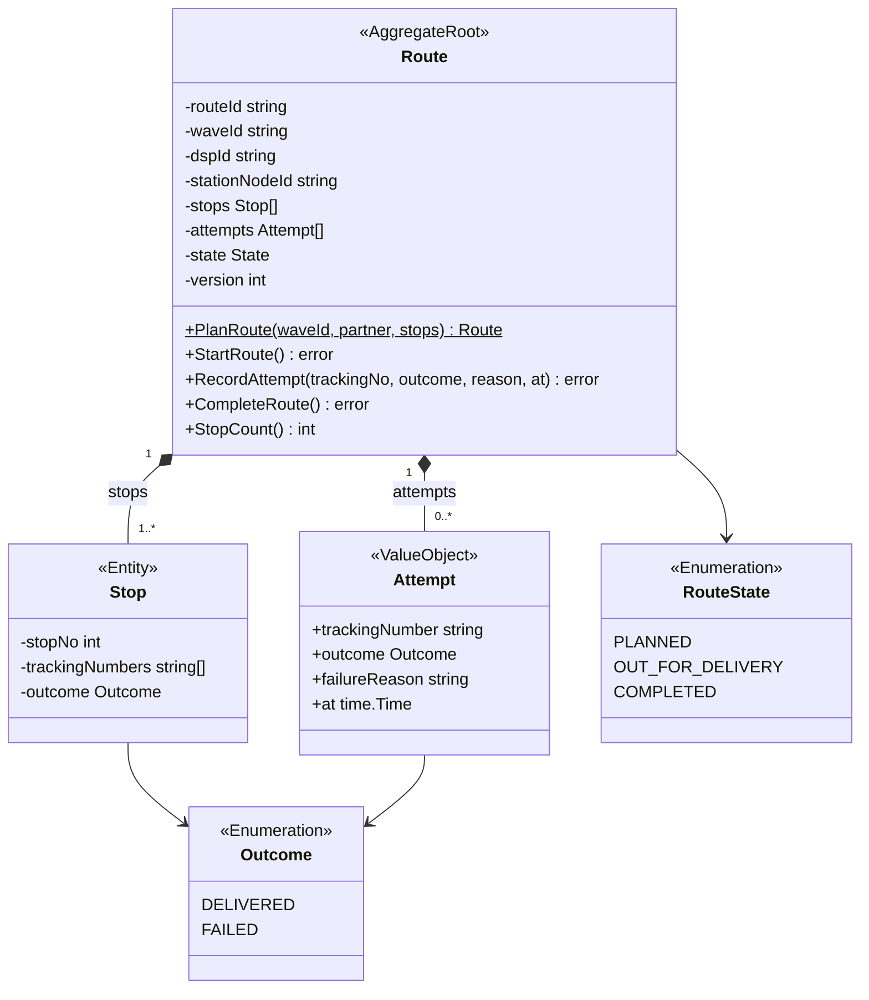
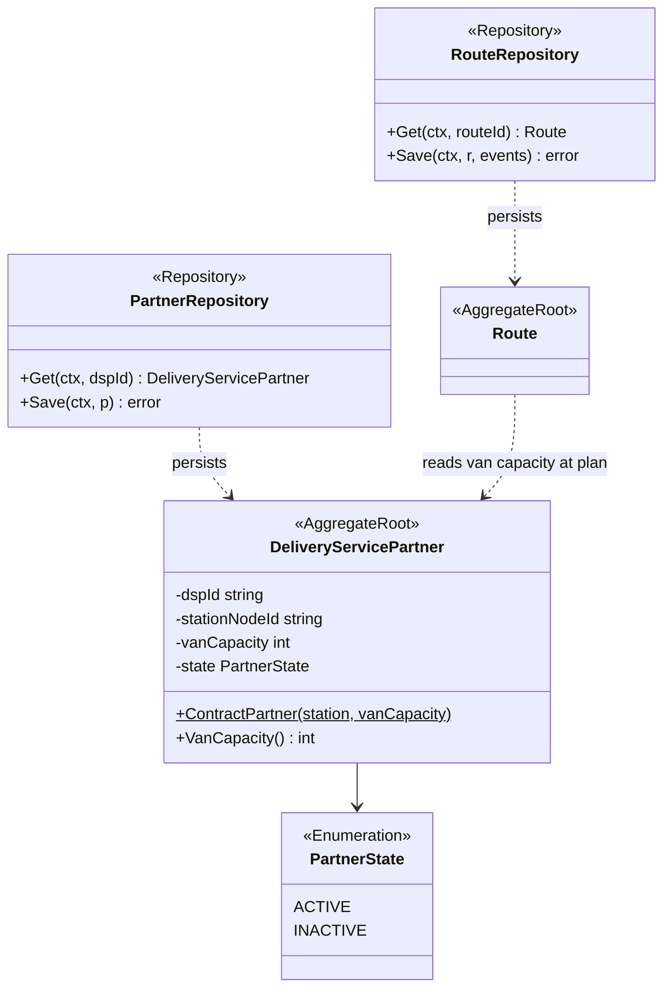
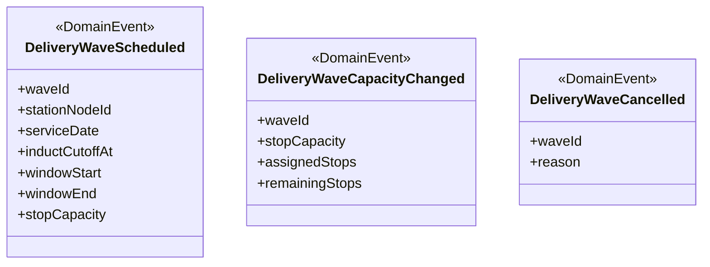
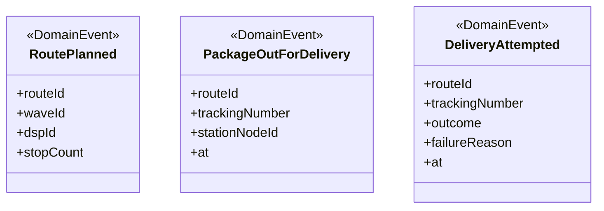
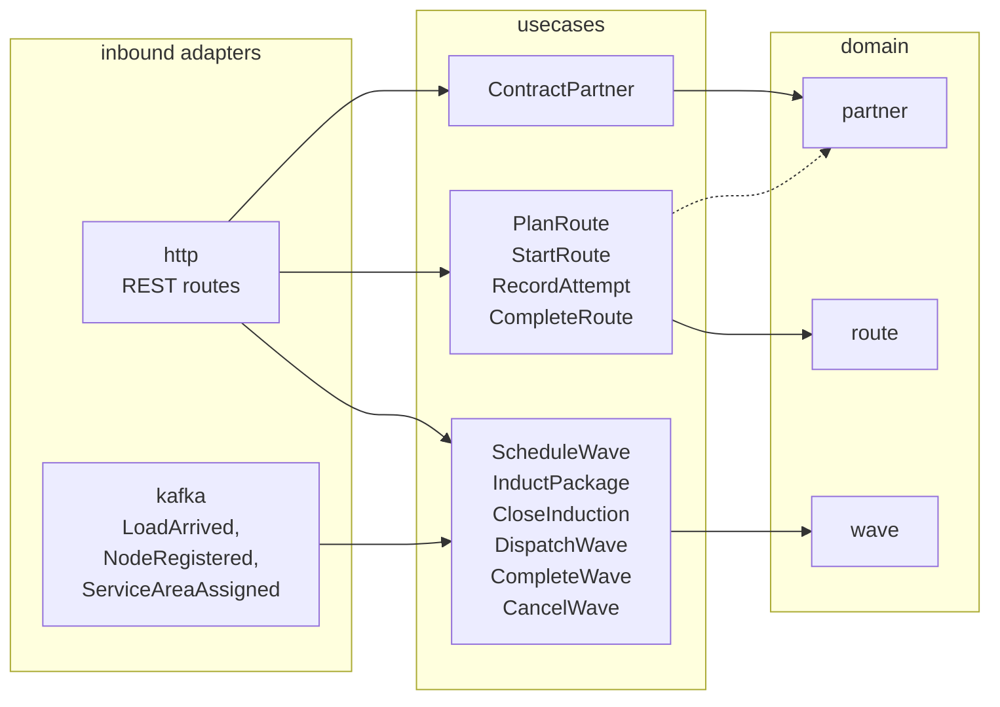
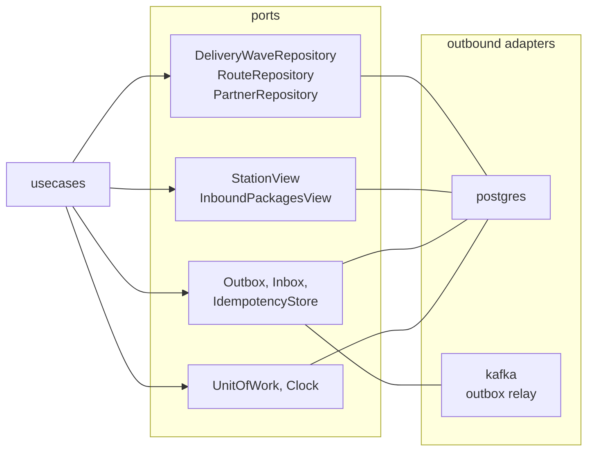

# Class Diagram

:::info[Proposed design]
Derived from [`model/model.yaml`](https://github.com/IQVO/retail-network-docs/blob/main/model/model.yaml). Nothing in this context is built yet; identifiers (`Err...` names, routes, CloudEvents types) are the names an implementation must use.
:::

UML class diagrams of the proposed `internal/domain/**`, plus the hexagonal
ports and adapters. Type names follow the model's `ul` code identifiers
(`wave.DeliveryWave`, `wave.InductPackage`, `route.Route`, `route.Attempt`,
`partner.DeliveryServicePartner`). Fields are unexported in Go and shown with
`-`; exported methods with `+`. Only commands and key queries are shown.

## 1. DeliveryWave aggregate (`internal/domain/wave`)

Derived from: model.yaml → `contexts[last-mile-delivery].aggregates[DeliveryWave]`
(`states`, `value_objects`, `commands`, `invariants`).

Omitted: the error variables `ErrInvalidWaveTimes`, `ErrWaveFull`,
`ErrInductionClosed` (see the
[Aggregate Design Canvas](/network/contexts/last-mile-delivery/aggregate-design-canvas))
and read accessors. `version` is the proposed optimistic-concurrency
counter, not a model field.

## 2. DeliveryWave repository and policies

Derived from: model.yaml → `contexts[last-mile-delivery].policies`,
`.rest` (`GET /waves?stationNodeId=&serviceDate=`).

Omitted: the members of `DeliveryWave` (diagram 1). The two list methods
return `DeliveryWave[]`.

## 3. Route aggregate (`internal/domain/route`)

Derived from: model.yaml → `contexts[last-mile-delivery].aggregates[Route]`
(`states`, `entities`, `commands`, `invariants`), `.ul` (`route.Attempt`),
`.publishes[DeliveryAttempted].data`.

Omitted: the error variables `ErrRouteOverCapacity`, `ErrRouteNotStarted`,
`ErrAlreadyDelivered`. The Go type for the route state is `route.State`; it
is drawn as `RouteState` so it does not clash with `wave.State` on this
page. `stationNodeId` is copied from the wave at plan time so that
`PackageOutForDelivery` can carry it.

## 4. DeliveryServicePartner aggregate and repositories (`internal/domain/partner`)

Derived from: model.yaml → `contexts[last-mile-delivery].aggregates[DeliveryServicePartner]`,
`.aggregates[Route].invariants` (`ErrRouteOverCapacity`).

Omitted: `ErrInvalidVanCapacity`. The partner fields `stationNodeId` and
`vanCapacity` come from the model's description ("contracted to a station,
with its vans") and invariant ("van capacity > 0"); the model gives no field
list. `Route` refers to a partner by `dspId` only; the dotted arrow is a
read at `PlanRoute`, not a held reference.

## 5. Domain events

Derived from: model.yaml → `contexts[last-mile-delivery].publishes[DeliveryWaveScheduled, DeliveryWaveCapacityChanged, DeliveryWaveCancelled].data`.

Derived from: model.yaml → `contexts[last-mile-delivery].publishes[*].data`.

Omitted: field types (on [Domain Events](/network/contexts/last-mile-delivery/domain-events))
and the CloudEvents envelope, which the outbound Kafka adapter adds.

## 6. Hexagonal ports and adapters

Driving side: inbound adapters, use cases and the domain packages they
change.

Derived from: model.yaml → `contexts[last-mile-delivery].rest`, `.consumes`, `.aggregates[*].commands`.

Driven side: the ports the use cases call and the adapters behind them.

Derived from: model.yaml → `contexts[last-mile-delivery].rest`, `.consumes`,
`.aggregates[*].commands`, `.read_models`, `conventions.integration_rules`.

Subgraph names are shortened: `internal/adapters/inbound/{http,kafka}`,
`internal/application/usecases`, `internal/domain/{wave,route,partner}`,
`internal/application/ports`, `internal/adapters/outbound/{postgres,kafka}`.
The dotted edge from the route use cases to `partner` is the read of a
partner's van capacity at `PlanRoute`. Omitted: `Clock` needs no adapter package; the composition root
(`cmd/last-mile-delivery`) that wires the adapters; and the internal handler
that runs `RetryNextWave` after a `FAILED` attempt commits (it calls
`InductPackage`). The Kafka consumer also writes the two read models through
the `StationView` and `InboundPackagesView` ports. The package names are
proposed.
