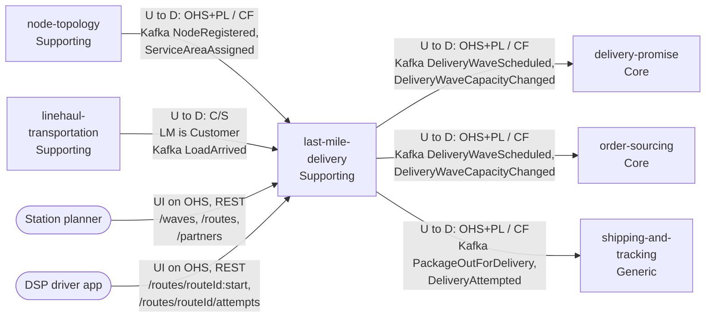

# Context Map

:::info[Proposed design]
Derived from [`model/model.yaml`](https://github.com/IQVO/retail-network-docs/blob/main/model/model.yaml). Nothing in this context is built yet; identifiers (`Err...` names, routes, CloudEvents types) are the names an implementation must use.
:::

Following ddd-crew [Context Mapping](https://github.com/ddd-crew/context-mapping).
This is **last-mile-delivery's slice** of the
[network context map](/network/strategic-design/context-map): every relationship this
context has, with the upstream (U) and downstream (D) side, the pattern and the
channel.

Derived from: model.yaml → `contexts[last-mile-delivery].inbound`,
`.publishes`, `.consumes`, `.rest`; the `consumes` of `delivery-promise`,
`order-sourcing` and `shipping-and-tracking`; the `publishes` of
`node-topology` and `linehaul-transportation`.

Legend: arrows point from upstream to downstream; the two actors are drawn
as rounded boxes. Path parameters are written `routeId` inside the diagram for
`{routeId}`. Abbreviations: OHS = Open Host Service, PL = Published Language,
CF = Conformist, C/S = Customer/Supplier.

Omitted: the analytics-only events (`DeliveryWaveCancelled`, `RoutePlanned`),
which have no context consumer; Postgres and Kafka as infrastructure; and the
contexts with no edge to this one (below).

## Relationships

| Neighbour | Classification | Direction | Pattern | Channel | Messages | Why this pattern |
| --- | --- | --- | --- | --- | --- | --- |
| `node-topology` | Supporting | Upstream (we are D) | **OHS + PL / Conformist** | Kafka `retailnetwork.node-topology.events` | `NodeRegistered`, `ServiceAreaAssigned` | Node and service-area master data is one network-wide truth; every consumer takes it as published. The model marks the row `Conformist`. |
| `linehaul-transportation` | Supporting | Upstream (we are D) | **Customer/Supplier** (we are the Customer) | Kafka `retailnetwork.linehaul-transportation.events` | `LoadArrived` | The model marks it `Customer/Supplier`: `LoadArrived` carries `destinationNodeId` and `trackingNumbers`, which exist so that a station can induct. The supplier lists this context as a named consumer. |
| `delivery-promise` | Core | Downstream (we are U) | **OHS + PL / Conformist** | Kafka `retailnetwork.last-mile-delivery.events` | `DeliveryWaveScheduled`, `DeliveryWaveCapacityChanged` | The promise conforms to the published wave and keeps a local `DeliveryWaveView`. The hot path makes no synchronous call (model integration rule). |
| `order-sourcing` | Core | Downstream (we are U) | **OHS + PL / Conformist** | Kafka `retailnetwork.last-mile-delivery.events` | `DeliveryWaveScheduled`, `DeliveryWaveCapacityChanged` | Same wave facts, kept in its `NetworkGraphView` to pick a `deliveryWaveId` per candidate. |
| `shipping-and-tracking` | Generic | Downstream (we are U) | **OHS + PL / Conformist** | Kafka `retailnetwork.last-mile-delivery.events` | `PackageOutForDelivery`, `DeliveryAttempted` | The journey conforms to our facts and turns them into scans; the model marks its row `Conformist`. |
| Station planner | person | Calls us | **UI on Open Host** | REST `POST /waves`, `GET /waves`, `POST /waves/{waveId}:close-induction`, `POST /waves/{waveId}:dispatch`, `POST /routes`, `POST /partners` | `ScheduleWave`, `CloseInduction`, `DispatchWave`, `PlanRoute`, `ContractPartner`, list waves | Model relationship `UI`. |
| DSP driver app | external organisation | Calls us | **UI on Open Host** | REST `POST /routes/{routeId}:start`, `POST /routes/{routeId}/attempts` | `StartRoute`, `RecordAttempt` | Model relationship `UI`. A partner is an independent business using our published API. |

## Separate Ways

| Context | Classification | Why no edge |
| --- | --- | --- |
| `customer-ordering` | Generic | Holds the ship-to address; this context never sees PII ([ADR 0006](/network/adr/0006-pii-confinement)). Delivery reaches the customer through `shipping-and-tracking`. |
| `offer-availability` | Supporting | Catalogue and listings play no part at the station. |
| `vendor-connectivity` | Supporting | Vendors never operate a station ([ADR 0004](/network/adr/0004-parcel-nodes-are-network-operated)). |
| `node-performance` | Supporting | Scores vendor nodes, not stations. |
| `network-fulfillment` (warehouse-systems fleet, other organization) | Supporting (in the fleet) | Hard boundary: the only seam is the Vendor API ([WMS/WES integration](/network/integration/wms-wes-integration)). |

## Notes on the patterns

- **Open Host + Published Language toward three consumers.** The wave and
  attempt events are versioned CloudEvents (`dataschema
  urn:retailnetwork:last-mile-delivery:events:<EventName>:v1`). No consumer
  negotiates their shape, so they are a Published Language, not a
  Customer/Supplier contract.
- **Customer/Supplier with linehaul.** This is the one upstream edge where
  the model records negotiation: the load's arrival is published with the
  tracking numbers so that induction can work.
- **No Shared Kernel.** Identifiers such as `trackingNumber` and
  `stationNodeId` are carried by value. No code or table is shared.
