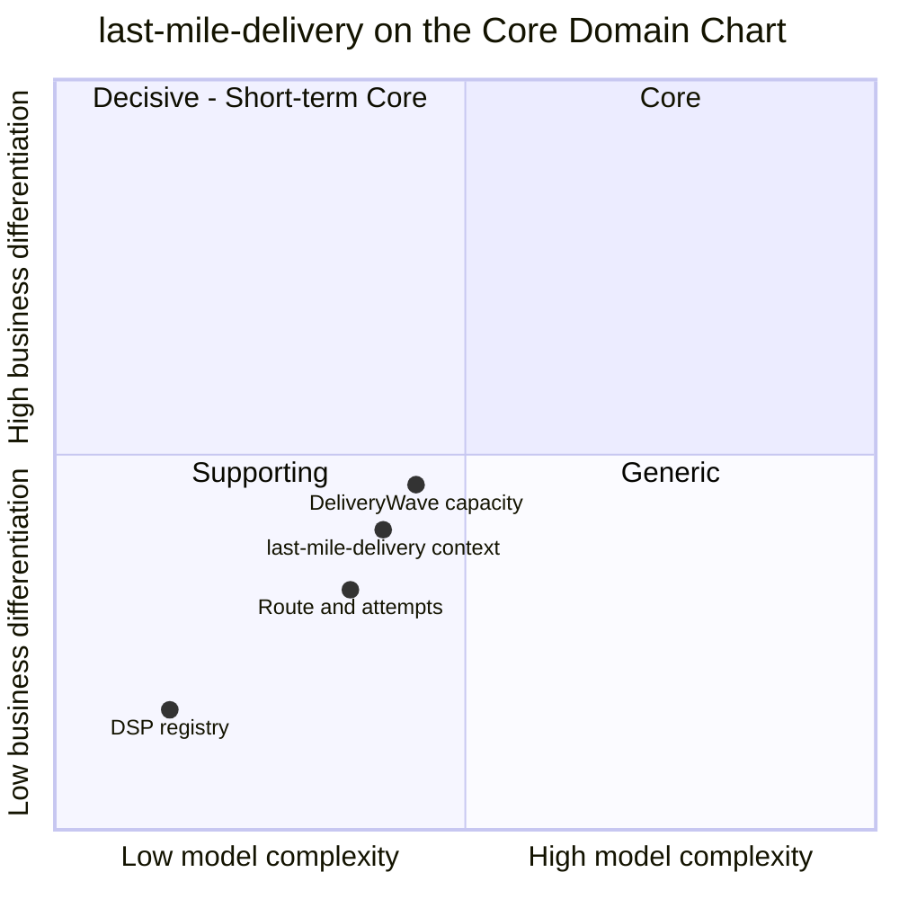

# Core Domain Chart

:::info[As built]
Derived from [`model/model.yaml`](https://github.com/IQVO/retail-network-docs/blob/main/model/model.yaml). This context's service is built; the model carries its as-built contracts, and identifiers (`Err...` names, routes, CloudEvents types) are the names the service uses.
:::

Following the ddd-crew [Core Domain Charts](https://github.com/ddd-crew/core-domain-charts):
business differentiation (y) against model complexity (x).

Derived from: model.yaml → `contexts[last-mile-delivery].chart`
(`complexity: 0.40`, `differentiation: 0.40`), `.classification`,
`.aggregates`, `.policies`. The three slices are this page's estimate; the
model places only the context.

Omitted: the other ten contexts (each has its own chart; the network-wide
chart is [Core Domain Chart](/network/strategic-design/core-domain-chart)), and the
future contexts.

## Classification: Supporting

All four points sit in **quadrant 3 (Supporting)**, bottom-left. The model
classifies `last-mile-delivery` as **Supporting**, with evolution
**Custom-built** and business model *"Cost reducer and experience creator
(the doorstep)"*.

**Business model.** The last mile is where cost-to-serve is spent and where
the customer meets the network. Doing it well lowers cost per stop and makes
the doorstep reliable. It does not decide *which* promise the network makes,
and it does not decide *which* node fulfils an order. Those decisions are the
differentiators, and they belong to the two Core contexts, `delivery-promise`
and `order-sourcing`. This context provides one of their inputs: wave
capacity.

**Why differentiation is moderate (y = 0.40).** The most valuable thing it
owns is the published wave (`DeliveryWaveScheduled`,
`DeliveryWaveCapacityChanged`). The promise's last leg rests on it, so the
`DeliveryWave capacity` slice is plotted highest. It still stays below the
line, because the rule it enforces is plain stop counting (`ErrWaveFull`).
The routes and attempts are necessary execution. The DSP registry is master
data with one invariant (`ErrInvalidVanCapacity`) and no published event.

**Why complexity is moderate (x = 0.40).** There are three aggregates.
`DeliveryWave` has five states and four transitions, `Route` has three
states, and `DeliveryServicePartner` has two states and no modelled
transitions. There are seven invariants and two policies (`InductOnArrival`,
`RetryNextWave`). The hard part is not the model. It is keeping the published
capacity honest while packages arrive in bursts with each `LoadArrived`. Route
optimisation could raise the complexity a lot, but the model treats a route as
a planned list of stops and does not specify an optimiser.

## Evolution

| Part | Evolution stage | Why |
| --- | --- | --- |
| Delivery waves and induction | **Custom-built** | The wave is the network's own contract with the promise; no product owns it. |
| Routes and attempts | **Custom-built**, leaning **Product** | Route planning and driver apps are a known market; the model keeps only the stop list and the attempt fact. |
| DSP registry | **Product / Commodity** | A contract register with a van capacity. |
| Plumbing (outbox, inbox, CloudEvents) | **Commodity** | The network-wide standard ([event standard](/network/strategic-design/event-standard-cloudevents)). |

**Movement to watch.** If station capacity became a live trading variable
(for example, waves resized every hour from demand), the `DeliveryWave
capacity` slice could move right and up toward quadrant 2. Nothing in the
model puts it there today.
