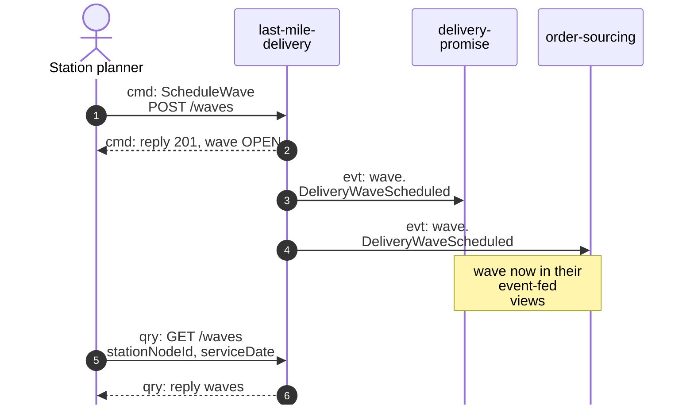
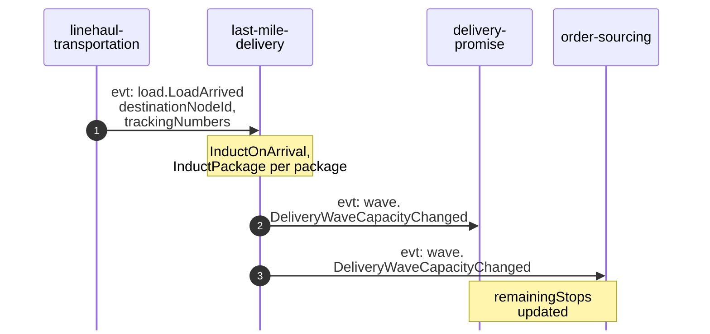
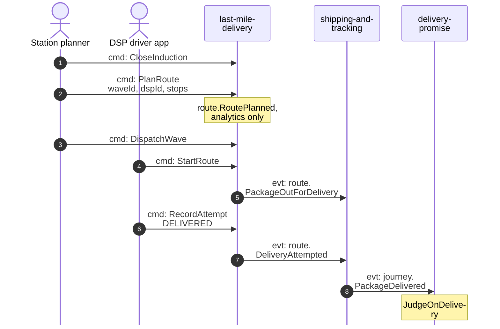
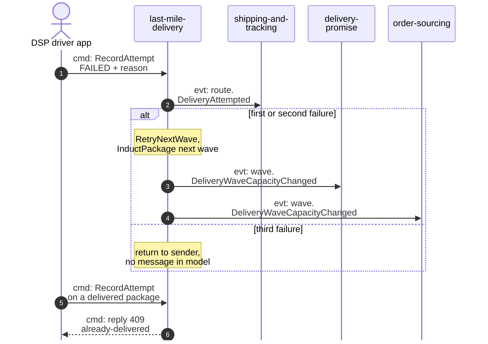

# Domain Message Flow

:::info[As built]
Derived from [`network/model/model.yaml`](https://github.com/IQVO/warehouse-docs/blob/main/network/model/model.yaml). This context's service is built; the model carries its as-built contracts, and identifiers (`Err...` names, routes, CloudEvents types) are the names the service uses.
:::

Following ddd-crew [Domain Message Flow Modelling](https://github.com/ddd-crew/domain-message-flow-modelling).
Four scenarios. Participants are contexts and actors. Every arrow is a
message from the model, prefixed `cmd:` (command), `qry:` (query) or `evt:`
(event). Events travel on Kafka through the producer's outbox; the diagrams
draw them from producer to consumer and leave Kafka out. Event names are
written `<entity>.<EventName>`; the full types are on
[Domain Events](/network/contexts/last-mile-delivery/domain-events). REST path
parameters are written without braces. The network-wide flows are on
[Domain Message Flows](/network/strategic-design/domain-message-flows).

Scenarios 2 and 3 are the happy path, from arrival to the doorstep, split in
two diagrams to stay readable. Scenario 4 is the most important failure path.

## 1. A wave is scheduled and becomes promisable

Derived from: model.yaml → `contexts[last-mile-delivery].rest`,
`.publishes[DeliveryWaveScheduled]`;
`contexts[delivery-promise].read_models[DeliveryWaveView]`;
`contexts[order-sourcing].read_models[NetworkGraphView]`.

Omitted: the `ErrInvalidWaveTimes` reply (422) and how `delivery-promise`
quotes on the wave (see [promise model](/network/network-model/promise-model)).

## 2. A load arrives and its packages are inducted

Derived from: model.yaml → `contexts[last-mile-delivery].policies[InductOnArrival]`,
`.consumes`, `.publishes[DeliveryWaveCapacityChanged]`;
`contexts[linehaul-transportation].publishes[LoadArrived]`.

Omitted: `InboundPackagesView`, and the earliest-wave search, which skips
waves that fail with `ErrWaveFull` or `ErrInductionClosed`.

## 3. The wave is dispatched and the package is delivered

Derived from: model.yaml → `contexts[last-mile-delivery].inbound`, `.rest`,
`.publishes`; `contexts[shipping-and-tracking].publishes[PackageDelivered]`;
`contexts[delivery-promise].policies[JudgeOnDelivery]`.

Omitted: the routes behind each command (`POST /waves/waveId:close-induction`,
`POST /routes`, `POST /waves/waveId:dispatch`, `POST /routes/routeId:start`,
`POST /routes/routeId/attempts`); `PackageOutForDelivery` is sent once per
package; `ErrRouteOverCapacity` on `PlanRoute`; `CompleteRoute` and
`CompleteWave` (no trigger in the model); the other consumers of
`PackageDelivered`.

## 4. Failed attempt, next wave, return to sender

Derived from: model.yaml → `contexts[last-mile-delivery].policies[RetryNextWave]`,
`.aggregates[Route].invariants`, `.publishes[DeliveryAttempted]`;
`contexts[shipping-and-tracking].aggregates[PackageJourney].transitions`
(`OUT_FOR_DELIVERY` back to `AT_STATION`).

Omitted: a full or closed next wave (`ErrWaveFull`, `ErrInductionClosed`:
the policy tries the wave after); `ExceptionOnSilence` in
`shipping-and-tracking` and `RepromiseOnRisk` in `delivery-promise`. The
third-failure branch is a gap in the model. The rule exists
(`RetryNextWave`), but no command, event or state of this context carries
the return to sender, and `shipping-and-tracking` has no inbound row for it.
See the open questions on the
[Bounded Context Canvas](/network/contexts/last-mile-delivery/bounded-context-canvas).
