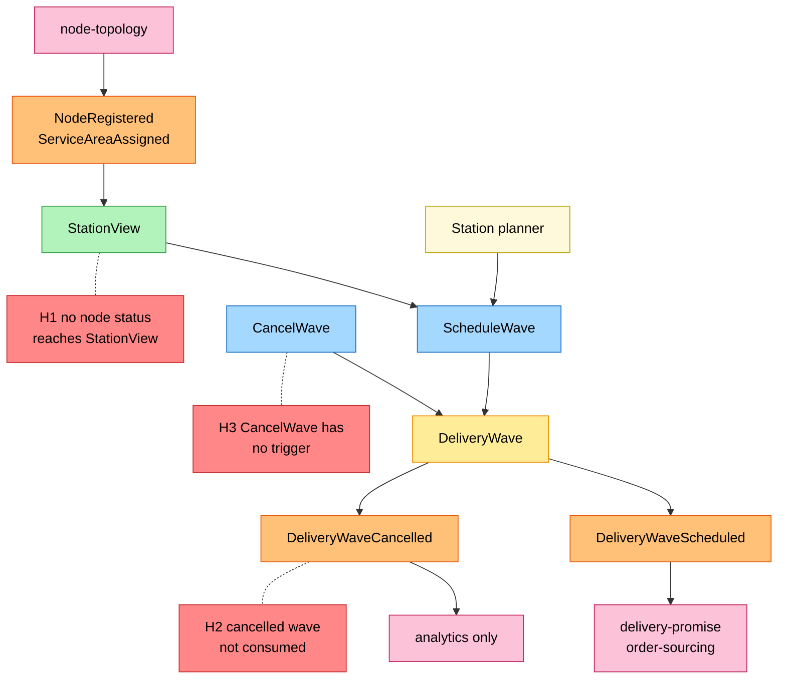
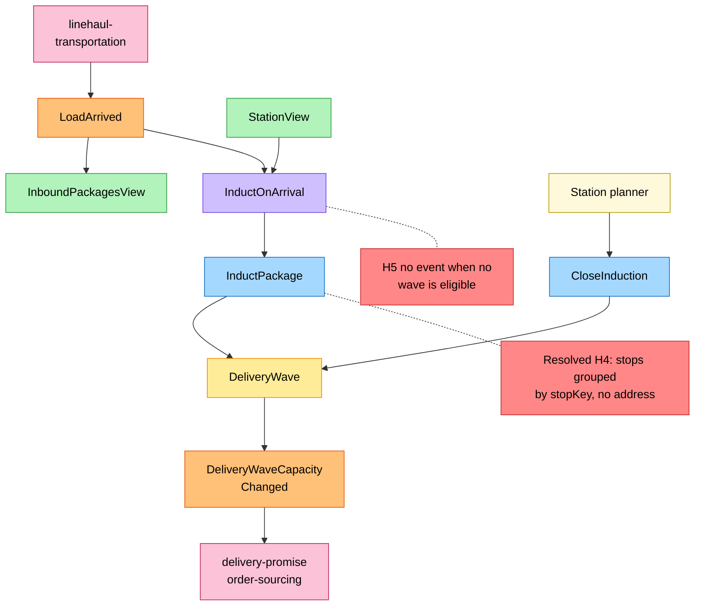
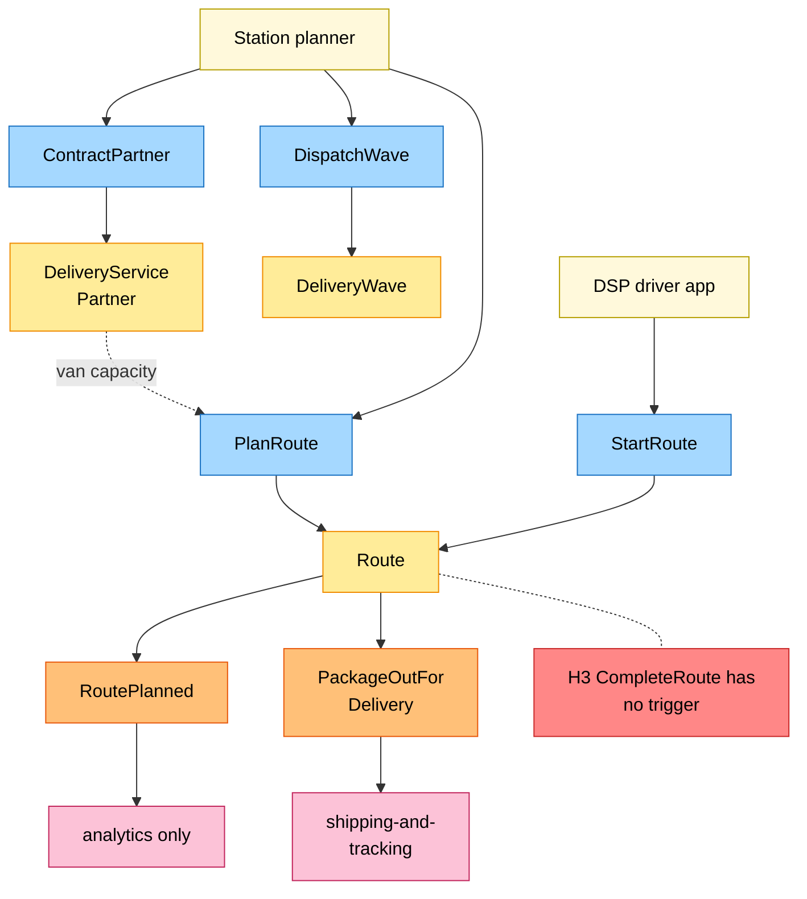
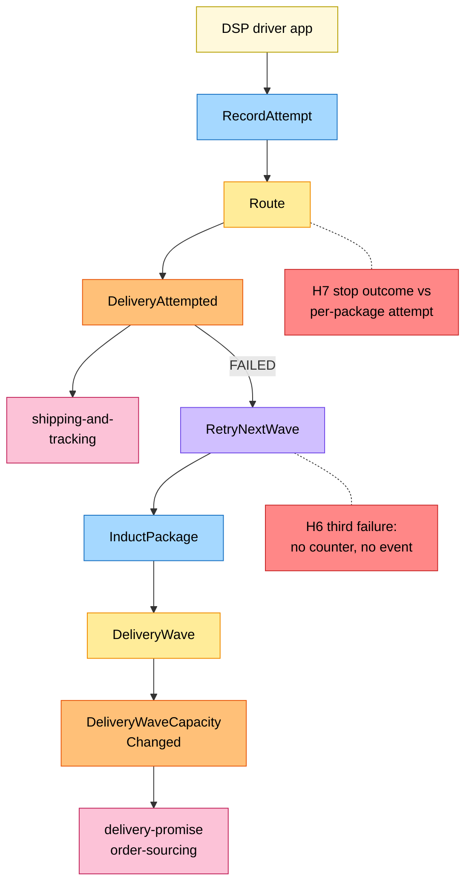

# EventStorming

:::info[Proposed design]
Derived from [`model/model.yaml`](https://github.com/IQVO/retail-network-docs/blob/main/model/model.yaml). Nothing in this context is built yet; identifiers (`Err...` names, routes, CloudEvents types) are the names an implementation must use.
:::

Process-level EventStorming in the ddd-crew
[EventStorming glossary & cheat sheet](https://github.com/ddd-crew/eventstorming-glossary-cheat-sheet)
notation. Every sticky is a command, aggregate, event, policy or read model of
the model. Every hotspot is a gap or risk that can be read in the model
itself; the source of each is in the hotspot table. The network-wide board is
[EventStorming big picture](/network/strategic-design/eventstorming-big-picture).

## Legend

| Sticky | Colour | Meaning here |
| --- | --- | --- |
| Actor | pale yellow `#fff9db` | Station planner, DSP driver app |
| Command | blue `#a5d8ff` | a command of an aggregate (`commands`) |
| Aggregate | yellow `#ffec99` | `DeliveryWave`, `Route`, `DeliveryServicePartner` |
| Domain Event | orange `#ffc078` | an event this context publishes or consumes |
| Policy | lilac `#d0bfff` | `InductOnArrival`, `RetryNextWave` |
| Read Model | green `#b2f2bb` | `StationView`, `InboundPackagesView` |
| External System | pink `#fcc2d7` | a sibling context |
| Hotspot | red `#ff8787` | an open question or risk from the model |

## 1. Scheduling waves and keeping station data

Derived from: model.yaml → `contexts[last-mile-delivery].aggregates[DeliveryWave]`,
`.read_models[StationView]`, `.publishes`, `.consumes`;
`contexts[delivery-promise].read_models[DeliveryWaveView]`.

Omitted: the list-waves query; the outbox between aggregate and event.

## 2. Induction on arrival

Derived from: model.yaml → `contexts[last-mile-delivery].policies[InductOnArrival]`,
`.read_models`, `.aggregates[DeliveryWave].invariants`,
`.publishes[DeliveryWaveCapacityChanged]`;
`contexts[linehaul-transportation].publishes[LoadArrived]`.

Omitted: the invariants `ErrWaveFull` and `ErrInductionClosed`, which make
the policy try the next wave.

## 3. Routes and dispatch

Derived from: model.yaml → `contexts[last-mile-delivery].aggregates[Route]`,
`.aggregates[DeliveryServicePartner]`, `.aggregates[DeliveryWave].transitions`,
`.publishes[RoutePlanned, PackageOutForDelivery]`.

Omitted: `ErrRouteOverCapacity` (the van-capacity check on `PlanRoute`) and
`CompleteWave`.

## 4. Attempts and retries

Derived from: model.yaml → `contexts[last-mile-delivery].policies[RetryNextWave]`,
`.aggregates[Route].entities`, `.aggregates[Route].invariants`,
`.publishes[DeliveryAttempted]`.

Omitted: `ErrRouteNotStarted` and `ErrAlreadyDelivered`, and
`shipping-and-tracking`'s journey transitions.

## Hotspots

| # | Hotspot | Where it comes from in the model |
| --- | --- | --- |
| H1 | A suspended or retired station can still get waves. | `read_models[StationView].source` lists only `NodeRegistered`, `ServiceAreaAssigned`; `node-topology` does not list this context as a consumer of `NodeSuspended` or `NodeRetired`. `DeliveryWave.invariants` has no station check. |
| H2 | A cancelled wave may stay in the promise's view. | `publishes[DeliveryWaveCancelled].consumers` is `analytics only`; `delivery-promise.read_models[DeliveryWaveView]` reads only `DeliveryWaveScheduled`, `DeliveryWaveCapacityChanged`; `RepromiseOnRisk` names cancelled departures, not waves. |
| H3 | `CancelWave`, `CompleteWave` and `CompleteRoute` have no trigger. | They are in `aggregates[*].commands` and `transitions` but have no `rest` route, `inbound` row or policy. |
| H4 | Resolved (G11): capacity is in stops, induction is per package, and stops are grouped by the opaque `stopKey` of `LabelIssued`, never by an address. | `StopCapacity{stops, assigned}`, `Stop{stopNo, trackingNumbers[], outcome}`, `read_models[PackageStopView]`, `policies[GroupByStopKey]`; the address stays in `customer-ordering` and `shipping-and-tracking` ([ADR 0006](/network/adr/0006-pii-confinement)) and no address route exists (`policies[NoAddressAtLastMile]`). |
| H5 | When no wave is eligible, nobody hears about it. | `InductOnArrival` has no failure outcome and no event; only `shipping-and-tracking`'s `ExceptionOnSilence` would surface it later. |
| H6 | "Three failures return it to sender" has no home. | `RetryNextWave.rule`; no aggregate holds a failure count across routes; no event or command carries the return to sender; `shipping-and-tracking`'s `ReturnToSender` has no inbound trigger from this context. |
| H7 | A stop has one `outcome`, an attempt is per package. | `Route.entities` `Stop{..., outcome}` against `DeliveryAttempted.data` (`trackingNumber`, `outcome`). |
