# Sequence Diagrams

:::info[As built]
Derived from [`network/model/model.yaml`](https://github.com/IQVO/warehouse-docs/blob/main/network/model/model.yaml). This context's service is built; the model carries its as-built contracts, and identifiers (`Err...` names, routes, CloudEvents types) are the names the service uses.
:::

One UML sequence diagram per command use case on
[Use Cases](/network/contexts/last-mile-delivery/use-cases). The participants are the
proposed hexagonal pieces:

| Participant | Piece |
| --- | --- |
| `http` / `kafka consumer` | inbound adapter: `internal/adapters/inbound/http` or `internal/adapters/inbound/kafka` |
| use case (named after the command) | `internal/application/usecases` |
| aggregate (`DeliveryWave`, `Route`, `DeliveryServicePartner`) | `internal/domain/{wave,route,partner}` |
| `WaveRepo`, `RouteRepo`, `PartnerRepo` | repository ports, implemented in `internal/adapters/outbound/postgres` |
| `outbox` | the `outbox_events` table, written in the same transaction as the repository |
| `relay to Kafka` | the outbox relay in `internal/adapters/outbound/kafka`, publishing to topic `retailnetwork.last-mile-delivery.events`; drawn as one participant to keep each diagram at six participants |

Every save checks the row `version` it loaded (optimistic concurrency). A
mismatch rolls the transaction back and returns 409 `stale-version`, or, in
a consumer, retries. Every REST command first looks up its
`Idempotency-Key` in `idempotency_keys`. Event names are broken over two
lines inside the diagrams to keep them narrow. REST path parameters are
written without braces.

## 1. ScheduleWave

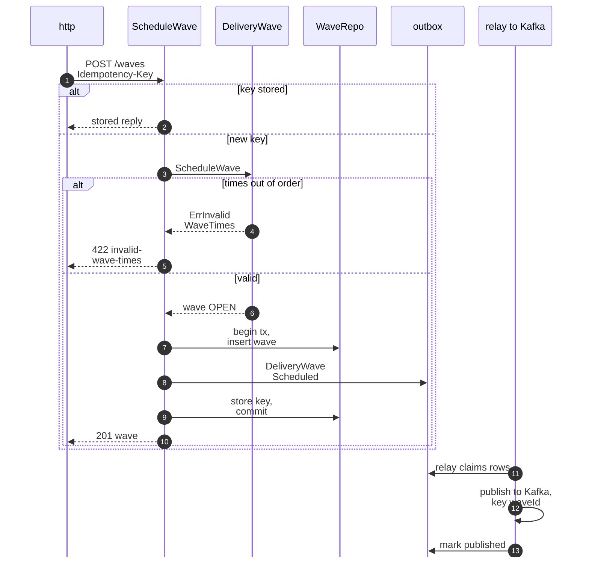

Derived from: model.yaml → `contexts[last-mile-delivery].aggregates[DeliveryWave]`,
`.rest`, `.publishes[DeliveryWaveScheduled]`, `conventions.integration_rules`.

Omitted: a station check against `StationView`, which the model does not
require.

## 2. InductPackage (InductOnArrival)

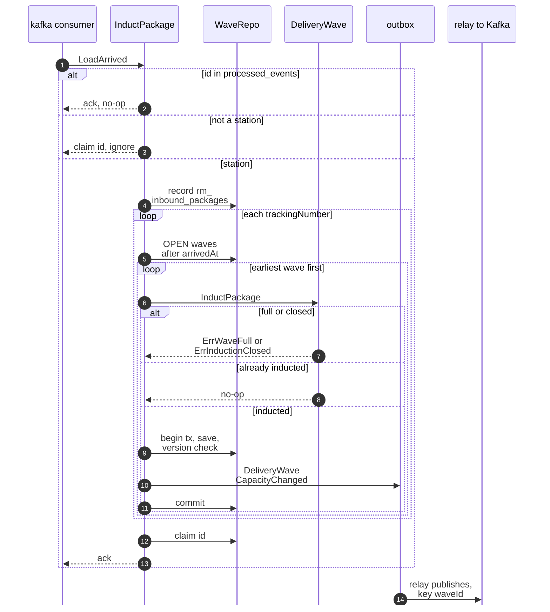

Derived from: model.yaml → `contexts[last-mile-delivery].policies[InductOnArrival]`,
`.aggregates[DeliveryWave].invariants`, `.read_models[InboundPackagesView]`,
`.publishes[DeliveryWaveCapacityChanged]`.

Each induction is its own transaction and is a no-op for a package already
in `wave_inductions`, so a crash part way through a load resumes without
double counting; the CloudEvents `id` is claimed after the last package. On
a version conflict the package is retried. A full or closed wave sends the
loop to the next wave. Omitted: a package that no wave accepts stays only in
`rm_inbound_packages`; the model has no event for it. The `RetryNextWave`
path runs the same loop, triggered by a `FAILED` attempt (diagram 9).

## 3. CloseInduction

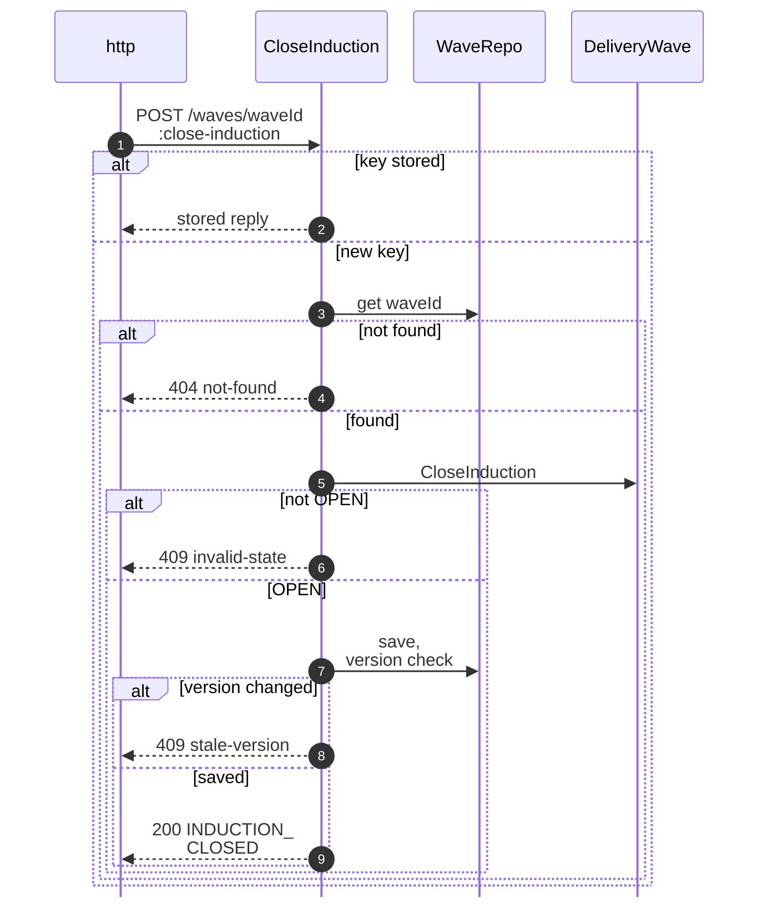

Derived from: model.yaml → `contexts[last-mile-delivery].aggregates[DeliveryWave].transitions`,
`.rest`. No event: the model has none for this transition, so there is no
outbox write and nothing for the relay.

## 4. DispatchWave

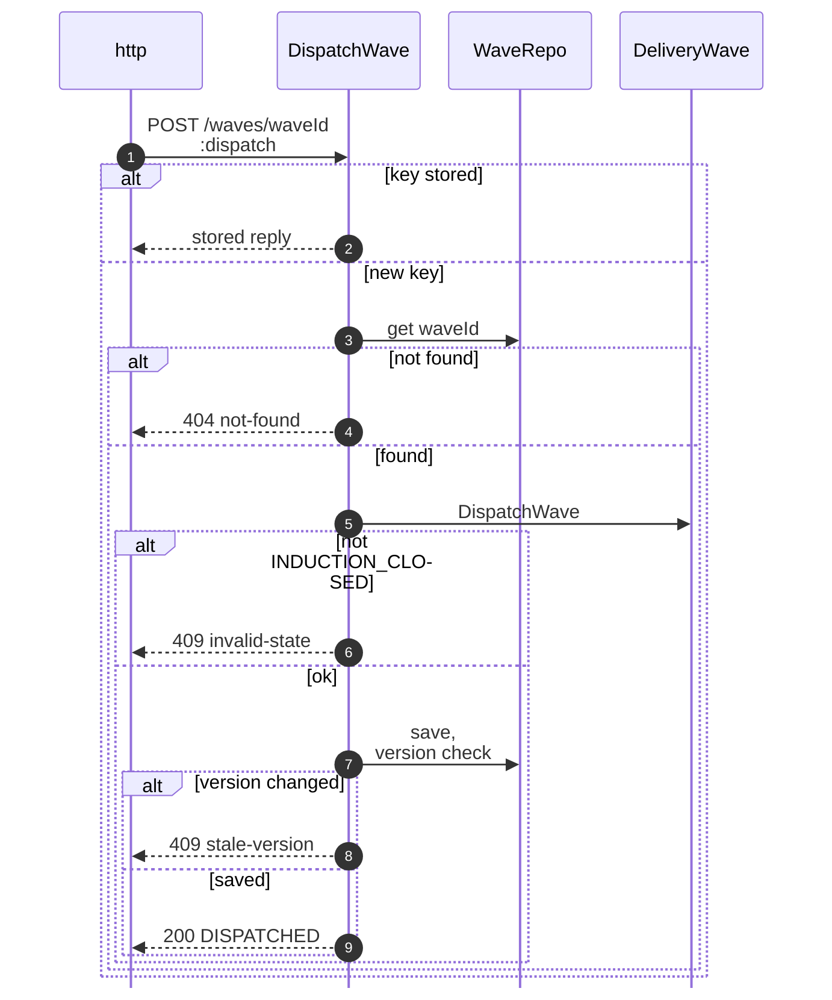

Derived from: model.yaml → `contexts[last-mile-delivery].aggregates[DeliveryWave].transitions`,
`.rest`. No event, so no outbox write.

## 5. CompleteWave

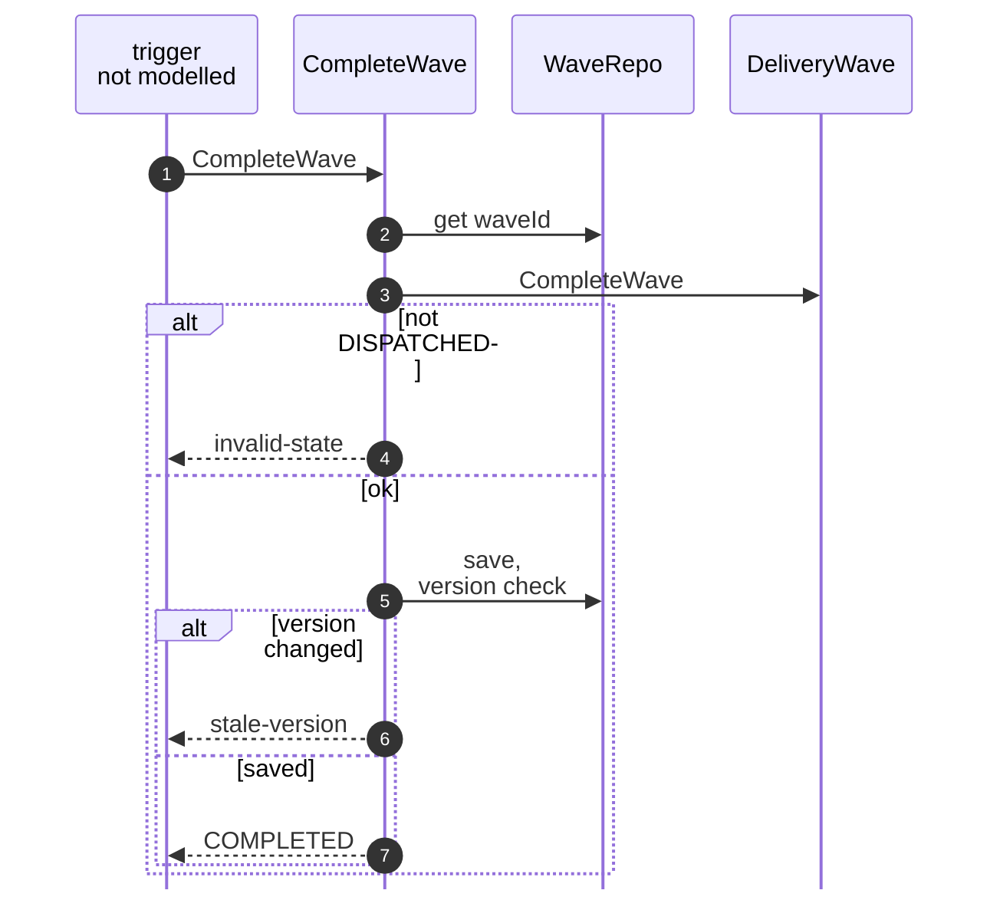

Derived from: model.yaml → `contexts[last-mile-delivery].aggregates[DeliveryWave].transitions`
(`DISPATCHED` → `COMPLETED`). The model gives no route, policy or event.

## 6. CancelWave

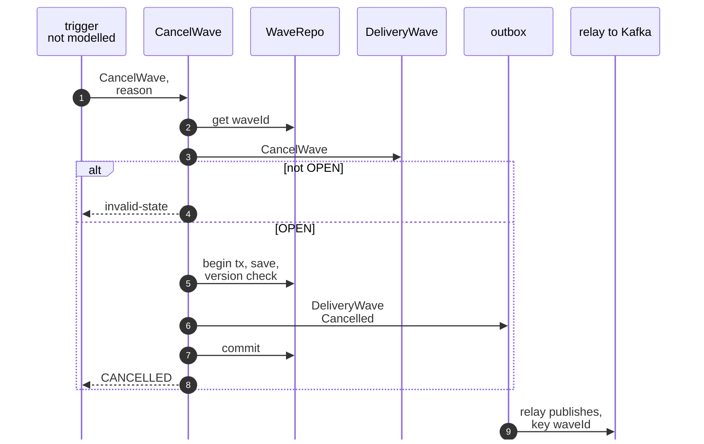

Derived from: model.yaml → `contexts[last-mile-delivery].aggregates[DeliveryWave].transitions`,
`.publishes[DeliveryWaveCancelled]`.

Omitted: what happens to packages already inducted; the model does not say.

## 7. PlanRoute

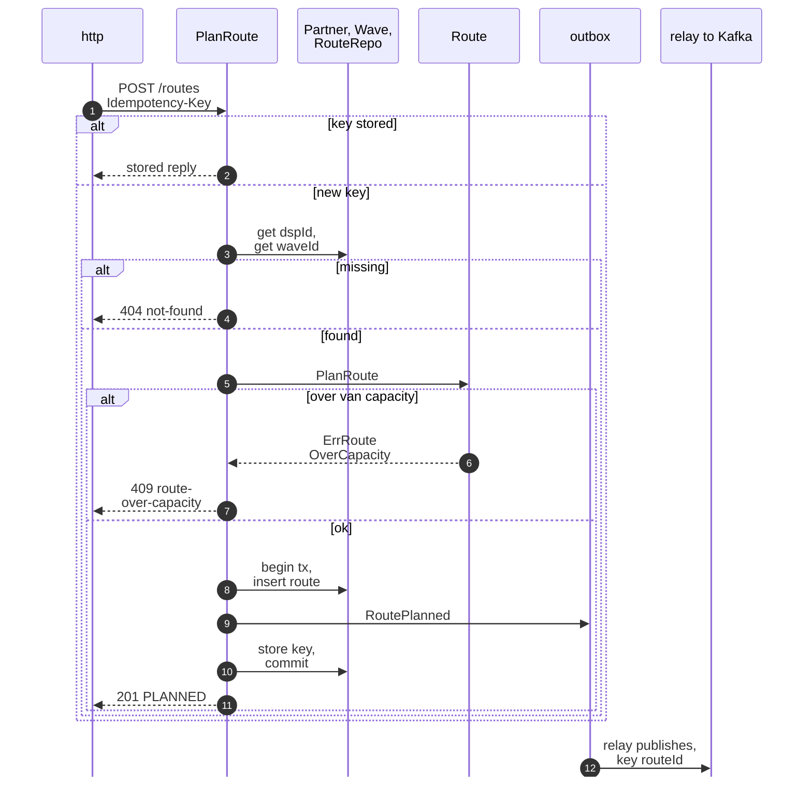

Derived from: model.yaml → `contexts[last-mile-delivery].aggregates[Route]`,
`.aggregates[DeliveryServicePartner].invariants`, `.publishes[RoutePlanned]`.

The partner and the wave are read, not changed, and are not part of the
transaction.

## 8. StartRoute

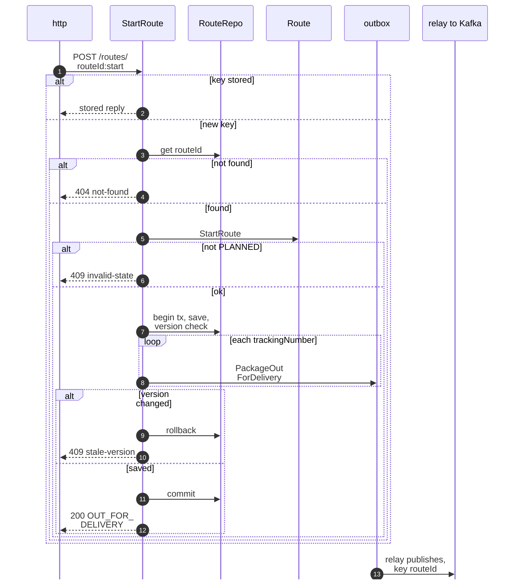

Derived from: model.yaml → `contexts[last-mile-delivery].aggregates[Route].transitions`,
`.publishes[PackageOutForDelivery]`.

## 9. RecordAttempt

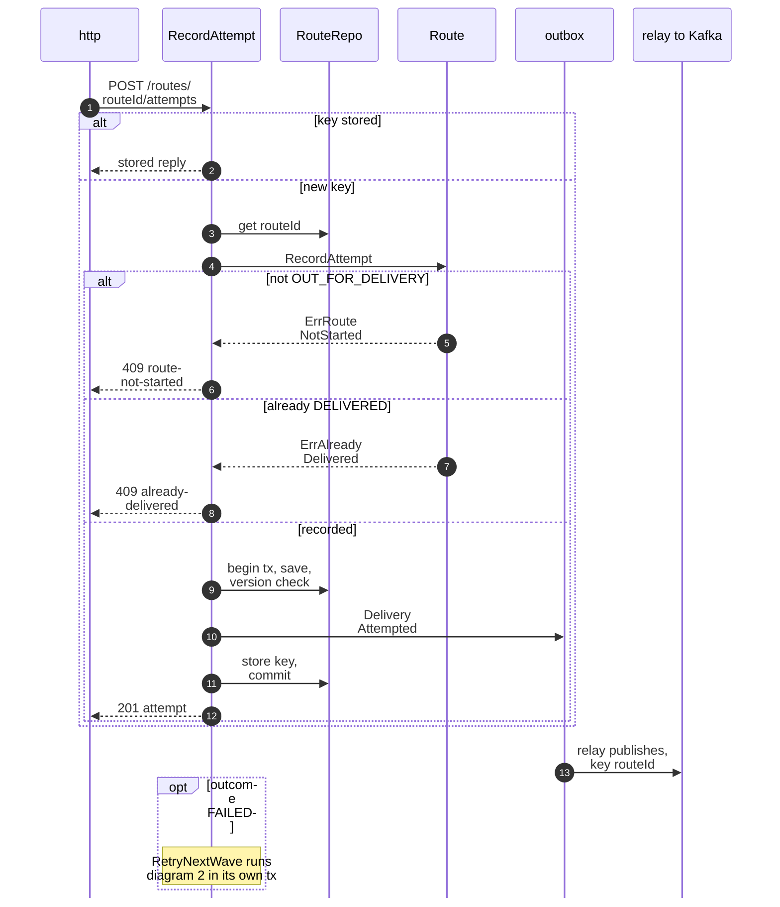

Derived from: model.yaml → `contexts[last-mile-delivery].aggregates[Route].invariants`,
`.policies[RetryNextWave]`, `.publishes[DeliveryAttempted]`.

Omitted: 404 for an unknown route or a tracking number not on the route,
and the `stale-version` branch (as in diagram 8). The third failure (return
to sender) has no step because the model has no message for it.

## 10. CompleteRoute

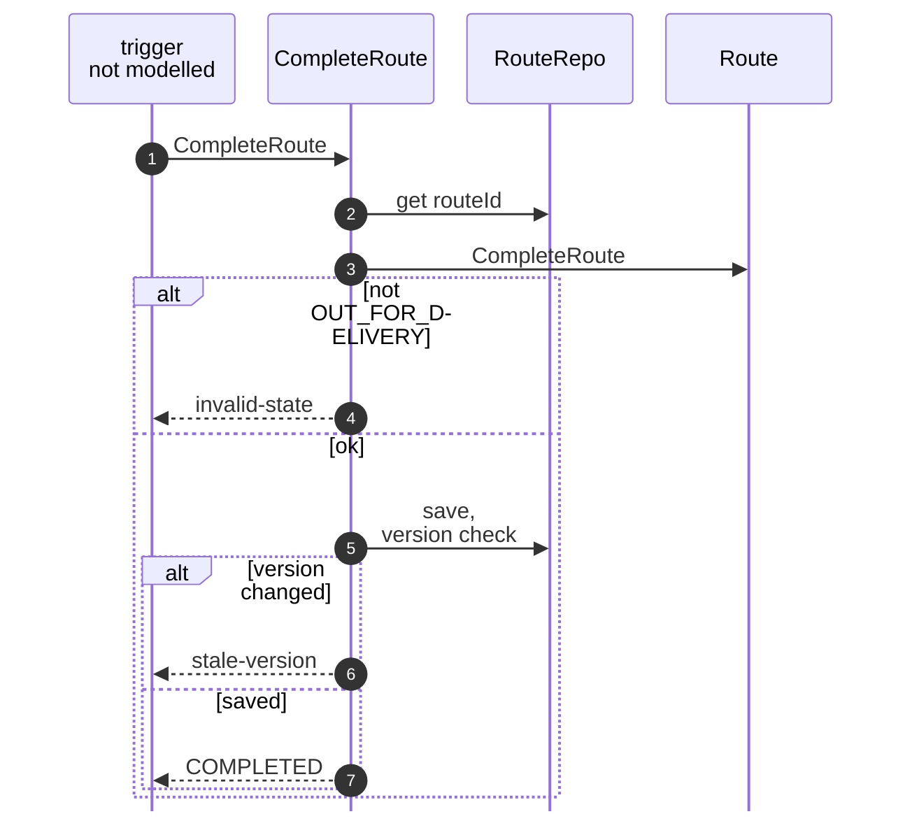

Derived from: model.yaml → `contexts[last-mile-delivery].aggregates[Route].transitions`.
The model gives no route, policy or event.

## 11. ContractPartner

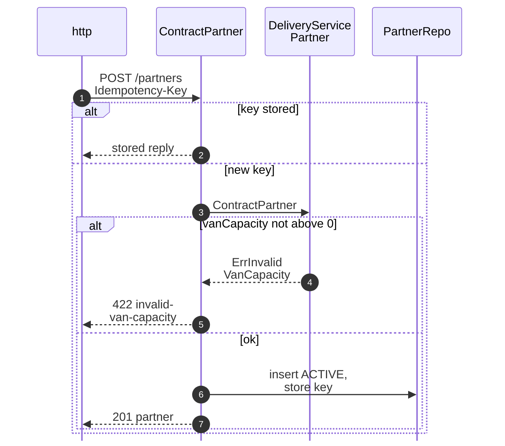

Derived from: model.yaml → `contexts[last-mile-delivery].aggregates[DeliveryServicePartner]`,
`.rest`. No event (`events: []`), so there is no outbox write.
