# Sequence Diagrams

:::info[As built]
Derived from [`network/model/model.yaml`](https://github.com/IQVO/warehouse-docs/blob/main/network/model/model.yaml). This context's service is built; the model carries its as-built contracts, and identifiers (`Err...` names, routes, CloudEvents types) are the names the service uses.
:::

One UML sequence diagram per command use case on
[Use Cases](/network/contexts/last-mile-delivery/use-cases). The participants are the
proposed hexagonal pieces:

| Participant | Piece |
| --- | --- |
| `http` / `kafka consumer` | inbound adapter: `internal/adapters/inbound/http` or `internal/adapters/inbound/kafka` |
| use case (named after the command) | `internal/application/usecases` |
| aggregate (`DeliveryWave`, `Route`, `DeliveryServicePartner`) | `internal/domain/{wave,route,partner}` |
| `WaveRepo`, `RouteRepo`, `PartnerRepo` | repository ports, implemented in `internal/adapters/outbound/postgres` |
| `outbox` | the `outbox_events` table, written in the same transaction as the repository |
| `relay to Kafka` | the outbox relay in `internal/adapters/outbound/kafka`, publishing to topic `retailnetwork.last-mile-delivery.events`; drawn as one participant to keep each diagram at six participants |

Every save checks the row `version` it loaded (optimistic concurrency). A
mismatch rolls the transaction back and returns 409 `concurrent-update`, or, in
a consumer, retries. Every REST `POST` first looks up its `Idempotency-Key`
in `idempotency_keys`: the key is global, a 2xx and a 4xx answer are stored,
and the same key with another request is 409 `idempotency-key-reused`
(last-mile-delivery ADR 0010; the use-cases page has the details). Event names are broken over two
lines inside the diagrams to keep them narrow. REST path parameters are
written without braces.

## 1. ScheduleWave

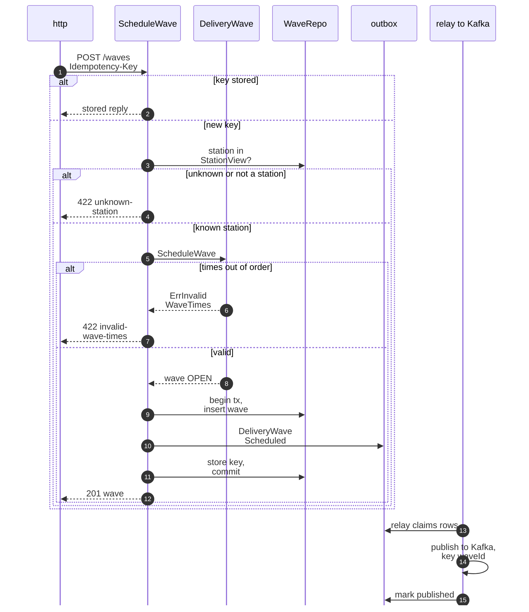

Derived from: model.yaml → `contexts[last-mile-delivery].aggregates[DeliveryWave]`,
`.rest`, `.publishes[DeliveryWaveScheduled]`, `conventions.integration_rules`.

The station check against `StationView` is a precondition of the use case
(ADR 0002 A1), not an invariant of the aggregate. After the commit the
packages waiting at the station are inducted into the new wave (A19).

## 2. InductPackage (InductOnArrival)

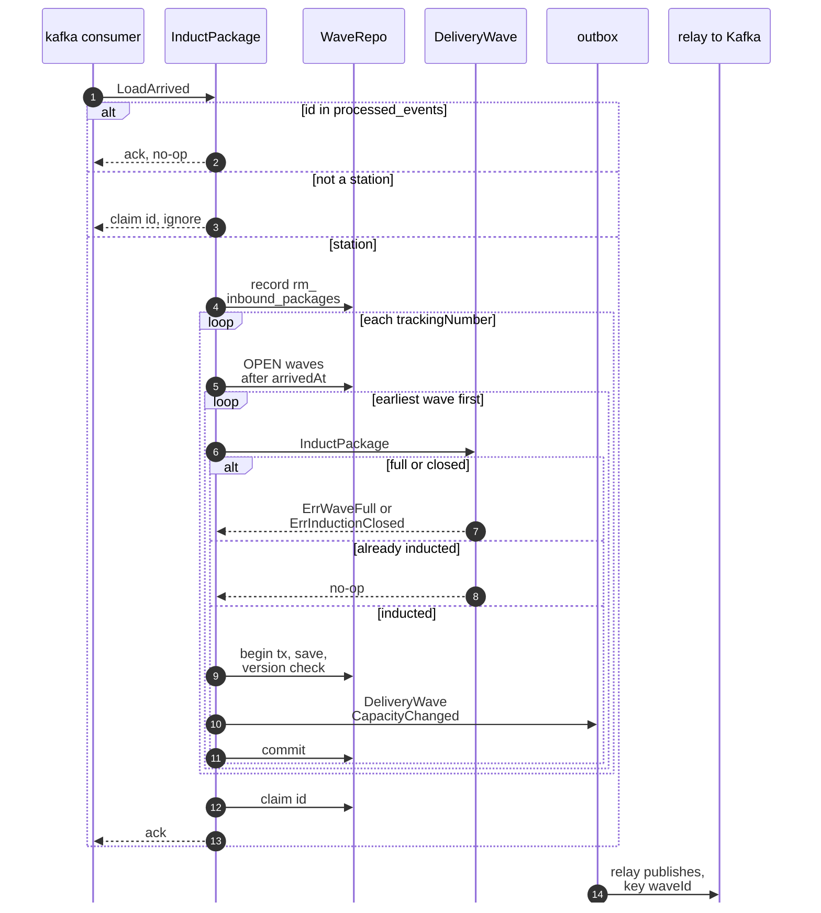

Derived from: model.yaml → `contexts[last-mile-delivery].policies[InductOnArrival]`,
`.aggregates[DeliveryWave].invariants`, `.read_models[InboundPackagesView]`,
`.publishes[DeliveryWaveCapacityChanged]`.

Each induction is its own transaction and is a no-op for a package already
in `wave_inductions`, so a crash part way through a load resumes without
double counting; the CloudEvents `id` is claimed after the last package. On
a version conflict the package is retried. A full or closed wave sends the
loop to the next wave. Omitted: a package that no wave accepts stays only in
`rm_inbound_packages`; the model has no event for it. The `RetryNextWave`
path runs the same loop, triggered by a `FAILED` attempt (diagram 9).

## 3. CloseInduction

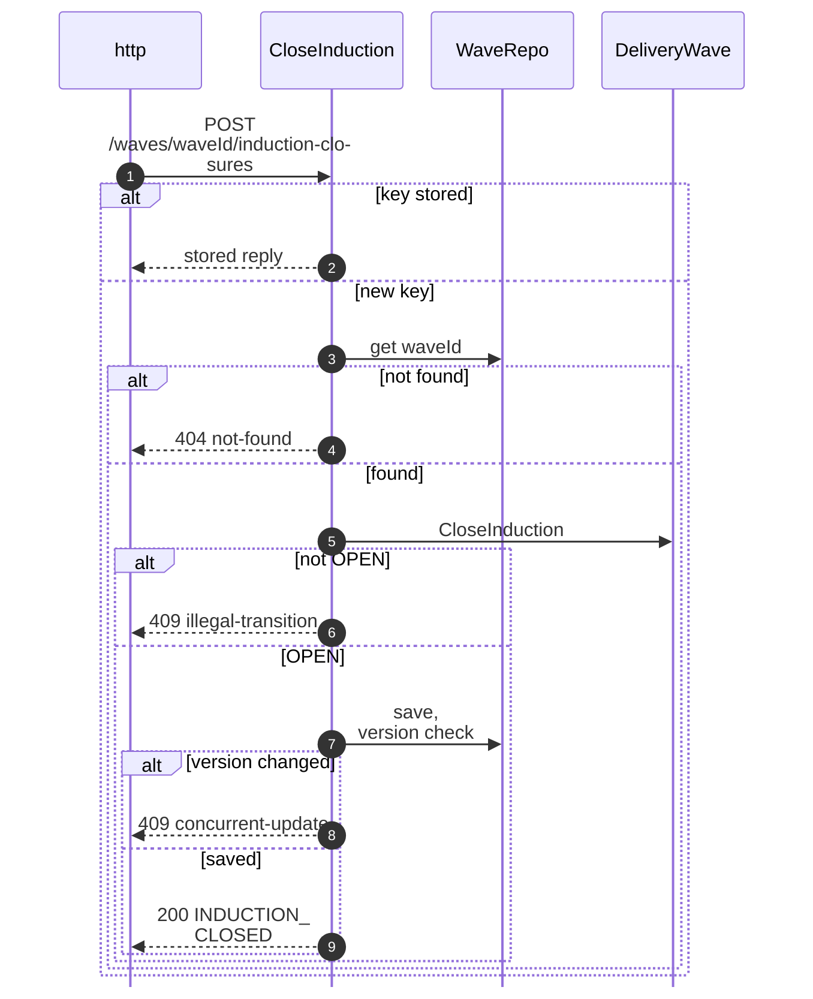

Derived from: model.yaml → `contexts[last-mile-delivery].aggregates[DeliveryWave].transitions`,
`.rest`. No event: the model has none for this transition, so there is no
outbox write and nothing for the relay.

## 4. DispatchWave

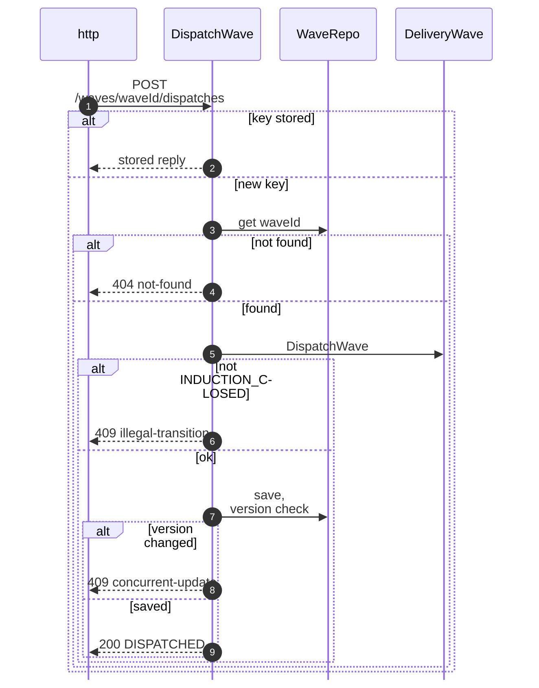

Derived from: model.yaml → `contexts[last-mile-delivery].aggregates[DeliveryWave].transitions`,
`.rest`. No event, so no outbox write.

## 5. CompleteWave

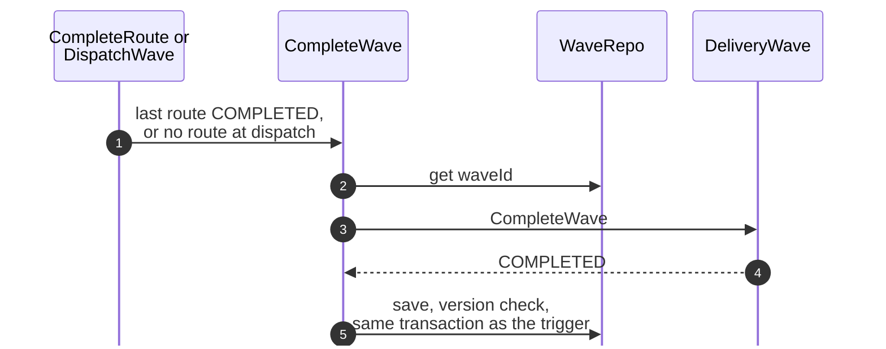

Derived from: ADR 0002 A9 and `contexts[last-mile-delivery].aggregates[DeliveryWave].transitions`
(`DISPATCHED` → `COMPLETED`). There is no REST route and no caller: the wave
completes in the transaction in which its last route completes, or at once
when it is dispatched with no route (the dispatch response may then show
`COMPLETED`). No event.

## 6. CancelWave

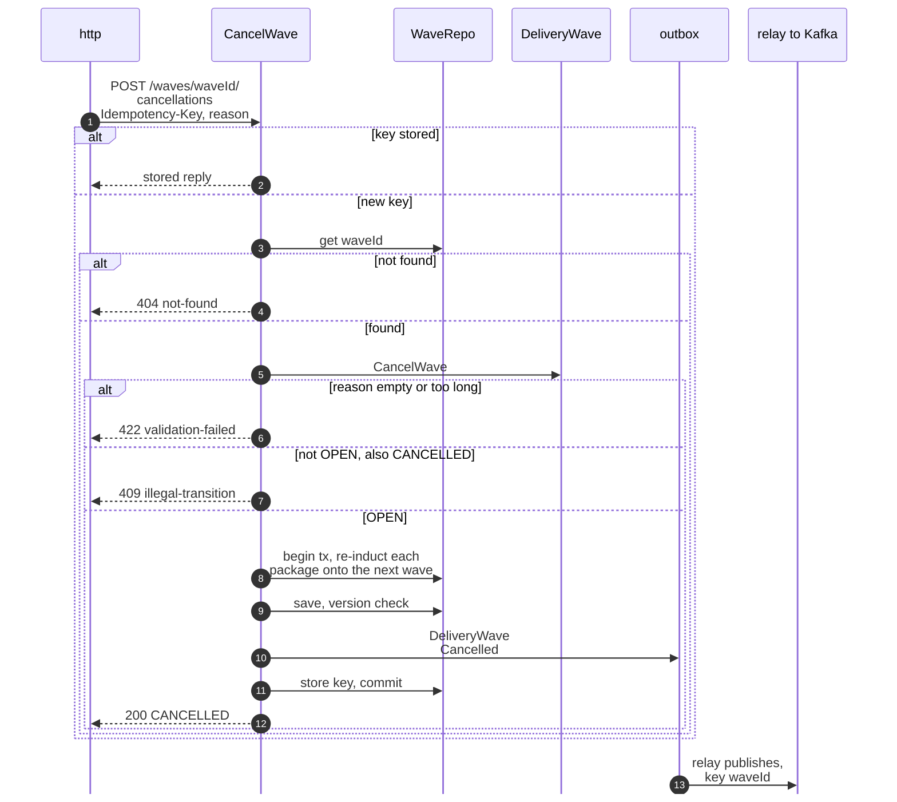

Derived from: ADR 0002 A10, A22, `contexts[last-mile-delivery].aggregates[DeliveryWave].transitions`,
`.publishes[DeliveryWaveCancelled]`.

A package with no eligible wave is unplaced and raises
`PackageInductionDeferred`. A second cancel of a `CANCELLED` wave is 409
`illegal-transition`: the wave stays `CANCELLED` and no second
`DeliveryWaveCancelled` is raised. A version conflict is 409
`concurrent-update` (omitted from the diagram).

## 7. PlanRoute

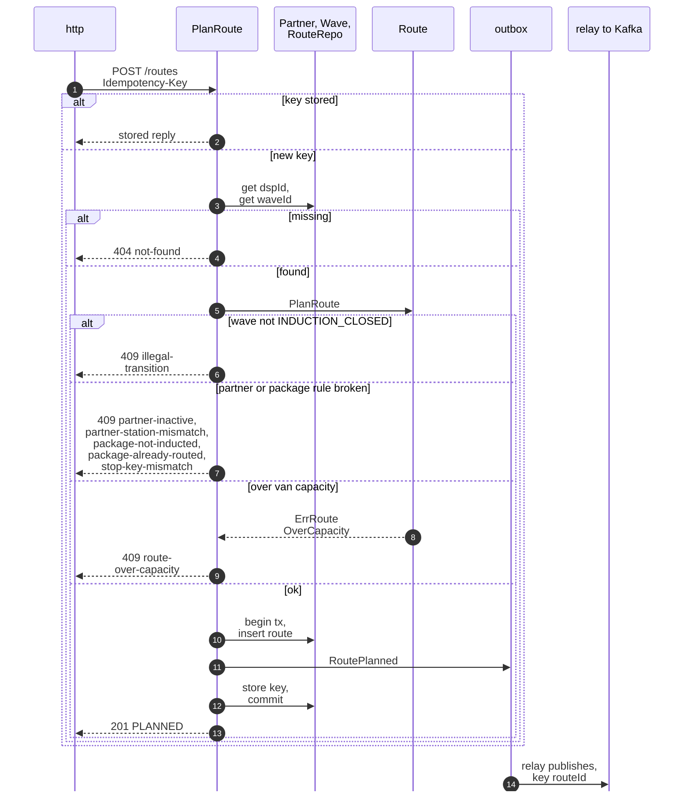

Derived from: model.yaml → `contexts[last-mile-delivery].aggregates[Route]`,
`.aggregates[DeliveryServicePartner].invariants`, `.publishes[RoutePlanned]`.

The partner and the wave are read, not changed, and are not part of the
transaction. The preconditions are those of ADR 0002 A12.

## 8. StartRoute

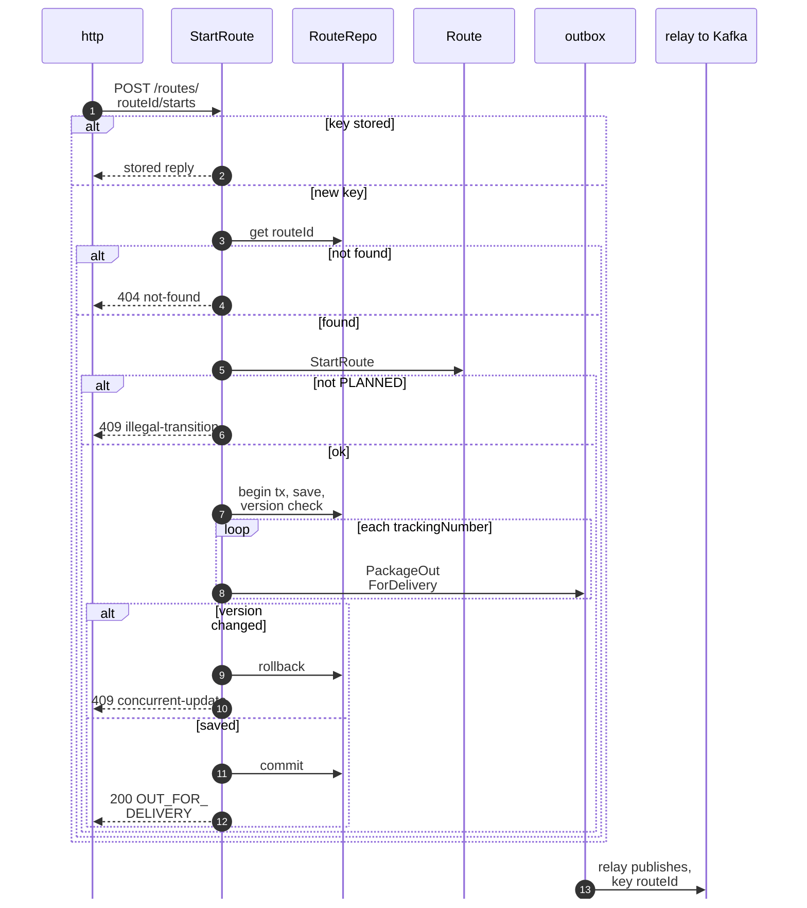

Derived from: model.yaml → `contexts[last-mile-delivery].aggregates[Route].transitions`,
`.publishes[PackageOutForDelivery]`. The route's wave must be `DISPATCHED`
(ADR 0002 A14), else 409 `illegal-transition`.

## 9. RecordAttempt

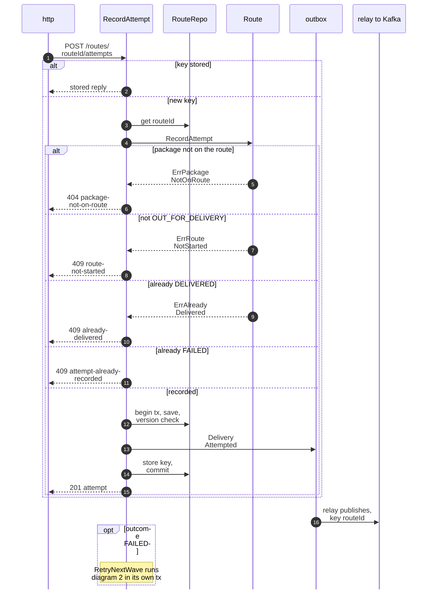

Derived from: model.yaml → `contexts[last-mile-delivery].aggregates[Route].invariants`,
`.policies[RetryNextWave]`, `.publishes[DeliveryAttempted]`.

Omitted: 404 `not-found` for an unknown route and the `concurrent-update`
branch (as in diagram 8). When the attempt is the last outstanding package the
route completes in the same unit of work (diagram 10). The third failure
raises `PackageReturnInitiated` and the package is not re-inducted (ADR 0002
A18).

## 10. CompleteRoute

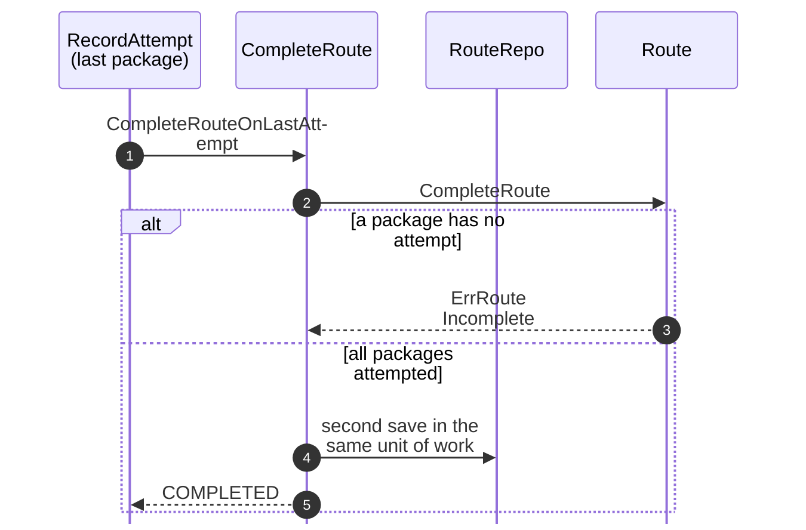

Derived from: ADR 0002 A16 and `contexts[last-mile-delivery].aggregates[Route].transitions`.
There is no REST route and no caller: the route completes right after the
attempt that records its last outstanding package (policy
`CompleteRouteOnLastAttempt`), and the wave completes when its last route does
(diagram 5). The domain refuses it with `ErrRouteIncomplete` (409
`route-incomplete`) while a package has no attempt. No event.

## 11. ContractPartner

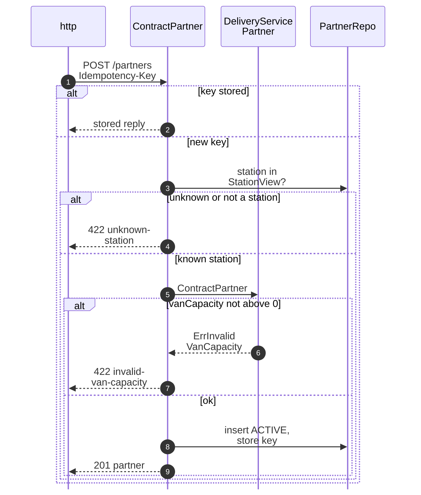

Derived from: model.yaml → `contexts[last-mile-delivery].aggregates[DeliveryServicePartner]`,
`.rest`. No event (`events: []`), so there is no outbox write.
