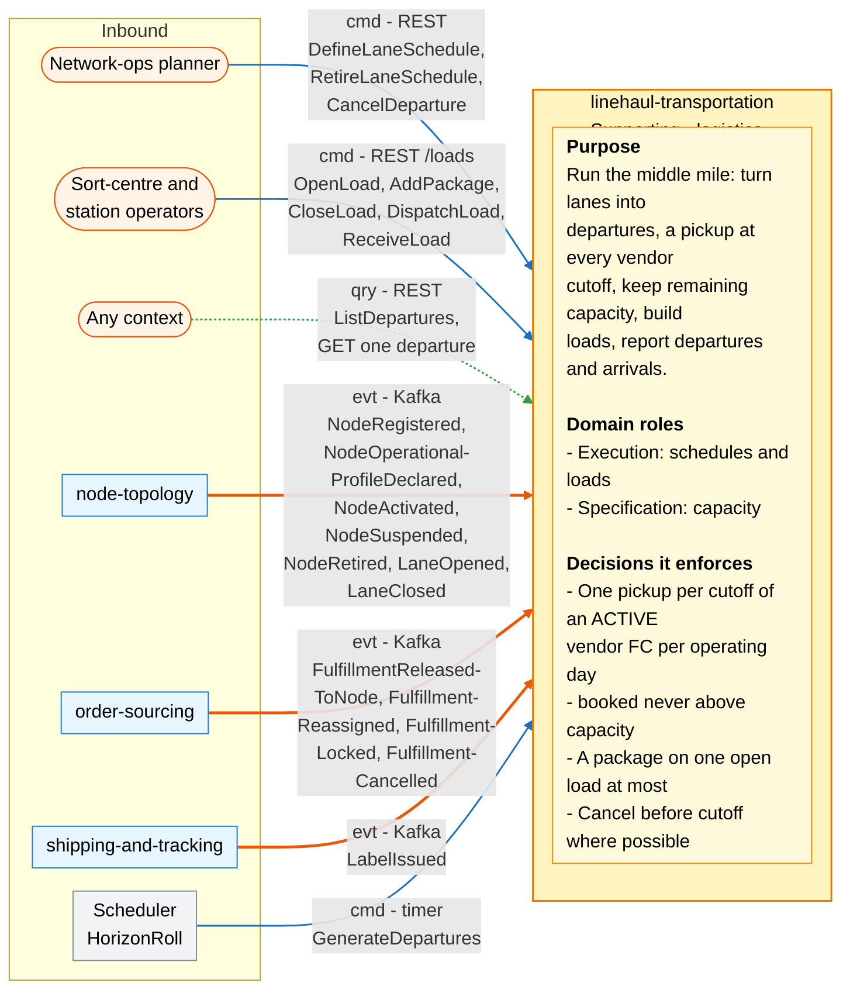
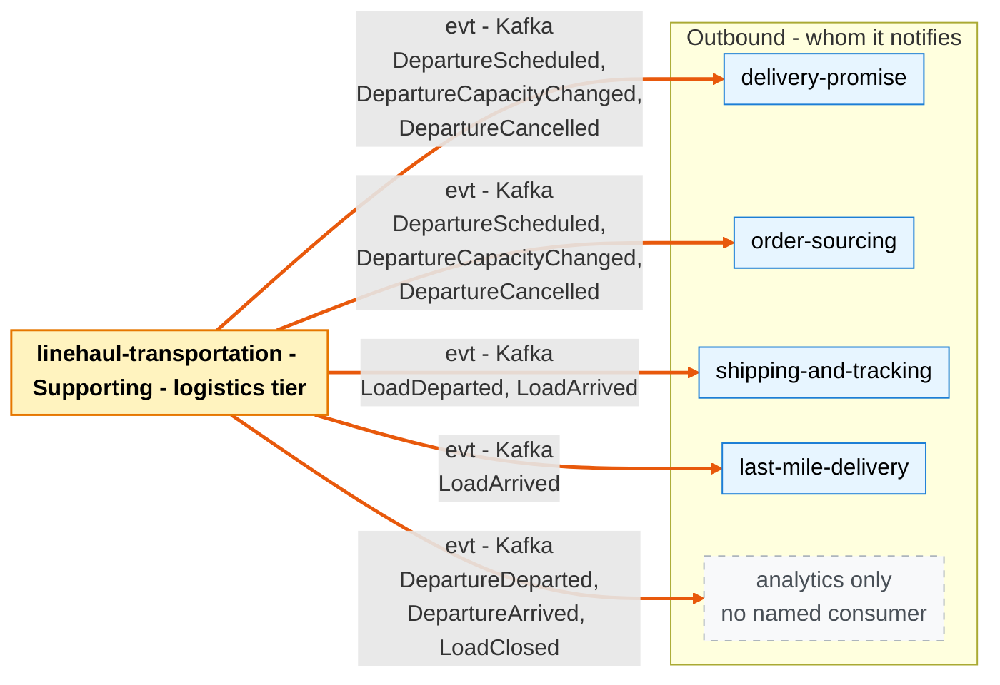

# Bounded Context Canvas

:::info[Proposed design]
Derived from [`model/model.yaml`](https://github.com/IQVO/retail-network-docs/blob/main/model/model.yaml). Nothing in this context is built yet; identifiers (`Err...` names, routes, CloudEvents types) are the names an implementation must use.
:::

Following the ddd-crew [Bounded Context Canvas v5](https://github.com/ddd-crew/bounded-context-canvas).
Every message row comes from `contexts[linehaul-transportation]` →
`inbound`, `rest`, `publishes`, `consumes` and `sync_calls` (empty).

## Canvas at a glance

Two pictures of the sections below: first the collaborators that command,
query or feed this context (with its purpose, roles and the decisions it
enforces), then the collaborators it notifies. Arrows follow the message
type: **solid blue** commands (`cmd`), **dotted green** queries (`qry`),
**thick orange** events (`evt`). Box shapes mark the collaborator kind:
rounded = people or any client; blue = sibling bounded context; grey = this
context's own scheduler; dashed = published with no named consumer
(analytics only). Channel names are abbreviated; the tables carry the exact
route, topic and CloudEvents type.

### Inbound

### Outbound

Derived from: `model.yaml → contexts[linehaul-transportation].inbound`,
`.rest`, `.publishes`, `.consumes`, `.policies[HorizonRoll]`,
`.business_decisions`, `.roles`.

Omitted: assumptions, metrics, open questions and the glossary (sections
below); the relationship pattern per message (see the tables); full
CloudEvents types and routes (see the tables). There are no outbound
commands or queries: `sync_calls` is empty, so this context calls no other
context synchronously.

## Name

**Linehaul Transportation** (`linehaul-transportation`, code `LH`,
CloudEvents tier `logistics`).

## Purpose

Run the middle mile. Turn lanes into scheduled departures, including a
pickup departure at every vendor node cutoff; keep each departure's
remaining capacity; build loads of packages onto departures; report when
loads depart and arrive. Promises (`delivery-promise`) and assignments
(`order-sourcing`) are only as good as these departures, and the last mile
(`last-mile-delivery`) starts when a load arrives.

## Strategic Classification

| Axis | Verdict |
| --- | --- |
| **Domain** | **Supporting** (see [Core Domain Chart](/network/contexts/linehaul-transportation/core-domain-chart)). |
| **Business Model** | Cost reducer (cost-to-serve) and speed enabler. |
| **Evolution** | Custom-built. |

## Domain Roles

| Role | Evidence in the model |
| --- | --- |
| **Execution** (schedules and loads) | Generates departures from lane schedules and vendor cutoffs (`GenerateDepartures`, `PickupFromCutoffs`, `HorizonRoll`); runs the load lifecycle (`OpenLoad` … `ReceiveLoad`). |
| **Specification** (capacity) | Publishes each departure's capacity and remaining room (`DepartureScheduled`, `DepartureCapacityChanged`); `delivery-promise` and `order-sourcing` plan against it. |

## Inbound Communication

| Collaborator | Message | Type | Channel | Relationship |
| --- | --- | --- | --- | --- |
| Network-ops planner | `DefineLaneSchedule` | Command | REST `POST /lane-schedules` | UI |
| Network-ops planner | `RetireLaneSchedule` | Command | REST `POST /lane-schedules/{laneId}:retire` (route in `rest`; the `inbound` row does not name this message, see Open Questions) | UI |
| Network-ops planner | `CancelDeparture` | Command | REST `POST /departures/{departureId}:cancel` | UI |
| Sort-centre and station operators | `OpenLoad` | Command | REST `POST /loads` | UI |
| Sort-centre and station operators | `AddPackage` | Command | REST `POST /loads/{loadId}/packages` | UI |
| Sort-centre and station operators | `CloseLoad` | Command | REST `POST /loads/{loadId}:close` | UI |
| Sort-centre and station operators | `DispatchLoad` | Command | REST `POST /loads/{loadId}:dispatch` | UI |
| Sort-centre and station operators | `ReceiveLoad` | Command | REST `POST /loads/{loadId}:receive` | UI |
| Any context | `ListDepartures` | Query | REST `GET /departures?origin=&destination=&from=&to=` | OHS |
| Any context | Get one departure (no message name in the model) | Query | REST `GET /departures/{departureId}` | OHS |
| Scheduler (internal) | `GenerateDepartures` | Command | nightly timer (policy `HorizonRoll`) | Internal |
| `node-topology` | `NodeRegistered` | Event | Kafka `retailnetwork.node-topology.events`, `com.retailnetwork.logistics.node-topology.node.NodeRegistered` | Conformist |
| `node-topology` | `NodeOperationalProfileDeclared` | Event | Kafka `retailnetwork.node-topology.events`, `com.retailnetwork.logistics.node-topology.node.NodeOperationalProfileDeclared` | Conformist |
| `node-topology` | `NodeActivated` | Event | Kafka `retailnetwork.node-topology.events`, `com.retailnetwork.logistics.node-topology.node.NodeActivated` | Conformist |
| `node-topology` | `NodeSuspended` | Event | Kafka `retailnetwork.node-topology.events`, `com.retailnetwork.logistics.node-topology.node.NodeSuspended` | Conformist |
| `node-topology` | `NodeRetired` | Event | Kafka `retailnetwork.node-topology.events`, `com.retailnetwork.logistics.node-topology.node.NodeRetired` | Conformist |
| `node-topology` | `LaneOpened` | Event | Kafka `retailnetwork.node-topology.events`, `com.retailnetwork.logistics.node-topology.lane.LaneOpened` | Conformist |
| `node-topology` | `LaneClosed` | Event | Kafka `retailnetwork.node-topology.events`, `com.retailnetwork.logistics.node-topology.lane.LaneClosed` | Conformist |
| `order-sourcing` | `FulfillmentReleasedToNode` | Event | Kafka `retailnetwork.order-sourcing.events`, `com.retailnetwork.commerce.order-sourcing.assignment.FulfillmentReleasedToNode` | Customer/Supplier |
| `order-sourcing` | `FulfillmentReassigned` | Event | Kafka `retailnetwork.order-sourcing.events`, `com.retailnetwork.commerce.order-sourcing.assignment.FulfillmentReassigned` | Customer/Supplier |
| `order-sourcing` | `FulfillmentLocked` | Event | Kafka `retailnetwork.order-sourcing.events`, `com.retailnetwork.commerce.order-sourcing.assignment.FulfillmentLocked` | Customer/Supplier |
| `order-sourcing` | `FulfillmentCancelled` | Event | Kafka `retailnetwork.order-sourcing.events`, `com.retailnetwork.commerce.order-sourcing.assignment.FulfillmentCancelled` | Customer/Supplier |
| `shipping-and-tracking` | `LabelIssued` | Event | Kafka `retailnetwork.shipping-and-tracking.events`, `com.retailnetwork.logistics.shipping-and-tracking.label.LabelIssued` | Conformist |

## Outbound Communication

| Collaborator | Message | Type | Channel | Relationship |
| --- | --- | --- | --- | --- |
| `delivery-promise`, `order-sourcing` | `DepartureScheduled` | Event | Kafka `retailnetwork.linehaul-transportation.events`, `com.retailnetwork.logistics.linehaul-transportation.departure.DepartureScheduled` | OHS + PL (they are Conformist) |
| `delivery-promise`, `order-sourcing` | `DepartureCapacityChanged` | Event | Kafka `retailnetwork.linehaul-transportation.events`, `com.retailnetwork.logistics.linehaul-transportation.departure.DepartureCapacityChanged` | OHS + PL (they are Conformist) |
| `delivery-promise`, `order-sourcing` | `DepartureCancelled` | Event | Kafka `retailnetwork.linehaul-transportation.events`, `com.retailnetwork.logistics.linehaul-transportation.departure.DepartureCancelled` | OHS + PL (they are Conformist) |
| analytics only | `DepartureDeparted` | Event | Kafka `retailnetwork.linehaul-transportation.events`, `com.retailnetwork.logistics.linehaul-transportation.departure.DepartureDeparted` | PL, no in-org consumer |
| analytics only | `DepartureArrived` | Event | Kafka `retailnetwork.linehaul-transportation.events`, `com.retailnetwork.logistics.linehaul-transportation.departure.DepartureArrived` | PL, no in-org consumer |
| analytics only | `LoadClosed` | Event | Kafka `retailnetwork.linehaul-transportation.events`, `com.retailnetwork.logistics.linehaul-transportation.load.LoadClosed` | PL, no in-org consumer |
| `shipping-and-tracking` | `LoadDeparted` | Event | Kafka `retailnetwork.linehaul-transportation.events`, `com.retailnetwork.logistics.linehaul-transportation.load.LoadDeparted` | OHS + PL (Conformist) |
| `shipping-and-tracking`, `last-mile-delivery` | `LoadArrived` | Event | Kafka `retailnetwork.linehaul-transportation.events`, `com.retailnetwork.logistics.linehaul-transportation.load.LoadArrived` | `shipping-and-tracking` Conformist; `last-mile-delivery` Customer/Supplier |
| — | (no synchronous calls) | — | `sync_calls: []` | — |

Full message details: [Domain Events](/network/contexts/linehaul-transportation/domain-events).
Relationship evidence: [Context Map](/network/contexts/linehaul-transportation/context-map).

## Ubiquitous Language

Full glossary: [Ubiquitous Language](/network/contexts/linehaul-transportation/ubiquitous-language).
Top terms: **Middle Mile**, **Departure** (kinds `PICKUP`, `LINEHAUL`,
`AIR`), **Pickup Departure**, **Capacity** (`packages`, `booked`),
**Load**, **Lane Schedule**.

## Business Decisions

1. **One pickup per cutoff per operating day.** Every declared cutoff of an
   `ACTIVE` vendor fulfillment node gets one `PICKUP` departure per operating
   day (policy `PickupFromCutoffs`; future pickups are cancelled on
   `NodeSuspended` or `NodeRetired`).
2. **`booked <= capacity`.** `BookCapacity` refuses with `ErrDepartureFull`.
3. **No booking after `cutoffAt`** (`ErrDepartureClosed`).
4. **Departures are scheduled only on an `OPEN` lane** (`ErrLaneClosed`),
   with `cutoffAt <= departsAt < arrivesAt` (`ErrInvalidDepartureTimes`).
5. **A package is on at most one open load** (`ErrPackageAlreadyLoaded`),
   and a load never carries more packages than its departure's capacity
   (`ErrLoadOverCapacity`).
6. **Book on lock.** One package is booked on the pickup departure when an
   assignment locks (`FulfillmentLocked`); it is released on
   `FulfillmentCancelled` or reassignment (policy `BookOnLock`).
7. **Announce cancellations early.** A cancelled departure is announced
   before its cutoff wherever possible, so `delivery-promise` can revise the
   promises on it.
8. **Keep a 14-day horizon** (policy `HorizonRoll`).

## Assumptions

- `node-topology` publishes every cutoff in `NodeOperationalProfileDeclared`
  with the node's time zone and operating hours, and activates a node only
  after its profile is complete (`ErrIncompleteOperationalProfile` on its
  side).
- A vendor fulfillment node has an `OPEN` lane to the node its pickups go to;
  otherwise no pickup can be scheduled (`ErrLaneClosed`).
- `order-sourcing` locks an assignment before the pickup cutoff (its
  `VirtualQueue` policy releases at cutoff minus handling time minus the ack
  budget), so `BookOnLock` normally lands before `cutoffAt`.
- Consumers rebuild their departure views from events only; there is no
  synchronous call into this context on the promise hot path.

## Verification Metrics

| Metric | Target | Source |
| --- | --- | --- |
| Share of declared cutoffs of `ACTIVE` vendor FCs with a `PICKUP` departure for each day of the horizon | 100% | `NodeProfileView` × `departures` |
| Departures with `booked > capacity` | 0 | `departures` table check |
| Share of `DepartureCancelled` whose `cancelledAt` is before the departure's `cutoffAt` | as high as possible; report weekly | `DepartureCancelled` vs `DepartureScheduled` |
| Lag from `NodeOperationalProfileDeclared` to the matching `DepartureScheduled` | p95 under one minute | event timestamps |
| Days of horizon covered after the nightly roll | 14 | `departures` per lane |
| `BookCapacity` refused with `ErrDepartureFull` or `ErrDepartureClosed` | trend to 0 | use-case error counter |
| `AddPackage` refused with `ErrPackageAlreadyLoaded` | trend to 0 | use-case error counter |
| Lag from `ReceiveLoad` to `LoadArrived` on the topic | p95 under 10 s | outbox relay |

## Open Questions

Each of these is a gap in `model.yaml` reported to the orchestrator, not
patched here.

- **Who triggers `CloseDeparture`, `RecordDeparture` and `RecordArrival`?**
  No inbound row, policy or route names an actor; the model lists the
  commands only.
- **How does capacity change?** `DepartureCapacityChanged` carries
  `capacityPackages`, but the only commands that touch capacity are
  `BookCapacity` and `ReleaseCapacity`, which change `booked`.
- **Pickup capacity and destination (resolved, G9).** The lane of a `PICKUP`
  departure is the node's open ground lane that ranks first by destination type
  (sort centre first), then lowest nominal transit, then lowest lane id (policy
  `DefaultOutboundLane`). Its package capacity is the orders the node can take
  in the window times this context's own `packagesPerOrder` setting (policy
  `PickupCapacity`). `node-topology` declares neither.
- **Pickups on activation.** `PickupFromCutoffs` fires on
  `NodeOperationalProfileDeclared`, but a profile is declared before the
  node is `ACTIVE`; `NodeActivated` is consumed with no stated reaction.
- **A full pickup at lock time.** `BookOnLock` runs after the vendor has
  accepted; the model names no follow-up when it hits `ErrDepartureFull`.
- **Unreachable release.** `order-sourcing` reassigns and cancels only
  before `LOCKED`, so the release branch of `BookOnLock` never finds a
  booking to release.
- **`RetireLaneSchedule` and `GET /departures/{departureId}`** have routes
  but no `inbound` message row.
