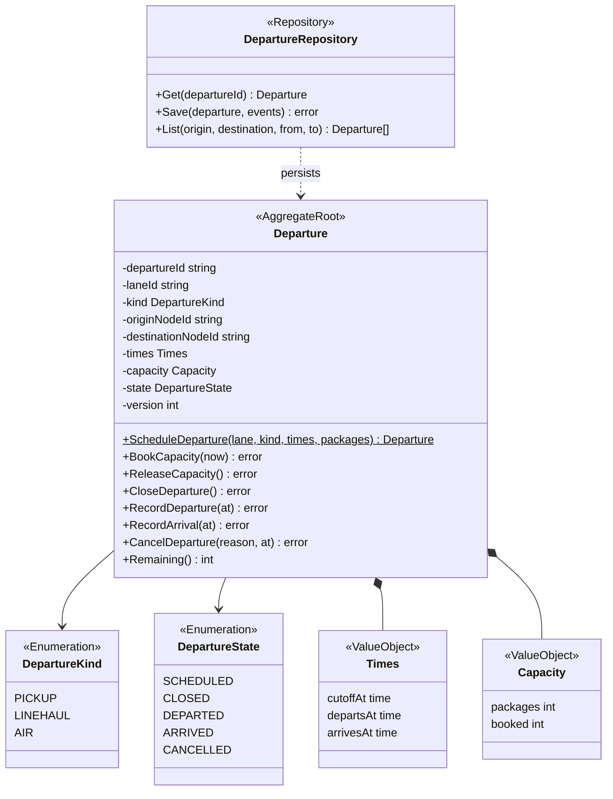
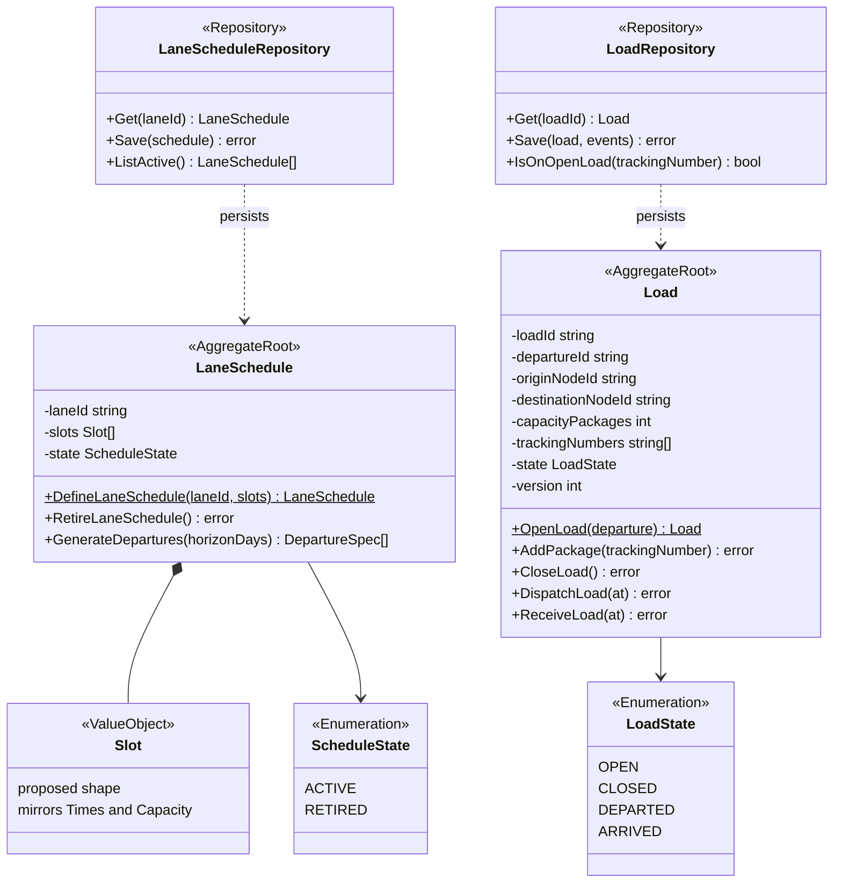
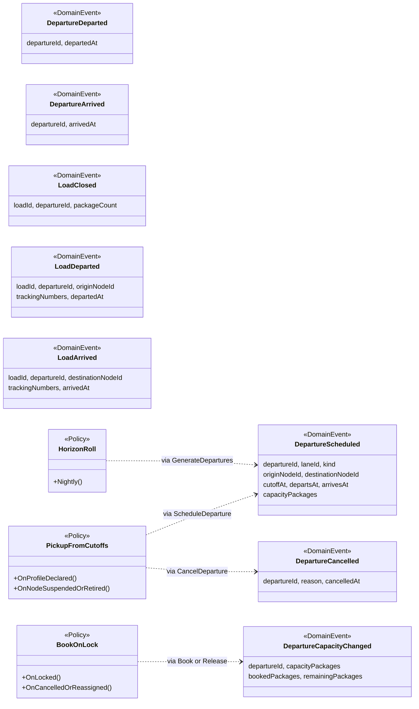
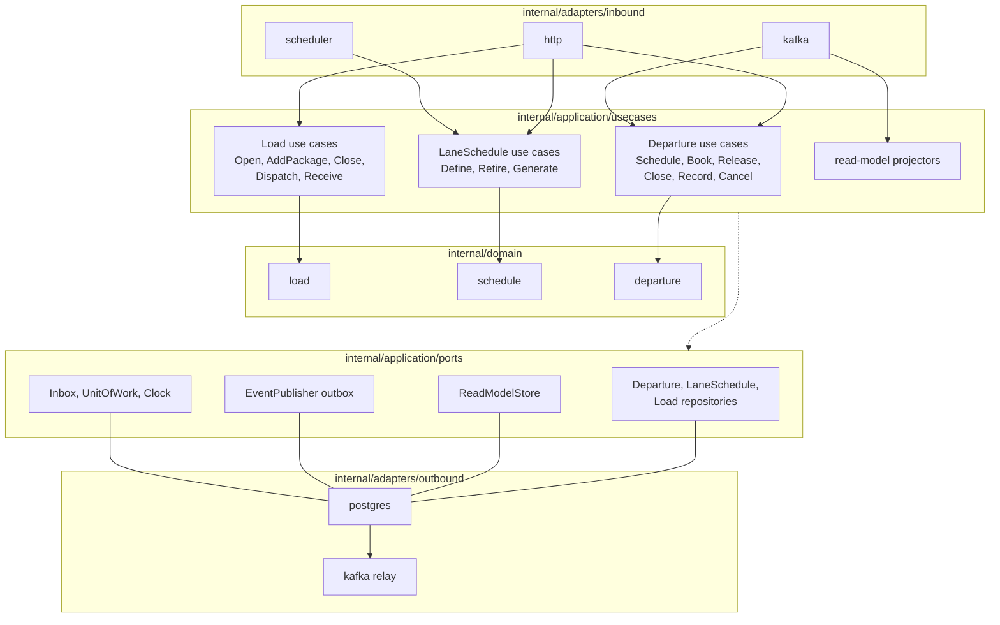

# Class Diagram

:::info[As built]
Derived from [`model/model.yaml`](https://github.com/IQVO/retail-network-docs/blob/main/model/model.yaml). This context's service is built; the model carries its as-built contracts, and identifiers (`Err...` names, routes, CloudEvents types) are the names the service uses.
:::

UML class diagrams of the **proposed** `internal/domain/**` packages
(`departure`, `schedule`, `load`), then the hexagonal ports and adapters in
the Go layout the fleet uses. Type and field names come from `model.yaml`;
method names are the model's commands. Fields are shown `-` (unexported),
methods `+`.

## 1. Departure aggregate

Derived from: `model.yaml → contexts[linehaul-transportation].aggregates[Departure]`
(`value_objects`, `states`, `commands`), `.publishes[DepartureScheduled].data`.

Omitted: the error variables (`ErrInvalidDepartureTimes`, `ErrDepartureFull`,
`ErrLaneClosed`, `ErrDepartureClosed`; see
[Aggregate Design Canvas](/network/contexts/linehaul-transportation/aggregate-design-canvas)),
read accessors, and `version` handling (proposed optimistic concurrency, not
in the model). `ScheduleDeparture` is drawn as a constructor; the
`ErrLaneClosed` check needs the lane status from `LaneView`, passed in by the
use case.

## 2. LaneSchedule and Load aggregates

Derived from: `model.yaml → contexts[linehaul-transportation].aggregates[LaneSchedule, Load]`,
`.publishes[LoadDeparted, LoadArrived].data`.

Omitted: `ErrOverlappingSlots`, `ErrPackageAlreadyLoaded`,
`ErrLoadOverCapacity`. The model lists no fields for `LaneSchedule` or its
slots; `Slot` is a proposed value object. `capacityPackages`,
`originNodeId` and `destinationNodeId` on `Load` are a snapshot copied from
the departure at `OpenLoad`, so that `ErrLoadOverCapacity` and the
`LoadDeparted` / `LoadArrived` payloads need no cross-aggregate read.
`IsOnOpenLoad` backs `ErrPackageAlreadyLoaded`, an invariant that spans
loads.

## 3. Events, policies and read models

Derived from: `model.yaml → contexts[linehaul-transportation].publishes`,
`.policies`.

Omitted: the CloudEvents envelope (see
[Domain Events](/network/contexts/linehaul-transportation/domain-events)); the
three read models `NodeProfileView`, `LaneView` and `ExpectedVolumeView`
(projections, shown in the ports view below). `DepartureDeparted`,
`DepartureArrived`, `LoadClosed`, `LoadDeparted` and `LoadArrived` are
raised directly by their commands, not by a policy.

## 4. Hexagonal ports and adapters

Derived from: `model.yaml → contexts[linehaul-transportation].inbound`,
`.consumes`, `.read_models`, `.policies`, `conventions.integration_rules`
(own database, transactional outbox, idempotent consumers).

All paths are under `internal/` (`internal/adapters/inbound/{http,kafka}`,
`internal/application/usecases`, `internal/domain`,
`internal/application/ports`, `internal/adapters/outbound/{postgres,kafka}`).
The dashed arrow means every use case calls ports only: the repository of
its aggregate, the event publisher (outbox), the inbox and the unit of
work. `http` drives the planner and operator commands, `kafka` drives the
policies (`PickupFromCutoffs`, `BookOnLock`) and the projectors, the
scheduler drives `GenerateDepartures`.

Omitted: the HTTP read path (`GET /departures`, `GET /departures/{departureId}`
read `DepartureRepository` directly); `Clock` has no adapter package. The
`scheduler` inbound adapter is proposed; the fleet's Go layout names only
`http` and `kafka`. There are no outbound HTTP clients: `sync_calls` is
empty.
