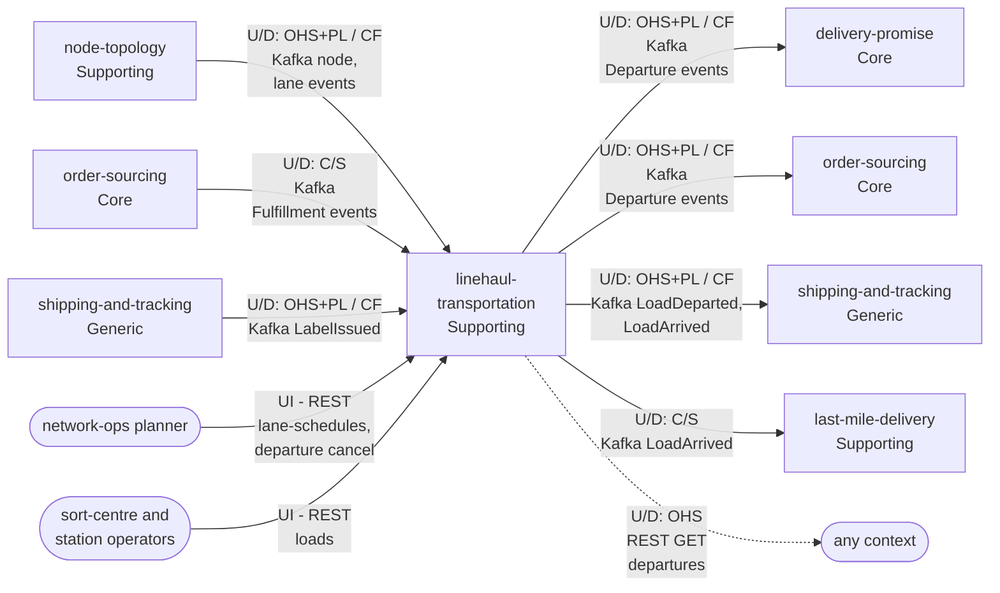

# Context Map

:::info[As built]
Derived from [`network/model/model.yaml`](https://github.com/IQVO/warehouse-docs/blob/main/network/model/model.yaml). This context's service is built; the model carries its as-built contracts, and identifiers (`Err...` names, routes, CloudEvents types) are the names the service uses.
:::

Following ddd-crew [Context Mapping](https://github.com/ddd-crew/context-mapping).
This is **linehaul-transportation's slice** of the
[network context map](/network/strategic-design/context-map): every relationship it
has, with the upstream (U) and downstream (D) side, the pattern and the
channel. Abbreviations: OHS = Open Host Service, PL = Published Language,
CF = Conformist, C/S = Customer/Supplier.

Derived from: `model.yaml → contexts[linehaul-transportation].inbound`,
`.publishes[*].consumers`, `.consumes`; the matching `inbound` rows of
`contexts[delivery-promise]`, `contexts[order-sourcing]`,
`contexts[shipping-and-tracking]` and `contexts[last-mile-delivery]`.

Legend: arrows point from upstream to downstream. Solid = events or
commands; dotted = synchronous query. `order-sourcing` and
`shipping-and-tracking` appear twice because they are on both sides: they
feed this context and they consume from it. People are rounded boxes.

Omitted: Kafka and Postgres as infrastructure; the analytics-only events
(`DepartureDeparted`, `DepartureArrived`, `LoadClosed`), which have no
in-org consumer. **Separate Ways** (no edge at all): `offer-availability`,
`customer-ordering`, `vendor-connectivity`, `node-performance`. The
warehouse-systems fleet's `network-fulfillment` (Supporting in the fleet)
has no relationship with this context: the only channel between the two
organizations is the Vendor API of `vendor-connectivity`.

## Relationships

| Neighbour | Direction | Pattern | Channel | Messages | Why this pattern |
| --- | --- | --- | --- | --- | --- |
| `node-topology` (Supporting) | Upstream | OHS + PL; this context is **Conformist** | Kafka `retailnetwork.node-topology.events` | `NodeRegistered`, `NodeOperationalProfileDeclared`, `NodeActivated`, `NodeSuspended`, `NodeRetired`, `LaneOpened`, `LaneClosed` | `node-topology` is the registry for every context; it publishes one language for all of them and does not adapt to this one. Cutoffs, time zones and lanes are taken as given into `NodeProfileView` and `LaneView`. |
| `order-sourcing` (Core) | Upstream | **Customer/Supplier** (this context is the Customer) | Kafka `retailnetwork.order-sourcing.events` | `FulfillmentReleasedToNode`, `FulfillmentReassigned`, `FulfillmentLocked`, `FulfillmentCancelled` | The model lists this context among the named consumers of these events, and `FulfillmentLocked` carries `pickupDepartureId` so `BookOnLock` can book. The supplier shapes its events for this consumer. |
| `shipping-and-tracking` (Generic) | Upstream | OHS + PL; this context is **Conformist** | Kafka `retailnetwork.shipping-and-tracking.events` | `LabelIssued` | Labels are a generic capability; this context takes `trackingNumber`, `assignmentId` and `packageNo` as given into `ExpectedVolumeView`. No address crosses. |
| Network-ops planner | Upstream (person) | UI on this context's REST | REST `POST /lane-schedules`, `POST /lane-schedules/{laneId}:retire`, `POST /departures/{departureId}:cancel` | `DefineLaneSchedule`, `RetireLaneSchedule`, `CancelDeparture` | Human planning of templates and cancellations. |
| Sort-centre and station operators | Upstream (person / scanner) | UI on this context's REST | REST `POST /loads`, `POST /loads/{loadId}/packages`, `:close`, `:dispatch`, `:receive` | `OpenLoad`, `AddPackage`, `CloseLoad`, `DispatchLoad`, `ReceiveLoad` | Physical consolidation is recorded by the people doing it. |
| `delivery-promise` (Core) | Downstream | OHS + PL; `delivery-promise` is **Conformist** | Kafka `retailnetwork.linehaul-transportation.events` | `DepartureScheduled`, `DepartureCapacityChanged`, `DepartureCancelled` | `delivery-promise` builds `DepartureView` from these events and makes no synchronous call on its hot path. `DepartureCancelled` triggers its `RepromiseOnRisk` policy. |
| `order-sourcing` (Core) | Downstream | OHS + PL; `order-sourcing` is **Conformist** | Kafka `retailnetwork.linehaul-transportation.events` | `DepartureScheduled`, `DepartureCapacityChanged`, `DepartureCancelled` | Feeds its `NetworkGraphView`; the same published language as for `delivery-promise`. |
| `shipping-and-tracking` (Generic) | Downstream | OHS + PL; `shipping-and-tracking` is **Conformist** | Kafka `retailnetwork.linehaul-transportation.events` | `LoadDeparted`, `LoadArrived` | Load movements become scans on each package's journey; the first `PICKUP`-load departure is the handover instant (`HandoverOnFirstScan`). |
| `last-mile-delivery` (Supporting) | Downstream | **Customer/Supplier** (`last-mile-delivery` is the Customer) | Kafka `retailnetwork.linehaul-transportation.events` | `LoadArrived` | `LoadArrived` at a delivery station drives `InductOnArrival`; the station needs `destinationNodeId` and `trackingNumbers` in the payload. |
| Any context | Downstream | **OHS** | REST `GET /departures?origin=&destination=&from=&to=`, `GET /departures/{departureId}` | `ListDepartures` | Read access for tools and diagnostics; no context depends on it for a decision (the decision paths use events). |
| `offer-availability`, `customer-ordering`, `vendor-connectivity`, `node-performance` | — | **Separate Ways** | none | none | No message in the model connects them to this context. |

## Notes on the patterns

- **Conformist upstream, Open Host downstream.** This context conforms to
  `node-topology`'s and `shipping-and-tracking`'s languages, and in turn
  offers its own departure and load events as a published language that
  `delivery-promise`, `order-sourcing` and `shipping-and-tracking` conform
  to.
- **No Anti-Corruption Layer.** All neighbours are in the same organization
  and share the [CloudEvents standard](/network/strategic-design/event-standard-cloudevents);
  translation is limited to projecting events into local read models.
- **No Shared Kernel.** Identifiers such as `nodeId`, `laneId` and
  `trackingNumber` are values copied from events, not shared code or shared
  tables.
