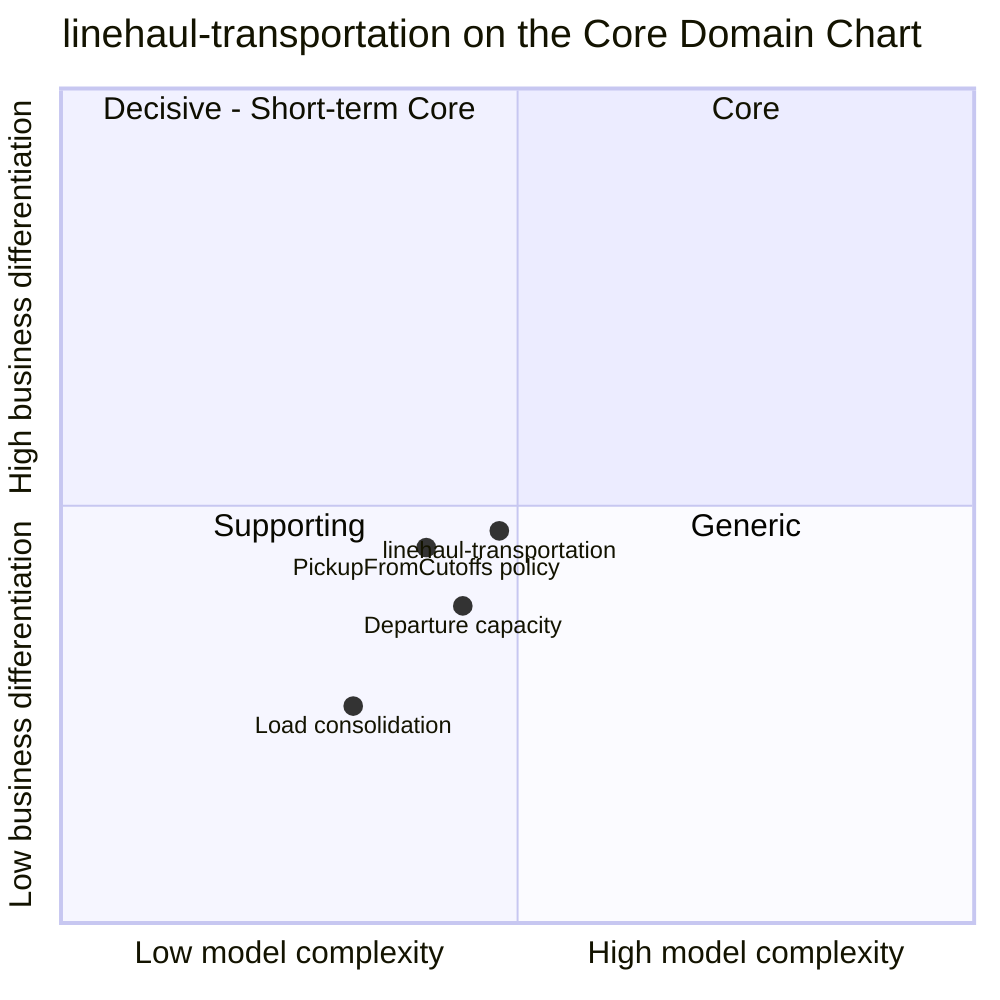

# Core Domain Chart

:::info[As built]
Derived from [`network/model/model.yaml`](https://github.com/IQVO/warehouse-docs/blob/main/network/model/model.yaml). This context's service is built; the model carries its as-built contracts, and identifiers (`Err...` names, routes, CloudEvents types) are the names the service uses.
:::

Following the ddd-crew [Core Domain Charts](https://github.com/ddd-crew/core-domain-charts):
business differentiation (y) against model complexity (x). The network-wide
chart is on [Core Domain Chart](/network/strategic-design/core-domain-chart).

Derived from: `model.yaml → contexts[linehaul-transportation].chart`
(`complexity: 0.48`, `differentiation: 0.47`, `evolution: Custom-built`),
`.aggregates[Departure]`, `.aggregates[Load]`, `.policies[PickupFromCutoffs]`.

Omitted: the other ten contexts (their positions are on their own charts
and on the network-wide chart). The three internal slices are this page's
reading of the model, not values from `model.yaml`; all of them stay in
quadrant 3.

## Classification: Supporting

The context point sits in **quadrant 3 (Supporting)**, just below and left
of the centre. The model classifies it `Supporting`, business model *Cost
reducer (cost-to-serve) and speed enabler*.

**Differentiation is moderate (y = 0.47).** The network's differentiating
promise is made in `delivery-promise` and kept by the choices of
`order-sourcing` (both Core). They cannot work without real departures: a
fast tier is never promised from nominal lane times
([ADR 0008](/network/adr/0008-capacity-held-at-promise-time)). So this context is
close to the Core line. It stays below it because it does not decide what
the customer is promised or which node ships; it supplies the trips and
keeps their capacity honest. The highest slice is `PickupFromCutoffs`,
because it is where a vendor's declared cutoff becomes a bookable pickup and
the `shipBy` of a promise.

**Model complexity is moderate (x = 0.48).** Three aggregates
(`Departure` with five states, `LaneSchedule`, `Load` with four states), seven
invariants and three policies. The hard parts are temporal, not structural:
time zones and operating days when generating pickups, a 14-day rolling
horizon, capacity that changes days ahead, and the ordering of
`node-topology` events (profile declared, then activated). Loads are plain
consolidation and plotted lowest.

## Evolution

| Part | Evolution stage | Why |
| --- | --- | --- |
| Pickup generation from vendor cutoffs | **Custom-built** | Specific to a network that lets vendors declare their own cutoffs and must schedule its own trucks against them. |
| Departure capacity ledger | **Custom-built** | A simple counter, but its events feed the promise and sourcing read models; its semantics are the network's own. |
| Lane schedules and loads | **Custom-built → Product** | Weekly templates and load building are well-known transport-management functions; a product could replace them if it published the same events. |
| Plumbing (outbox, inbox, CloudEvents) | **Commodity** | The same building blocks as every context (see [CloudEvents standard](/network/strategic-design/event-standard-cloudevents)). |

**Movement to watch.** If the network began to compete on the middle mile
itself (dynamic capacity bought per day, load-level re-routing to save a
promise), the capacity slice would move right and up, towards Core. Nothing in
the model does that today: capacity changes have no command of their own,
and a cancelled departure is handed to `delivery-promise` to re-promise
rather than re-planned here.
