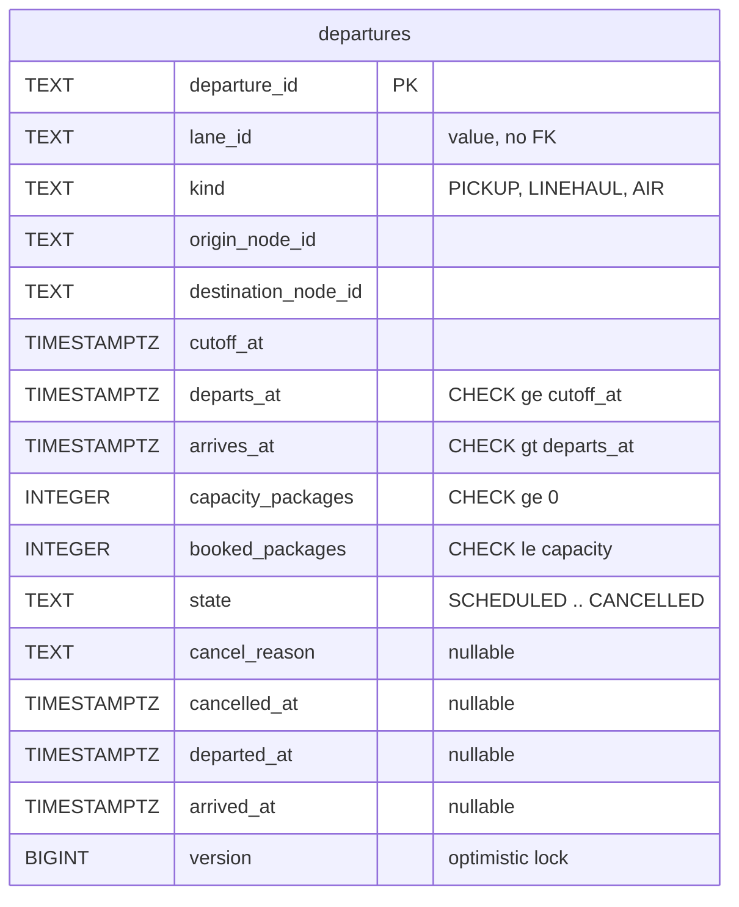
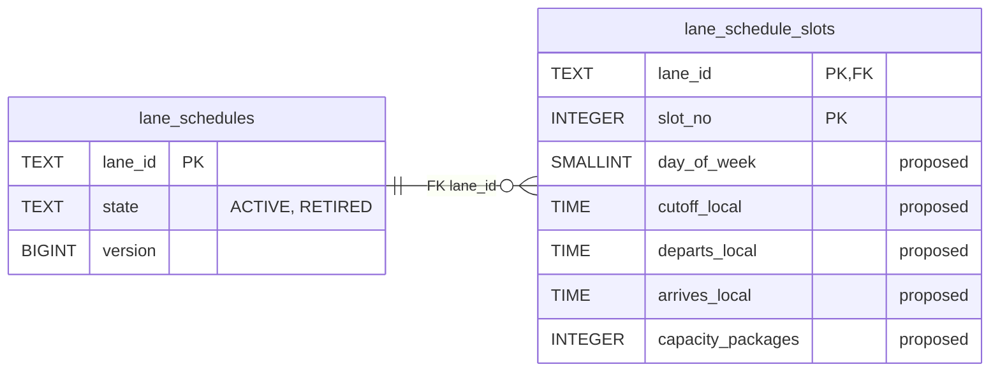
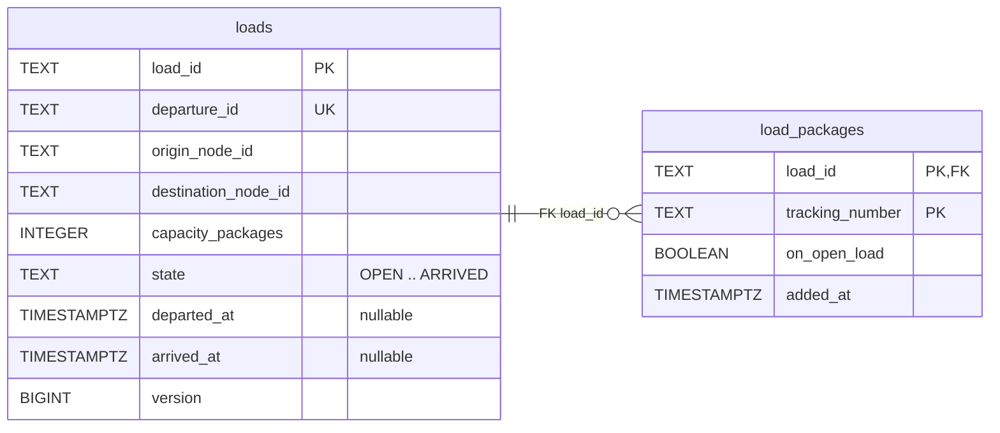
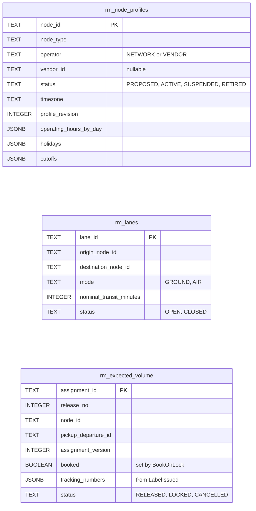
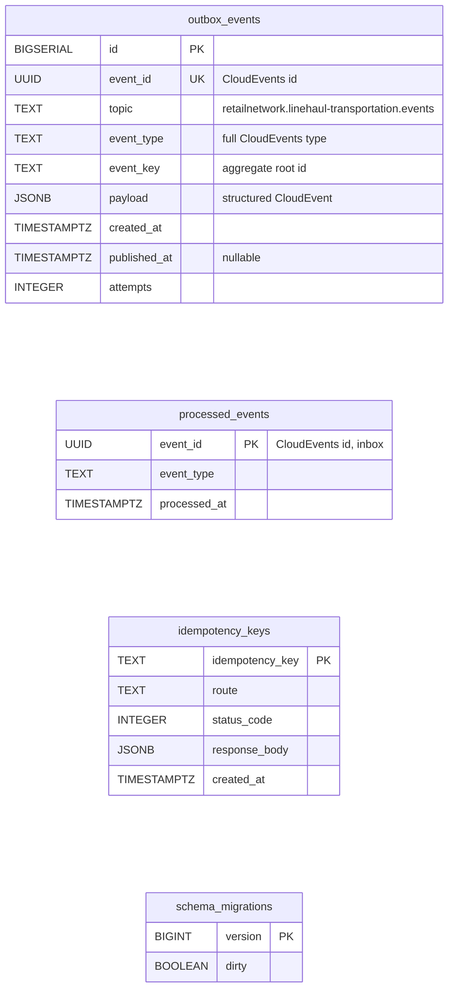

# Entity Relationship

:::info[As built]
Derived from [`network/model/model.yaml`](https://github.com/IQVO/warehouse-docs/blob/main/network/model/model.yaml). This context's service is built; the model carries its as-built contracts, and identifiers (`Err...` names, routes, CloudEvents types) are the names the service uses.
:::

The **proposed** Postgres schema. This context owns its database; no table
is shared with another context (`conventions.integration_rules`). A
relationship line is drawn only where a foreign key would exist, and only
inside one aggregate.

## Aggregate tables

### Departure

### LaneSchedule

### Load

Derived from: `model.yaml → contexts[linehaul-transportation].aggregates`
(`Departure`, `LaneSchedule`, `Load`: root ids, states, value objects,
invariants) and `.publishes[*].data`.

Omitted: indexes. Proposed: `departures (origin_node_id, cutoff_at)` and
`(destination_node_id, cutoff_at)` for `GET /departures`; a partial unique
index on `load_packages (tracking_number) WHERE on_open_load`, which
enforces `ErrPackageAlreadyLoaded` across loads; `CHECK booked_packages <=
capacity_packages` backs `ErrDepartureFull`. Comparison operators are
written `le` / `lt` / `ge` / `gt` inside the diagrams, and `..` abbreviates the
full state list from the model. The slot columns are a
proposal: the model lists no `LaneSchedule` fields. In `loads`, `origin_node_id`, `destination_node_id` and
`capacity_packages` are snapshots of the departure, and `departure_id` is a
value with no FK. `load_packages.on_open_load` is true while the load is
`OPEN` or `CLOSED`. `UK` on
`loads.departure_id` follows the size estimate "one per departure".

## Read-model tables

Derived from: `model.yaml → contexts[linehaul-transportation].read_models`,
and the `data` of the consumed events in `contexts[node-topology].publishes`,
`contexts[order-sourcing].publishes`, `contexts[shipping-and-tracking].publishes`.

Omitted: the remaining event fields not used by a decision here (for
example `regionId`, `postalCode`). `rm_expected_volume.booked` is the
per-assignment booking record that makes `BookCapacity` idempotent and lets
`ReleaseCapacity` release only what was booked.

## Infrastructure tables

Derived from: `model.yaml → conventions.integration_rules` (transactional
outbox, idempotent consumers on the CloudEvents id),
`conventions.cloudevents`.

**All four are infrastructure, not domain.** `outbox_events` is written in
the same transaction as the aggregate and drained by the relay to Kafka.
`processed_events` is the inbox: one row per consumed CloudEvents `id`,
written in the same transaction as the effect. `idempotency_keys` stores the
first response to a REST `Idempotency-Key` (proposed; the REST
contract requires the header on every state-changing call). `schema_migrations` is the migration tool's
bookkeeping.

## Why no foreign key crosses an aggregate or a context

- **Across aggregates.** `loads.departure_id` and `departures.lane_id` are
  values, not foreign keys. `Load`, `Departure` and `LaneSchedule` are
  separate consistency boundaries, saved in separate transactions; a foreign
  key would couple their lifecycles (a departure could not be archived
  without its load) and invite cross-aggregate joins in write paths.
- **To other contexts.** `origin_node_id`, `destination_node_id`,
  `lane_id`, `assignment_id` and `tracking_number` name things owned by
  `node-topology`, `order-sourcing` and `shipping-and-tracking`. Those live
  in other databases; this context only holds event-fed copies (`rm_...`).

## Table ≠ aggregate

| Table | Aggregate / role | Notes |
| --- | --- | --- |
| `departures` | **Departure** (root) | One row per departure; `version` for optimistic concurrency on contended bookings. |
| `lane_schedules` | **LaneSchedule** (root) | One row per lane. |
| `lane_schedule_slots` | **LaneSchedule** (its slots) | Replaced as a set when a schedule is defined. |
| `loads` | **Load** (root) | One row per load; capacity, origin and destination are snapshots of the departure. |
| `load_packages` | **Load** (its tracking numbers) | `on_open_load` is cleared on dispatch so the unique index frees the tracking number. |
| `rm_node_profiles` | read model `NodeProfileView` | From `node-topology` node events. |
| `rm_lanes` | read model `LaneView` | From `LaneOpened`, `LaneClosed`. |
| `rm_expected_volume` | read model `ExpectedVolumeView` | From `order-sourcing` assignment events and `LabelIssued`. |
| `outbox_events` | none (infrastructure) | Transactional outbox. |
| `processed_events` | none (infrastructure) | Inbox. |
| `idempotency_keys` | none (infrastructure) | REST replay store. |
| `schema_migrations` | none (infrastructure) | Migrations. |
