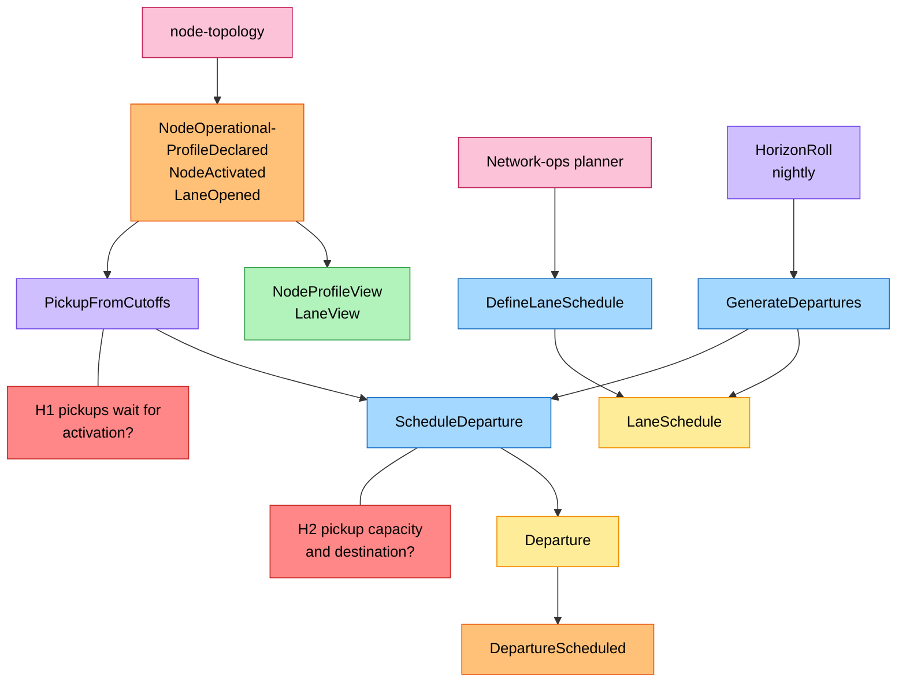
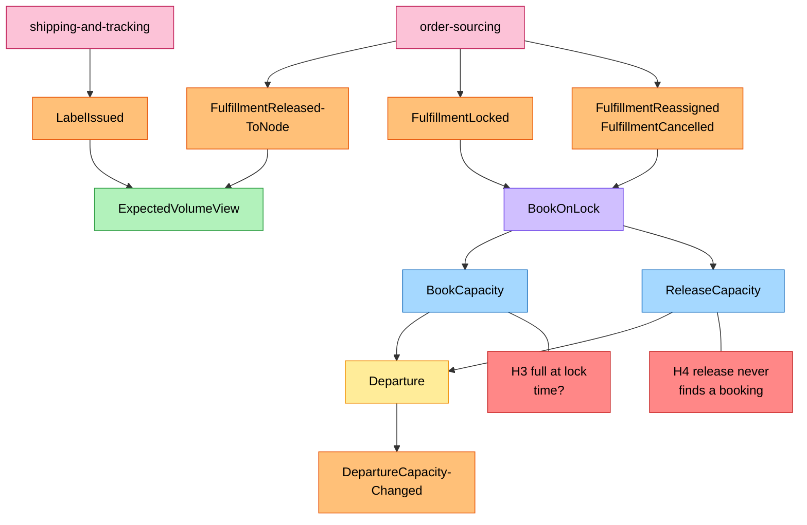
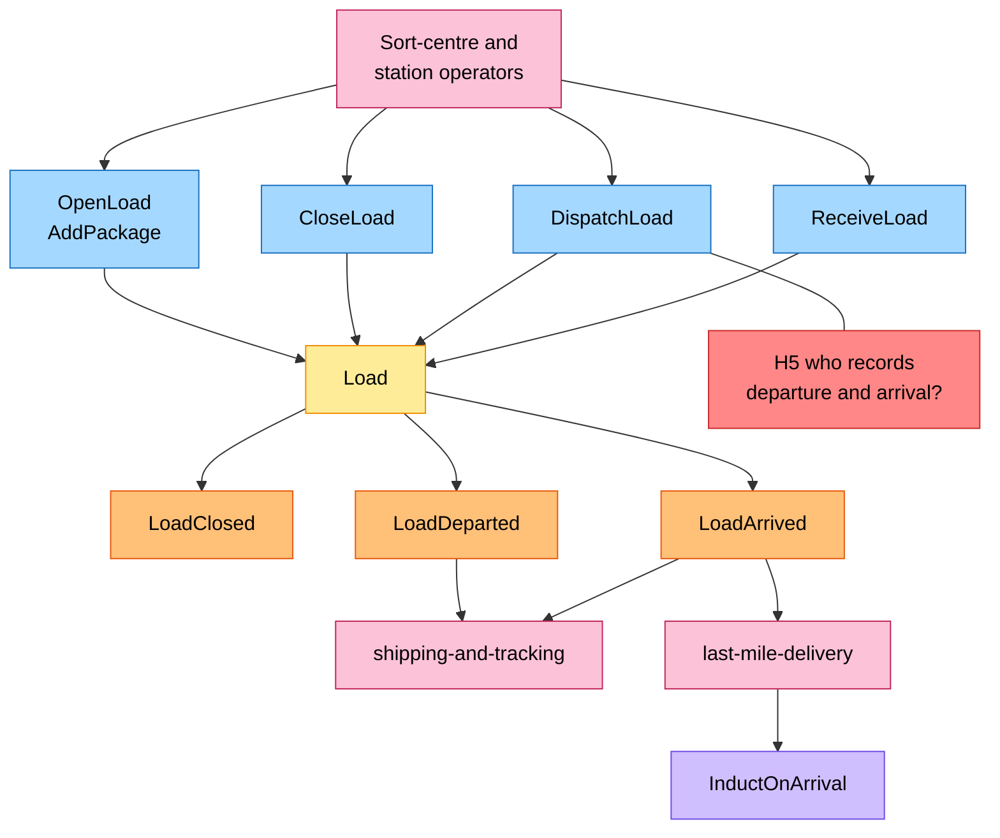
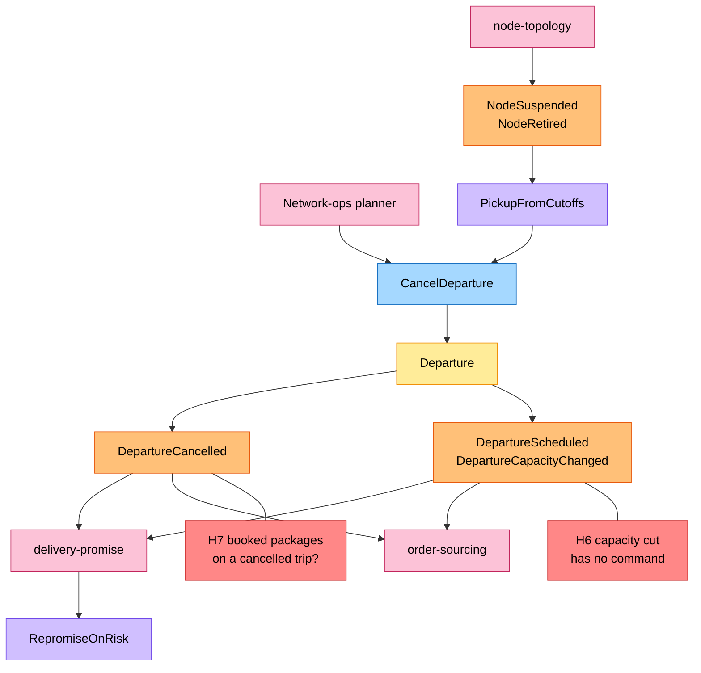

# EventStorming

:::info[Proposed design]
Derived from [`model/model.yaml`](https://github.com/IQVO/retail-network-docs/blob/main/model/model.yaml). Nothing in this context is built yet; identifiers (`Err...` names, routes, CloudEvents types) are the names an implementation must use.
:::

Process-level EventStorming in the ddd-crew
[EventStorming glossary & cheat sheet](https://github.com/ddd-crew/eventstorming-glossary-cheat-sheet)
notation. Every sticky comes from `model.yaml`. Hotspots are genuine open
questions or risks in the model; the source of each is in the
[hotspot table](#hotspots). The network-wide board is on
[EventStorming big picture](/network/strategic-design/eventstorming-big-picture).

## Legend

| Colour | Sticky | Hex |
| --- | --- | --- |
| Blue | Command | `#a5d8ff` |
| Yellow | Aggregate | `#ffec99` |
| Orange | Domain Event | `#ffc078` |
| Lilac | Policy | `#d0bfff` |
| Green | Read Model | `#b2f2bb` |
| Pink | External System (a sibling context or an actor) | `#fcc2d7` |
| Red | Hotspot | `#ff8787` |

## 1. Departures from lanes and vendor cutoffs

Derived from: `model.yaml → contexts[linehaul-transportation].policies[PickupFromCutoffs, HorizonRoll]`,
`.aggregates[LaneSchedule, Departure]`, `.read_models`, `.inbound`.

Omitted: `ErrLaneClosed`, `ErrInvalidDepartureTimes` and `ErrOverlappingSlots`
refusals; consumers of `DepartureScheduled` (board 4).

## 2. Booking on lock

Derived from: `model.yaml → contexts[linehaul-transportation].policies[BookOnLock]`,
`.read_models[ExpectedVolumeView]`, `.aggregates[Departure]`;
`contexts[order-sourcing].aggregates[FulfillmentAssignment].invariants`.

Omitted: `ErrDepartureClosed` (a lock after `cutoffAt`).

## 3. Loads

Derived from: `model.yaml → contexts[linehaul-transportation].aggregates[Load]`,
`.publishes`, `contexts[last-mile-delivery].policies[InductOnArrival]`.

Omitted: the refusals `ErrPackageAlreadyLoaded` and `ErrLoadOverCapacity`.
`InductOnArrival` is `last-mile-delivery`'s policy, drawn for context.

## 4. Cancellation and its consumers

Derived from: `model.yaml → contexts[linehaul-transportation].aggregates[Departure]`,
`.policies[PickupFromCutoffs]`, `.publishes`,
`contexts[delivery-promise].policies[RepromiseOnRisk]`.

Omitted: `RepromiseOnRisk`'s outputs (`PromiseRevised`), shown in
[Domain Message Flow](/network/contexts/linehaul-transportation/domain-message-flow).

## Hotspots

| # | Hotspot | Where it comes from in the model |
| --- | --- | --- |
| H1 | Pickups are generated on `NodeOperationalProfileDeclared`, but the business decision limits them to `ACTIVE` nodes and a profile is declared before activation (`ErrIncompleteOperationalProfile` in `node-topology`). `NodeActivated` is consumed with no stated reaction. | `contexts[linehaul-transportation].policies[PickupFromCutoffs]` vs `.business_decisions[0]`; `contexts[node-topology].aggregates[Node].invariants` |
| H2 | Resolved (G9): a `PICKUP` departure's lane is the node's default outbound lane (policy `DefaultOutboundLane`) and its `capacityPackages` is `capacityOrders x packagesPerOrder` (policy `PickupCapacity`); `node-topology` declares neither. | `aggregates[Departure].value_objects` (`Capacity{packages, booked}`), `aggregates[LaneSchedule].description` ("or the node cutoffs for a pickup lane"); `lane_rules.allowed` |
| H3 | `BookOnLock` runs after the vendor accepted; if the pickup is full (`ErrDepartureFull`) or closed (`ErrDepartureClosed`) the model names no follow-up. | `policies[BookOnLock]`, `aggregates[Departure].invariants` |
| H4 | `FulfillmentReassigned` and `FulfillmentCancelled` happen only before `LOCKED`, so `ReleaseCapacity` never finds a booking made on lock. | `policies[BookOnLock]`; `contexts[order-sourcing].aggregates[FulfillmentAssignment].transitions`, `ErrAssignmentLocked`, `ErrCancelAfterLock` |
| H5 | No actor, policy or route triggers `CloseDeparture`, `RecordDeparture` or `RecordArrival`; their link to `DispatchLoad` / `ReceiveLoad` is not stated. | `aggregates[Departure].commands` vs `.inbound` and `.rest` |
| H6 | `DepartureCapacityChanged` carries `capacityPackages`, yet no command changes capacity (only `booked`). | `publishes[DepartureCapacityChanged].data`, `aggregates[Departure].commands` |
| H7 | What happens to bookings and loads on a cancelled departure (re-book onto the next one?) is not modelled; only `delivery-promise` reacts. | `aggregates[Departure].transitions`, `policies` |
