# Sequence Diagrams

:::info[As built]
Derived from [`network/model/model.yaml`](https://github.com/IQVO/warehouse-docs/blob/main/network/model/model.yaml). This context's service is built; the model carries its as-built contracts, and identifiers (`Err...` names, routes, CloudEvents types) are the names the service uses.
:::

One UML sequence diagram per command use case of
[Use Cases](/network/contexts/linehaul-transportation/use-cases), in the proposed
hexagonal layout: inbound adapter → use case → aggregate → repository →
outbox (same transaction) → relay → Kafka. The relay and Kafka share one
lifeline ("relay to Kafka") to keep each diagram at six participants or
fewer. `alt` blocks show error
branches, optimistic-concurrency `version` checks and idempotency (REST
`Idempotency-Key`, Kafka inbox on the CloudEvents `id`). Problem slugs with
no `Err...` in the model (`not-found`, `invalid-state-transition`,
`concurrent-modification`) are proposed placeholders. Route parameters are
written without braces. The relay always publishes to
`retailnetwork.linehaul-transportation.events`, keyed by the aggregate root
id.

## 1. ScheduleDeparture

Triggered by `GenerateDepartures` or by `PickupFromCutoffs`; the caller here is the Kafka consumer reacting to `NodeOperationalProfileDeclared`.

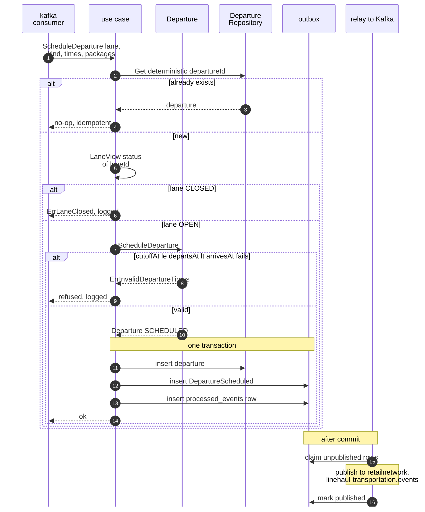

Derived from: `model.yaml → contexts[linehaul-transportation].aggregates[Departure]` (`commands`, `invariants`), `.policies[PickupFromCutoffs, HorizonRoll]`, `conventions.integration_rules`.

Omitted: the inbox check that precedes the call (shown in diagram 2); when `GenerateDepartures` is the caller there is no `processed_events` row. `le` / `lt` stand for `<=` / `<`.

## 2. BookCapacity

Policy `BookOnLock` on `FulfillmentLocked`.

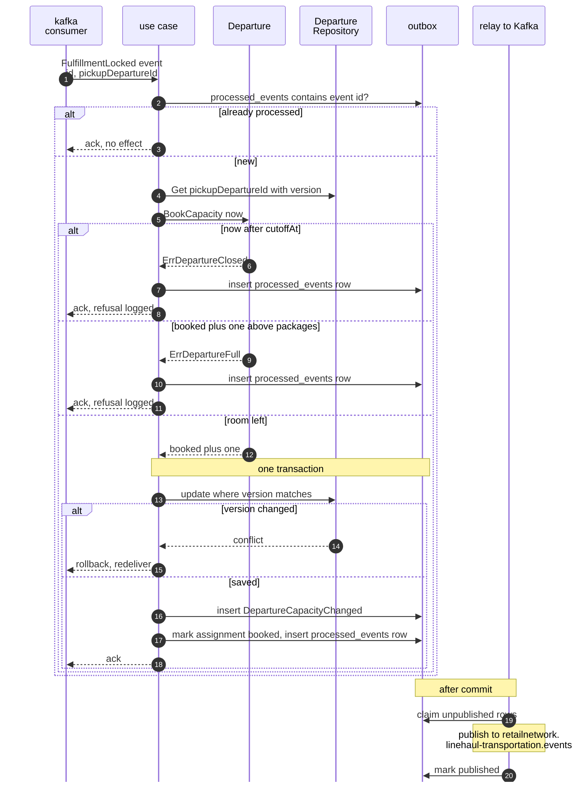

Derived from: `model.yaml → contexts[linehaul-transportation].policies[BookOnLock]`, `.aggregates[Departure].invariants`, `conventions.integration_rules`.

Omitted: the read-model write is shown as part of the outbox step for width; it is a row in `rm_expected_volume`, same transaction. The model names no follow-up for the two refusals.

## 3. ReleaseCapacity

Policy `BookOnLock` on `FulfillmentCancelled` or `FulfillmentReassigned`.

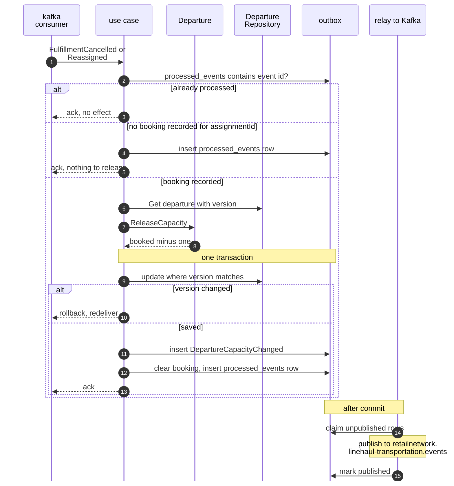

Derived from: `model.yaml → contexts[linehaul-transportation].policies[BookOnLock]`; `contexts[order-sourcing].aggregates[FulfillmentAssignment].invariants`.

Omitted: in the model as written the "no booking recorded" branch is the only reachable one, because `order-sourcing` cancels and reassigns only before `LOCKED`.

## 4. CloseDeparture

No trigger is named in the model; the caller is drawn as a generic adapter.

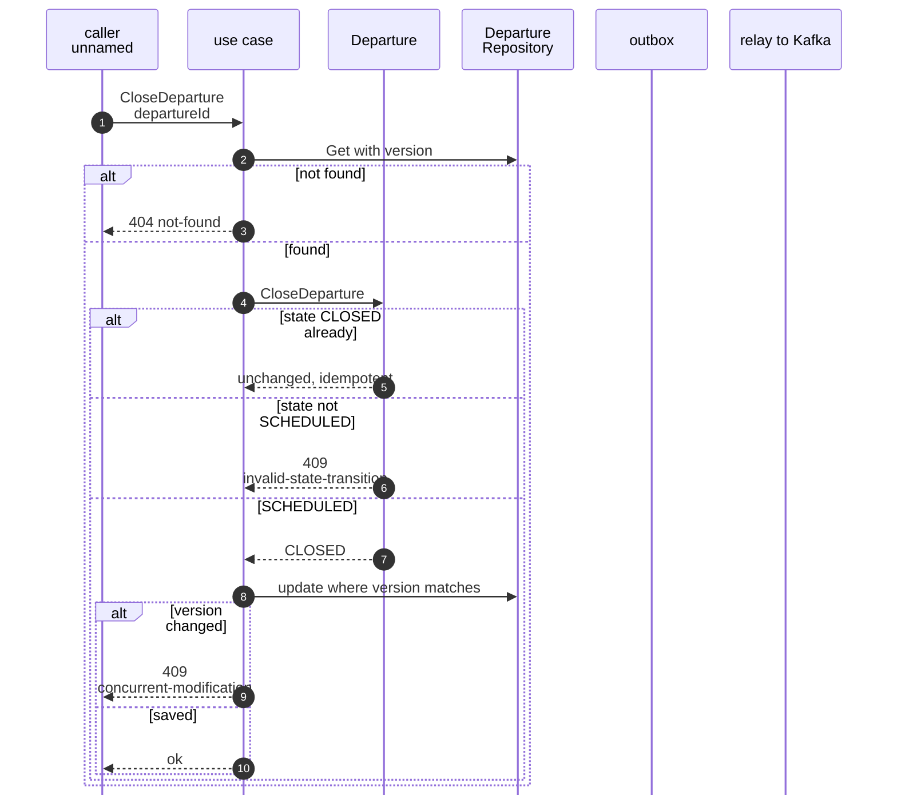

Derived from: `model.yaml → contexts[linehaul-transportation].aggregates[Departure].transitions`.

Omitted: no outbox row: the model lists no event for `CloseDeparture`, so the relay and Kafka are not involved.

## 5. RecordDeparture

No trigger is named in the model.

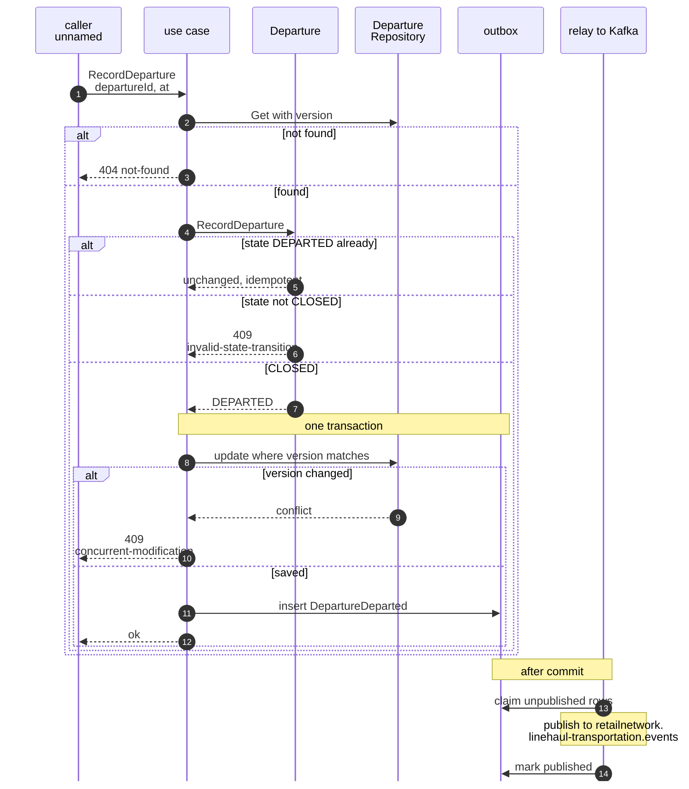

Derived from: `model.yaml → contexts[linehaul-transportation].aggregates[Departure]`, `.publishes[DepartureDeparted]`.

Omitted: the caller is unnamed in the model (a reported gap).

## 6. RecordArrival

No trigger is named in the model.

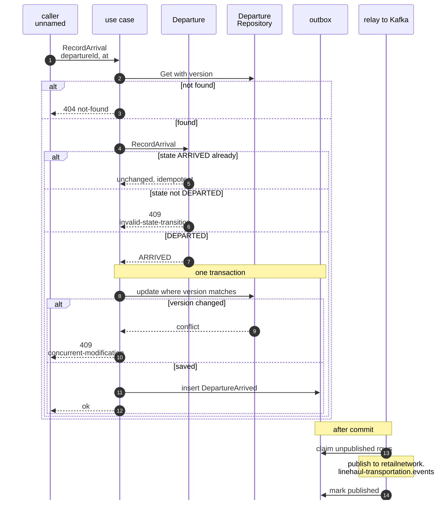

Derived from: `model.yaml → contexts[linehaul-transportation].aggregates[Departure]`, `.publishes[DepartureArrived]`.

Omitted: the caller is unnamed in the model (a reported gap).

## 7. CancelDeparture

From the planner over REST; `PickupFromCutoffs` calls the same use case from the Kafka consumer on `NodeSuspended` or `NodeRetired`, once per future pickup.

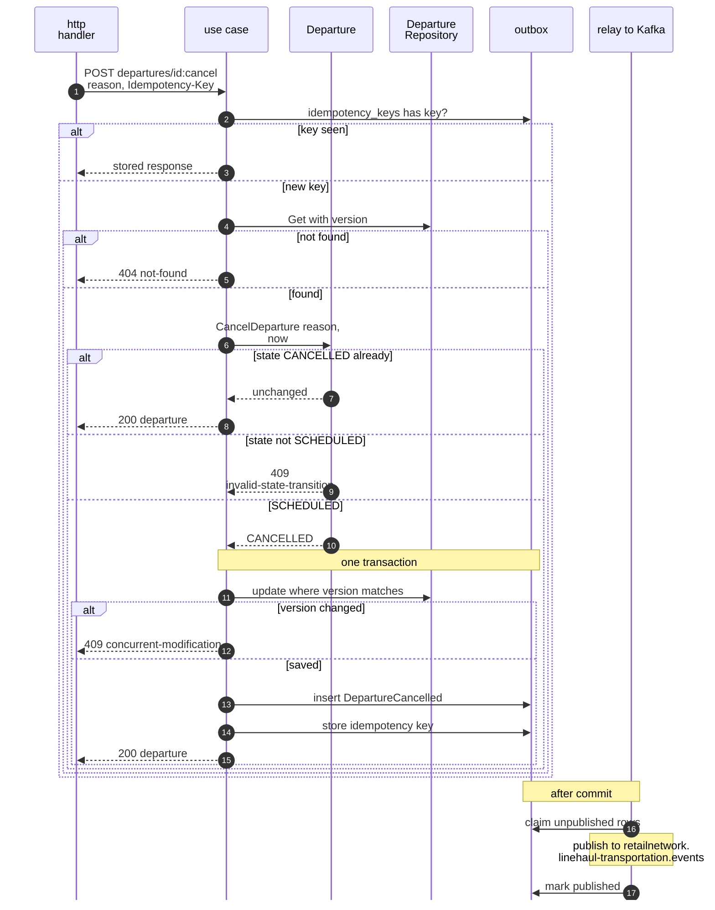

Derived from: `model.yaml → contexts[linehaul-transportation].aggregates[Departure]`, `.inbound`, `.rest`, `.policies[PickupFromCutoffs]`, `.publishes[DepartureCancelled]`.

Omitted: the Kafka-driven path, which replaces the idempotency key by the inbox row. The idempotency store is drawn on the outbox lifeline for width; it is the `idempotency_keys` table.

## 8. DefineLaneSchedule

From the planner over REST.

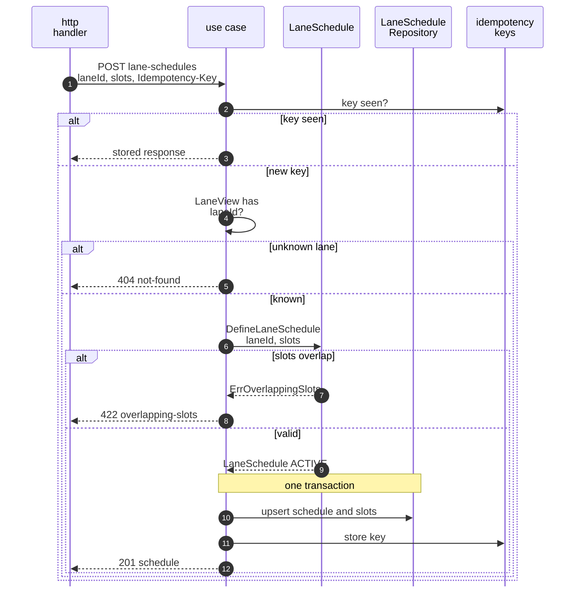

Derived from: `model.yaml → contexts[linehaul-transportation].aggregates[LaneSchedule]`, `.inbound`, `.rest`.

Omitted: no outbox, relay or Kafka: `LaneSchedule` raises no event. A `RETIRED` schedule for the lane answers 409 `invalid-state-transition` (not drawn).

## 9. RetireLaneSchedule

Over REST; the `inbound` rows do not name the actor.

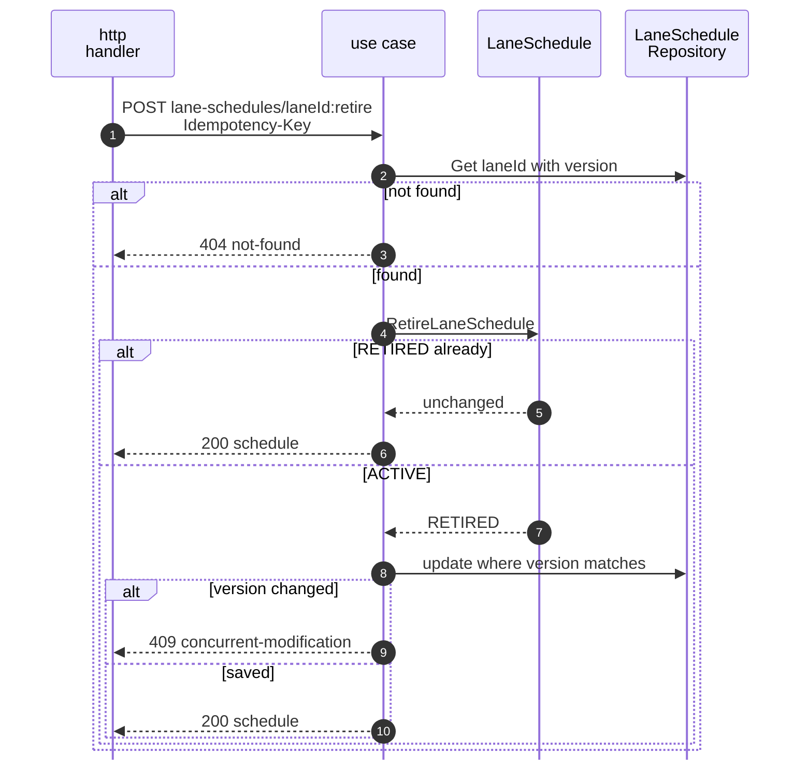

Derived from: `model.yaml → contexts[linehaul-transportation].aggregates[LaneSchedule].transitions`, `.rest`.

Omitted: the idempotency-key check (as in diagram 8); no outbox row, no event.

## 10. GenerateDepartures

Nightly, policy `HorizonRoll`.

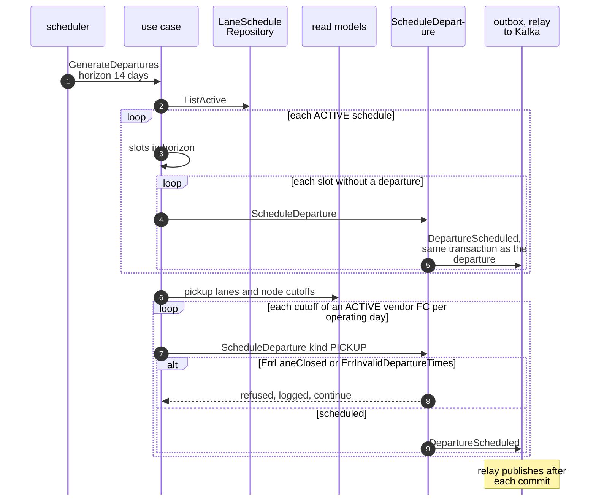

Derived from: `model.yaml → contexts[linehaul-transportation].policies[HorizonRoll]`, `.aggregates[LaneSchedule].description`, `.business_decisions`.

Omitted: the per-departure detail, which is diagram 1. Each `ScheduleDeparture` is its own transaction, so one refusal does not roll back the night's work.

## 11. OpenLoad

From a sort-centre or station operator over REST.

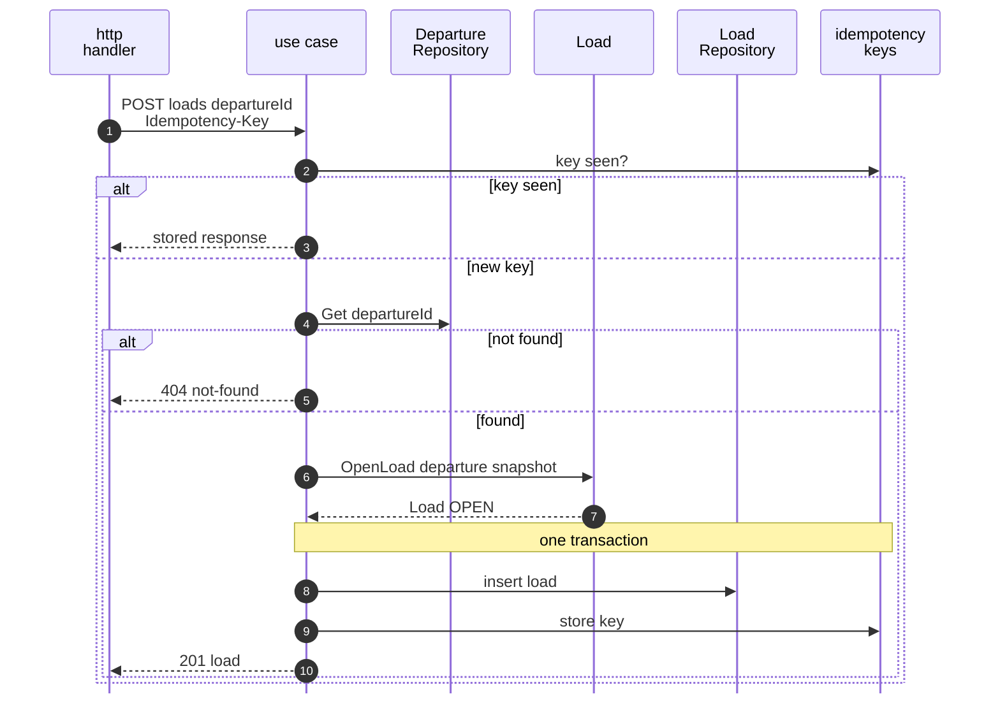

Derived from: `model.yaml → contexts[linehaul-transportation].aggregates[Load]`, `.rest`.

Omitted: outbox, relay and Kafka: `OpenLoad` raises no event. A second load for the same departure fails on the unique `departure_id` (409, not drawn).

## 12. AddPackage

From a scanner over REST.

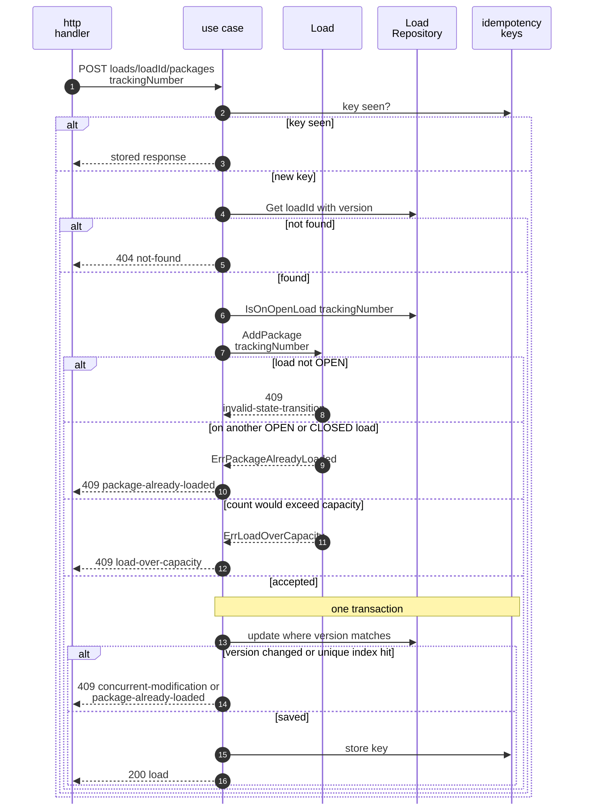

Derived from: `model.yaml → contexts[linehaul-transportation].aggregates[Load].invariants`, `.rest`.

Omitted: outbox, relay and Kafka: `AddPackage` raises no event. The partial unique index on `load_packages` is the race-safe backstop for `ErrPackageAlreadyLoaded`.

## 13. CloseLoad

From an operator over REST.

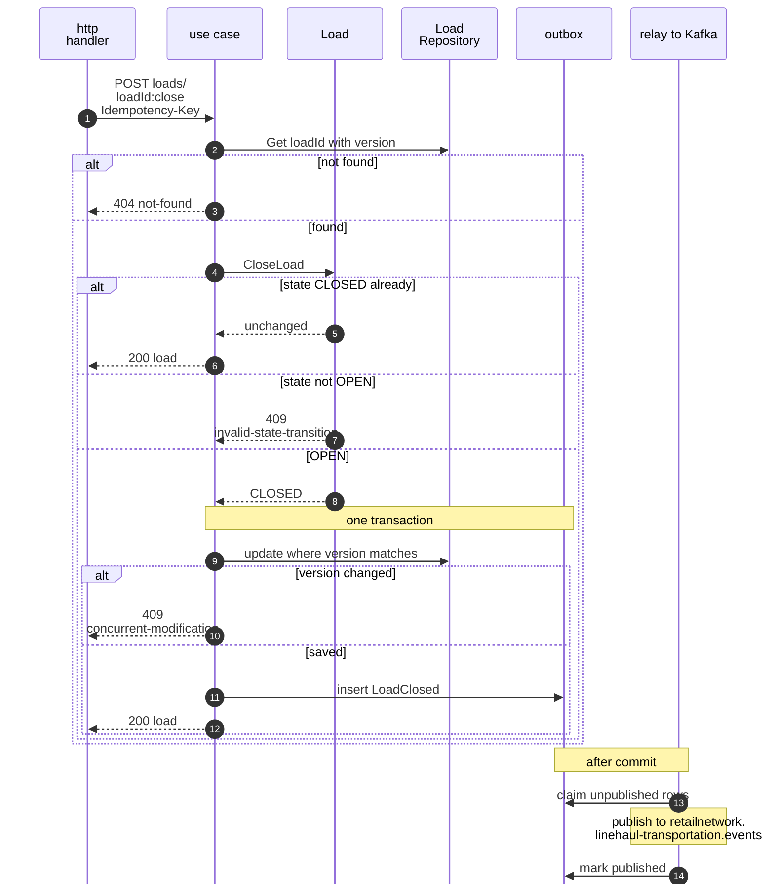

Derived from: `model.yaml → contexts[linehaul-transportation].aggregates[Load]`, `.publishes[LoadClosed]`.

Omitted: the idempotency-key check (as in diagram 11).

## 14. DispatchLoad

From an operator over REST, when the truck leaves.

Derived from: `model.yaml → contexts[linehaul-transportation].aggregates[Load]`, `.publishes[LoadDeparted]`.

Omitted: the idempotency-key check; clearing `on_open_load` on the package rows (same transaction). Whether this also drives `RecordDeparture` is not stated in the model.

## 15. ReceiveLoad

From an operator at the destination node over REST.

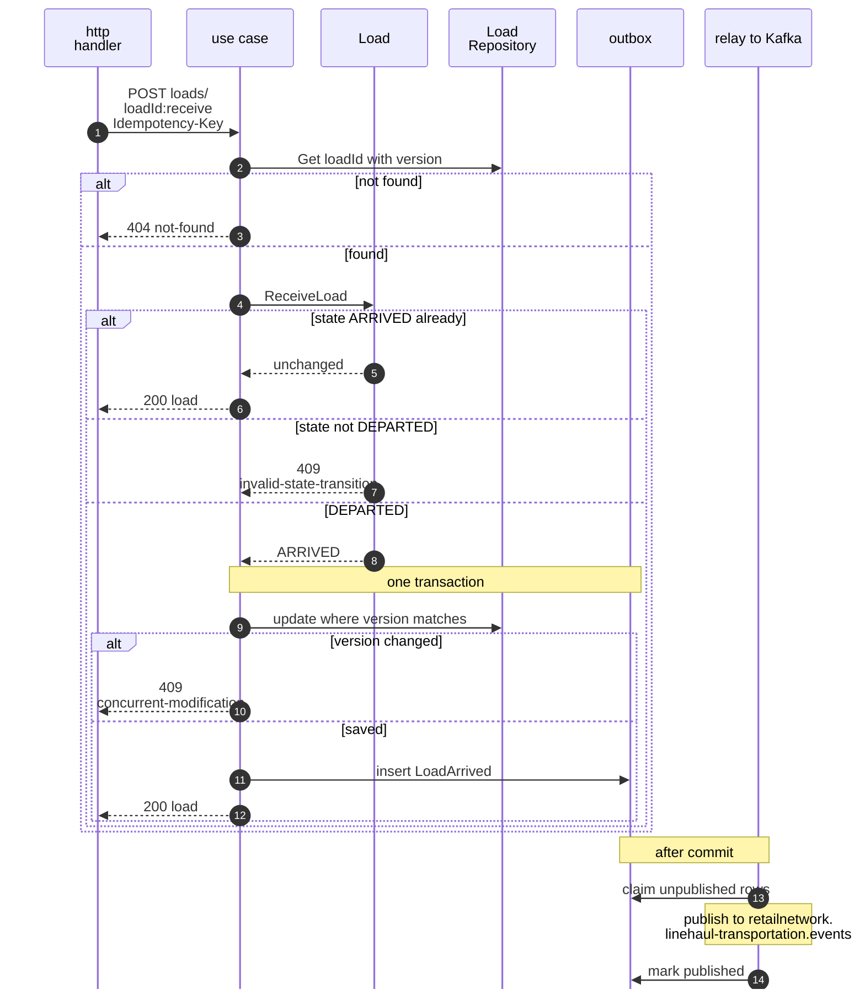

Derived from: `model.yaml → contexts[linehaul-transportation].aggregates[Load]`, `.publishes[LoadArrived]`.

Omitted: the idempotency-key check. `shipping-and-tracking` and `last-mile-delivery` consume `LoadArrived` from Kafka (`InductOnArrival`).
