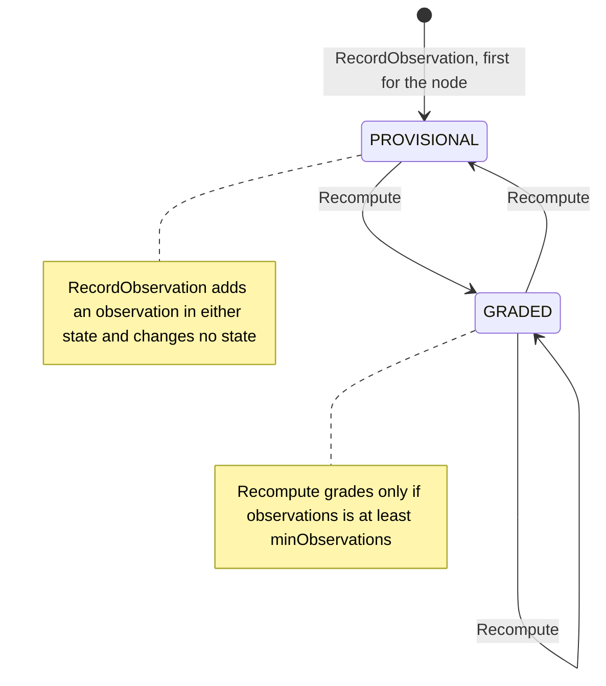

# Aggregate Design Canvas

:::info[Proposed design]
Derived from [`model/model.yaml`](https://github.com/IQVO/retail-network-docs/blob/main/model/model.yaml). Nothing in this context is built yet; identifiers (`Err...` names, routes, CloudEvents types) are the names an implementation must use.
:::

Following the ddd-crew [Aggregate Design Canvas v1.1](https://github.com/ddd-crew/aggregate-design-canvas).
The context has one aggregate root, **NodeScorecard**, in the proposed Go
package `internal/domain/scorecard`.

## NodeScorecard

### 1. Name

`NodeScorecard` (`scorecard.NodeScorecard`), identified by
`scorecardId = nodeId + ':' + window`. A node has two: one for the 7-day
window and one for the 30-day window. These pages write the window as
`7d` and `30d` (for example `N-0042:30d`); the model does not name the
literal.

### 2. Description

Rolling-window performance of one node (7-day and 30-day). It holds the
observations counted in its window, the `Metrics` value object computed
from them
(`onTimeHandoverRate, lateAckRate, rejectRate, expiryRate, promiseKeptRate, feedFreshnessP95Minutes, observations`),
its state (`PROVISIONAL` or `GRADED`) and, when graded, a `Grade` (`A`,
`B`, `C` or `D`). It decides nothing about the node's eligibility; it
states how the node has behaved.

The model lists no entity for this aggregate. Its size estimate ("nodes x
2 windows + observations (30 days)") and its third invariant (an
observation is counted once, by source event id) imply a collection of
observations inside it. These pages call each one an `Observation`, keyed
by the source CloudEvents `id`, carrying the fields of the source event
that a metric reads.

### 3. State Transitions

Derived from: model.yaml →
contexts[node-performance].aggregates[NodeScorecard].states,
.transitions, .commands, .invariants.

The model lists the three `Recompute` transitions only. Two edges are this
page's reading and are listed as model gaps: the creation edge (`[*]` to
`PROVISIONAL`; the model names no creation command, and the first
`RecordObservation` for a node is the earliest point the aggregate is
needed) and the absent `PROVISIONAL` to `PROVISIONAL` recompute (a
recompute that stays below the minimum), which is not drawn. There is no
terminal state: a scorecard lives as long as the node is observed.
`GRADED` to `PROVISIONAL` happens when old observations leave the window
and the count falls below `minObservations`.

### 4. Enforced Invariants

| Invariant | Enforced by |
| --- | --- |
| Rates are in `[0,1]` | `Metrics` constructor → `ErrRateOutOfRange` |
| A grade requires `observations >= minObservations` | `NodeScorecard.Recompute` (and any grade assignment) → `ErrInsufficientObservations`. `Recompute` itself never returns it for a thin window: it moves the scorecard to `PROVISIONAL` instead. |
| An observation is counted once (idempotent on source event id) | `NodeScorecard.RecordObservation` → `ErrDuplicateObservation` |

`minObservations` has no value in the model (open question).

### 5. Corrective Policies

- **`Grading`** (own): `A` if `onTimeHandoverRate >= 0.98` and
  `promiseKeptRate >= 0.97` and `lateAckRate <= 0.01`; `B` at
  `0.95 / 0.94 / 0.03`; `C` at `0.90 / 0.90 / 0.05`; otherwise `D`. Applied
  by `Recompute` only when the scorecard has enough observations.
- **`ThresholdAlert`** (own): publish `NodeThresholdBreached` when a metric
  crosses its threshold downward. The model names no per-metric threshold;
  these pages read the `Grading` boundaries as the thresholds for the three
  graded metrics and leave the other three open.
- **Window slide** (from the size estimate, "observations (30 days)"):
  `Recompute` counts only observations inside the window; observations
  older than 30 days are dropped from both scorecards.
- **Duplicate tolerance:** a redelivered event is stopped at the inbox, and
  `ErrDuplicateObservation` is the aggregate's second line. The consumer
  treats it as success, so redelivery never inflates a metric.
- **Neighbour reactions** (not this context's decisions):
  `delivery-promise` applies `ScorecardHandicap` (grade `A`: +0; `B`:
  +handling x 0.25; `C`: next cutoff; `D`: two cutoffs later; no scorecard
  yet: +0). `order-sourcing` adds a `scorecardPenalty` in
  `AssignmentCost`. `vendor-connectivity` shows the scorecard to the
  node's vendor. Nobody suspends the node automatically.

### 6. Handled Commands

| Command | Method | Issued by |
| --- | --- | --- |
| `RecordObservation` | `NodeScorecard.RecordObservation(obs)` on the node's `7d` and `30d` scorecards | `RecordObservation` use case, driven by the Kafka consumers of `PurchaseOrderIssued`, `PurchaseOrderAccepted`, `PurchaseOrderRejected`, `PurchaseOrderExpired`, `VendorShipmentConfirmed`, `PackageHandedOver`, `PromiseKept`, `PromiseBroken`, `InventoryFeedApplied` |
| `Recompute` | `NodeScorecard.Recompute(now, grading)` | `Recompute` use case, driven by the per-minute scheduler, for every scorecard with new observations or observations leaving the window |

The four other consumed events (`VendorOnboarded`, `SubmissionProcessed`,
`NodeRegistered`, `NodeOperationalProfileDeclared`) issue no command: the
model gives them no use here (see
[Domain Events](/network/contexts/node-performance/domain-events)).

### 7. Created Events

| Event | Raised when | Full CloudEvents type |
| --- | --- | --- |
| `NodeScorecardUpdated` | after a `Recompute` is saved | `com.retailnetwork.partner.node-performance.scorecard.NodeScorecardUpdated` |
| `NodeThresholdBreached` | after a `Recompute` in which a metric crossed its threshold downward is saved (one per metric) | `com.retailnetwork.partner.node-performance.scorecard.NodeThresholdBreached` |

`RecordObservation` raises no event: an observation is input, the grade is
the output.

### 8. Throughput

*Estimate (from the model):* medium; recompute batched per minute. Writes
are dominated by `RecordObservation`, one per consumed fact, each touching
the two scorecards of one node. Contention is per node: two consumers
(for example a handover and a promise judgement for the same node) can
write the same row in the same second, so the aggregate carries a
`version` for optimistic concurrency and the consumer retries on conflict.
`Recompute` is a single writer per scorecard.

### 9. Size

*Estimate (from the model):* nodes x 2 windows + observations (30 days).
The `30d` scorecard holds every observation of the last 30 days for its
node; the `7d` scorecard holds the last 7 days. Event count per instance:
one `NodeScorecardUpdated` per recompute that ran, plus zero or more
`NodeThresholdBreached`.

## Read models

The model declares none (`read_models: []`). The two REST queries read the
`NodeScorecard` state directly:

| Query | Reads | Why it is not a separate read model |
| --- | --- | --- |
| `GET /scorecards/{nodeId}` | Both scorecards of the node | A lookup by the aggregate's own key prefix. |
| `GET /scorecards?grade=` | Scorecards whose current grade matches | A filter on one column of the aggregate's table. |

What the model leaves unhomed: the facts of `NodeRegistered`,
`NodeOperationalProfileDeclared` and `VendorOnboarded` (node identity, the
declared profile, the vendor's ack window). The **Declared vs Measured**
principle suggests the declared profile should sit next to the scorecard
for reading, but the model defines neither a read model nor a field for
it. It is listed as an open question rather than invented here.

## Inbound observations

> **Proposed, [ADR 0009](/network/adr/0009-seller-inbound-and-case-packed-shipments).** This section is the delta that the seller-inbound design adds to this page. Nothing in it is built.

`Metrics` gains two informational fields, `inboundReceiptLatencyP95Minutes` and `inboundDiscrepancyRate`, from the new input `InboundReceiptSubmitted` (policy `InboundObservations`). They are shown on the scorecard and are **not** an input to `Grading`; they are not on `NodeScorecardUpdated`, so `delivery-promise` and `order-sourcing` are unaffected. A missing or damaged carton can be the seller's fault as much as the node's, so the discrepancy rate mixes causes until they are separated (gap G52).
