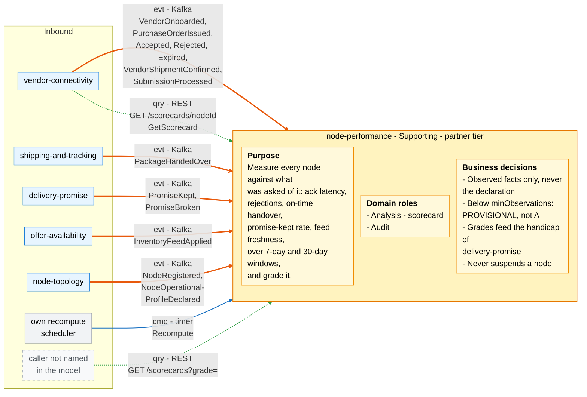
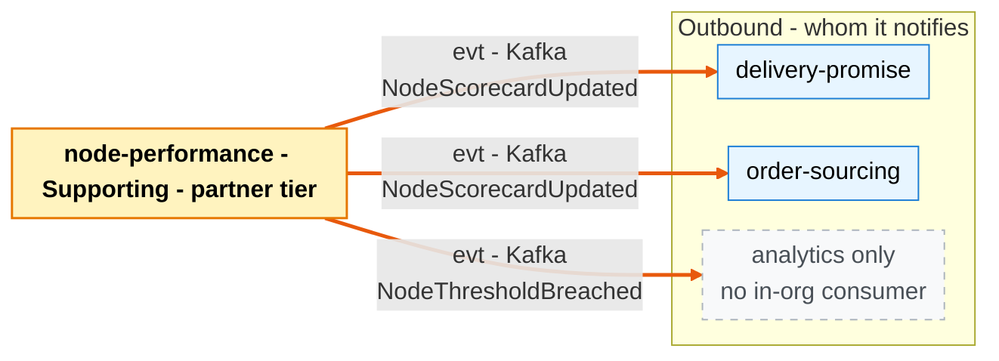

# Bounded Context Canvas

:::info[As built]
Derived from [`model/model.yaml`](https://github.com/IQVO/retail-network-docs/blob/main/model/model.yaml). This context's service is built; the model carries its as-built contracts, and identifiers (`Err...` names, routes, CloudEvents types) are the names the service uses.
:::

Following the ddd-crew [Bounded Context Canvas v5](https://github.com/ddd-crew/bounded-context-canvas).
Every message row comes from `contexts[node-performance]` (`inbound`,
`rest`, `publishes`, `consumes`, `sync_calls`) or from a neighbour's entry
that names this context.

## Canvas at a glance

Two pictures of the sections below: first the inbound collaborators feeding
this context (with its purpose, roles and business decisions), then the
outbound collaborators it notifies. Arrows follow the message type:
**solid blue** commands (`cmd`), **dotted green** queries (`qry`), **thick
orange** events (`evt`). Box shapes mark the collaborator kind: blue =
sibling bounded context; grey = this context's own scheduler; dashed = a
caller or consumer the model does not name. Channel names on the arrows
are abbreviated; the tables carry the exact route, topic and CloudEvents
type.

### Inbound

Derived from: model.yaml → contexts[node-performance].purpose, .roles,
.business_decisions, .inbound, .rest, .consumes,
.aggregates[NodeScorecard].throughput_estimate.

### Outbound

Derived from: model.yaml → contexts[node-performance].publishes,
.sync_calls (empty).

Both diagrams omit the relationship pattern per message (see the tables),
the assumptions, metrics and open questions below, and Postgres and Kafka
as infrastructure. There is no outbound command or query arrow because
`sync_calls` is empty: the reply to `vendor-connectivity`'s query is drawn
on the inbound side only.

## Name

**Node Performance** (`node-performance`, code `NP`, CloudEvents tier
`partner`).

## Purpose

Measures every node against what it declared and what was asked of it:
acknowledgement latency, rejections, on-time handover against
`requiredShipBy`, promise-kept rate and inventory feed freshness, over
rolling windows, and grades the node. The scorecard is built from observed
facts only. It is published so that `delivery-promise` can handicap a weak
node's promises and `order-sourcing` can price it, and it is readable by
the node's vendor through `vendor-connectivity`.

## Strategic Classification

| Axis | Verdict |
| --- | --- |
| **Domain** | **Supporting.** See the [Core Domain Chart](/network/contexts/node-performance/core-domain-chart) (complexity 0.34, differentiation 0.45). |
| **Business Model** | Risk reducer: promises rest on measured, not just declared, capability. |
| **Evolution** | Custom-built. |

## Domain Roles

| Role | Applies? | Evidence in the model |
| --- | --- | --- |
| **Analysis (scorecard)** | Yes, primary | `NodeScorecard` with `Metrics{onTimeHandoverRate, lateAckRate, rejectRate, expiryRate, promiseKeptRate, feedFreshnessP95Minutes, observations}` and the `Grading` policy. |
| **Audit** | Yes | Every metric is traceable to counted source events (`ErrDuplicateObservation` keys on the source event id). |
| **Enforcer** | No | "This context never suspends a node." The handicap is `delivery-promise`'s. |
| **Gateway** | No | Vendors reach the scorecard only through `vendor-connectivity`. |

## Inbound Communication

| Collaborator | Message | Type | Channel | Relationship |
| --- | --- | --- | --- | --- |
| `vendor-connectivity` | `VendorOnboarded` | Event | Kafka `retailnetwork.vendor-connectivity.events`, `com.retailnetwork.partner.vendor-connectivity.vendoraccount.VendorOnboarded` | Conformist |
| `vendor-connectivity` | `PurchaseOrderIssued` | Event | Kafka `retailnetwork.vendor-connectivity.events`, `com.retailnetwork.partner.vendor-connectivity.purchaseorder.PurchaseOrderIssued` | Conformist |
| `vendor-connectivity` | `PurchaseOrderAccepted` | Event | Kafka `retailnetwork.vendor-connectivity.events`, `com.retailnetwork.partner.vendor-connectivity.purchaseorder.PurchaseOrderAccepted` | Conformist |
| `vendor-connectivity` | `PurchaseOrderRejected` | Event | Kafka `retailnetwork.vendor-connectivity.events`, `com.retailnetwork.partner.vendor-connectivity.purchaseorder.PurchaseOrderRejected` | Conformist |
| `vendor-connectivity` | `PurchaseOrderExpired` | Event | Kafka `retailnetwork.vendor-connectivity.events`, `com.retailnetwork.partner.vendor-connectivity.purchaseorder.PurchaseOrderExpired` | Conformist |
| `vendor-connectivity` | `VendorShipmentConfirmed` | Event | Kafka `retailnetwork.vendor-connectivity.events`, `com.retailnetwork.partner.vendor-connectivity.purchaseorder.VendorShipmentConfirmed` | Conformist |
| `vendor-connectivity` | `SubmissionProcessed` | Event | Kafka `retailnetwork.vendor-connectivity.events`, `com.retailnetwork.partner.vendor-connectivity.submission.SubmissionProcessed` | Conformist |
| `vendor-connectivity` | `InboundReceiptSubmitted` | Event | Kafka `retailnetwork.vendor-connectivity.events`, `com.retailnetwork.partner.vendor-connectivity.inboundreceipt.InboundReceiptSubmitted` | Conformist |
| `seller-inbound` | `InboundShipmentShipped` | Event | Kafka `retailnetwork.seller-inbound.events`, `com.retailnetwork.partner.seller-inbound.inboundshipment.InboundShipmentShipped` | Conformist |
| `vendor-connectivity` | `GetScorecard` | Query | REST `GET /scorecards/{nodeId}` (in-org), serving the Vendor API's `GET /vendor/nodes/{nodeId}/scorecard` | Customer/Supplier (this context is the Supplier) |
| `shipping-and-tracking` | `PackageHandedOver` | Event | Kafka `retailnetwork.shipping-and-tracking.events`, `com.retailnetwork.logistics.shipping-and-tracking.journey.PackageHandedOver` | Conformist |
| `delivery-promise` | `PromiseKept` | Event | Kafka `retailnetwork.delivery-promise.events`, `com.retailnetwork.commerce.delivery-promise.promise.PromiseKept` | Conformist |
| `delivery-promise` | `PromiseBroken` | Event | Kafka `retailnetwork.delivery-promise.events`, `com.retailnetwork.commerce.delivery-promise.promise.PromiseBroken` | Conformist |
| `offer-availability` | `InventoryFeedApplied` | Event | Kafka `retailnetwork.offer-availability.events`, `com.retailnetwork.commerce.offer-availability.inventoryfeed.InventoryFeedApplied` | Conformist |
| `node-topology` | `NodeRegistered` | Event | Kafka `retailnetwork.node-topology.events`, `com.retailnetwork.logistics.node-topology.node.NodeRegistered` | Conformist |
| `node-topology` | `NodeOperationalProfileDeclared` | Event | Kafka `retailnetwork.node-topology.events`, `com.retailnetwork.logistics.node-topology.node.NodeOperationalProfileDeclared` | Conformist |
| Own scheduler | `Recompute` | Command | In-process timer, batched per minute (`throughput_estimate`) | Internal |
| Not named in the model | List scorecards by grade (the model gives no message name) | Query | REST `GET /scorecards?grade=` | Open Host (read-only) |

Every consumed event becomes, at most, one `RecordObservation` command on
the node's scorecards. Which events actually produce an observation is in
[Domain Events](/network/contexts/node-performance/domain-events).

## Outbound Communication

| Collaborator | Message | Type | Channel | Relationship |
| --- | --- | --- | --- | --- |
| `delivery-promise` | `NodeScorecardUpdated` | Event | Kafka `retailnetwork.node-performance.events`, `com.retailnetwork.partner.node-performance.scorecard.NodeScorecardUpdated` | Conformist (`delivery-promise` conforms; feeds its `ScorecardView` and `ScorecardHandicap`) |
| `order-sourcing` | `NodeScorecardUpdated` | Event | Kafka `retailnetwork.node-performance.events`, `com.retailnetwork.partner.node-performance.scorecard.NodeScorecardUpdated` | Conformist (`order-sourcing` conforms; feeds its `ScorecardView` and `AssignmentCost`) |
| Analytics only | `NodeThresholdBreached` | Event | Kafka `retailnetwork.node-performance.events`, `com.retailnetwork.partner.node-performance.scorecard.NodeThresholdBreached` | Published Language, no in-org consumer |

No synchronous outbound call: `sync_calls` is empty. Full payloads:
[Domain Events](/network/contexts/node-performance/domain-events). Relationship
reasoning: [Context Map](/network/contexts/node-performance/context-map).

## Ubiquitous Language

Full glossary: [Ubiquitous Language](/network/contexts/node-performance/ubiquitous-language).
Top terms: **Scorecard**, **Grade** (`A`-`D`, `PROVISIONAL`), **On-Time
Handover Rate**, **Late Ack Rate**, **Declared vs Measured**, **Window**
(7-day, 30-day).

## Business Decisions

1. **Observed facts only.** A scorecard is computed only from observed
   facts, never from the vendor's declaration.
2. **Provisional below the minimum.** A node with fewer than the minimum
   observations in the window is graded `PROVISIONAL`, not `A`
   (`ErrInsufficientObservations` guards a grade without enough
   observations).
3. **Grading thresholds** (`Grading` policy):

   | Grade | onTimeHandoverRate | promiseKeptRate | lateAckRate |
   | --- | --- | --- | --- |
   | `A` | `>= 0.98` | `>= 0.97` | `<= 0.01` |
   | `B` | `>= 0.95` | `>= 0.94` | `<= 0.03` |
   | `C` | `>= 0.90` | `>= 0.90` | `<= 0.05` |
   | `D` | otherwise | otherwise | otherwise |

4. **Count once.** An observation is counted once, idempotent on the
   source event id (`ErrDuplicateObservation`).
5. **Report crossings.** `NodeThresholdBreached` is published when a metric
   crosses its threshold downward (`ThresholdAlert`).
6. **Never suspend.** Grades drive the promise handicap (owned by
   `delivery-promise`); this context never suspends a node.

## Assumptions

- `vendor-connectivity`, `shipping-and-tracking`, `delivery-promise` and
  `offer-availability` publish every fact once per occurrence through their
  outboxes, and a redelivery carries the same CloudEvents `id`.
- `poNumber` joins a handover (`PackageHandedOver`) to the purchase order's
  `requiredShipBy` (from `PurchaseOrderIssued` or `VendorShipmentConfirmed`).
- `nodeId` is the same identifier in every producer (it is minted by
  `node-topology`).
- A per-minute recompute is fresh enough for the handicap; nothing on the
  promise hot path waits for it.

## Verification Metrics

- **Freshness:** time from a consumed event's CloudEvents `time` to the
  `NodeScorecardUpdated` that includes it; target under two recompute
  periods.
- **Coverage:** share of `ACTIVE` vendor nodes with a `GRADED` 30-day
  scorecard.
- **Duplicates:** count of `ErrDuplicateObservation` per hour (expected
  non-zero under redelivery, never counted into a metric).
- **Correlation gaps:** `PackageHandedOver` observations whose `poNumber`
  has no known `requiredShipBy`; should trend to zero.
- **Predictive value:** promise-kept rate of the following 7 days per
  grade; a `D` node should keep fewer promises than an `A` node, or the
  thresholds need tuning.
- **Breach rate:** `NodeThresholdBreached` per node per week.

## Open Questions

Each comes from a gap in the model; none is answered on these pages.

- **What is `minObservations`, and what counts toward it?** The model
  names the invariant but no value.
- **What are the literal window values?** These pages use `7d` and `30d`.
- **Which window drives the handicap and the cost?** Both windows publish
  `NodeScorecardUpdated`; neither consumer says which it reads.
- **How does `delivery-promise` treat `PROVISIONAL`?** `ScorecardHandicap`
  defines `A`-`D` and "no scorecard yet", not `PROVISIONAL`.
- **What are the `ThresholdAlert` thresholds per metric**, and what does
  "downward" mean for metrics where higher is worse (`lateAckRate`,
  `rejectRate`, `expiryRate`, `feedFreshnessP95Minutes`)?
- **Which `PromiseBroken` causes count against the node?** The event
  carries `cause`, but no rule attributes a late linehaul to the network
  rather than the node.
- **How is feed freshness sampled?** `InventoryFeedApplied` carries
  `appliedAt` but no `asOf`.
- **What do `VendorOnboarded`, `SubmissionProcessed`, `NodeRegistered` and
  `NodeOperationalProfileDeclared` feed?** They are consumed, but no metric
  reads them, `SubmissionProcessed` and `VendorOnboarded` carry no `nodeId`,
  and the context declares no read model.
- **Who calls `GET /scorecards?grade=`?** No inbound row names a caller.
- **How is the issue instant of a purchase order known?**
  `PurchaseOrderIssued` has `ackBy` but no `issuedAt`; these pages read the
  CloudEvents `time`.
