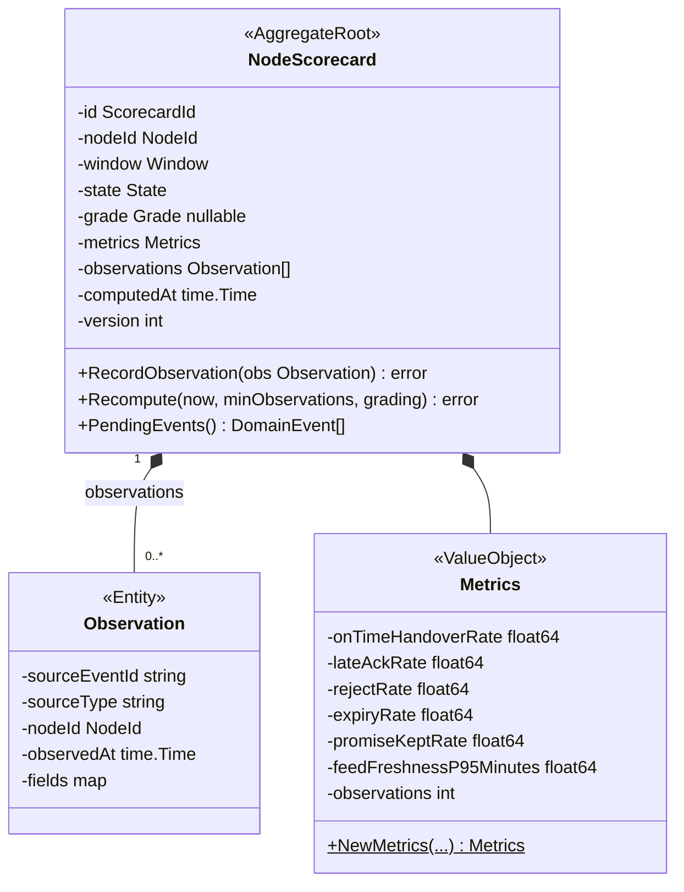
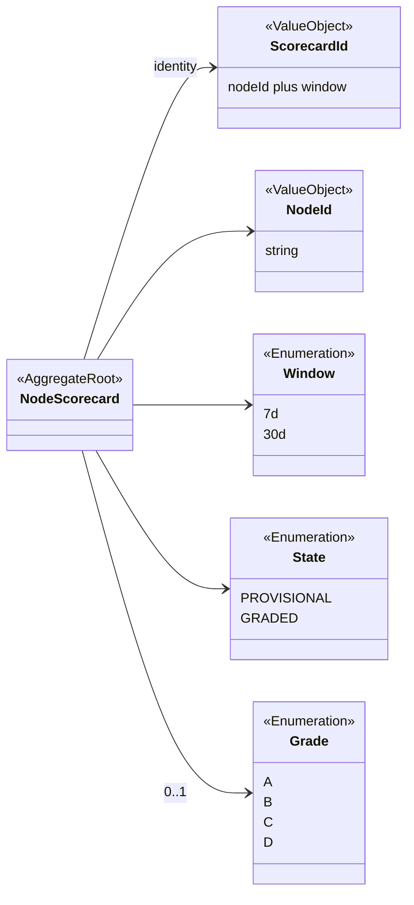
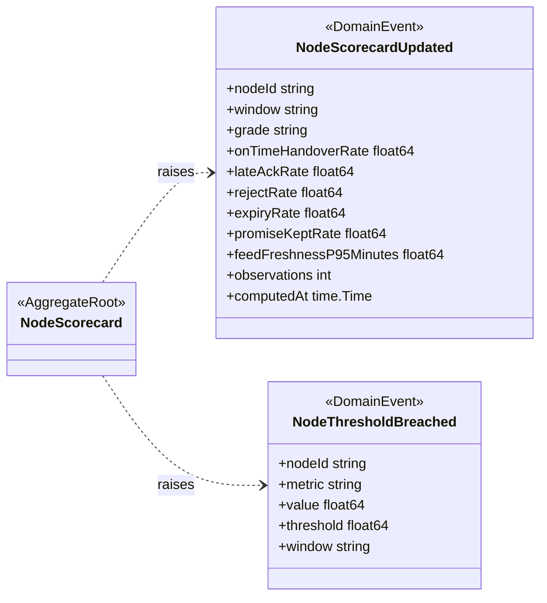
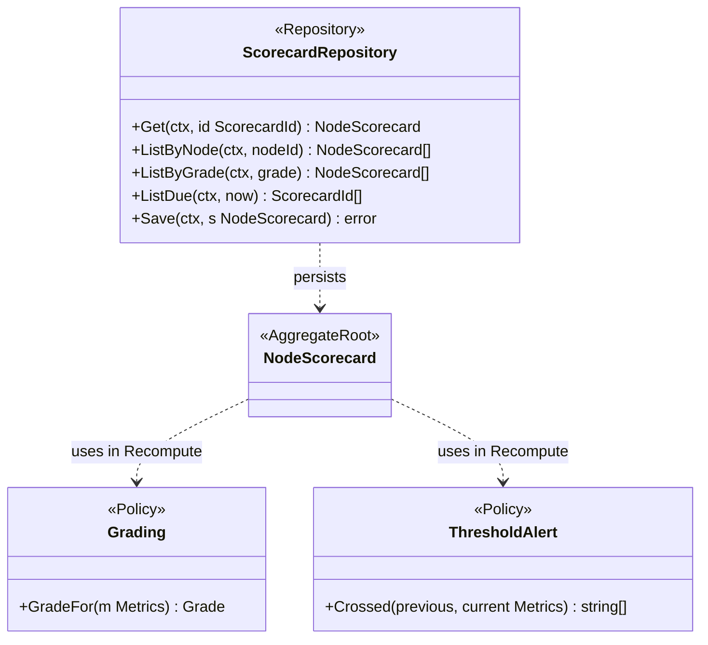
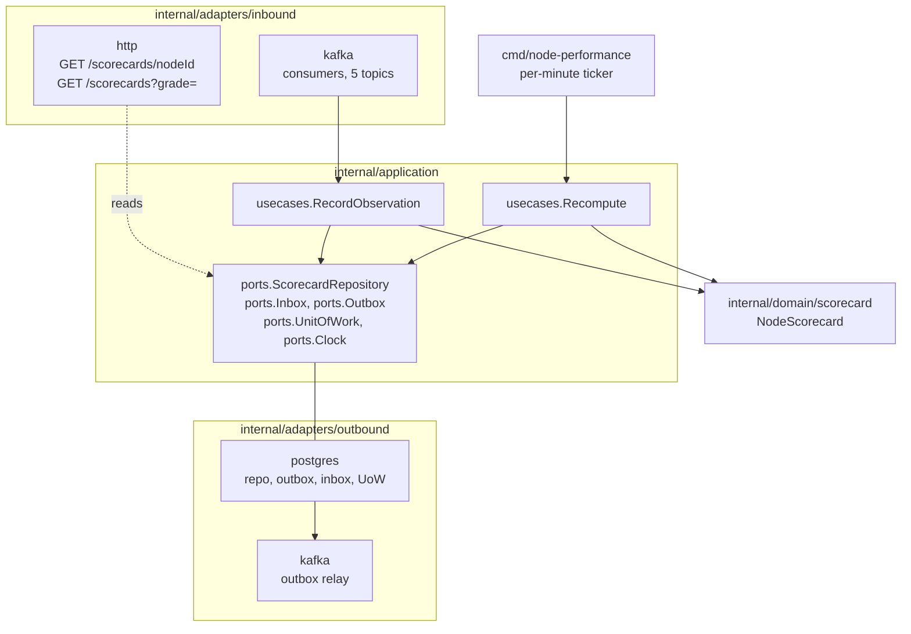

# Class Diagram

:::info[As built]
Derived from [`model/model.yaml`](https://github.com/IQVO/retail-network-docs/blob/main/model/model.yaml). This context's service is built; the model carries its as-built contracts, and identifiers (`Err...` names, routes, CloudEvents types) are the names the service uses.
:::

UML class diagrams of the **proposed** Go domain model in
`internal/domain/scorecard`, followed by the hexagonal ports and adapters
in the fleet's layout. Fields are shown unexported (`-`), methods exported
(`+`). Only state-changing methods and key queries are shown.

## 1. NodeScorecard aggregate

### 1a. Root, observations and metrics

### 1b. Identity and enumerations

Derived from: model.yaml → contexts[node-performance].aggregates[NodeScorecard]
(.root_id, .states, .value_objects, .commands, .invariants, .size_estimate).

Omitted: the errors. `NewMetrics` returns `ErrRateOutOfRange`;
`Recompute` returns `ErrInsufficientObservations` only on a path that
would grade a thin window; `RecordObservation` returns
`ErrDuplicateObservation`. `Observation` is this page's name for the
collection the model implies (no entity is listed); `fields` holds the
source event's data fields a metric reads. `version` is the proposed
optimistic-concurrency counter. The `7d` and `30d` literals are proposed.
`PROVISIONAL` is a `State`; when the state is `PROVISIONAL` the published
`grade` is the string `PROVISIONAL` and `grade` here is empty.

## 2. Events, policies and repository

### 2a. Domain events

### 2b. Policies and repository

Derived from: model.yaml → contexts[node-performance].policies,
.publishes[].data, .rest.

Omitted: the `Grading` thresholds (on the
[Bounded Context Canvas](/network/contexts/node-performance/bounded-context-canvas));
`ThresholdAlert` has no threshold table in the model.

## 3. Hexagonal ports and adapters

Derived from: model.yaml → contexts[node-performance].rest, .consumes,
.aggregates[NodeScorecard].commands, .throughput_estimate;
conventions.integration_rules.

Omitted: `Clock` is satisfied in the composition root and has no adapter
package. The HTTP adapter reads the repository directly, because both
routes are pure reads (the fleet's convention). There is no outbound HTTP
client: `sync_calls` is empty. The relay reads `outbox_events` and
publishes to `retailnetwork.node-performance.events`.
