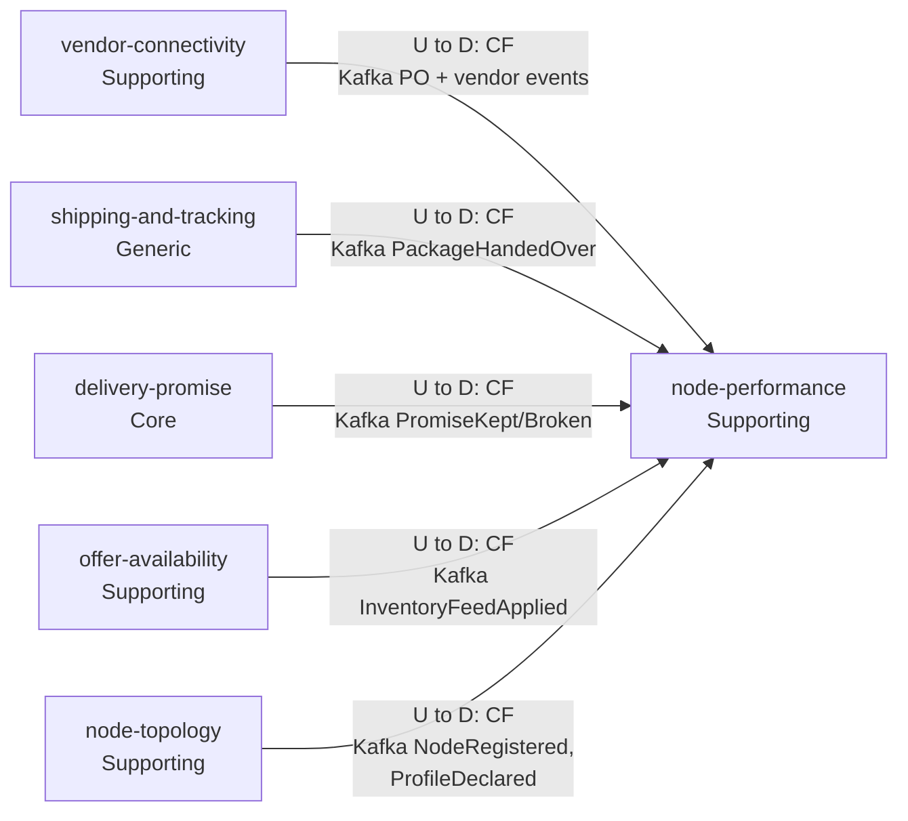
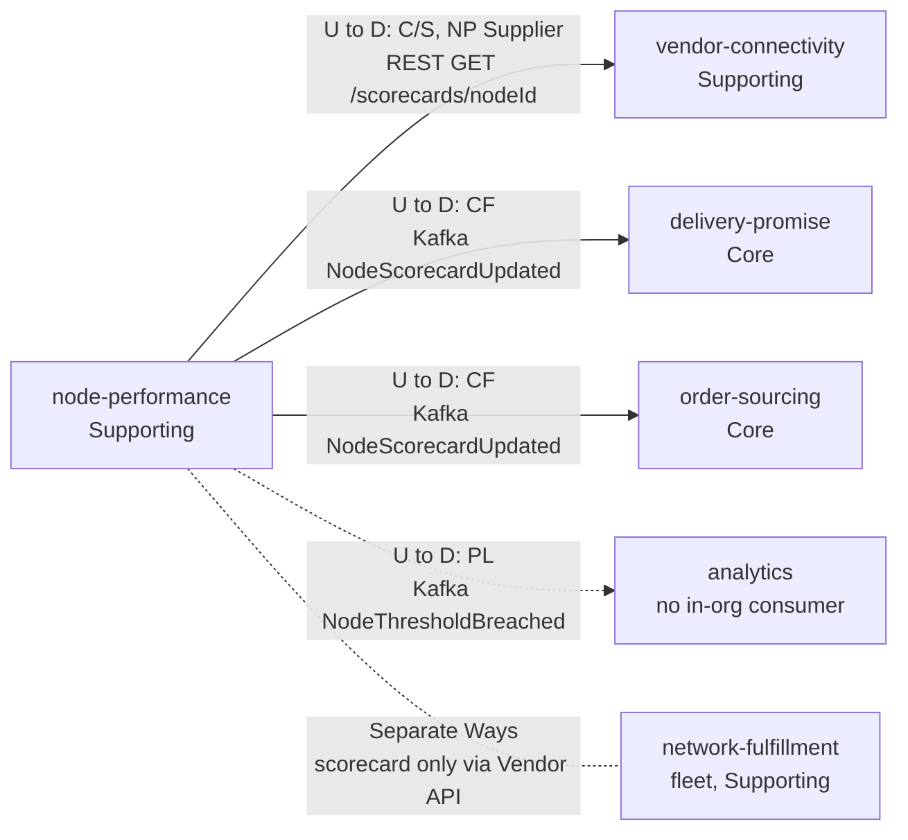

# Context Map

:::info[Proposed design]
Derived from [`model/model.yaml`](https://github.com/IQVO/retail-network-docs/blob/main/model/model.yaml). Nothing in this context is built yet; identifiers (`Err...` names, routes, CloudEvents types) are the names an implementation must use.
:::

Following ddd-crew [Context Mapping](https://github.com/ddd-crew/context-mapping).
This is **node-performance's slice** of the
[network-wide context map](/network/strategic-design/context-map): every
relationship this context has, with the upstream (U) and downstream (D)
side, the pattern and the channel. Arrows point from upstream to
downstream. The map is split in two diagrams to stay readable;
`vendor-connectivity` and `delivery-promise` appear in both because each
has one edge in each direction.

### Upstream: what node-performance conforms to

Derived from: model.yaml → contexts[node-performance].inbound,
.consumes; the producers' publishes.

### Downstream: who depends on node-performance

Derived from: model.yaml → contexts[node-performance].publishes,
.inbound (GetScorecard); contexts[delivery-promise].inbound,
contexts[order-sourcing].inbound, contexts[vendor-connectivity].sync_calls;
meta.hard_boundary; external[network-fulfillment].

Legend: solid arrow = integration edge in the model; dotted arrow = a
published event with no in-organization consumer ("analytics only");
dotted line without arrow head = no relationship (Separate Ways). Path
parameter `{nodeId}` is written `nodeId` inside the diagram. "PO + vendor
events" stands for the seven `vendor-connectivity` events listed in the
table.

Omitted: Postgres and Kafka as infrastructure; the contexts with no edge
to this one, which are Separate Ways: `customer-ordering` (Generic),
`linehaul-transportation` (Supporting) and `last-mile-delivery`
(Supporting).

## Relationships

| Neighbour | Direction | Pattern | Channel | Messages | Why this pattern |
| --- | --- | --- | --- | --- | --- |
| `vendor-connectivity` (Supporting) | U → D (NP downstream) | Conformist | Kafka `retailnetwork.vendor-connectivity.events` | `VendorOnboarded`, `PurchaseOrderIssued`, `PurchaseOrderAccepted`, `PurchaseOrderRejected`, `PurchaseOrderExpired`, `VendorShipmentConfirmed`, `SubmissionProcessed` | The purchase-order protocol and its clock belong to `vendor-connectivity`. This context takes the facts as published and translates nothing. |
| `vendor-connectivity` (Supporting) | U → D (NP upstream) | Customer/Supplier, NP is the Supplier | REST `GET /scorecards/{nodeId}` (in-org) | `GetScorecard` | `vendor-connectivity` needs an answer inside a vendor's request to `GET /vendor/nodes/{nodeId}/scorecard`, so it is a sync call (listed in its `sync_calls`). The two teams agree the shape; `vendor-connectivity` re-exposes it in its own Published Language and checks node ownership (`ErrNodeNotOwnedByVendor`). |
| `shipping-and-tracking` (Generic) | U → D | Conformist | Kafka `retailnetwork.shipping-and-tracking.events` | `PackageHandedOver` | The handover instant is defined by `shipping-and-tracking`'s `HandoverOnFirstScan` policy ("the handover instant used by node-performance"). This context accepts that definition. |
| `delivery-promise` (Core) | U → D (NP downstream) | Conformist | Kafka `retailnetwork.delivery-promise.events` | `PromiseKept`, `PromiseBroken` | The judgement against `deliverByLatest` is `delivery-promise`'s. This context counts it. |
| `delivery-promise` (Core) | U → D (NP upstream) | Conformist (`delivery-promise` conforms) | Kafka `retailnetwork.node-performance.events` | `NodeScorecardUpdated` | `delivery-promise` keeps a local `ScorecardView` and applies `ScorecardHandicap`; no sync call on the promise hot path. |
| `offer-availability` (Supporting) | U → D | Conformist | Kafka `retailnetwork.offer-availability.events` | `InventoryFeedApplied` | `InventoryFeedApplied` is published for this context only; it is consumed as is. |
| `node-topology` (Supporting) | U → D | Conformist | Kafka `retailnetwork.node-topology.events` | `NodeRegistered`, `NodeOperationalProfileDeclared` | `node-topology` is the master of node identity and the declared profile. |
| `order-sourcing` (Core) | U → D | Conformist (`order-sourcing` conforms) | Kafka `retailnetwork.node-performance.events` | `NodeScorecardUpdated` | Feeds `order-sourcing`'s `ScorecardView` and the `scorecardPenalty` of `AssignmentCost`. |
| Analytics (not a context) | U → D | Published Language | Kafka `retailnetwork.node-performance.events` | `NodeThresholdBreached` | Consumers: "analytics only" in the model. |
| `network-fulfillment` (warehouse-systems fleet, other organization; Supporting in the fleet) | none | Separate Ways | none | none | The hard boundary: no retail-network context calls the fleet or is called by it except through the Vendor API. A vendor reads its scorecard via `vendor-connectivity`. |

## Notes on the patterns

- **Conformist everywhere upstream.** Every fact this context reads is
  published once by its owner for several consumers. Translating them
  would add an anti-corruption layer with nothing to protect: the
  vocabulary (`poNumber`, `nodeId`, `requiredShipBy`, `deliverByLatest`) is
  already the network's own.
- **A two-way relationship with `delivery-promise`, by events only.**
  `delivery-promise` is upstream for promise judgements and downstream for
  grades. Neither calls the other, so there is no runtime cycle: a grade
  computed from last week's broken promises changes next week's `shipBy`.
- **Customer/Supplier with `vendor-connectivity` for the read.** It is the
  only synchronous edge. If this context is down, the Vendor API's
  scorecard route fails; nothing else does.
- **No Shared Kernel.** `nodeId` and `poNumber` are values copied from the
  events, not shared code.
