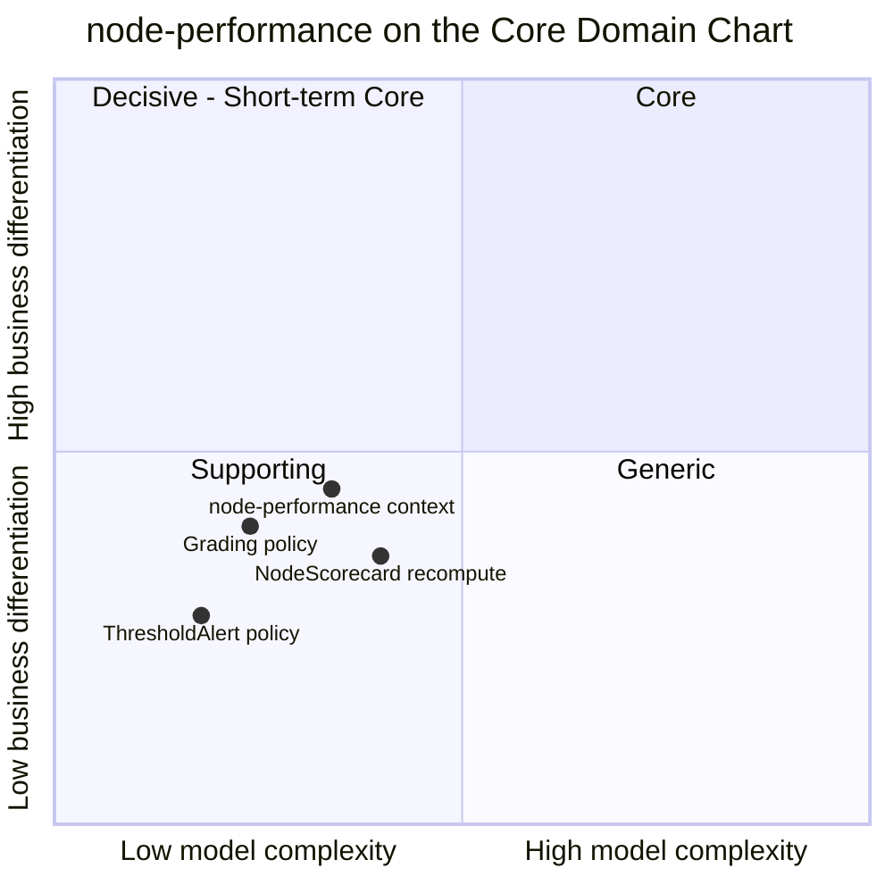

# Core Domain Chart

:::info[Proposed design]
Derived from [`model/model.yaml`](https://github.com/IQVO/retail-network-docs/blob/main/model/model.yaml). Nothing in this context is built yet; identifiers (`Err...` names, routes, CloudEvents types) are the names an implementation must use.
:::

Following the ddd-crew [Core Domain Charts](https://github.com/ddd-crew/core-domain-charts):
business differentiation (y) against model complexity (x).

Derived from: model.yaml → contexts[node-performance].chart,
contexts[node-performance].classification,
contexts[node-performance].aggregates[NodeScorecard],
contexts[node-performance].policies.

Omitted: the other nine contexts (their positions are on the
[network-wide chart](/network/strategic-design/core-domain-chart)). The three
internal slices are placed by this page, not by the model; the model gives
only the context point.

## Classification: Supporting

The context point sits at complexity 0.34, differentiation 0.45: **quadrant
3, Supporting**, close to the vertical middle. All three slices stay in the
same quadrant.

**Differentiation is moderate (y = 0.45).** The grade matters to the
business: it is one of the two inputs to the promise (declared and
measured, [ADR 0003](/network/adr/0003-declared-and-measured-capability)), and a
promise the network cannot keep is the costliest mistake it can make. But
the differentiating decision is not made here. `delivery-promise` turns
the grade into a later `shipBy` (`ScorecardHandicap`), and `order-sourcing`
turns it into a cost (`AssignmentCost`). This context supplies a
trustworthy number and stops, which is the definition of a supporting
capability. The `Grading` policy is plotted highest of the slices because
its thresholds are where the business states what "good enough" means.

**Model complexity is low to moderate (x = 0.34).** One aggregate,
`NodeScorecard`, with two states (`PROVISIONAL`, `GRADED`), three
transitions all driven by `Recompute`, two commands and three invariants.
The real work is in the inputs: thirteen consumed event types from five
producers, idempotent on the source event id
(`ErrDuplicateObservation`), joined by `poNumber` and `nodeId`, and
recomputed over two rolling windows. That is data plumbing more than
domain logic, so the recompute slice sits furthest right but still well
below the Core line. The `ThresholdAlert` policy is a comparison and sits
lowest.

## Business model and evolution

| Axis | Verdict |
| --- | --- |
| **Business model** | Risk reducer: promises rest on measured, not just declared, capability. |
| **Evolution** | Custom-built. The metrics, thresholds and the declared-vs-measured split are this network's own. |

| Part | Evolution stage | Why |
| --- | --- | --- |
| `Grading` and `ThresholdAlert` policies | Custom-built | Thresholds are a business choice of this network and will be tuned. |
| `NodeScorecard` recompute over rolling windows | Custom-built, trending to Product | Windowed rates and percentiles are a well-known shape; a stream-processing product could compute them. |
| Inbox, outbox, CloudEvents | Commodity | The same building blocks as every other context ([event standard](/network/strategic-design/event-standard-cloudevents)). |

## Why it is its own context

The scorecard could have lived inside `vendor-connectivity` (which sees
most purchase-order facts) or inside `delivery-promise` (which uses the
grade). It does not, for three reasons taken from the model:

1. **It reads from five producers.** Handover comes from
   `shipping-and-tracking`, promise judgement from `delivery-promise`,
   feed freshness from `offer-availability`. Putting the scorecard in any
   one of them would make that context consume the others' facts for a
   purpose that is not its own.
2. **It must stay neutral.** `delivery-promise` judges promises and also
   applies the handicap; if it also computed the grade, the judge and the
   penalty would sit in one model. Keeping the measurement apart keeps the
   rule "this context never suspends a node" easy to enforce.
3. **Two consumers use the grade differently.** `delivery-promise` and
   `order-sourcing` both conform to one published `NodeScorecardUpdated`.

**Movement to watch.** If the network later lets the grade decide by
itself (for example, an automatic suspension), this context would gain an
Enforcer role and move up. The model rules that out today ("this context
never suspends a node"); it would need a new ADR.
