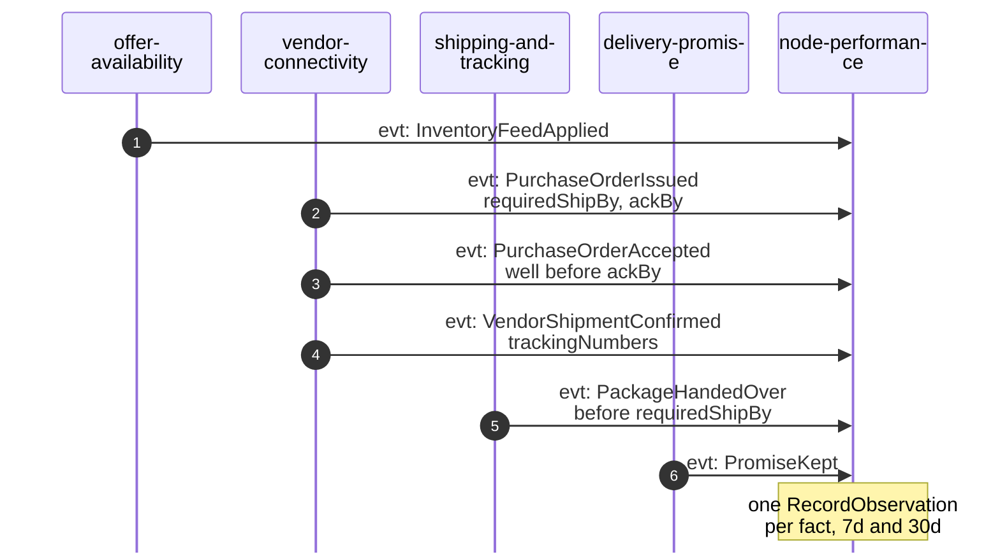
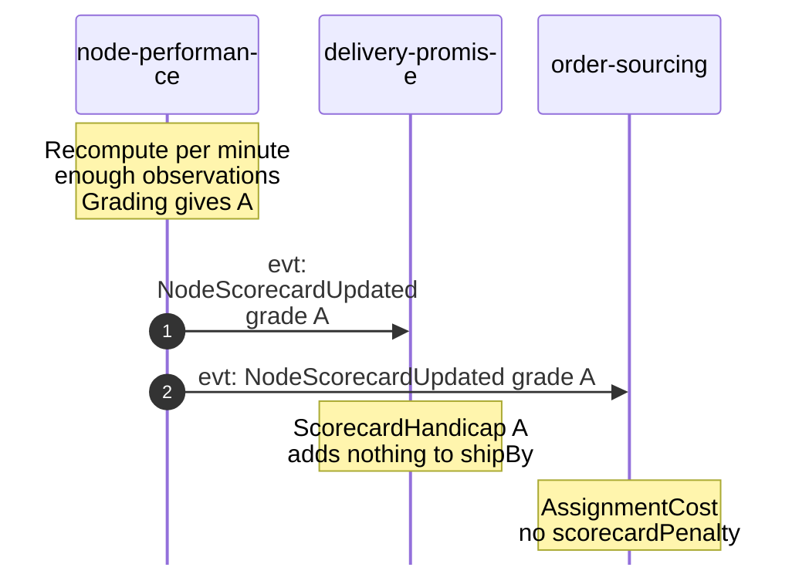
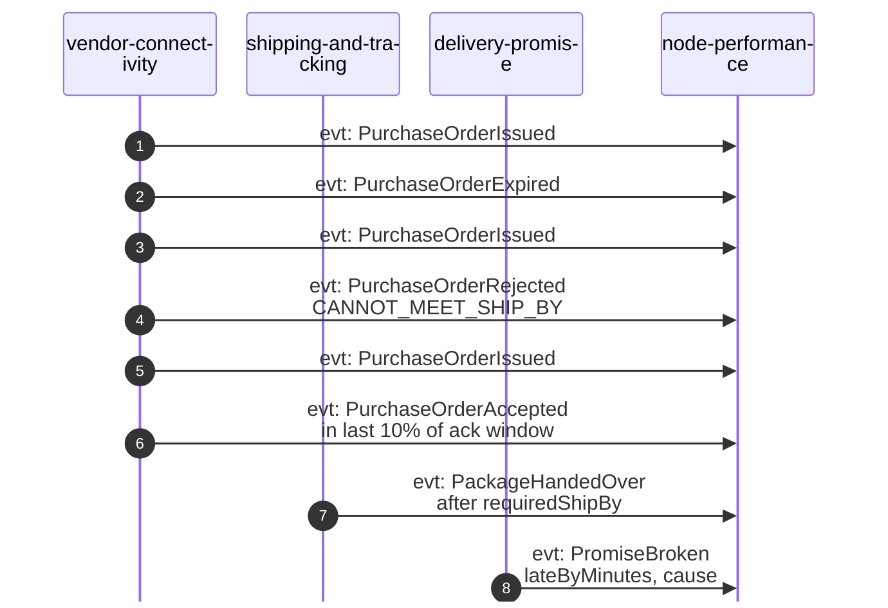
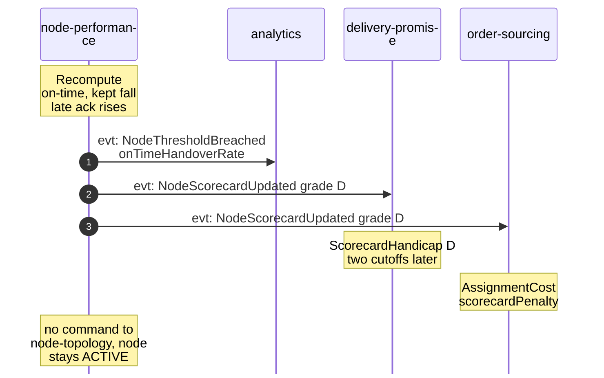
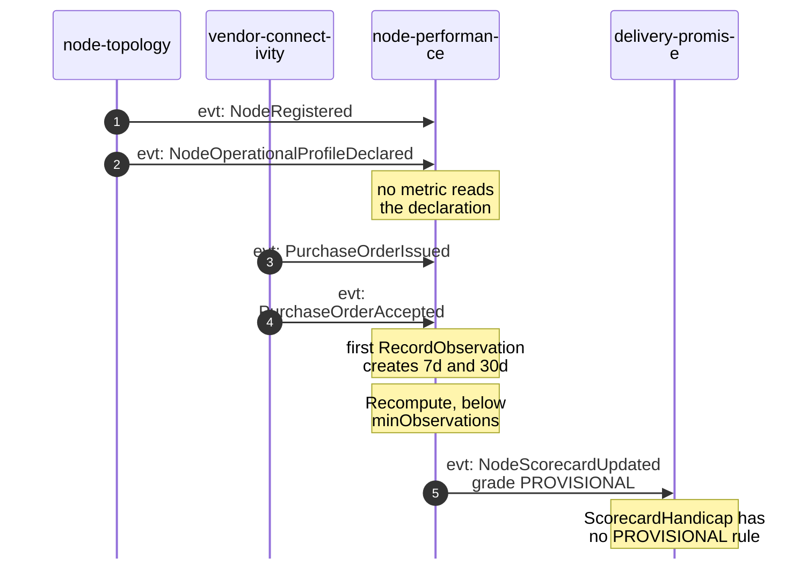
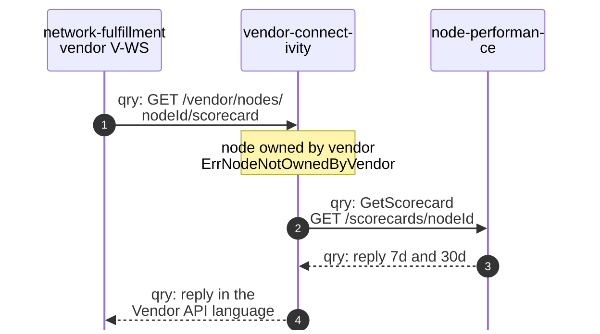

# Domain Message Flow

:::info[As built]
Derived from [`network/model/model.yaml`](https://github.com/IQVO/warehouse-docs/blob/main/network/model/model.yaml). This context's service is built; the model carries its as-built contracts, and identifiers (`Err...` names, routes, CloudEvents types) are the names the service uses.
:::

Following ddd-crew [Domain Message Flow Modelling](https://github.com/ddd-crew/domain-message-flow-modelling).
Participants are contexts and actors. Every arrow is a message from the
model, prefixed `cmd:` (command), `evt:` (event) or `qry:` (query). Event
arrows go from the producer straight to the consumer; Kafka is implied.
Full CloudEvents types are on [Domain Events](/network/contexts/node-performance/domain-events).
The network-wide flows are on
[Domain message flows](/network/strategic-design/domain-message-flows).

## 1. A good node is graded and the grade reaches the promise

### 1a. Facts arrive

### 1b. The grade is published

Derived from: model.yaml → contexts[node-performance].consumes,
.publishes, .policies[Grading]; contexts[delivery-promise].policies[ScorecardHandicap];
contexts[order-sourcing].policies[AssignmentCost].

Omitted: what causes each fact (`order-sourcing`'s
`FulfillmentReleasedToNode`, the vendor's calls on the Vendor API, the
label and the delivery that lead to `PromiseKept`); the other consumers of
each event (`order-sourcing` also consumes the purchase-order events).
Both windows publish their own `NodeScorecardUpdated`; one is drawn. The
size of `scorecardPenalty` per grade is not in the model.

## 2. A node degrades and is handicapped, not suspended

The most important failure path.

### 2a. Bad facts arrive

### 2b. The grade drops and neighbours react

Derived from: model.yaml → contexts[node-performance].consumes,
.policies[Grading, ThresholdAlert], .business_decisions;
contexts[vendor-connectivity].aggregates[PurchaseOrder].value_objects
(RejectReason); contexts[delivery-promise].policies[ScorecardHandicap];
contexts[order-sourcing].policies[AssignmentCost].

Omitted: `order-sourcing`'s own reaction to the rejection and the expiry
(`ReassignOnRefusal`), which happens whatever the grade is. A single bad
day rarely moves a 30-day grade; the diagram compresses many facts into a
few. The threshold values for `NodeThresholdBreached` are not in the model.

## 3. A new node stays provisional

Derived from: model.yaml → contexts[node-performance].business_decisions
(PROVISIONAL, not A), .aggregates[NodeScorecard].invariants
(`ErrInsufficientObservations`), .ul[Grade];
contexts[delivery-promise].policies[ScorecardHandicap].

Omitted: `order-sourcing` receives the same event. The last note is a
model gap, not a behaviour: how `delivery-promise` treats `PROVISIONAL` is
open.

## 4. A vendor reads its node's scorecard

Derived from: model.yaml → contexts[vendor-connectivity].inbound (qry
GetScorecard), .sync_calls (GET /scorecards/nodeId),
.aggregates[VendorAccount].invariants; contexts[node-performance].inbound,
.rest; meta.hard_boundary.

Omitted: the `404` branch for a node with no scorecard yet (see
[Use Cases](/network/contexts/node-performance/use-cases)); the Vendor API's rate
limit (`429`). Path parameters are written without braces.
`network-fulfillment` belongs to the warehouse-systems fleet; this is the
only path by which the fleet sees a grade.
