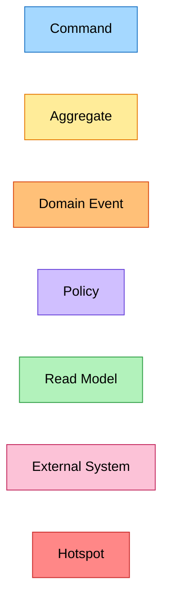
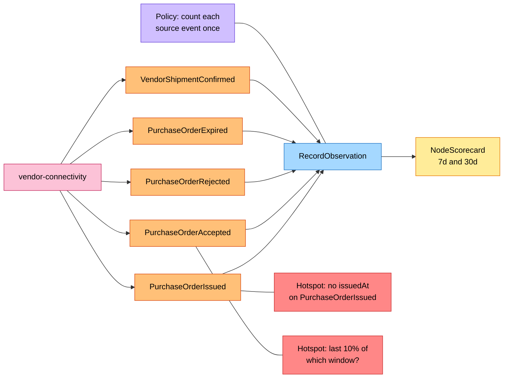
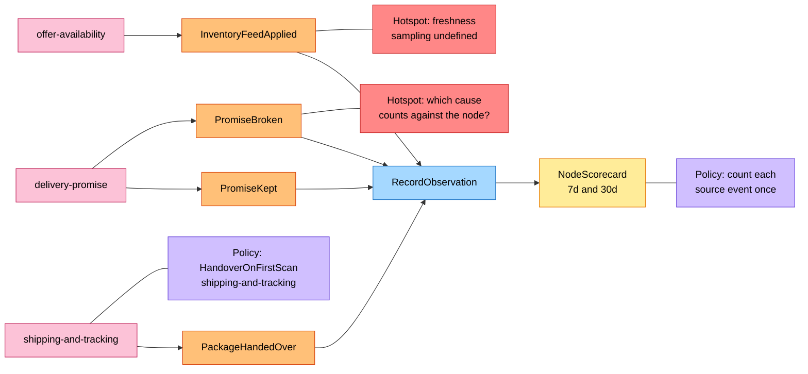
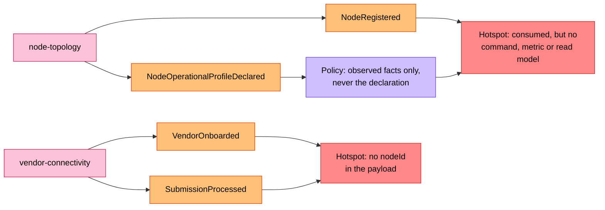
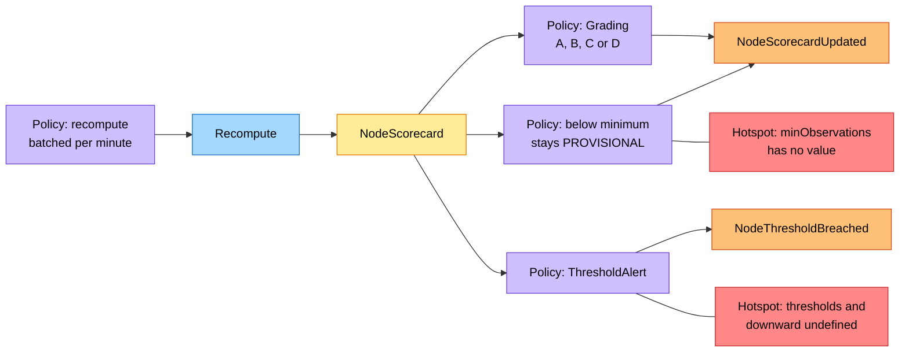
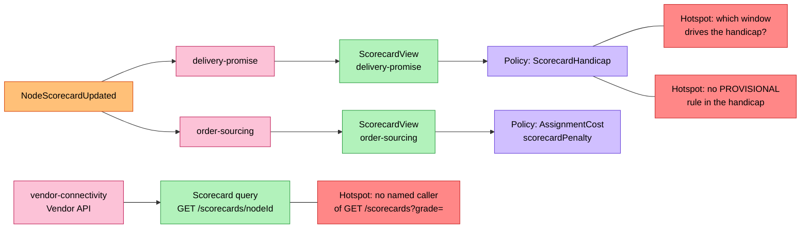

# EventStorming

:::info[As built]
Derived from [`network/model/model.yaml`](https://github.com/IQVO/warehouse-docs/blob/main/network/model/model.yaml). This context's service is built; the model carries its as-built contracts, and identifiers (`Err...` names, routes, CloudEvents types) are the names the service uses.
:::

Process-level boards in the ddd-crew
[EventStorming glossary & cheat sheet](https://github.com/ddd-crew/eventstorming-glossary-cheat-sheet)
notation. Every sticky comes from `model.yaml`. Every hotspot is a gap or
risk in the model, and the table at the end says where each comes from.
The network-wide board is
[EventStorming big picture](/network/strategic-design/eventstorming-big-picture).

## Legend

| Sticky | Colour | Meaning here |
| --- | --- | --- |
| Command | blue `#a5d8ff` | `RecordObservation`, `Recompute` |
| Aggregate | yellow `#ffec99` | `NodeScorecard` |
| Domain Event | orange `#ffc078` | an event this context publishes or consumes |
| Policy | lilac `#d0bfff` | a rule from `policies` or `business_decisions` (own or a neighbour's) |
| Read Model | green `#b2f2bb` | data read to decide or to answer a query |
| External System | pink `#fcc2d7` | another bounded context |
| Hotspot | red `#ff8787` | an open question or risk in the model |

## 1. Purchase-order facts become observations

Derived from: model.yaml → contexts[node-performance].consumes,
.aggregates[NodeScorecard].commands, .invariants (`ErrDuplicateObservation`),
.ul[Late Ack Rate]; contexts[vendor-connectivity].publishes.

Omitted: the inbox write and the transaction. `VendorShipmentConfirmed`
feeds no rate by itself; it links `trackingNumbers` to `requiredShipBy`.

## 2. Handover, promise and feed facts become observations

Derived from: model.yaml → contexts[node-performance].consumes;
contexts[shipping-and-tracking].policies[HandoverOnFirstScan], .publishes;
contexts[delivery-promise].publishes; contexts[offer-availability].publishes.

Omitted: the `poNumber` join from a handover to its `requiredShipBy`,
which happens at recompute time.

## 3. Facts the model gives no use

Derived from: model.yaml → contexts[node-performance].consumes,
.read_models (empty), .business_decisions; contexts[node-topology].publishes;
contexts[vendor-connectivity].publishes.

## 4. Recompute and grade

Derived from: model.yaml → contexts[node-performance].aggregates[NodeScorecard]
(.commands, .transitions, .events, .throughput_estimate), .policies,
.business_decisions.

## 5. Where the grade is used

Derived from: model.yaml → contexts[delivery-promise].read_models[ScorecardView],
.policies[ScorecardHandicap]; contexts[order-sourcing].read_models[ScorecardView],
.policies[AssignmentCost]; contexts[vendor-connectivity].sync_calls;
contexts[node-performance].rest.

Omitted: `NodeThresholdBreached` goes to analytics only. "Scorecard query"
is not a declared read model: it reads the `NodeScorecard` table directly
(`read_models` is empty).

## Sticky inventory

| Sticky | Kind | Model evidence |
| --- | --- | --- |
| `RecordObservation`, `Recompute` | Command | `aggregates[NodeScorecard].commands` |
| `NodeScorecard` | Aggregate | `aggregates[NodeScorecard]` |
| `NodeScorecardUpdated`, `NodeThresholdBreached` | Domain Event (published) | `publishes` |
| Thirteen consumed events | Domain Event (consumed) | `consumes` |
| Count each source event once | Policy | invariant `ErrDuplicateObservation` |
| Grading | Policy | `policies[Grading]` |
| ThresholdAlert | Policy | `policies[ThresholdAlert]` |
| Below minimum stays PROVISIONAL | Policy | `business_decisions[1]`, invariant `ErrInsufficientObservations` |
| Observed facts only, never the declaration | Policy | `business_decisions[0]` |
| Recompute batched per minute | Policy | `aggregates[NodeScorecard].throughput_estimate` |
| HandoverOnFirstScan | Policy (neighbour) | `contexts[shipping-and-tracking].policies` |
| ScorecardHandicap, AssignmentCost | Policy (neighbour) | `contexts[delivery-promise].policies`, `contexts[order-sourcing].policies` |
| ScorecardView (two) | Read Model (neighbour) | `read_models` of `delivery-promise` and `order-sourcing` |
| Scorecard query | Read Model (aggregate read) | `rest` |
| Six neighbour contexts | External System | `inbound`, `publishes[].consumers`, `sync_calls` of `vendor-connectivity` |

## Hotspots and where they come from

| Hotspot | Source in the model |
| --- | --- |
| No `issuedAt` on `PurchaseOrderIssued` | `contexts[vendor-connectivity].publishes[PurchaseOrderIssued].data` lacks it; Late Ack Rate needs the start of the ack window. These pages read the CloudEvents `time`. |
| "Last 10% of the window": which window? | `ul[Late Ack Rate]`: "window" could be the ack window or the scorecard window. |
| Which `PromiseBroken` cause counts against the node? | `publishes[PromiseBroken].data` has `cause`; no rule in `node-performance` uses it. |
| Feed freshness sampling undefined | `Metrics.feedFreshnessP95Minutes` has no definition; `InventoryFeedApplied` has `appliedAt` but no `asOf`. |
| Consumed, but no command, metric or read model | `consumes` lists `NodeRegistered`, `NodeOperationalProfileDeclared`, `VendorOnboarded`, `SubmissionProcessed`; `read_models: []`; `commands` has only `RecordObservation` and `Recompute`. |
| No `nodeId` in the payload | `publishes[VendorOnboarded].data`, `publishes[SubmissionProcessed].data` in `vendor-connectivity`. |
| `minObservations` has no value | invariant `ErrInsufficientObservations`. |
| Thresholds and "downward" undefined | `policies[ThresholdAlert]`: no per-metric threshold; four metrics are worse when higher. |
| Which window drives the handicap? | `delivery-promise` and `order-sourcing` read `NodeScorecardUpdated` for both windows; neither policy names one. |
| No `PROVISIONAL` rule in the handicap | `contexts[delivery-promise].policies[ScorecardHandicap]` covers `A`-`D` and "no scorecard yet". |
| No named caller of `GET /scorecards?grade=` | `rest` lists it; no `inbound` row names a caller. |
