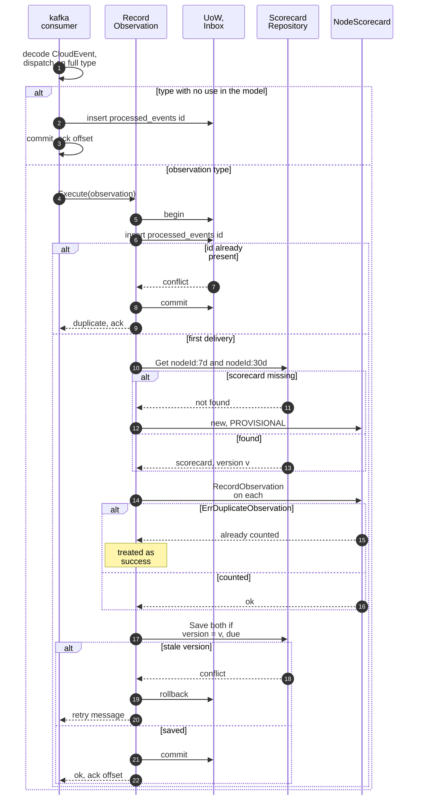
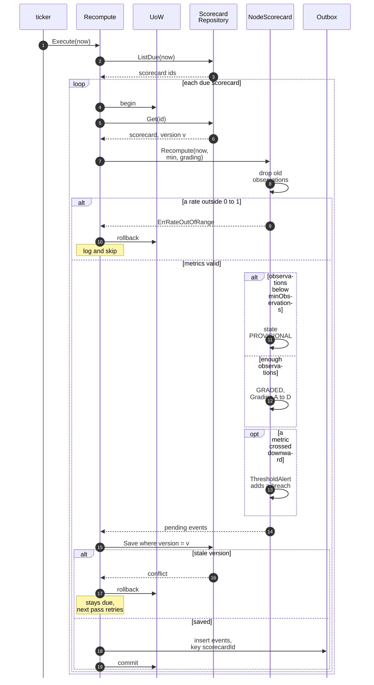
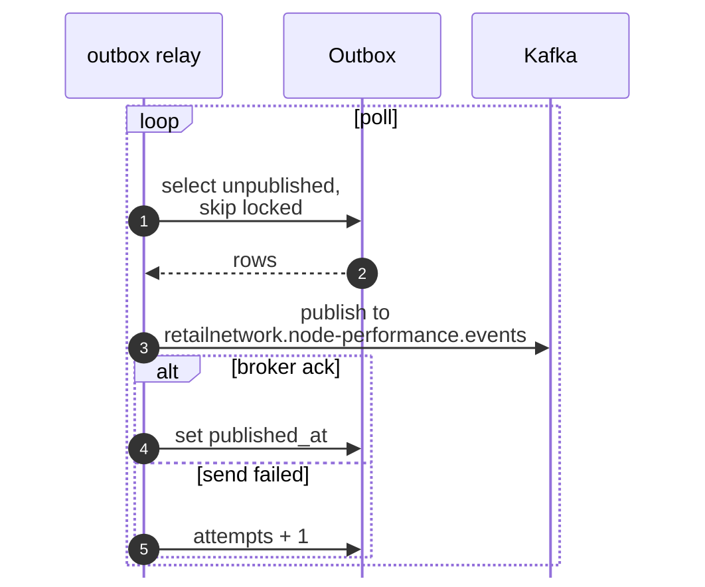

# Sequence Diagrams

:::info[Proposed design]
Derived from [`model/model.yaml`](https://github.com/IQVO/retail-network-docs/blob/main/model/model.yaml). Nothing in this context is built yet; identifiers (`Err...` names, routes, CloudEvents types) are the names an implementation must use.
:::

One UML sequence diagram per command use case of the **proposed**
implementation. `UoW` is `ports.UnitOfWork`, one Postgres transaction.
`Inbox` is the `processed_events` table, `Outbox` the `outbox_events`
table; both are written inside the same transaction as the aggregate
(`conventions.integration_rules`). The relay drains the outbox to Kafka
outside that transaction. Use-case prose is on
[Use Cases](/network/contexts/node-performance/use-cases).

## 1. RecordObservation (Kafka consumer)

Derived from: model.yaml → contexts[node-performance].aggregates[NodeScorecard]
(.commands, .invariants), .consumes; conventions.integration_rules.

Omitted: the dead-letter path for an undecodable message or a missing
`nodeId`. No outbox row is written: `RecordObservation` emits no event, so
there is no relay or Kafka publish in this diagram. The two scorecards are
saved in one transaction (see
[Entity Relationship](/network/contexts/node-performance/entity-relationship)).

## 2. Recompute (per-minute ticker)

### 2a. Recompute, save and outbox

### 2b. Relay to Kafka

Derived from: model.yaml → contexts[node-performance].aggregates[NodeScorecard]
(.commands, .transitions, .invariants, .events, .throughput_estimate),
.policies, .publishes; conventions.cloudevents (topic, key),
conventions.integration_rules.

Omitted: `ErrInsufficientObservations`, which `Recompute` never returns
(a thin window is set `PROVISIONAL` instead). The full types published are
`com.retailnetwork.partner.node-performance.scorecard.NodeScorecardUpdated`
and `com.retailnetwork.partner.node-performance.scorecard.NodeThresholdBreached`.
A relay crash after the broker ack and before `published_at` is set
republishes the same CloudEvents `id`; consumers deduplicate on it.

## Queries

The two GET routes read `ScorecardRepository` directly and touch no
aggregate method, outbox or Kafka. They are not drawn.
`GET /scorecards/{nodeId}` answers 404 `scorecard-not-found` when the node has
no scorecard; `GET /scorecards?grade=` answers 422 `invalid-grade` for an
unknown grade.
