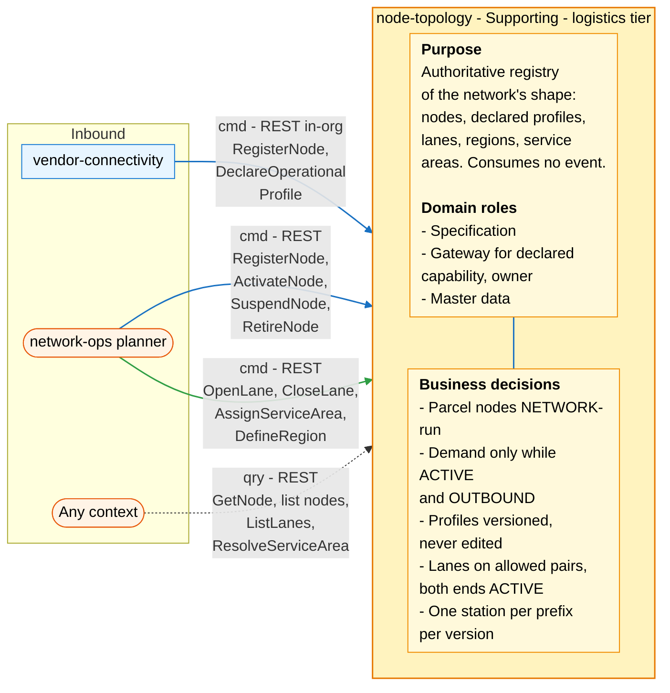
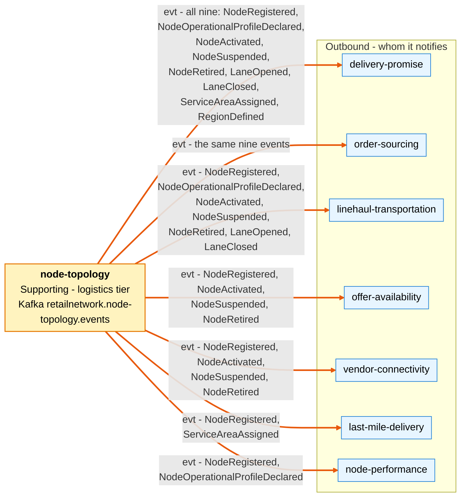

# Bounded Context Canvas

:::info[As built]
Derived from [`network/model/model.yaml`](https://github.com/IQVO/warehouse-docs/blob/main/network/model/model.yaml). This context's service is built; the model carries its as-built contracts, and identifiers (`Err...` names, routes, CloudEvents types) are the names the service uses.
:::

Following the ddd-crew [Bounded Context Canvas v5](https://github.com/ddd-crew/bounded-context-canvas).
Every message row comes from `contexts[node-topology].inbound`, `.rest`,
`.publishes` and `.sync_calls` in the model, and from the neighbours'
`consumes` and `sync_calls` entries that name this context.

## Canvas at a glance

Two pictures of the sections below, laid out like the ddd-crew canvas: first
the inbound collaborators (with the purpose, domain roles and business
decisions of this context), then the outbound collaborators it notifies.
Arrows follow the message type: **solid blue** commands (`cmd`), **dotted
green** queries (`qry`), **thick orange** events (`evt`). Box shapes mark the
collaborator kind: rounded = people or any client; blue = sibling bounded
context. Path parameters are written without braces inside the diagrams.

### Inbound

### Outbound

Derived from: model.yaml → `contexts[node-topology].inbound`, `.publishes`,
`.sync_calls` (empty), `.purpose`, `.roles`, `.business_decisions`; and the
`consumes` lists of the seven consumers.

The diagrams omit: assumptions, verification metrics, open questions and the
ubiquitous language (sections below); the relationship pattern per message
(see the tables); the full CloudEvents types (see the Outbound table); and
`customer-ordering` and `shipping-and-tracking`, which have no edge to this
context. There is no outbound command or query: `sync_calls` is empty.

## Name

**Node Topology** (`node-topology`, code `NT`, CloudEvents tier `logistics`).

## Purpose

To be the authoritative registry of the network's physical shape:

- every node: vendor fulfillment centres, inbound cross-docks and returns
  centres, and the network's own sortation centres, delivery stations and air
  hubs;
- each node's declared operational profile, versioned;
- the directed lanes between nodes;
- the regions;
- which delivery station serves which postal prefix.

It holds declared facts. It does not schedule, promise, assign or measure.

## Strategic Classification

| Axis | Verdict |
| --- | --- |
| **Domain** | **Supporting**. See [Core Domain Chart](/network/contexts/node-topology/core-domain-chart). |
| **Business Model** | Enabler: every promise, assignment and route rests on it. |
| **Evolution** | Custom-built. The operational profile is shaped after a Product surface (the supply-source (multi-location inventory) API, see the vendor platform API surface map). |

## Domain Roles

| Role | Applies? | Evidence in the model |
| --- | --- | --- |
| **Specification** | Yes, primary | It specifies the shape every other logistics decision works within: node types, allowed lane pairs, service areas. |
| **Gateway for declared capability (owner)** | Yes | Vendors' declarations (`DeclareOperationalProfile`, `declaredBy: VENDOR`) arrive here, through `vendor-connectivity`, and leave as `NodeOperationalProfileDeclared`. |
| **Master data** | Yes | Low write rate, many readers: nine events, seven consuming contexts, three read queries for any context. |
| Execution, Analysis, Enforcer | No | It makes no per-order decision and measures nothing. |

## Inbound Communication

| Collaborator | Message | Type | Channel | Relationship |
| --- | --- | --- | --- | --- |
| `vendor-connectivity` | `RegisterNode` (vendor node) | Command | REST `POST /nodes` (in-org) | Customer/Supplier (this context is the Supplier) |
| `vendor-connectivity` | `DeclareOperationalProfile` | Command | REST `PUT /nodes/{nodeId}/operational-profile` (in-org) | Customer/Supplier |
| network-ops planner | `RegisterNode` (network node) | Command | REST `POST /nodes` | UI |
| network-ops planner | `ActivateNode` | Command | REST `POST /nodes/{nodeId}:activate` | UI |
| network-ops planner | `SuspendNode` | Command | REST `POST /nodes/{nodeId}:suspend` | UI |
| network-ops planner | `RetireNode` | Command | REST `POST /nodes/{nodeId}:retire` | UI |
| network-ops planner | `OpenLane` | Command | REST `POST /lanes` | UI |
| network-ops planner | `CloseLane` | Command | REST `POST /lanes/{laneId}:close` | UI |
| network-ops planner | `AssignServiceArea` | Command | REST `PUT /service-areas/{postalPrefix}` | UI |
| network-ops planner | `DefineRegion` | Command | REST `POST /regions` | UI |
| Any context | `GetNode` | Query | REST `GET /nodes/{nodeId}` | Open Host Service |
| Any context | list nodes (no message name in the model) | Query | REST `GET /nodes?type=&region=&status=` | Open Host Service |
| Any context | `ListLanes` | Query | REST `GET /lanes?origin=&destination=` | Open Host Service |
| Any context | `ResolveServiceArea` | Query | REST `GET /service-areas/{postalPrefix}` | Open Host Service |

No inbound event: the model's `consumes` list for this context is empty.
No neighbour declares a synchronous query to this context in its
`sync_calls`; the only declared synchronous caller is `vendor-connectivity`,
with the two commands above.

## Outbound Communication

Every event goes to topic `retailnetwork.node-topology.events`, source
`/retailnetwork/node-topology`, through a transactional outbox.

| Collaborator | Message | Type | Channel | Relationship |
| --- | --- | --- | --- | --- |
| `offer-availability`, `delivery-promise`, `order-sourcing`, `linehaul-transportation`, `last-mile-delivery`, `node-performance`, `vendor-connectivity` | `NodeRegistered` | Event | `retailnetwork.node-topology.events`, `com.retailnetwork.logistics.node-topology.node.NodeRegistered` | Open Host Service + Published Language (consumers Conformist) |
| `delivery-promise`, `order-sourcing`, `linehaul-transportation`, `node-performance` | `NodeOperationalProfileDeclared` | Event | `retailnetwork.node-topology.events`, `com.retailnetwork.logistics.node-topology.node.NodeOperationalProfileDeclared` | OHS + PL (Conformist) |
| `offer-availability`, `delivery-promise`, `order-sourcing`, `linehaul-transportation`, `vendor-connectivity` | `NodeActivated` | Event | `retailnetwork.node-topology.events`, `com.retailnetwork.logistics.node-topology.node.NodeActivated` | OHS + PL (Conformist) |
| `offer-availability`, `delivery-promise`, `order-sourcing`, `linehaul-transportation`, `vendor-connectivity` | `NodeSuspended` | Event | `retailnetwork.node-topology.events`, `com.retailnetwork.logistics.node-topology.node.NodeSuspended` | OHS + PL (Conformist) |
| `offer-availability`, `delivery-promise`, `order-sourcing`, `linehaul-transportation`, `vendor-connectivity` | `NodeRetired` | Event | `retailnetwork.node-topology.events`, `com.retailnetwork.logistics.node-topology.node.NodeRetired` | OHS + PL (Conformist) |
| `linehaul-transportation`, `delivery-promise`, `order-sourcing` | `LaneOpened` | Event | `retailnetwork.node-topology.events`, `com.retailnetwork.logistics.node-topology.lane.LaneOpened` | OHS + PL (Conformist) |
| `linehaul-transportation`, `delivery-promise`, `order-sourcing` | `LaneClosed` | Event | `retailnetwork.node-topology.events`, `com.retailnetwork.logistics.node-topology.lane.LaneClosed` | OHS + PL (Conformist) |
| `delivery-promise`, `order-sourcing`, `last-mile-delivery` | `ServiceAreaAssigned` | Event | `retailnetwork.node-topology.events`, `com.retailnetwork.logistics.node-topology.servicearea.ServiceAreaAssigned` | OHS + PL (Conformist) |
| `delivery-promise`, `order-sourcing` | `RegionDefined` | Event | `retailnetwork.node-topology.events`, `com.retailnetwork.logistics.node-topology.region.RegionDefined` | OHS + PL (Conformist) |

No outbound command or query (`sync_calls: []`). Full payloads:
[Domain Events](/network/contexts/node-topology/domain-events). Relationship
reasoning: [Context Map](/network/contexts/node-topology/context-map).

## Ubiquitous Language

Full glossary: [Ubiquitous Language](/network/contexts/node-topology/ubiquitous-language).
Top terms: **Node**, **Node Type**, **Node Operator**, **Operational
Profile** (versioned by `profileRevision`), **Cutoff**, **Handling Time**,
**Throughput Cap**, **Lane**, **Region**, **Service Area**.

## Business Decisions

1. **Parcel nodes are network-operated.** A `SORTATION_CENTER`,
   `DELIVERY_STATION` or `AIR_HUB` always has operator `NETWORK`; a vendor
   registers only `FULFILLMENT_CENTER`, `INBOUND_CROSS_DOCK` or
   `RETURNS_CENTER` (`ErrOperatorNotAllowedForNodeType`).
2. **Demand only while `ACTIVE` and `OUTBOUND`.** Capabilities come from the
   node type (`DefaultCapabilitiesByType`). The decision is applied by the
   consumers (`offer-availability` suppresses listings on a non-`ACTIVE`
   node, `delivery-promise` and `order-sourcing` read node status from
   their `NodeProfileView`).
3. **Profiles are versioned, never edited.** `profileRevision` strictly
   increases (`ErrStaleProfileRevision`). A `FULFILLMENT_CENTER` needs at
   least one cutoff and a `handlingTime` above zero before activation
   (`ErrIncompleteOperationalProfile`), and every cutoff falls inside the
   operating hours of its day (`ErrCutoffOutsideOperatingHours`).
4. **Lanes follow the allowed type pairs, and both ends are `ACTIVE` when
   opened.** `ErrLaneLoop`, `ErrLaneTypePairNotAllowed`,
   `ErrLaneEndpointNotActive`; at most one `OPEN` lane per origin,
   destination and mode (`ErrDuplicateLane`).
5. **One delivery station per postal prefix per assignment version.**
   `ErrNotADeliveryStation`, `ErrStaleAssignmentVersion`.
6. **`RETIRED` is terminal** (`ErrNodeRetired`).

## Assumptions

- Vendors never call this context directly. Every vendor node arrives
  through `vendor-connectivity`, which has already checked that the vendor
  acts on its own nodes (`ErrNodeNotOwnedByVendor` is enforced there).
- Write volume stays low (tens of node writes a day; lane and service-area
  bulk loads only at network redesign), so a single writer per aggregate and
  optimistic concurrency are enough.
- Consumers keep their own read models from the events and never need a
  synchronous read on their hot path (model `conventions.integration_rules`).
- The reference network has single-digit regions (eight in the model's size
  estimate).

## Verification Metrics

Proposed, measurable once built:

- **Event lag**: time from a committed write to the outbox row being
  published on `retailnetwork.node-topology.events`, p95.
- **Pickup coverage**: share of cutoffs of `ACTIVE` vendor
  `FULFILLMENT_CENTER` nodes for which `linehaul-transportation` has a pickup
  departure on the next operating day (target: all of them).
- **Unserved prefixes**: count of postal prefixes resolved by
  `GET /service-areas/{postalPrefix}` with a 404, per day.
- **Stale-write rate**: `ErrStaleProfileRevision` and
  `ErrStaleAssignmentVersion` responses per day (a high rate means callers
  race each other).
- **Refused parcel registrations**: `ErrOperatorNotAllowedForNodeType`
  responses per vendor (vendors trying to register a parcel node).

## Open Questions

- **Lanes and service areas after a node leaves service.** When a node is
  suspended or retired, its lanes stay `OPEN` and the prefixes assigned to a
  retired delivery station stay `ASSIGNED`. The model has no policy that
  closes or reassigns them.
- **Who declares a network node's profile?** `declaredBy` allows
  `NETWORK_OPS`, but the planner's inbound row in the model does not list
  `DeclareOperationalProfile`.
- **A new profile on an `ACTIVE` fulfillment centre.** The completeness rule
  holds "before activation". Whether a later revision may drop every cutoff
  is not stated.
- **Cutoffs have no day.** `CutoffSlot{localTime, maxOrders?}` carries no
  day of week, so "inside the operating hours of their day" must be read as
  "inside the hours of every operating day".
- **Region membership is not checked.** No invariant makes a node's or a
  service area's `regionId` name a defined region.
- **Not-found and illegal-transition errors are unnamed.** The model names
  no `Err...` for an unknown `nodeId`, `laneId` or `postalPrefix`, nor for a
  transition outside the table (for example `SuspendNode` on a `PROPOSED`
  node).
