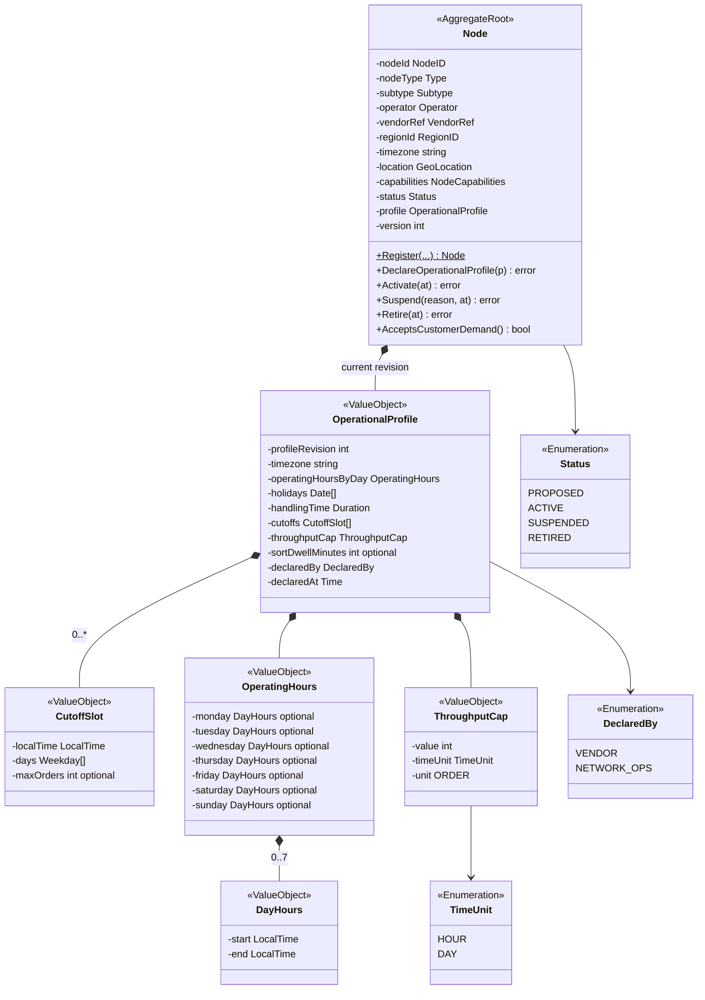
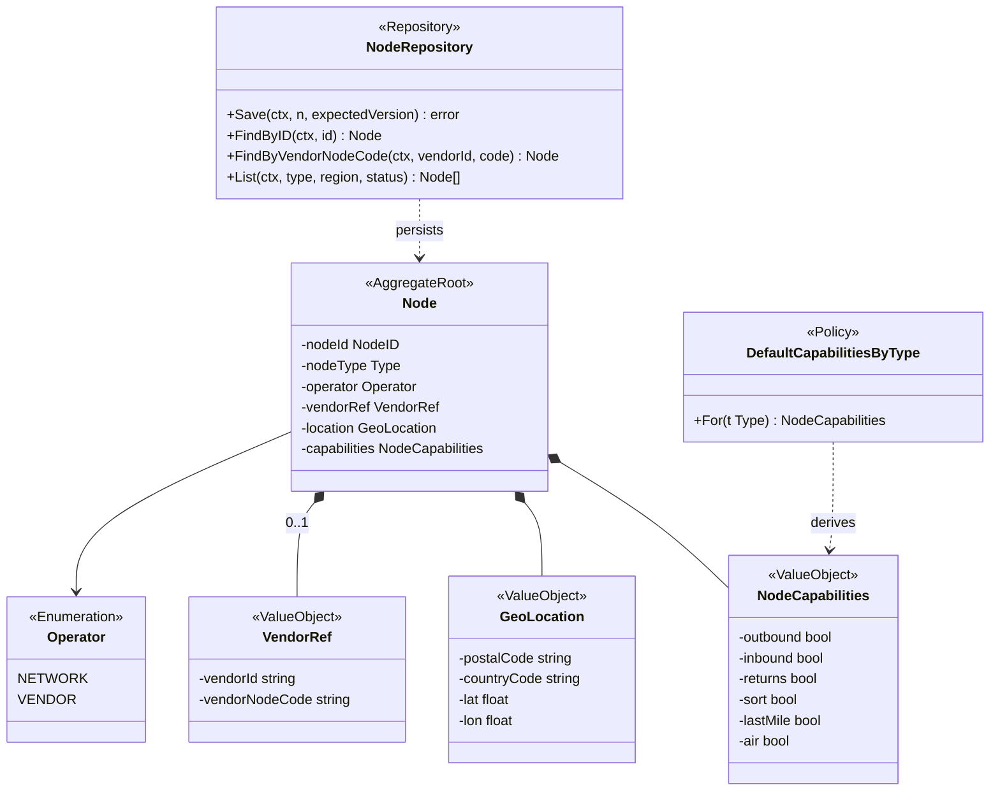
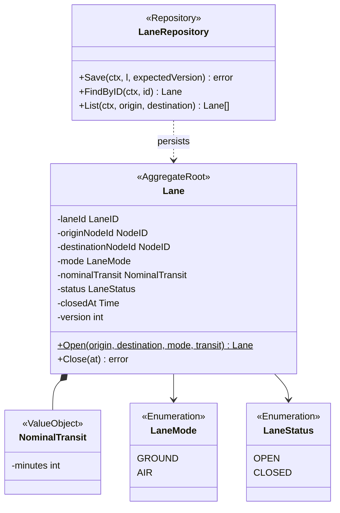
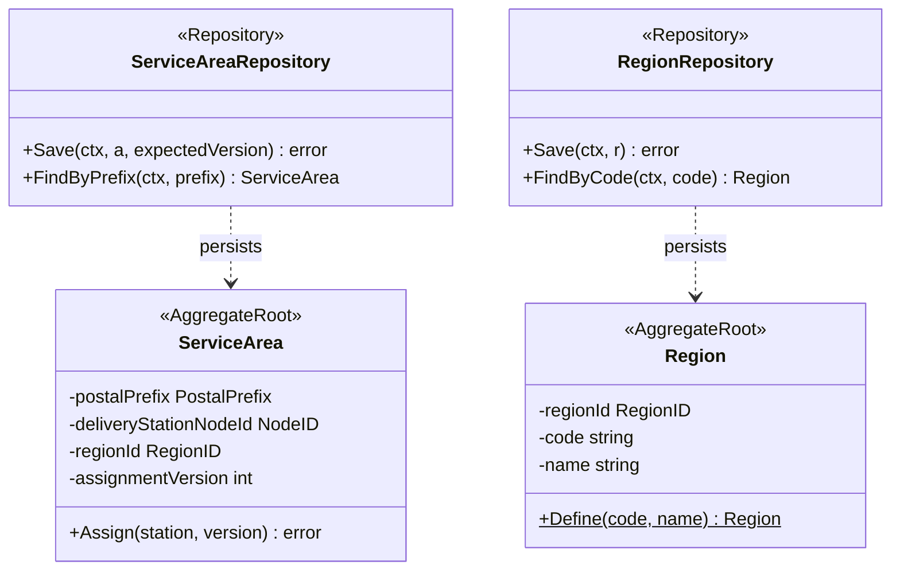
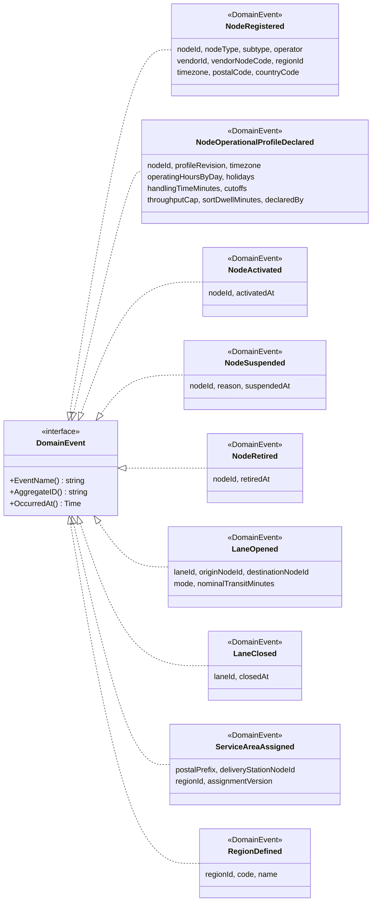
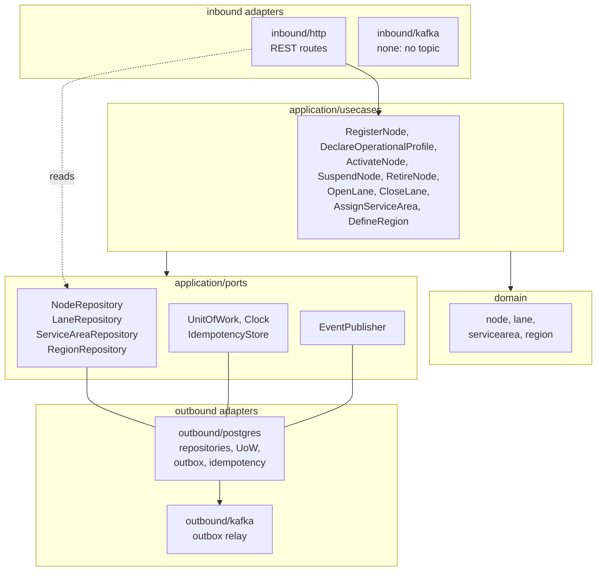

# Class Diagram

:::info[As built]
Derived from [`model/model.yaml`](https://github.com/IQVO/retail-network-docs/blob/main/model/model.yaml). This context's service is built; the model carries its as-built contracts, and identifiers (`Err...` names, routes, CloudEvents types) are the names the service uses.
:::

UML class diagrams of the **proposed** domain model, in the Go hexagonal
layout the warehouse-systems fleet uses. Type names follow the model's `ul`
code identifiers (`node.Node`, `node.OperationalProfile`, `node.CutoffSlot`,
`node.ThroughputCap`, `lane.Lane`, `region.Region`,
`servicearea.ServiceArea`). Fields are unexported (`-`), methods exported
(`+`). Only state-changing methods and key queries are shown.

## 1. Node aggregate: root and operational profile

Derived from: model.yaml → `contexts[node-topology].aggregates[Node]`
(`value_objects`, `states`, `commands`), `.ul`.

Omitted: the read accessors and the `Err...` variables (on
[Aggregate Design Canvas](/network/contexts/node-topology/aggregate-design-canvas)).
The model shows one `OperationalProfile` per `Node`; the repository keeps
every past revision, which the aggregate never edits. `OperatingHours` is the
map `{monday … sunday: {start, end}}` (`HH:mm`); a missing day is closed.
`CutoffSlot.days` defaults to every operating day. `sortDwellMinutes` is set
only on `SORTATION_CENTER` and `AIR_HUB` nodes. `version` is the optimistic-concurrency counter, not a domain field.

## 2. Node aggregate: identity, capabilities, policy and repository

Derived from: model.yaml → `contexts[node-topology].aggregates[Node].value_objects`,
`.policies[DefaultCapabilitiesByType]`, `node_types`.

Omitted: the fields already shown in diagram 1; the enumerations `Type`
(six node types) and `Subtype` (seven fulfillment-centre subtypes), listed on
[Ubiquitous Language](/network/contexts/node-topology/ubiquitous-language).
`VendorRef` is absent on a `NETWORK` node.

## 3. Lane aggregate

Derived from: model.yaml → `contexts[node-topology].aggregates[Lane]`.

Omitted: `originNodeId` and `destinationNodeId` are ids, not associations
to `Node`. The lane type-pair rule is a domain function over `node_types` and
`lane_rules`, not a class.

## 4. ServiceArea and Region aggregates

Derived from: model.yaml → `contexts[node-topology].aggregates[ServiceArea|Region]`.

Omitted: `deliveryStationNodeId` and `regionId` are ids, not associations:
each aggregate is loaded and saved on its own. `ServiceArea` and `Region`
have a single state each (`ASSIGNED`, `DEFINED`; `ServiceArea` has one
transition, `ASSIGNED` to `ASSIGNED` on `AssignServiceArea`), so no status
enumeration is drawn.

## 5. Domain events

Derived from: model.yaml → `contexts[node-topology].publishes[*].data`.

Omitted: field types (on [Domain Events](/network/contexts/node-topology/domain-events)).
`AggregateID()` is the CloudEvents `subject` and the Kafka key.

## 6. Hexagonal ports and adapters

Derived from: model.yaml → `contexts[node-topology].aggregates[*].commands`,
`.rest`, `.consumes` (empty), `conventions.integration_rules` (outbox).

Proposed packages, under `internal/`:

| Package | Contents |
| --- | --- |
| `internal/domain/node` | `Node`, `OperationalProfile`, `CutoffSlot`, `ThroughputCap`, `NodeCapabilities`, `GeoLocation`, `VendorRef`, `Type`, `Subtype`, `Operator`, `Status`, `DefaultCapabilitiesByType`, the nine `Err...` of `Node` |
| `internal/domain/lane` | `Lane`, `NominalTransit`, `LaneMode`, the allowed type pairs, the four `Err...` of `Lane` |
| `internal/domain/servicearea` | `ServiceArea`, `ErrNotADeliveryStation`, `ErrStaleAssignmentVersion`, `ErrUnknownRegion` |
| `internal/domain/region` | `Region`, `ErrRegionCodeTaken` |
| `internal/application/usecases` | the nine command use cases |
| `internal/application/ports` | the four repositories, `EventPublisher`, `UnitOfWork`, `Clock`, `IdempotencyStore` |
| `internal/adapters/inbound/http` | the thirteen REST routes, problem+json mapping (the shared `not-found`, `illegal-transition`, `concurrent-update` and `validation-failed` problems), `Idempotency-Key` handling |
| `internal/adapters/inbound/kafka` | empty: the context consumes no topic |
| `internal/adapters/outbound/postgres` | repositories, unit of work, outbox writer, idempotency store, migrations |
| `internal/adapters/outbound/kafka` | outbox relay to `retailnetwork.node-topology.events`, CloudEvents encoder |

Omitted from the diagram: the composition root (`cmd/`), health and metrics
routes, and the use cases' read of a second aggregate (`OpenLane` and
`AssignServiceArea` read `Node` through `NodeRepository`). The HTTP adapter
reads repositories directly for the four `GET` routes, because every read is
a lookup on one aggregate type.
