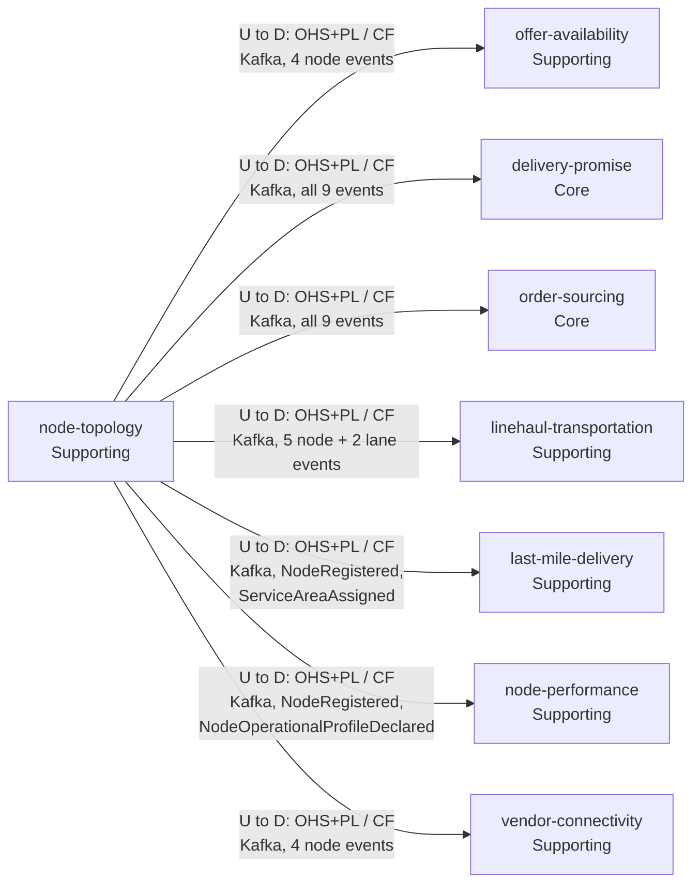
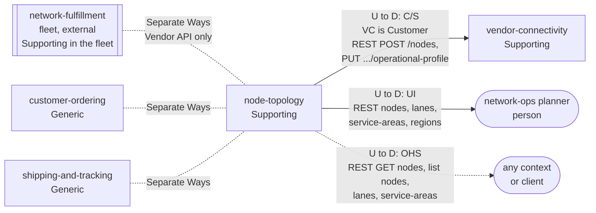

# Context Map

:::info[Proposed design]
Derived from [`model/model.yaml`](https://github.com/IQVO/retail-network-docs/blob/main/model/model.yaml). Nothing in this context is built yet; identifiers (`Err...` names, routes, CloudEvents types) are the names an implementation must use.
:::

Following ddd-crew [Context Mapping](https://github.com/ddd-crew/context-mapping).
This is **node-topology's slice** of the
[domain-wide context map](/network/strategic-design/context-map). Node Topology is
upstream of every relationship it has: it consumes nothing and calls nobody.

## Event relationships

## Synchronous relationships and Separate Ways

Derived from: model.yaml → `contexts[node-topology].inbound`, `.publishes`,
`.consumes` (empty), `.sync_calls` (empty);
`contexts[vendor-connectivity].sync_calls`; the `consumes` lists of the seven
consumers; `meta.hard_boundary`; `external`.

Legend: arrows point from upstream (U) to downstream (D). Solid = command or
event, dotted with an arrow head = query, dotted without an arrow head = no
relationship (Separate Ways). Pattern abbreviations: OHS = Open Host Service,
PL = Published Language, CF = Conformist, C/S = Customer/Supplier. Path
parameters are written without braces inside the diagrams.

Omitted: Kafka and Postgres as infrastructure; the analytics topic (the model
names no analytics event for this context); the future contexts
(`customer-returns`, `customer-notification`, `payments-and-invoicing`),
which have no edge in the model.

## Relationships

| Neighbour | Direction | Pattern | Channel | Messages | Why this pattern |
| --- | --- | --- | --- | --- | --- |
| `offer-availability` (Supporting) | NT upstream, OA downstream | OHS + PL / Conformist | Kafka `retailnetwork.node-topology.events` | `NodeRegistered`, `NodeActivated`, `NodeSuspended`, `NodeRetired` | OA only needs to know whether a listing's node is sellable (`NodeStatusView`, `SuppressOnNodeUnavailable`). It takes the node vocabulary as published. |
| `delivery-promise` (Core) | NT upstream, DP downstream | OHS + PL / Conformist | Kafka `retailnetwork.node-topology.events` | all nine events | DP builds `NodeProfileView`, `RegionAndServiceAreaView` and `LaneView` locally because its hot path makes no synchronous call. The topology is a given for the promise, not a negotiation. |
| `order-sourcing` (Core) | NT upstream, OS downstream | OHS + PL / Conformist | Kafka `retailnetwork.node-topology.events` | all nine events | OS builds `NodeProfileView` and `NetworkGraphView` to re-optimise assignments. Same reasoning as DP. |
| `linehaul-transportation` (Supporting) | NT upstream, LH downstream | OHS + PL / Conformist | Kafka `retailnetwork.node-topology.events` | `NodeRegistered`, `NodeOperationalProfileDeclared`, `NodeActivated`, `NodeSuspended`, `NodeRetired`, `LaneOpened`, `LaneClosed` | LH turns lanes into departures and cutoffs into pickup departures (`PickupFromCutoffs`). It conforms to the lane and cutoff definitions. |
| `last-mile-delivery` (Supporting) | NT upstream, LM downstream | OHS + PL / Conformist | Kafka `retailnetwork.node-topology.events` | `NodeRegistered`, `ServiceAreaAssigned` | LM's `StationView` needs the stations and the prefixes each serves. |
| `node-performance` (Supporting) | NT upstream, NP downstream | OHS + PL / Conformist | Kafka `retailnetwork.node-topology.events` | `NodeRegistered`, `NodeOperationalProfileDeclared` | NP measures a node against what it declared; it needs the declaration as published. |
| `vendor-connectivity` (Supporting) | NT upstream, VC downstream | OHS + PL / Conformist | Kafka `retailnetwork.node-topology.events` | `NodeRegistered`, `NodeActivated`, `NodeSuspended`, `NodeRetired` | VC's `VendorNodeView` lets it answer vendors about their nodes without calling this context. |
| `vendor-connectivity` (Supporting) | NT upstream (Supplier), VC downstream (Customer) | Customer/Supplier | REST in-org `POST /nodes`, `PUT /nodes/{nodeId}/operational-profile` | `RegisterNode`, `DeclareOperationalProfile` | VC needs an answer inside the processing of a vendor submission. The routes exist for this customer; the Supplier keeps the invariants (`ErrOperatorNotAllowedForNodeType`, `ErrStaleProfileRevision`) and VC turns a refusal into a failed submission. |
| network-ops planner (person) | NT upstream | UI | REST `/nodes`, `/lanes`, `/service-areas`, `/regions` | `RegisterNode` (network node), `DeclareOperationalProfile` (`declaredBy` `NETWORK_OPS`), `ActivateNode`, `SuspendNode`, `RetireNode`, `OpenLane`, `CloseLane`, `AssignServiceArea`, `DefineRegion` | A person drives the network's shape; there is no upstream system for it. |
| any context or client | NT upstream | Open Host Service | REST `GET /nodes/{nodeId}`, `GET /nodes?type=&region=&status=`, `GET /lanes?origin=&destination=`, `GET /service-areas/{postalPrefix}` | `GetNode`, `ListNodes`, `ListLanes`, `ResolveServiceArea` | One public read protocol for everyone. No neighbour declares these as a `sync_call`; they serve tools, planners and diagnosis. |
| `network-fulfillment` (warehouse-systems fleet, Supporting in the fleet, external) | none | Separate Ways | none | none | The hard boundary: the fleet reaches the network only through the Vendor API of `vendor-connectivity` (model `meta.hard_boundary`; [ADR 0007](/network/adr/0007-cloudevents-namespace), [WMS/WES integration](/network/integration/wms-wes-integration)). |
| `customer-ordering` (Generic) | none | Separate Ways | none | none | It works with promises and postal prefixes, never with nodes. |
| `shipping-and-tracking` (Generic) | none | Separate Ways | none | none | Scans name a `nodeId` as a value; it keeps no node read model in the model. |

## Notes on the patterns

- **Open Host Service + Published Language, every consumer Conformist.** One
  topic, nine CloudEvents types, one schema per type
  (`urn:retailnetwork:node-topology:events:<EventName>:v1`). With seven
  consumers, negotiating a model per consumer would cost more than it gives.
  The vocabulary is small and stable, so conforming is cheap.
- **Customer/Supplier with `vendor-connectivity`, not Conformist.** The two
  write routes exist because `vendor-connectivity` needs them, and their
  error contract (a 409 or 422 that becomes a failed vendor submission) is
  agreed between the two.
- **No Anti-Corruption Layer here.** The fleet's vocabulary (`siteCode`,
  `siteRole`, CPT) never arrives in this context. Translation happens twice,
  outside it: in the fleet's `network-fulfillment` (Conformist + ACL to the
  Vendor API) and in `vendor-connectivity`'s Published Language.
- **No Shared Kernel.** Consumers re-declare the few node fields they need
  in their own read models.

## Seller inbound

> **Proposed, [ADR 0009](/network/adr/0009-seller-inbound-and-case-packed-shipments).** This section is the delta that the seller-inbound design adds to this page. Nothing in it is built.

| Neighbour | Direction | Pattern | Channel | Messages | Why |
| --- | --- | --- | --- | --- | --- |
| `seller-inbound` | U → D | Conformist | Kafka `retailnetwork.node-topology.events` | `NodeRegistered`, `NodeOperationalProfileDeclared`, `NodeActivated`, `NodeSuspended`, `NodeRetired` | A node's status, `INBOUND` capability and carton limits are this context's facts. `seller-inbound` keeps a local `NodeInboundView`. |
