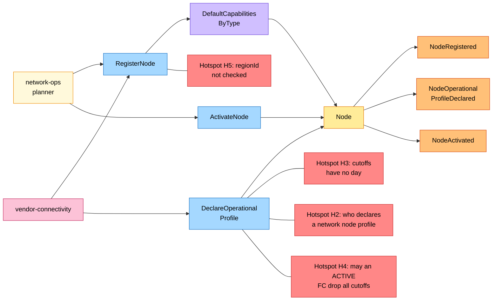
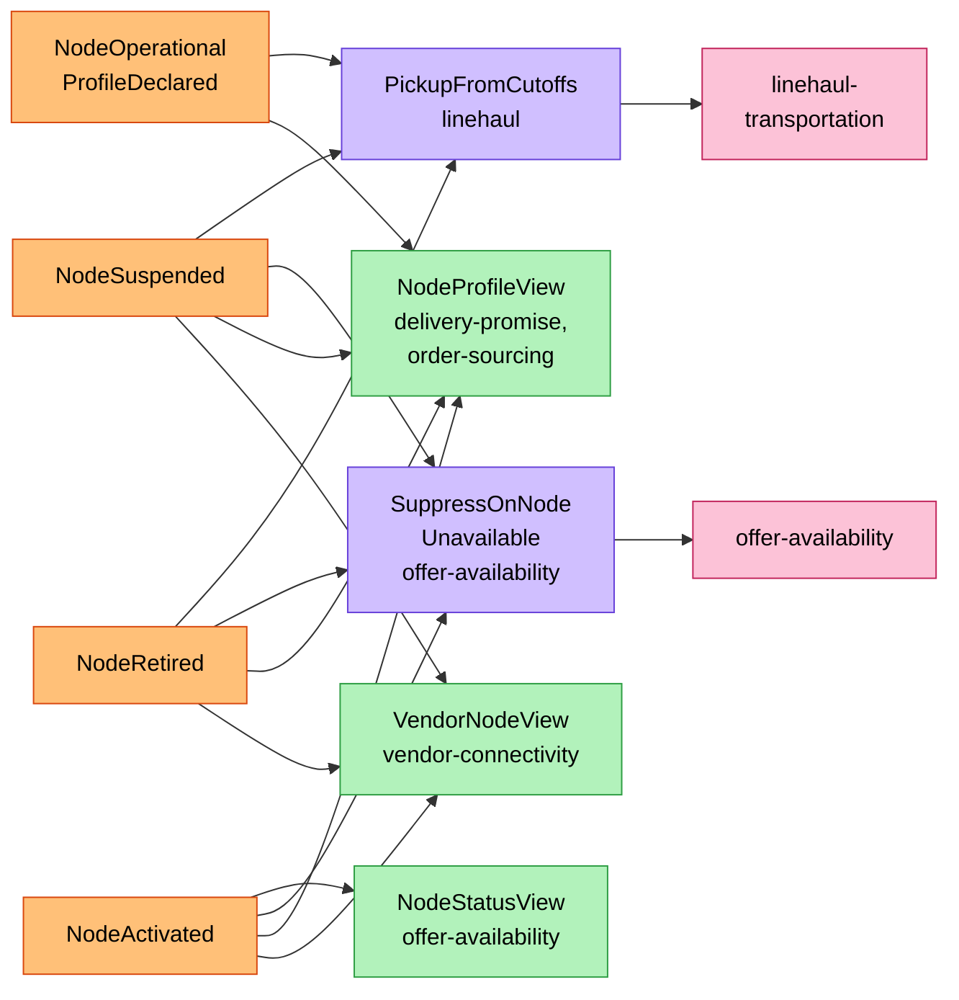
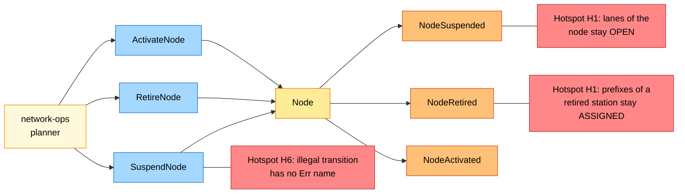
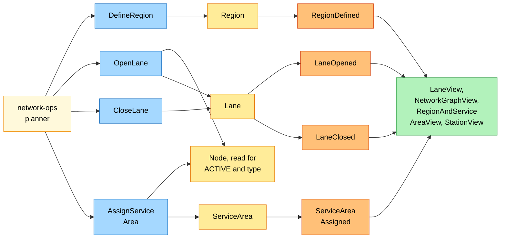

# EventStorming

:::info[Proposed design]
Derived from [`model/model.yaml`](https://github.com/IQVO/retail-network-docs/blob/main/model/model.yaml). Nothing in this context is built yet; identifiers (`Err...` names, routes, CloudEvents types) are the names an implementation must use.
:::

Process-level boards in the ddd-crew
[EventStorming glossary & cheat sheet](https://github.com/ddd-crew/eventstorming-glossary-cheat-sheet)
notation. Every sticky comes from the model. Every hotspot is an open
question or a risk the model leaves open, and the table at the end names the
model entry it comes from. The domain-wide board is
[EventStorming big picture](/network/strategic-design/eventstorming-big-picture).

## Legend

| Colour | Sticky | Meaning here |
| --- | --- | --- |
| Blue `#a5d8ff` | Command | A command from the model's `commands` |
| Yellow `#ffec99` | Aggregate | `Node`, `Lane`, `ServiceArea`, `Region` |
| Orange `#ffc078` | Domain Event | An event from the model's `publishes` |
| Lilac `#d0bfff` | Policy | This context's policy or a neighbour's reaction |
| Green `#b2f2bb` | Read Model | A neighbour's event-fed read model |
| Pink `#fcc2d7` | External System | Another bounded context |
| Red `#ff8787` | Hotspot | An open question or risk in the model |
| Pale yellow `#fff9db` | Actor | A person (the network-ops planner) |

## 1. A node is registered, declared and activated

Derived from: model.yaml → `contexts[node-topology].aggregates[Node]`,
`.policies`, `.inbound`, `.publishes`.

Omitted: the refusals (`ErrOperatorNotAllowedForNodeType`,
`ErrVendorNodeCodeTaken`, `ErrStaleProfileRevision`,
`ErrCutoffOutsideOperatingHours`, `ErrIncompleteOperationalProfile`), which
raise no event; the downstream reactions, on board 2.

## 2. What the network does with node facts

Derived from: model.yaml → `contexts[linehaul-transportation].policies[PickupFromCutoffs]`,
`contexts[offer-availability].policies[SuppressOnNodeUnavailable]`,
`.read_models[NodeStatusView]`; `contexts[delivery-promise|order-sourcing].read_models[NodeProfileView]`;
`contexts[vendor-connectivity].read_models[VendorNodeView]`.

Omitted: `NodeRegistered` feeding the same read models (and `StationView` in
`last-mile-delivery`); `node-performance`, which records
`NodeOperationalProfileDeclared` as the declaration it measures against.

## 3. Suspension and retirement

Derived from: model.yaml → `contexts[node-topology].aggregates[Node].transitions`,
`.invariants`; `.aggregates[Lane]`, `.aggregates[ServiceArea]`, `.policies`.

Omitted: `ErrNodeRetired` (any command on a `RETIRED` node); the reasons a
planner suspends (the model leaves them free text; `node-performance` never
suspends a node).

## 4. Lanes, regions and service areas

Derived from: model.yaml → `contexts[node-topology].aggregates[Lane|ServiceArea|Region]`,
`lane_rules`; the read models of `delivery-promise`, `order-sourcing`,
`linehaul-transportation` and `last-mile-delivery`.

Omitted: the refusals (`ErrLaneLoop`, `ErrLaneTypePairNotAllowed`,
`ErrLaneEndpointNotActive`, `ErrDuplicateLane`, `ErrNotADeliveryStation`,
`ErrStaleAssignmentVersion`, `ErrRegionCodeTaken`). The `Node` sticky here
is read, not changed: the lane and service-area use cases load it to check
their invariants.

## Hotspots

| Id | Hotspot | Where it comes from in the model |
| --- | --- | --- |
| H1 | Lanes of a suspended or retired node stay `OPEN`, and the prefixes of a retired delivery station stay `ASSIGNED`. No policy closes or reassigns them. | `contexts[node-topology].policies` holds only `DefaultCapabilitiesByType`; `Lane` closes only by `CloseLane`; `ErrLaneEndpointNotActive` and `ErrNotADeliveryStation` are checked only when opening or assigning. |
| H2 | Who declares a network node's profile? `declaredBy` allows `NETWORK_OPS`, but no inbound row gives the planner `DeclareOperationalProfile`. | `aggregates[Node].value_objects` (`declaredBy(VENDOR or NETWORK_OPS)`) against `inbound`. |
| H3 | A cutoff has no day of week, yet it must fall "inside the operating hours of its day". | `CutoffSlot{localTime, maxOrders?}` against `ErrCutoffOutsideOperatingHours`. |
| H4 | May a later profile revision of an `ACTIVE` fulfillment centre drop every cutoff? The completeness rule says "before activation". | `ErrIncompleteOperationalProfile`. |
| H5 | No invariant makes a node's or a service area's `regionId` name a defined region. | `aggregates[Region].description` ("nodes and service areas belong to exactly one region") with no matching invariant. |
| H6 | Illegal transitions (for example `SuspendNode` on `PROPOSED`) and unknown ids have no named error. | `aggregates[Node].transitions` and `invariants` (only `ErrNodeRetired` covers a refused transition). |
