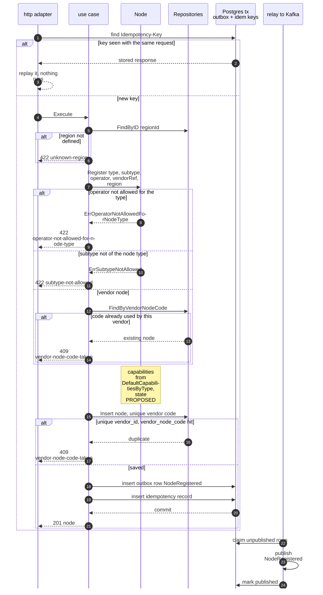
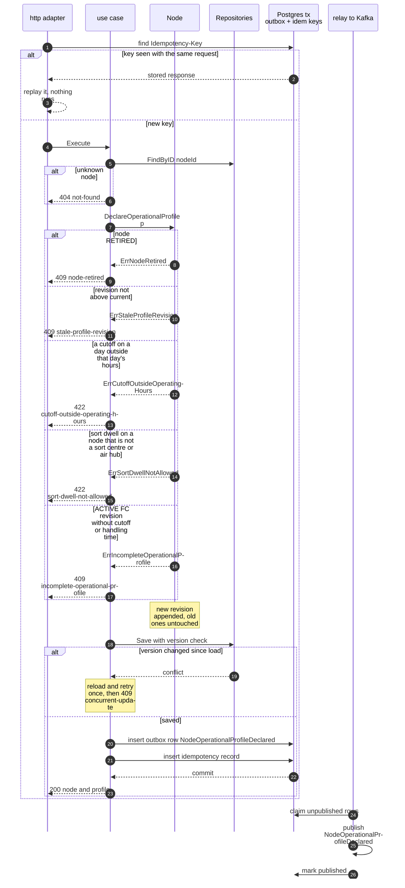
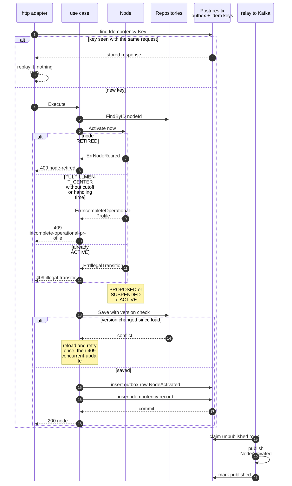
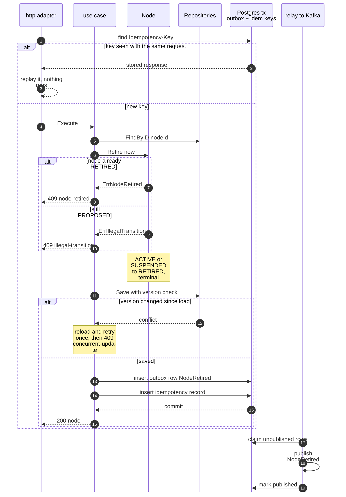
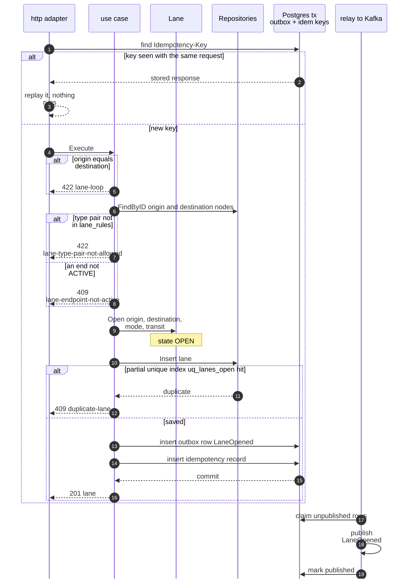
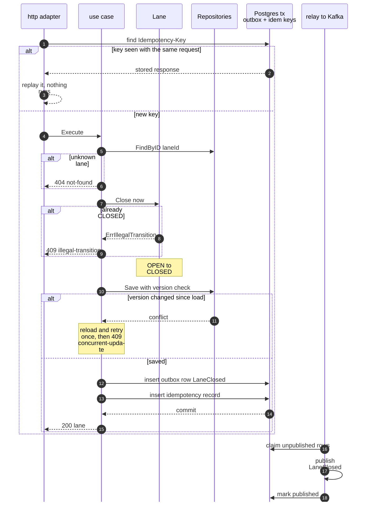
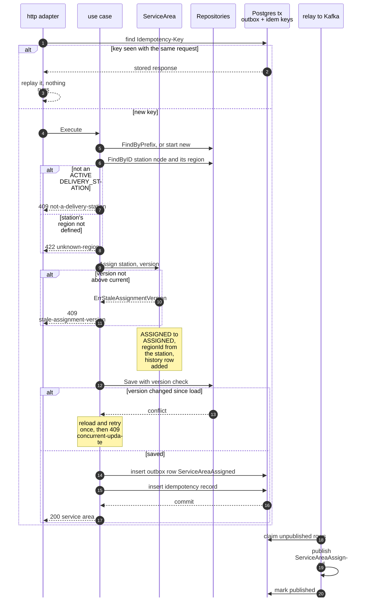
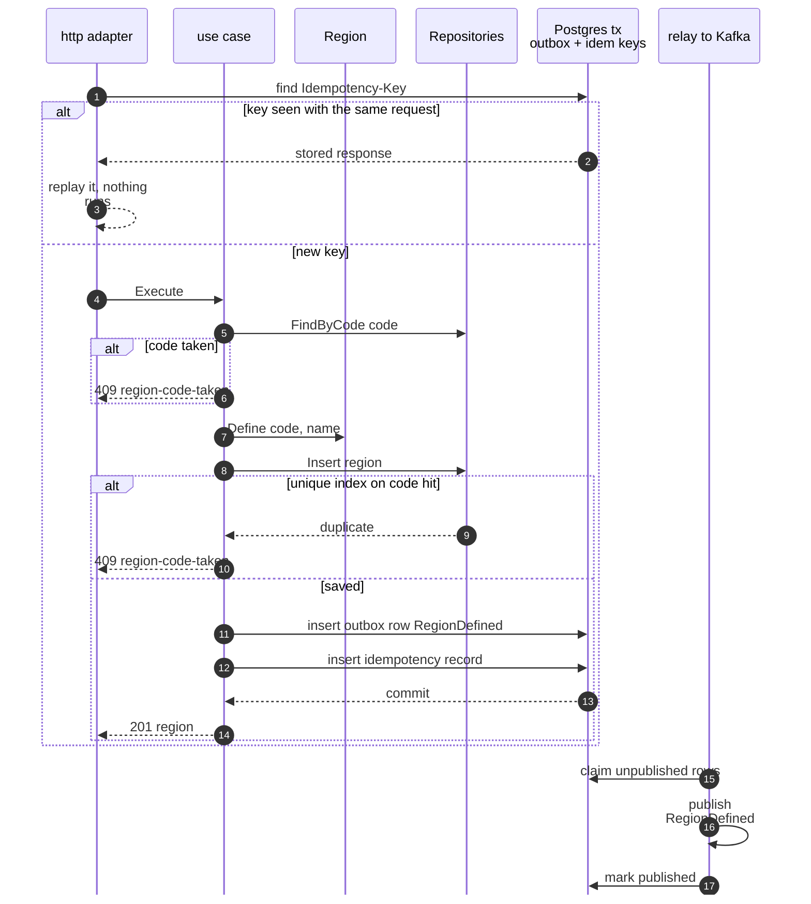

# Sequence Diagrams

:::info[As built]
Derived from [`model/model.yaml`](https://github.com/IQVO/retail-network-docs/blob/main/model/model.yaml). This context's service is built; the model carries its as-built contracts, and identifiers (`Err...` names, routes, CloudEvents types) are the names the service uses.
:::

One UML sequence diagram per command use case of the **proposed** service.
The participants are the same in every diagram:

| Participant | Proposed package |
| --- | --- |
| http adapter | `internal/adapters/inbound/http` |
| use case | `internal/application/usecases` |
| aggregate | `internal/domain/node`, `lane`, `servicearea` or `region` |
| Repositories | `internal/adapters/outbound/postgres` behind `internal/application/ports` |
| Postgres tx | the same transaction as the save: `outbox_events` and `idempotency_keys` |
| relay to Kafka | `internal/adapters/outbound/kafka`, publishing to `retailnetwork.node-topology.events` |

Every diagram shows the `Idempotency-Key` check, the optimistic-concurrency
version check (or the unique index that replaces it on a create), the outbox
write in the same transaction, and the relay. A domain error writes nothing
and publishes nothing. The problem `type` slugs match
[Use Cases](/network/contexts/node-topology/use-cases). Path parameters are written
without braces in the diagrams.

## 1. RegisterNode

`POST /nodes`, published type `com.retailnetwork.logistics.node-topology.node.NodeRegistered`.

Derived from: model.yaml → `contexts[node-topology].aggregates[Node]` (`commands`, `invariants`), `.rest`, `.publishes[NodeRegistered]`; `conventions.integration_rules`.

Omitted: a new node has no version to check, so the unique constraint on `(vendor_id, vendor_node_code)` takes that role and catches two concurrent registrations. A network node has no vendor reference and skips the lookup. The `Region` is read, never saved.

## 2. DeclareOperationalProfile

`PUT /nodes/{nodeId}/operational-profile`, published type `com.retailnetwork.logistics.node-topology.node.NodeOperationalProfileDeclared`.

Derived from: model.yaml → `contexts[node-topology].aggregates[Node]` (`commands`, `invariants`), `.rest`, `.publishes[NodeOperationalProfileDeclared]`; `conventions.integration_rules`.

Omitted: a node with no profile yet takes any first revision above zero. Both `vendor-connectivity` (`declaredBy` `VENDOR`) and the network-ops planner (`declaredBy` `NETWORK_OPS`) call this route.

## 3. ActivateNode

`POST /nodes/{nodeId}:activate`, published type `com.retailnetwork.logistics.node-topology.node.NodeActivated`.

Derived from: model.yaml → `contexts[node-topology].aggregates[Node]` (`commands`, `invariants`), `.rest`, `.publishes[NodeActivated]`; `conventions.integration_rules`.

Omitted: the 404 for an unknown `nodeId` (same as diagram 2).

## 4. SuspendNode

`POST /nodes/{nodeId}:suspend`, published type `com.retailnetwork.logistics.node-topology.node.NodeSuspended`.

Derived from: model.yaml → `contexts[node-topology].aggregates[Node]` (`commands`, `invariants`), `.rest`, `.publishes[NodeSuspended]`; `conventions.integration_rules`.

Omitted: the 404 for an unknown `nodeId`; the downstream reactions (on [Domain Message Flow](/network/contexts/node-topology/domain-message-flow)).

## 5. RetireNode

`POST /nodes/{nodeId}:retire`, published type `com.retailnetwork.logistics.node-topology.node.NodeRetired`.

Derived from: model.yaml → `contexts[node-topology].aggregates[Node]` (`commands`, `invariants`), `.rest`, `.publishes[NodeRetired]`; `conventions.integration_rules`.

Omitted: the 404 for an unknown `nodeId`. The node's lanes and service areas are not touched (policy `SuspendedEndpointsUnusable`).

## 6. OpenLane

`POST /lanes`, published type `com.retailnetwork.logistics.node-topology.lane.LaneOpened`.

Derived from: model.yaml → `contexts[node-topology].aggregates[Lane]` (`commands`, `invariants`), `.rest`, `.publishes[LaneOpened]`; `conventions.integration_rules`.

Omitted: the 404 when a named node is unknown. `ErrLaneLoop` and `ErrLaneTypePairNotAllowed` are raised by the `Lane` constructor; the diagram shows them before it for brevity. The two `Node` aggregates are read, never saved.

## 7. CloseLane

`POST /lanes/{laneId}:close`, published type `com.retailnetwork.logistics.node-topology.lane.LaneClosed`.

Derived from: model.yaml → `contexts[node-topology].aggregates[Lane]` (`commands`, `invariants`), `.rest`, `.publishes[LaneClosed]`; `conventions.integration_rules`.

Omitted: nothing else; `CloseLane` touches no other aggregate.

## 8. AssignServiceArea

`PUT /service-areas/{postalPrefix}`, published type `com.retailnetwork.logistics.node-topology.servicearea.ServiceAreaAssigned`.

Derived from: model.yaml → `contexts[node-topology].aggregates[ServiceArea]` (`commands`, `invariants`), `.rest`, `.publishes[ServiceAreaAssigned]`; `conventions.integration_rules`.

Omitted: the 404 for an unknown station `nodeId`. The station `Node` and its `Region` are read, never saved.

## 9. DefineRegion

`POST /regions`, published type `com.retailnetwork.logistics.node-topology.region.RegionDefined`.

Derived from: model.yaml → `contexts[node-topology].aggregates[Region]` (`commands`, `invariants`), `.rest`, `.publishes[RegionDefined]`; `conventions.integration_rules`.

Omitted: nothing else.
