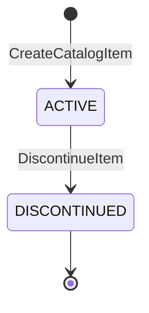
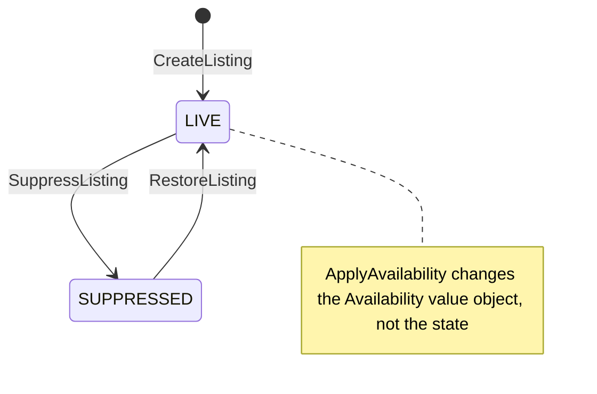
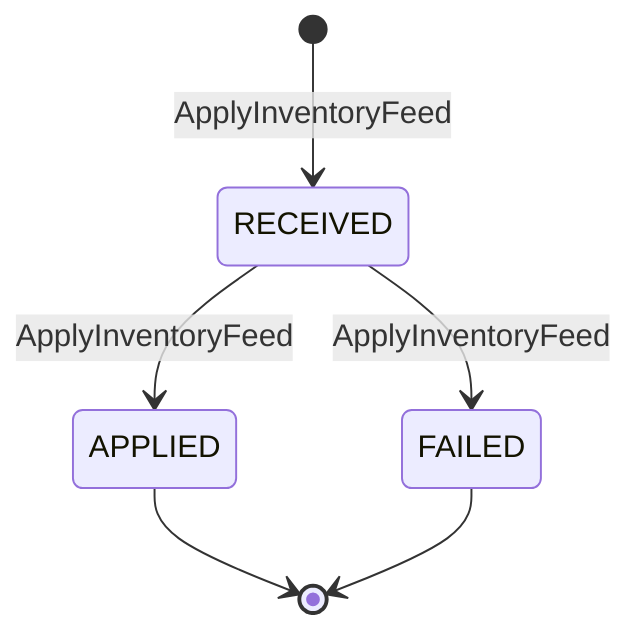

# Aggregate Design Canvas

:::info[As built]
Derived from [`network/model/model.yaml`](https://github.com/IQVO/warehouse-docs/blob/main/network/model/model.yaml). This context's service is built; the model carries its as-built contracts, and identifiers (`Err...` names, routes, CloudEvents types) are the names the service uses.
:::

Following the ddd-crew [Aggregate Design Canvas v1.1](https://github.com/ddd-crew/aggregate-design-canvas).
There are three aggregate roots: **CatalogItem**, **Listing** and
**InventoryFeed**. Sections 8 and 9 are estimates from the model, not
measurements.

## CatalogItem

### 1. Name

`CatalogItem` (proposed Go type `catalog.Item`), identified by
`catalogItemId`.

### 2. Description

The network's own item master entry: title, dimensions, weight and handling
flags (`hazmat`, `fragile`). It is independent of who ships the item.
Vendors refer to it through a `listingId`, never by their own SKU.

### 3. State Transitions

Derived from: `model.yaml → contexts[offer-availability].aggregates[CatalogItem].states`,
`.transitions`, `.commands`.

Omitted: nothing. The creation edge from `[*]` is the `CreateCatalogItem`
command; the model lists no transition out of `DISCONTINUED`, so it is
drawn as terminal.

### 4. Enforced Invariants

| Invariant | Enforced by |
| --- | --- |
| Dimensions and weight are positive | `CreateCatalogItem` → `ErrInvalidItemDimensions` |

### 5. Corrective Policies

- None inside this context. The model does not say whether discontinuing
  an item suppresses its listings (see Open Questions on the
  [canvas](/network/contexts/offer-availability/bounded-context-canvas)).
- Neighbours react to `CatalogItemDiscontinued`: `delivery-promise` and
  `order-sourcing` update their `AvailabilityView`.

### 6. Handled Commands

| Command | Issued by | Inbound adapter |
| --- | --- | --- |
| `CreateCatalogItem` | Network merchandising | REST `POST /catalog-items` |
| `DiscontinueItem` | Network merchandising | REST `POST /catalog-items/{catalogItemId}:discontinue` |

### 7. Created Events

| Event | Raised when | Full CloudEvents type |
| --- | --- | --- |
| `CatalogItemCreated` | after `CreateCatalogItem` commits | `com.retailnetwork.commerce.offer-availability.catalogitem.CatalogItemCreated` |
| `CatalogItemDiscontinued` | after `DiscontinueItem` commits | `com.retailnetwork.commerce.offer-availability.catalogitem.CatalogItemDiscontinued` |

### 8. Throughput

*Estimate* (model: "low"). Writes come from merchandising, one item at a
time. Reads (`GET /catalog`) dominate.

### 9. Size

*Estimate* (model: "~10^6 items"). One row of scalar fields per item, two
events in a lifetime.

## Listing

### 1. Name

`Listing` (`listing.Listing`), identified by `listingId`. Natural key
(`catalogItemId`, `nodeId`).

### 2. Description

One catalogue item offered from one node, with the node's claimed
available quantity, its basis and the feed it came from. It holds one value
object, `Availability{availableQty, basis(PHYSICAL|THROUGHPUT_CONSTRAINED|UNKNOWN), asOf, feedId}`.

### 3. State Transitions

Derived from: `model.yaml → contexts[offer-availability].aggregates[Listing].states`,
`.transitions`, `.commands`, `.value_objects`.

Omitted: the model gives no initial state. The page draws
`CreateListing` into `LIVE`; by the invariant "a listing on a non-`ACTIVE`
node is `SUPPRESSED`", a listing created for a node that is not `ACTIVE`
should start `SUPPRESSED`. That case is a model gap and is not drawn. No
terminal state exists in the model.

### 4. Enforced Invariants

| Invariant | Enforced by |
| --- | --- |
| `availableQty >= 0` | `ApplyAvailability` → `ErrNegativeAvailability` |
| An update with `asOf` not after the current `asOf` is ignored (monotonic per listing) | `ApplyAvailability` → `ErrStaleAvailability` (the line is ignored, not applied) |
| A listing on a non-`ACTIVE` node is `SUPPRESSED` | `RestoreListing` → `ErrNodeNotSellable` (checked against the local `NodeStatusView`) |
| One listing per (`catalogItemId`, `nodeId`) | `CreateListing` → `ErrDuplicateListing` (backed by a unique key) |

### 5. Corrective Policies

- **`SuppressOnNodeUnavailable`**: on `NodeSuspended` or `NodeRetired`,
  suppress every listing of the node; on `NodeActivated`, restore those
  suppressed for that reason.
- **`FullFeedZeroing`**: a full feed sets `availableQty=0` on every listing
  of the node it omits.
- Neighbours: `delivery-promise` and `order-sourcing` fold every listing
  event into their `AvailabilityView`; `vendor-connectivity` adds each new
  listing to its `ListingView`.

### 6. Handled Commands

| Command | Issued by | Inbound adapter |
| --- | --- | --- |
| `CreateListing` | Network merchandising | REST `POST /listings` |
| `ApplyAvailability` | `ApplyInventoryFeed` use case, once per feed line and once per listing zeroed by `FullFeedZeroing` | none of its own (inside `POST /inventory-feeds`) |
| `SuppressListing` | `SuppressOnNodeUnavailable` policy | Kafka consumer of `retailnetwork.node-topology.events` |
| `RestoreListing` | `SuppressOnNodeUnavailable` policy | Kafka consumer of `retailnetwork.node-topology.events` |

### 7. Created Events

| Event | Raised when | Full CloudEvents type |
| --- | --- | --- |
| `ListingCreated` | after `CreateListing` commits | `com.retailnetwork.commerce.offer-availability.listing.ListingCreated` |
| `ListingAvailabilityChanged` | after `ApplyAvailability` changes the `Availability` (not when the line is stale) | `com.retailnetwork.commerce.offer-availability.listing.ListingAvailabilityChanged` |
| `ListingSuppressed` | after `SuppressListing` commits; carries `reason` | `com.retailnetwork.commerce.offer-availability.listing.ListingSuppressed` |
| `ListingRestored` | after `RestoreListing` commits | `com.retailnetwork.commerce.offer-availability.listing.ListingRestored` |

### 8. Throughput

*Estimate* (model: "high: one update per feed line; bursty"). Every feed
line is a write on one listing. Contention on one listing is low (one node,
one vendor), but a full feed writes many listings of one node at once.
Proposed optimistic concurrency: a `version` per listing.

### 9. Size

*Estimate* (model: "items x nodes, sparse"). One row per listing with the
current `Availability` only; history lives in the events, not on the row.

## InventoryFeed

### 1. Name

`InventoryFeed` (`feed.InventoryFeed`), identified by `feedId`.

### 2. Description

One vendor inventory submission for one node, full or partial
(`fullUpdate`), applied atomically. `vendor-connectivity` owns the Vendor
API transaction that carries it; this aggregate records that the feed was
received and whether it was applied.

### 3. State Transitions

Derived from: `model.yaml → contexts[offer-availability].aggregates[InventoryFeed].states`,
`.transitions`, `.commands`.

Omitted: nothing. All three edges belong to the one command: the feed is
recorded `RECEIVED` and resolved in the same apply. `APPLIED` and `FAILED`
have no outgoing transition in the model and are drawn as terminal.

### 4. Enforced Invariants

| Invariant | Enforced by |
| --- | --- |
| Every line names a listing of the feed's node | `ApplyInventoryFeed` → `ErrListingNotOnNode` (the feed ends `FAILED`, no line applied) |
| A feed is applied at most once | `ApplyInventoryFeed` → `ErrFeedAlreadyApplied` |
| (carried from `Listing`) every line's `availableQty >= 0` | `ApplyAvailability` → `ErrNegativeAvailability` (proposed: the feed ends `FAILED`, because it is applied atomically) |

### 5. Corrective Policies

- **`FullFeedZeroing`**: when `fullUpdate` is true, every listing of the
  node the feed omits gets `availableQty=0` in the same apply.
- Neighbours: `node-performance` records an observation from
  `InventoryFeedApplied` (feed freshness). `vendor-connectivity` turns the
  call's answer into its `Submission` outcome (`SUCCESS` or `FAILURE`).

### 6. Handled Commands

| Command | Issued by | Inbound adapter |
| --- | --- | --- |
| `ApplyInventoryFeed` | `vendor-connectivity` (processing a vendor `SubmitInventory`) | REST `POST /inventory-feeds` (in-org) |

### 7. Created Events

| Event | Raised when | Full CloudEvents type |
| --- | --- | --- |
| `InventoryFeedApplied` | after the feed reaches `APPLIED` | `com.retailnetwork.commerce.offer-availability.inventoryfeed.InventoryFeedApplied` |

A `FAILED` feed raises no event: the model publishes none.

### 8. Throughput

*Estimate* (model: "medium: per vendor node every few minutes"). Proposed
assumption: feeds for one node arrive one at a time; two concurrent feeds
for the same node are serialised by the listing `version` check.

### 9. Size

*Estimate* (model: "retained 30 days"). One header row plus one row per
line, kept 30 days; one event per applied feed.

## Read models

| Read model | Source events | Used for | Why it is not an aggregate |
| --- | --- | --- | --- |
| `NodeStatusView` | `node-topology` `NodeRegistered`, `NodeActivated`, `NodeSuspended`, `NodeRetired` | `ErrNodeNotSellable` on `RestoreListing`; deciding which listings `SuppressOnNodeUnavailable` acts on | It holds no rule of its own; it is a local copy of `node-topology`'s facts, rebuilt from the topic, and this context never changes it by command. |

## Packaging hierarchy and owner

> **Proposed, [ADR 0009](/network/adr/0009-seller-inbound-and-case-packed-shipments).** This section is the delta that the seller-inbound design adds to this page. Nothing in it is built.

**CatalogItem** gains optional `Identifiers{gtin}` (the each-level GTIN) and a
`PackagingHierarchy` of `PackLevelDef{level, gtin, childGtin?, unitsPerPack, dimsMm?, grossWeightG?, active}`. New commands: `DeclarePackaging`, `RetirePackLevel`. New events: `CatalogItemPackagingDeclared`, `CatalogItemPackLevelRetired`.

| Invariant | Error |
| --- | --- |
| A GTIN is 8, 12, 13 or 14 digits with a valid mod-10 check digit, stored as 14 digits | `ErrInvalidGTIN` |
| A GTIN identifies exactly one (item, level) | `ErrGtinAlreadyAssigned` |
| Once a level is active its `unitsPerPack` never changes for that GTIN: a new quantity is a new GTIN at that level and a re-declaration of every level above, and the old level is retired | `ErrPackQuantityImmutable` |
| A level's child level is lower than the level itself | `ErrPackLevelOrder` |
| `unitsPerPack` is at least 2 for every level above `EACH` and 1 for `EACH` | `ErrInvalidPackQuantity` |
| Variable-measure GTINs (indicator digit 9) are rejected | `ErrVariableMeasureUnsupported` |

**Listing** gains an optional `OwnerRef`. The invariant `ErrDuplicateListing`
becomes "one listing per (`catalogItemId`, `nodeId`, `ownerRef`)"; an absent
`ownerRef` is its own owner. The policy `SegregatedByOwner` states that
availability is per listing and never summed, merged or moved between owners.
This context does not check that an `ownerRef` is an active seller (gap G48).
