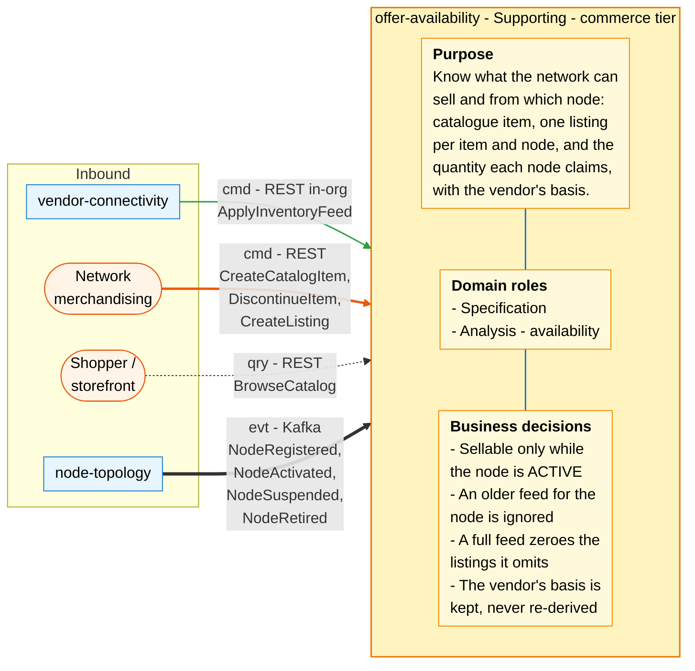
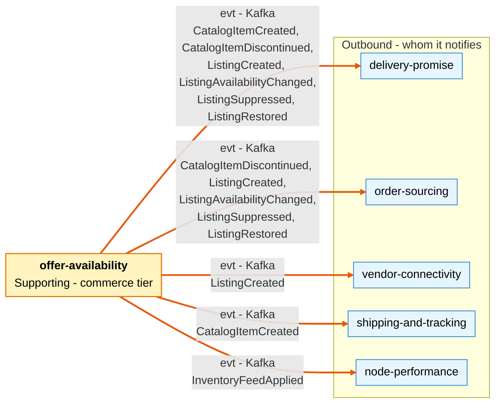

# Bounded Context Canvas

:::info[As built]
Derived from [`network/model/model.yaml`](https://github.com/IQVO/warehouse-docs/blob/main/network/model/model.yaml). This context's service is built; the model carries its as-built contracts, and identifiers (`Err...` names, routes, CloudEvents types) are the names the service uses.
:::

Following the ddd-crew [Bounded Context Canvas v5](https://github.com/ddd-crew/bounded-context-canvas).
Every message row comes from `model.yaml` (this context's `inbound`,
`rest`, `publishes`, `consumes` and `sync_calls`, and the neighbours'
entries for the other side of each edge).

## Canvas at a glance

Two pictures of the sections below: first the inbound collaborators and
what the context does with them (purpose, domain roles, business
decisions), then the outbound collaborators it notifies. Arrows follow the
message type: **solid blue** commands (`cmd`), **dotted green** queries
(`qry`), **thick orange** events (`evt`); each arrow names its channel and
messages. Box shapes mark the collaborator kind: rounded = people or UI;
blue = sibling bounded context. Channel names are abbreviated; the tables
carry the exact route, topic and CloudEvents type.

### Inbound

### Outbound

Derived from: `model.yaml → contexts[offer-availability].inbound`,
`.publishes`, `.consumes`, `.sync_calls` (empty), `.purpose`, `.roles`,
`.business_decisions`. The diagrams omit the relationship pattern per
message (see the tables), assumptions, metrics and open questions, and the
replies to the synchronous calls. The context makes no synchronous call,
so the Outbound picture has events only. The `ext`, `self` and `none`
classes are declared for consistency with the other canvases and unused
here.

## Name

**Offer & Availability** (`offer-availability`, code `OA`, CloudEvents tier
`commerce`).

## Purpose

To know what the network can sell and from which node:

- the **catalogue item**, the network's own entry for a product;
- one **listing** per (catalogue item, node);
- the **quantity** each node currently claims it can ship for each listing,
  with the **basis** the vendor gave for that number (physical stock or
  throughput-constrained).

It makes the facts available to the contexts that decide (promise and
sourcing) as events, so their hot paths make no synchronous call here.

## Strategic Classification

| Axis | Verdict |
| --- | --- |
| **Domain** | **Supporting**. See the [Core Domain Chart](/network/contexts/offer-availability/core-domain-chart). |
| **Business Model** | Revenue enabler (what can be sold, from where). |
| **Evolution** | Product. |

## Domain Roles

| Role | Applies? | Evidence in the model |
| --- | --- | --- |
| **Specification** | **Yes, primary** | It defines what is sellable: `CatalogItem`, `Listing`, the `LIVE` / `SUPPRESSED` rule tied to node status (`ErrNodeNotSellable`). |
| **Analysis (availability)** | **Yes** | It turns vendor feeds into per-listing availability: monotonic `asOf` (`ErrStaleAvailability`), `FullFeedZeroing`. It does not re-derive the vendor's basis. |
| Execution / Enforcer / Gateway | No | It enforces no deadline and no capacity, and it is not the vendor's entry point (`vendor-connectivity` is). |

## Inbound Communication

| Collaborator | Message | Type | Channel | Relationship |
| --- | --- | --- | --- | --- |
| `vendor-connectivity` | `ApplyInventoryFeed` | Command | REST `POST /inventory-feeds` (in-org; a `vendor-connectivity` `sync_calls` entry) | Customer/Supplier (`vendor-connectivity` is the Customer) |
| Network merchandising (human) | `CreateCatalogItem` | Command | REST `POST /catalog-items` | UI |
| Network merchandising (human) | `DiscontinueItem` | Command | REST `POST /catalog-items/{catalogItemId}:discontinue` | UI |
| Network merchandising (human) | `CreateListing` | Command | REST `POST /listings` | UI |
| Shopper / storefront | `BrowseCatalog` | Query | REST `GET /catalog`, `GET /catalog/{catalogItemId}` | Open Host Service |
| `node-topology` | `NodeRegistered` | Event | Kafka `retailnetwork.node-topology.events`, `com.retailnetwork.logistics.node-topology.node.NodeRegistered` | Conformist |
| `node-topology` | `NodeActivated` | Event | Kafka `retailnetwork.node-topology.events`, `com.retailnetwork.logistics.node-topology.node.NodeActivated` | Conformist |
| `node-topology` | `NodeSuspended` | Event | Kafka `retailnetwork.node-topology.events`, `com.retailnetwork.logistics.node-topology.node.NodeSuspended` | Conformist |
| `node-topology` | `NodeRetired` | Event | Kafka `retailnetwork.node-topology.events`, `com.retailnetwork.logistics.node-topology.node.NodeRetired` | Conformist |

Two routes in `rest` have no collaborator in `inbound`:
`GET /listings?nodeId=&catalogItemId=` and `GET /inventory-feeds/{feedId}`.
They are in the [REST contract](/network/api-reference) but not on the canvas,
because the model does not say who calls them (see Open Questions).

## Outbound Communication

| Collaborator | Message | Type | Channel | Relationship |
| --- | --- | --- | --- | --- |
| `delivery-promise`, `shipping-and-tracking` | `CatalogItemCreated` | Event | Kafka `retailnetwork.offer-availability.events`, `com.retailnetwork.commerce.offer-availability.catalogitem.CatalogItemCreated` | Conformist (downstream) |
| `delivery-promise`, `order-sourcing` | `CatalogItemDiscontinued` | Event | Kafka `retailnetwork.offer-availability.events`, `com.retailnetwork.commerce.offer-availability.catalogitem.CatalogItemDiscontinued` | Conformist (downstream) |
| `delivery-promise`, `order-sourcing`, `vendor-connectivity` | `ListingCreated` | Event | Kafka `retailnetwork.offer-availability.events`, `com.retailnetwork.commerce.offer-availability.listing.ListingCreated` | Conformist (downstream) |
| `delivery-promise`, `order-sourcing` | `ListingAvailabilityChanged` | Event | Kafka `retailnetwork.offer-availability.events`, `com.retailnetwork.commerce.offer-availability.listing.ListingAvailabilityChanged` | Conformist (downstream) |
| `delivery-promise`, `order-sourcing` | `ListingSuppressed` | Event | Kafka `retailnetwork.offer-availability.events`, `com.retailnetwork.commerce.offer-availability.listing.ListingSuppressed` | Conformist (downstream) |
| `delivery-promise`, `order-sourcing` | `ListingRestored` | Event | Kafka `retailnetwork.offer-availability.events`, `com.retailnetwork.commerce.offer-availability.listing.ListingRestored` | Conformist (downstream) |
| `node-performance` | `InventoryFeedApplied` | Event | Kafka `retailnetwork.offer-availability.events`, `com.retailnetwork.commerce.offer-availability.inventoryfeed.InventoryFeedApplied` | Conformist (downstream) |
| (none) | — | Sync call | `sync_calls` is empty: this context calls no one | — |

Full message details: [Domain Events](/network/contexts/offer-availability/domain-events).
Relationship evidence: [Context Map](/network/contexts/offer-availability/context-map).

## Ubiquitous Language

Full glossary: [Ubiquitous Language](/network/contexts/offer-availability/ubiquitous-language).
Top terms: **Catalog Item**, **Listing** (≠ Catalog Item), **Available
Quantity**, **Availability Basis** `PHYSICAL` / `THROUGHPUT_CONSTRAINED` /
`UNKNOWN` (≠ Promise Basis), **Inventory Feed** (≠ Submission), **Full
Feed**, `asOf`.

## Business Decisions

1. **A listing is sellable only while its node is `ACTIVE`.** Enforced by
   `ErrNodeNotSellable` and the `SuppressOnNodeUnavailable` policy.
2. **A feed older than the last applied feed for that node is ignored.**
   Per listing, an update with `asOf` not after the current `asOf` is
   ignored (`ErrStaleAvailability`).
3. **A full feed zeroes every listing of that node it omits**
   (`FullFeedZeroing`).
4. **The basis the vendor declares is kept with the number, never
   re-derived.**
5. **One listing per (`catalogItemId`, `nodeId`)** (`ErrDuplicateListing`).
6. **A feed is applied at most once, atomically** (`ErrFeedAlreadyApplied`),
   and every line names a listing of the feed's node
   (`ErrListingNotOnNode`).

## Assumptions

- `node-topology` publishes every node status change, keyed by `nodeId`, so
  the local `NodeStatusView` sees them in order per node.
- `vendor-connectivity` checks that a vendor acts only on its own nodes
  (`ErrNodeNotOwnedByVendor`) before it calls `POST /inventory-feeds`; this
  context does not know vendors.
- `vendor-connectivity` owns the asynchronous transaction, rate limits and
  the `202` answer to the vendor; this context answers its in-org call
  inside that processing.
- Consumers of availability (`delivery-promise`, `order-sourcing`) keep
  their own `AvailabilityView` from events; none calls this context on a
  hot path.
- Feeds are retained 30 days (`InventoryFeed` size estimate).

## Verification Metrics

All proposed; nothing is measured yet.

- Feed apply latency: `POST /inventory-feeds` p95, request to commit.
- Share of feeds ending `FAILED`, split by `ErrListingNotOnNode`,
  `ErrNegativeAvailability`.
- Share of feed lines ignored as stale (`ErrStaleAvailability`).
- Listings zeroed by `FullFeedZeroing` per full feed.
- Suppression lag: `NodeSuspended` / `NodeRetired` event time to the last
  `ListingSuppressed` of that node.
- Outbox lag: commit to publish on `retailnetwork.offer-availability.events`.
- Feed freshness per node, as measured by `node-performance`
  (`feedFreshnessP95Minutes`, from `InventoryFeedApplied`).

## Open Questions

- **Node-level staleness.** The decision "a feed older than the last
  applied feed for that node is ignored" has no invariant, no `Err...`
  identifier and no feed state; only the per-listing `ErrStaleAvailability`
  exists.
- **What a zeroed listing carries.** `FullFeedZeroing` sets
  `availableQty=0`, but the model does not say which `basis` and `asOf` the
  zeroed `Availability` gets.
- **A new listing's starting state.** The model does not say whether a
  listing created on a non-`ACTIVE` node starts `SUPPRESSED`, nor what its
  `Availability` is before the first feed.
- **Discontinued items.** Nothing says whether `DiscontinueItem` suppresses
  the item's listings or refuses new listings and feed lines for it.
- **Who reads `GET /listings` and `GET /inventory-feeds/{feedId}`.** No
  inbound row names a caller.
- **Feed and transaction correlation.** The model does not say whether
  `feedId` is `vendor-connectivity`'s `transactionId`, nor the shape of a
  feed line.
- **Atomic application at volume.** A full feed touches every listing of a
  node in one atomic apply, with "high, bursty" throughput.
