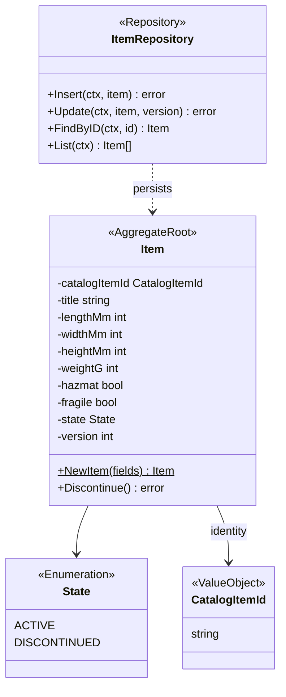
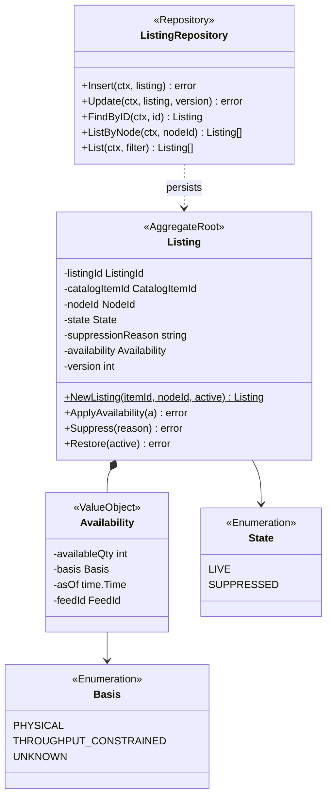
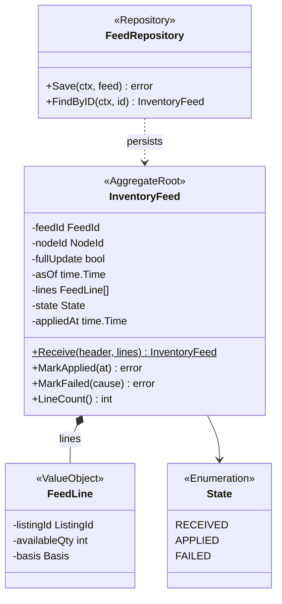
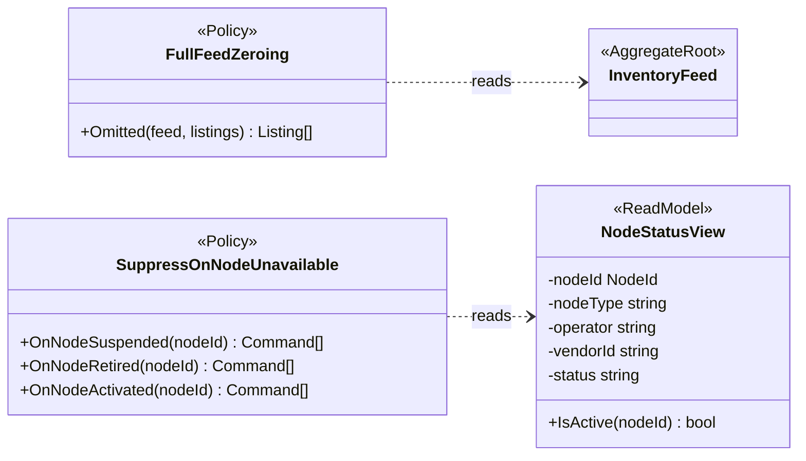
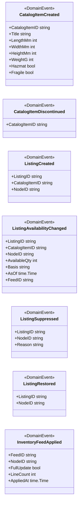
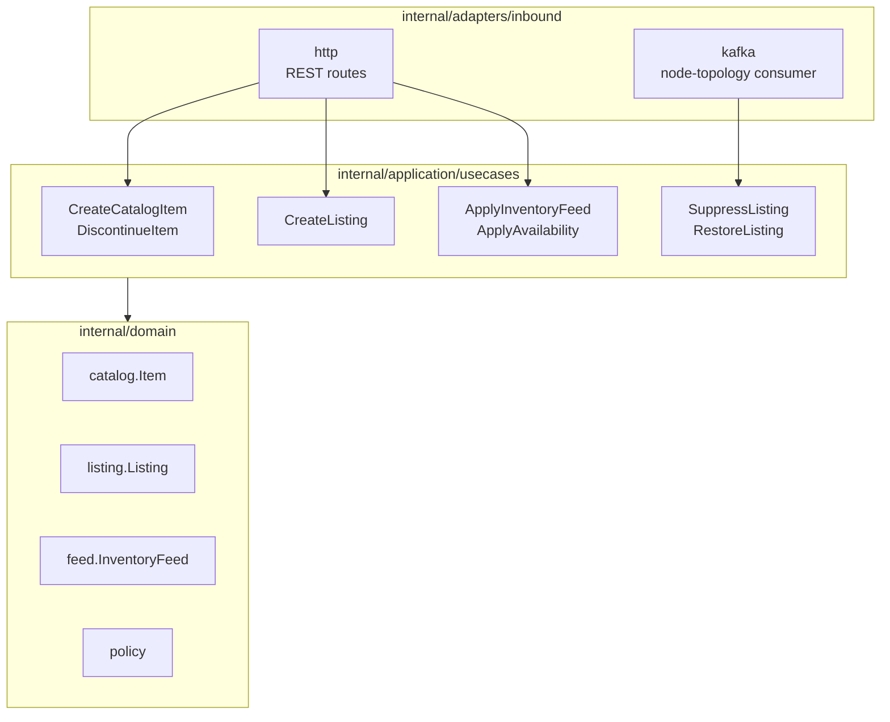
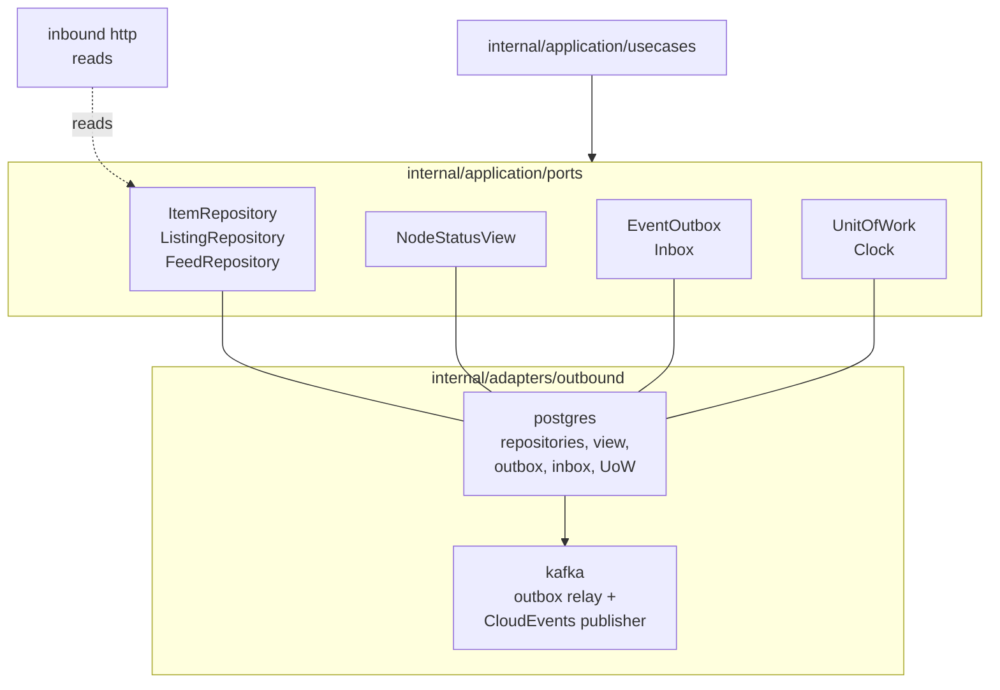

# Class Diagram

:::info[As built]
Derived from [`network/model/model.yaml`](https://github.com/IQVO/warehouse-docs/blob/main/network/model/model.yaml). This context's service is built; the model carries its as-built contracts, and identifiers (`Err...` names, routes, CloudEvents types) are the names the service uses.
:::

UML class diagrams of the **proposed** domain packages, then the hexagonal
ports and adapters in the Go layout the warehouse-systems fleet uses.
Aggregate, state, value object, policy, command and event names come from
`model.yaml`; Go method and field names are proposals. Fields are shown
`-` (unexported), methods `+` (exported); `$` marks a constructor.

## 1. CatalogItem aggregate

Derived from: `model.yaml → contexts[offer-availability].aggregates[CatalogItem]`,
`.publishes[CatalogItemCreated].data`, `.ul[Catalog Item]` (`catalog.Item`).

Omitted: read accessors. `NewItem` returns `ErrInvalidItemDimensions`
when a dimension or the weight is not positive.

## 2. Listing aggregate

Derived from: `model.yaml → contexts[offer-availability].aggregates[Listing]`
(`states`, `value_objects`, `invariants`, `commands`), `.ul[Listing]`,
`.ul[Available Quantity]`, `.ul[Availability Basis]`.

Omitted: the `ListingId`, `CatalogItemId`, `NodeId` and `FeedId` value
types (strings). Errors: `ApplyAvailability` returns
`ErrNegativeAvailability` and `ErrStaleAvailability`; `Restore` returns
`ErrNodeNotSellable`; the repository's `Insert` maps the unique-key
violation to `ErrDuplicateListing`. `NewListing` taking `nodeActive` is the
proposed answer to the missing initial state (H3 on
[EventStorming](/network/contexts/offer-availability/eventstorming)).

## 3. InventoryFeed aggregate

Derived from: `model.yaml → contexts[offer-availability].aggregates[InventoryFeed]`,
`.publishes[InventoryFeedApplied].data`, `.ul[Inventory Feed]`, `.ul[Full Feed]`.

Omitted: `FeedLine` and the feed-level `asOf` are proposals; the model
names lines in an invariant but gives no line shape. `MarkApplied` returns
`ErrFeedAlreadyApplied` on an `APPLIED` feed; the use case returns
`ErrListingNotOnNode` before `MarkFailed`.

## 3b. Policies and the read model

Derived from: `model.yaml → contexts[offer-availability].policies`,
`.read_models[NodeStatusView]`; `contexts[node-topology].publishes[NodeRegistered].data`.

Omitted: the commands each policy method returns are `SuppressListing`
and `RestoreListing`. `<<ReadModel>>` is not one of
the canvas stereotypes; it marks the local view.

## 4. Domain events

Derived from: `model.yaml → contexts[offer-availability].publishes[*].data`.

Omitted: the shared `EventName()` / `OccurredAt()` interface and the
CloudEvents envelope, built by the outbound Kafka adapter.

## 5. Hexagonal ports and adapters

Driving side: inbound adapters, use cases, domain.

Derived from: `model.yaml → contexts[offer-availability].inbound`,
`.rest`, `.consumes`, `.aggregates`, `.policies`.

Driven side: ports and outbound adapters.

Derived from: `model.yaml → contexts[offer-availability].inbound`,
`.rest`, `.consumes`, `.aggregates`, `.policies`, `.read_models`;
`conventions.integration_rules` (own database, transactional outbox,
idempotent consumer).

Proposed packages: `internal/adapters/inbound/{http,kafka}`,
`internal/application/usecases`, `internal/application/ports`,
`internal/domain/{catalog,listing,feed,policy}` and
`internal/adapters/outbound/{postgres,kafka}`.

Omitted: `cmd/` composition roots and configuration. `Clock` has no
adapter package (a system clock in the composition root). The Kafka
consumer also writes `NodeStatusView` through its port inside the same
unit of work as the listing changes. Reads go from the HTTP adapter to the
repositories directly; they are not use cases.
