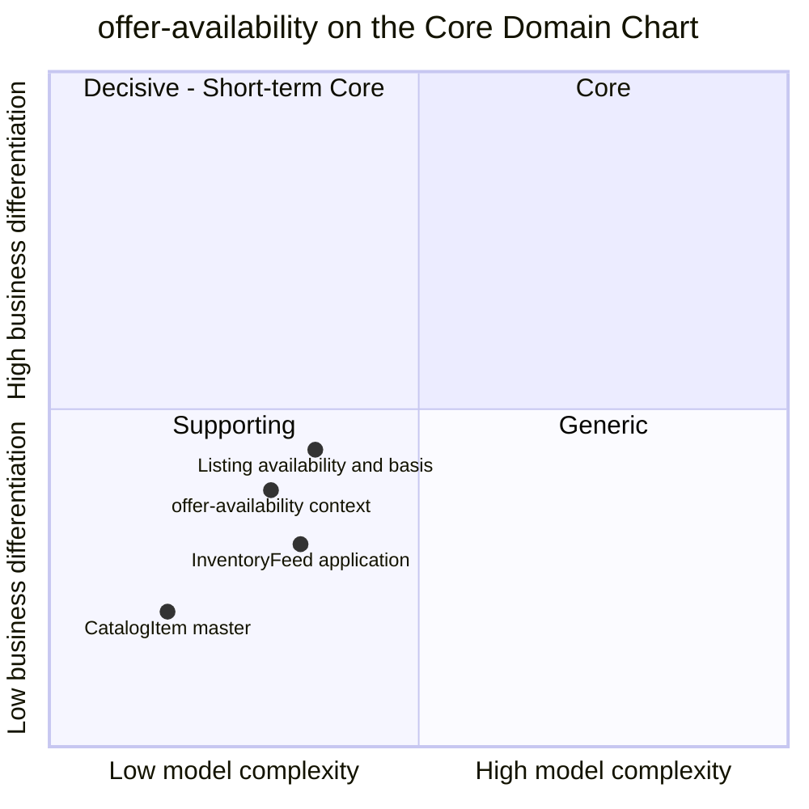

# Core Domain Chart

:::info[As built]
Derived from [`network/model/model.yaml`](https://github.com/IQVO/warehouse-docs/blob/main/network/model/model.yaml). This context's service is built; the model carries its as-built contracts, and identifiers (`Err...` names, routes, CloudEvents types) are the names the service uses.
:::

Following the ddd-crew [Core Domain Charts](https://github.com/ddd-crew/core-domain-charts):
business differentiation (y) against model complexity (x).

Derived from: `model.yaml → contexts[offer-availability].chart`
(`complexity: 0.30`, `differentiation: 0.38`),
`contexts[offer-availability].aggregates`. The three slice positions are
this page's estimate, not model values.

Omitted: the other ten contexts (each has its own chart; the domain-wide
picture is [Core Domain Chart](/network/strategic-design/core-domain-chart)).

## Classification: Supporting

The context point and all three slices sit in **quadrant 3 (Supporting)**,
bottom-left. The model classifies the context `Supporting`, business model
"Revenue enabler (what can be sold, from where)", evolution `Product`.

**Differentiation is moderate-low (y = 0.38).** The network needs to know
what it can sell and from where, or it cannot promise anything. But the
decisions that win customers (a date that is true, a node that keeps it)
are made in `delivery-promise` and `order-sourcing`, which are Core. This
context feeds them facts. The one idea with some edge is keeping the
vendor's **basis** next to the number, so a `THROUGHPUT_CONSTRAINED`
quantity is not read as stock. That is why the Listing slice is plotted
highest. It is still a declaration the context stores, not a decision it
makes, so it stays below the Core line.

**Complexity is low (x = 0.30).** Three aggregates with two or three
states each, seven invariants, two policies and one read model. The
non-trivial rules are monotonic `asOf`, full-feed zeroing and node-driven
suppression. The hardest part is operational, not conceptual: applying a
full feed for a node atomically across many listings, with the throughput
the model expects ("high: one update per feed line; bursty").

## Business model

| Aspect | Verdict |
| --- | --- |
| Business model | Revenue enabler: nothing is sold that is not listed, and nothing is promised from a node without a quantity. |
| Who pays if it is wrong | `delivery-promise` quotes from a quantity a node cannot ship, or misses one it can. `node-performance` measures the cost afterwards (feed freshness, rejections). |
| Who it serves | `delivery-promise`, `order-sourcing`, `vendor-connectivity`, `shipping-and-tracking`, `node-performance`, the storefront. |

## Evolution

| Part | Evolution stage | Why |
| --- | --- | --- |
| Catalogue item master | **Product / Commodity** | Item master data with dimensions and flags is a well-understood shape. |
| Listing and availability | **Product** | Per-node offers fed by partner submissions are an established pattern; the model's addition is the kept basis. |
| Feed application (full / partial, monotonic `asOf`) | **Product** | Known semantics; the work is in doing it atomically at volume. |
| Node-driven suppression | **Custom-built** | Specific to this network: it follows `node-topology`'s node lifecycle. |

**Movement to watch.** If the network ever re-derived or corrected the
vendor's number (for example, from `node-performance`'s measured feed
freshness), the Listing slice would move right and up. The model rules
that out today ("kept with the number, never re-derived"); such a change
would need an ADR next to
[ADR 0003](/network/adr/0003-declared-and-measured-capability).
