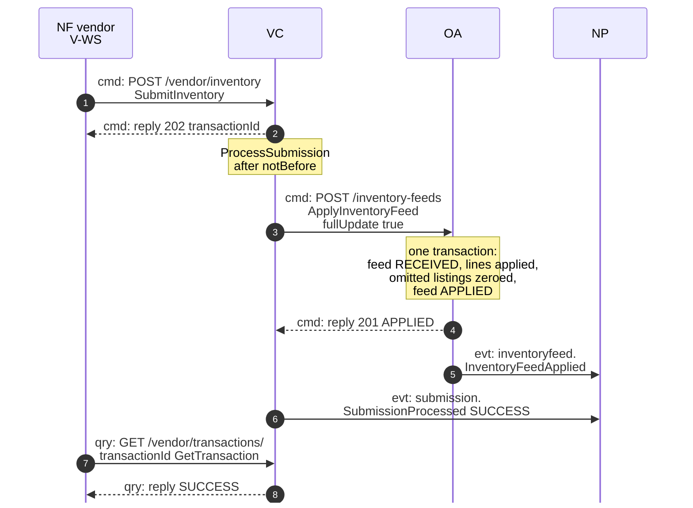
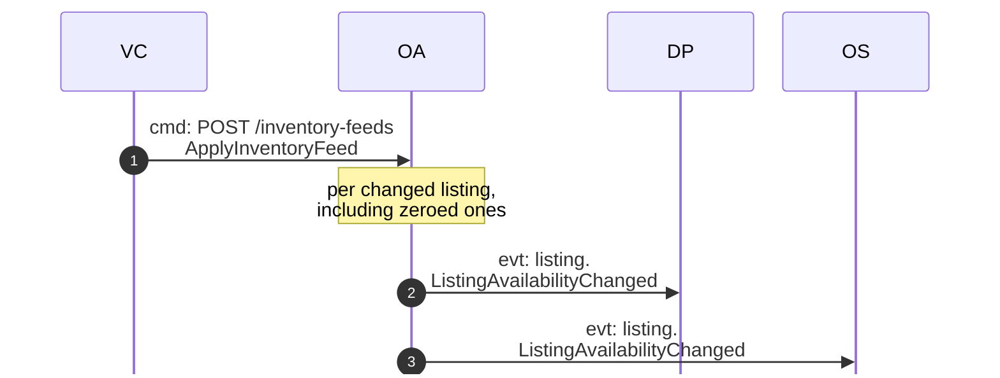
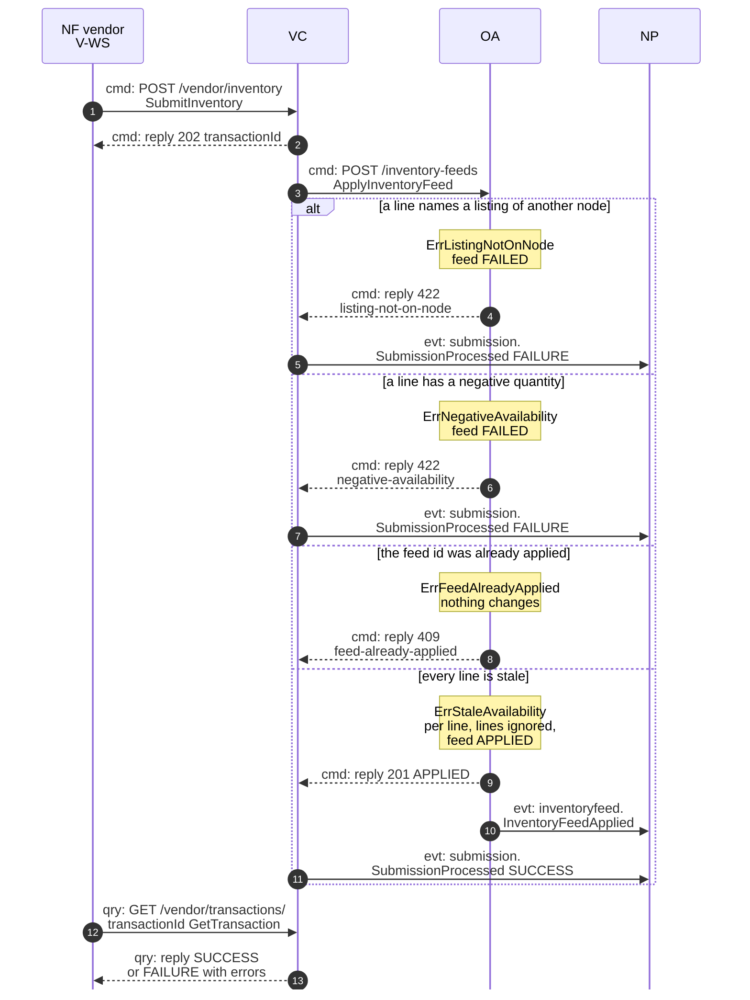
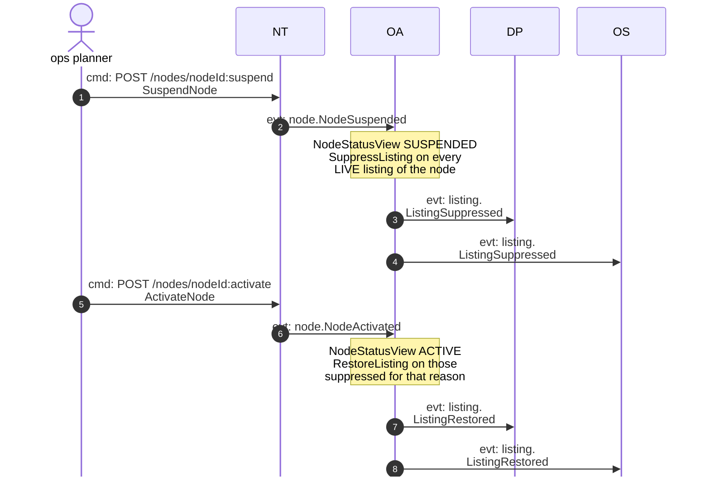
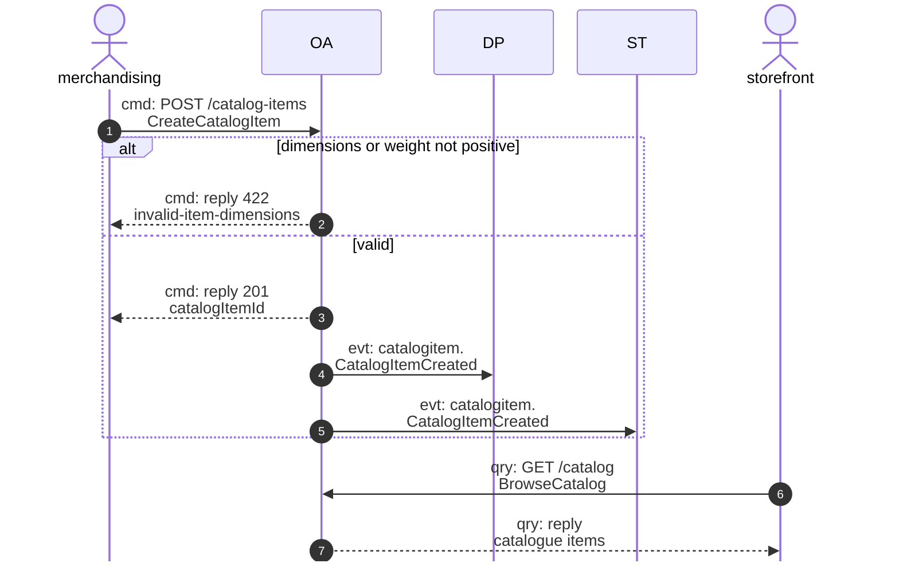
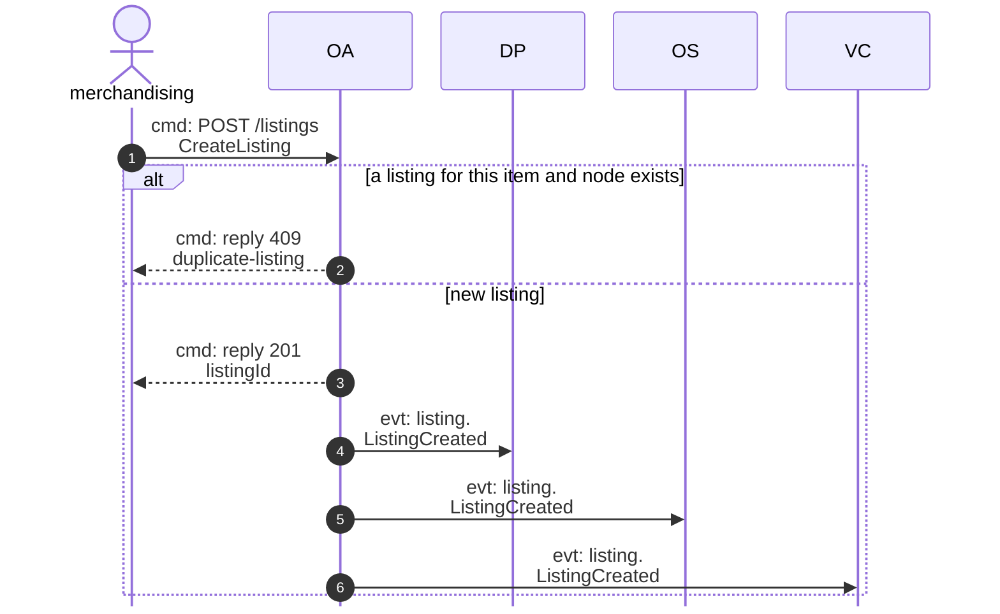

# Domain Message Flow

:::info[Proposed design]
Derived from [`model/model.yaml`](https://github.com/IQVO/retail-network-docs/blob/main/model/model.yaml). Nothing in this context is built yet; identifiers (`Err...` names, routes, CloudEvents types) are the names an implementation must use.
:::

Following ddd-crew [Domain Message Flow Modelling](https://github.com/ddd-crew/domain-message-flow-modelling).
Four scenarios. Participants are contexts and actors, abbreviated by
context code: NF = `network-fulfillment` (the fleet, vendor V-WS),
VC = `vendor-connectivity`, OA = `offer-availability`, NT =
`node-topology`, DP = `delivery-promise`, OS = `order-sourcing`, ST =
`shipping-and-tracking`, NP = `node-performance`. Every arrow is a
message from `model.yaml`, prefixed `cmd:` (command), `qry:` (query) or
`evt:` (event). Event arrows are written `<entity>.<EventName>`; the full
type is `com.retailnetwork.<tier>.<producer>.<entity>.<EventName>` (see
[Domain Events](/network/contexts/offer-availability/domain-events)). Path
parameters are written without braces. The domain-wide flows are on
[Domain Message Flows](/network/strategic-design/domain-message-flows).

## 1. A full inventory feed is applied (happy path)

Derived from: `model.yaml → contexts[vendor-connectivity].inbound`,
`.sync_calls`, `.aggregates[Submission]`, `.publishes[SubmissionProcessed]`;
`contexts[offer-availability].aggregates[InventoryFeed]`,
`.publishes[InventoryFeedApplied]`.

The same apply, seen from the availability consumers:

Derived from: `model.yaml → contexts[offer-availability].publishes[ListingAvailabilityChanged]`,
`.policies[FullFeedZeroing]`, `.aggregates[Listing]`;
`contexts[delivery-promise].read_models[AvailabilityView]`,
`contexts[order-sourcing].read_models[AvailabilityView]`.

Omitted: `vendor-connectivity`'s ownership check
(`ErrNodeNotOwnedByVendor`) and rate limiting; the outbox relay between
commit and Kafka, so the event arrows may be seen after the reply; the
listings whose line was stale, which raise no event. One
`ListingAvailabilityChanged` goes out per changed listing; the diagram
shows one arrow per consumer. A partial feed is the same flow without
zeroing.

## 2. A feed is refused, or changes nothing (failure path)

Derived from: `model.yaml → contexts[offer-availability].aggregates[InventoryFeed].invariants`,
`.aggregates[Listing].invariants`, `.publishes[InventoryFeedApplied]`;
`contexts[vendor-connectivity].aggregates[Submission]`,
`.publishes[SubmissionProcessed]`.

Omitted: what `vendor-connectivity` does with a `409` on a feed it already
applied (its `ErrSubmissionAlreadyProcessed` guards its own side). The
problem `type` slugs and status codes are this context's proposed contract
([Use Cases](/network/contexts/offer-availability/use-cases)). Whether a feed
whose lines are all stale should end `APPLIED` is a model gap; this flow
follows the invariant "is ignored".

## 3. A node is suspended, then activated again

Derived from: `model.yaml → contexts[node-topology].inbound`,
`.aggregates[Node].transitions`, `.publishes`;
`contexts[offer-availability].policies[SuppressOnNodeUnavailable]`,
`.read_models[NodeStatusView]`, `.publishes`.

Omitted: one `ListingSuppressed` / `ListingRestored` goes out per
listing; the diagram shows one arrow per consumer. `delivery-promise` and
`order-sourcing` also consume
`NodeSuspended` and `NodeActivated` directly; those arrows are on their
pages. `NodeRetired` follows the first half of this flow and is never
followed by `NodeActivated` (`RETIRED` is terminal in `node-topology`).

## 4. A catalogue item is created, listed and browsed

Derived from: `model.yaml → contexts[offer-availability].inbound`,
`.rest`, `.aggregates[CatalogItem]`, `.publishes[CatalogItemCreated]`.

Then the item is listed on a node:

Derived from: `model.yaml → contexts[offer-availability].inbound`,
`.rest`, `.aggregates[CatalogItem]`, `.aggregates[Listing].invariants`,
`.publishes`.

Omitted: `DiscontinueItem` (one command, one `CatalogItemDiscontinued` to
`delivery-promise` and `order-sourcing`); the listing has no availability
until the node's first feed names it.
