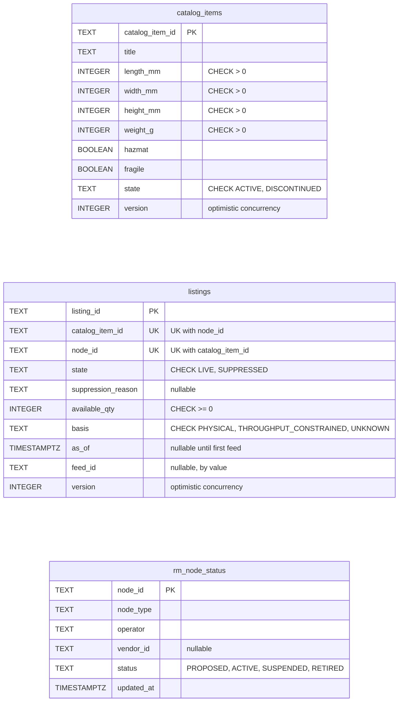
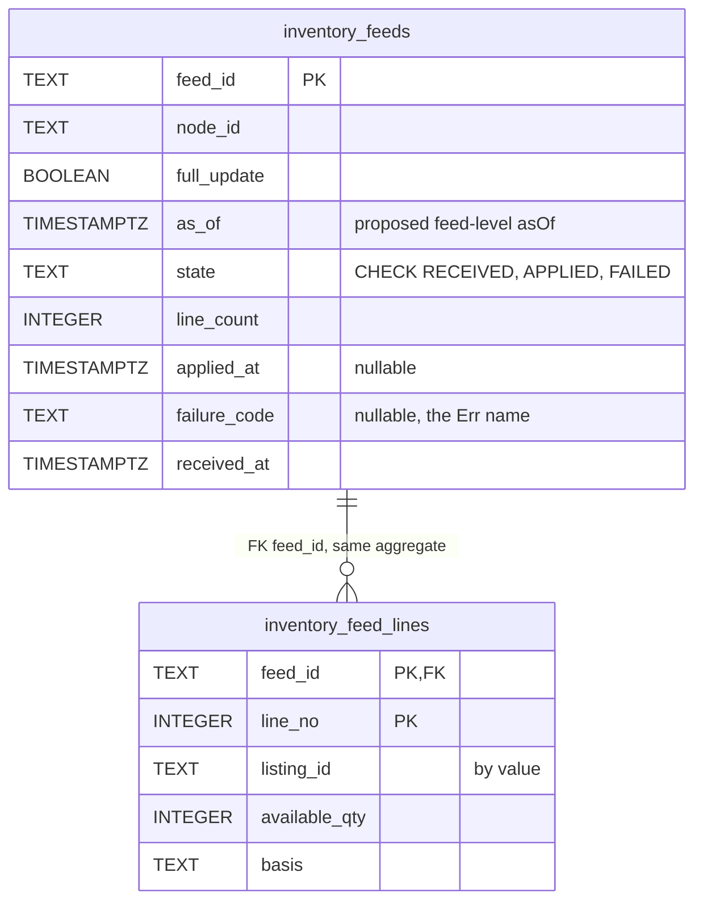
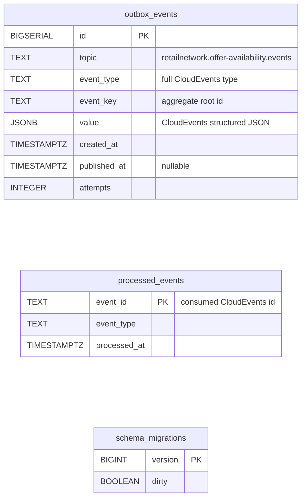

# Entity Relationship

:::info[As built]
Derived from [`network/model/model.yaml`](https://github.com/IQVO/warehouse-docs/blob/main/network/model/model.yaml). This context's service is built; the model carries its as-built contracts, and identifiers (`Err...` names, routes, CloudEvents types) are the names the service uses.
:::

The **proposed** Postgres schema. This context owns its database; no
table is shared (`conventions.integration_rules`). A relationship line is
drawn only inside one aggregate.

## Aggregate and read-model tables

Derived from: `model.yaml → contexts[offer-availability].aggregates[CatalogItem]`,
`.aggregates[Listing]` (root ids, states, value objects, invariants),
`.publishes[CatalogItemCreated].data`, `.read_models[NodeStatusView]`;
`contexts[node-topology].publishes[NodeRegistered].data`,
`.aggregates[Node].states`.

The `InventoryFeed` aggregate, the only one with a child table:

Derived from: `model.yaml → contexts[offer-availability].aggregates[InventoryFeed]`,
`.publishes[InventoryFeedApplied].data`, `.aggregates[Listing].value_objects`.

Omitted: indexes (proposed: `listings (node_id)` for full-feed zeroing and
node suppression, `inventory_feeds (node_id, as_of)`), and the
idempotency-key store for REST replays. `inventory_feed_lines` and
`inventory_feeds.as_of` are proposals; the model gives no line shape.
`received_at` and `failure_code` are proposed bookkeeping columns.

## Infrastructure tables

Derived from: `model.yaml → conventions.integration_rules` (transactional
outbox, idempotent consumer on the CloudEvents id),
`conventions.cloudevents`.

**Infrastructure, not domain.** `outbox_events` is the transactional
outbox: rows are written in the same transaction as the aggregate change
and a relay publishes them to Kafka. `processed_events` is the inbox for
the `node-topology` consumer. `schema_migrations` is the migration tool's
bookkeeping.

## Why there are no foreign keys across aggregates or contexts

- `listings.catalog_item_id` → `catalog_items`: a different aggregate. A
  foreign key would tie a listing's transaction to the item's row and
  block retention or archiving of either. The reference is by value.
- `listings.feed_id` and `inventory_feed_lines.listing_id`: the feed and
  the listing are different aggregates; feeds are retained 30 days while
  listings live on, so a key would break on retention.
- `listings.node_id`, `inventory_feeds.node_id`, `rm_node_status.node_id`:
  the node belongs to `node-topology`'s database. `rm_node_status` is a
  local copy fed by events; it is never the target of a key, because a
  replay may rebuild it at any time.
- `outbox_events.event_key` holds the aggregate root id as the Kafka key,
  not a reference.

The only drawn key, `inventory_feed_lines.feed_id`, is inside the
`InventoryFeed` aggregate.

## Table ≠ aggregate

| Table | Aggregate / role | Notes |
| --- | --- | --- |
| `catalog_items` | **CatalogItem** (root) | One row per item; `version` checked on update. |
| `listings` | **Listing** (root), with its `Availability` value object flattened into columns | Unique key (`catalog_item_id`, `node_id`) backs `ErrDuplicateListing`; `CHECK available_qty >= 0` repeats `ErrNegativeAvailability`. |
| `inventory_feeds` | **InventoryFeed** (root) | Retained 30 days. |
| `inventory_feed_lines` | **InventoryFeed** (its lines) | Written once with the feed; never updated. |
| `rm_node_status` | none (read model `NodeStatusView`) | Rebuilt from `retailnetwork.node-topology.events`. |
| `outbox_events` | none (infrastructure) | Transactional outbox. |
| `processed_events` | none (infrastructure) | Consumer inbox. |
| `schema_migrations` | none (infrastructure) | Migration bookkeeping. |
