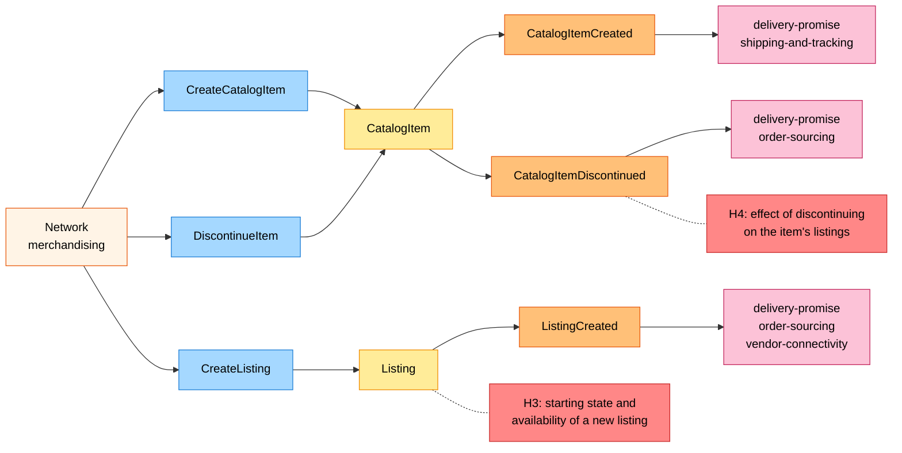
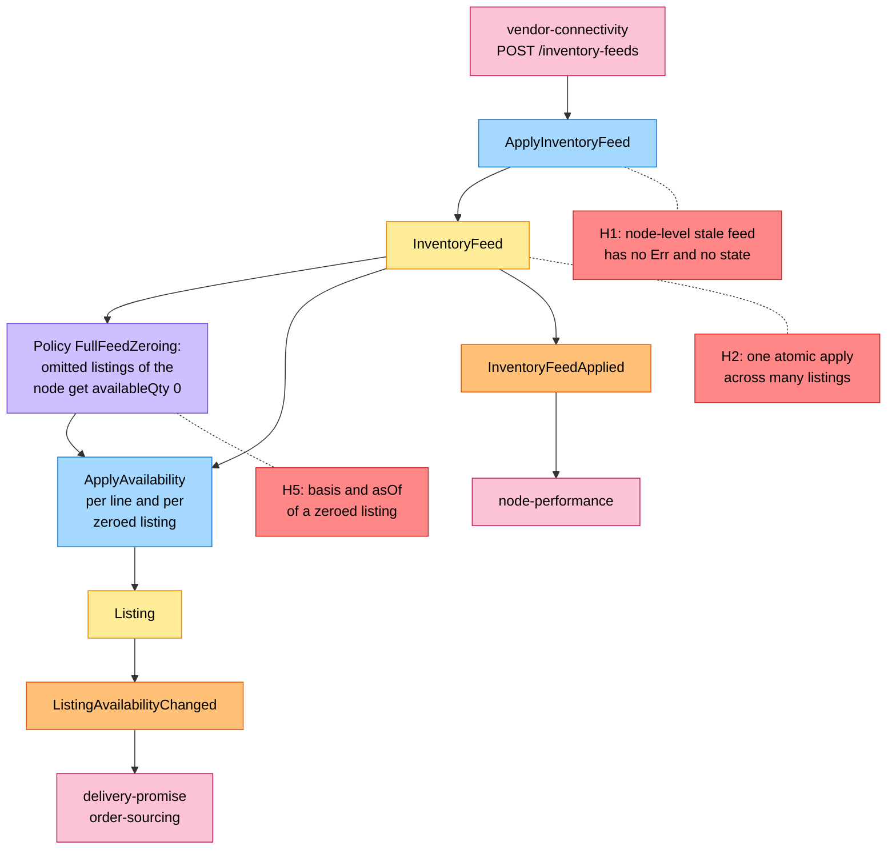
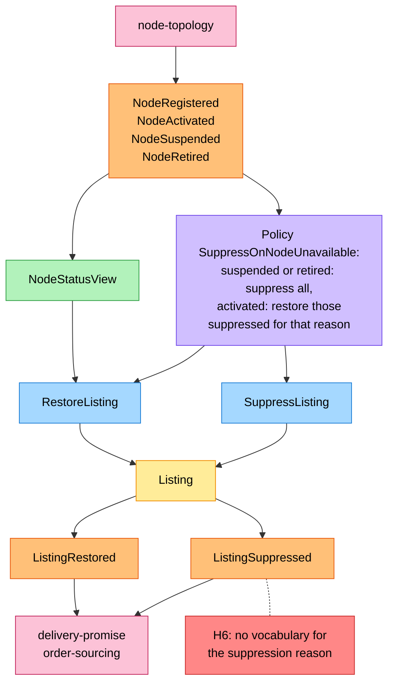

# EventStorming

:::info[Proposed design]
Derived from [`model/model.yaml`](https://github.com/IQVO/retail-network-docs/blob/main/model/model.yaml). Nothing in this context is built yet; identifiers (`Err...` names, routes, CloudEvents types) are the names an implementation must use.
:::

Process-level boards (`flowchart LR`, or `TB` where LR would be too wide) in the ddd-crew
[EventStorming glossary & cheat sheet](https://github.com/ddd-crew/eventstorming-glossary-cheat-sheet)
notation. Every sticky is a command, aggregate, event, policy, read model
or neighbour from `model.yaml`. Every hotspot is a genuine gap or risk in
the model; the table at the end says where each one comes from. The
domain-wide board is
[EventStorming Big Picture](/network/strategic-design/eventstorming-big-picture).

## Legend

| Sticky | Colour | Meaning |
| --- | --- | --- |
| Command | blue `#a5d8ff` | An intention, named as in the model's `commands` |
| Aggregate | yellow `#ffec99` | The aggregate root that decides |
| Domain Event | orange `#ffc078` | A fact from the model's `publishes` (or a consumed one) |
| Policy | lilac `#d0bfff` | "Whenever X, then Y", from the model's `policies` |
| Read Model | green `#b2f2bb` | A local, event-fed view from `read_models` |
| External System | pink `#fcc2d7` | A neighbouring context or the fleet |
| Hotspot | red `#ff8787` | An open question or risk in the model |
| Actor | pale orange `#fff4e6` | A person (not in the brief's palette; used only for humans) |

## 1. Catalogue and listing set-up

Derived from: `model.yaml → contexts[offer-availability].aggregates[CatalogItem]`,
`.aggregates[Listing]`, `.inbound`, `.publishes`.

Omitted: the `ErrInvalidItemDimensions` and `ErrDuplicateListing` refusals
(see [Use Cases](/network/contexts/offer-availability/use-cases)) and the
storefront's `BrowseCatalog` query, which changes nothing.

## 2. Inventory feed application

Derived from: `model.yaml → contexts[offer-availability].aggregates[InventoryFeed]`,
`.aggregates[Listing]`, `.policies[FullFeedZeroing]`, `.business_decisions`,
`.publishes`; `contexts[vendor-connectivity].sync_calls`.

Omitted: the `FAILED` outcome (`ErrListingNotOnNode`,
`ErrNegativeAvailability`), which raises no event; the stale-line skip
(`ErrStaleAvailability`), which raises no `ListingAvailabilityChanged`;
the vendor's own Vendor API submission upstream of `vendor-connectivity`.

## 3. Node-driven suppression

Derived from: `model.yaml → contexts[offer-availability].policies[SuppressOnNodeUnavailable]`,
`.read_models[NodeStatusView]`, `.aggregates[Listing]`, `.consumes`,
`.publishes`; `contexts[node-topology].publishes`.

Omitted: `NodeRegistered` only inserts the node into `NodeStatusView`; it
triggers no command. `RestoreListing` reads `NodeStatusView` because it is
refused with `ErrNodeNotSellable` on a node that is not `ACTIVE`.

## Hotspots and where they come from

| Hotspot | What is open | Where it comes from in `model.yaml` |
| --- | --- | --- |
| H1 | "A feed older than the last applied feed for that node is ignored" has no invariant, no `Err...` identifier and no `InventoryFeed` state for an ignored feed. Only the per-listing `ErrStaleAvailability` exists. | `contexts[offer-availability].business_decisions[1]` against `.aggregates[InventoryFeed].invariants` and `.states` |
| H2 | A full feed for a busy node writes every listing of that node in one atomic apply, while the listing throughput is "high: one update per feed line; bursty". Transaction size and lock time are a risk. | `.aggregates[InventoryFeed].description` ("applied atomically"), `.aggregates[Listing].throughput_estimate` |
| H3 | No initial state for `Listing`: a listing created on a non-`ACTIVE` node should be `SUPPRESSED` by the invariant, but `CreateListing` has no rule, and there is no `Availability` before the first feed. | `.aggregates[Listing].states`, `.transitions`, `.invariants[ErrNodeNotSellable]` |
| H4 | Whether `DiscontinueItem` suppresses the item's listings, or refuses later listings and feed lines for it. | `.aggregates[CatalogItem]`; no policy or invariant names it |
| H5 | `FullFeedZeroing` sets `availableQty=0`, but the vendor declared no `basis` and no `asOf` for an omitted listing; "the basis is kept, never re-derived" does not say what a zero carries. | `.policies[FullFeedZeroing]`, `.business_decisions[3]`, `.aggregates[Listing].value_objects` |
| H6 | `ListingSuppressed` carries `reason`, and the policy restores "those suppressed for that reason", but no reason vocabulary is modelled. | `.publishes[ListingSuppressed].data`, `.policies[SuppressOnNodeUnavailable]` |
