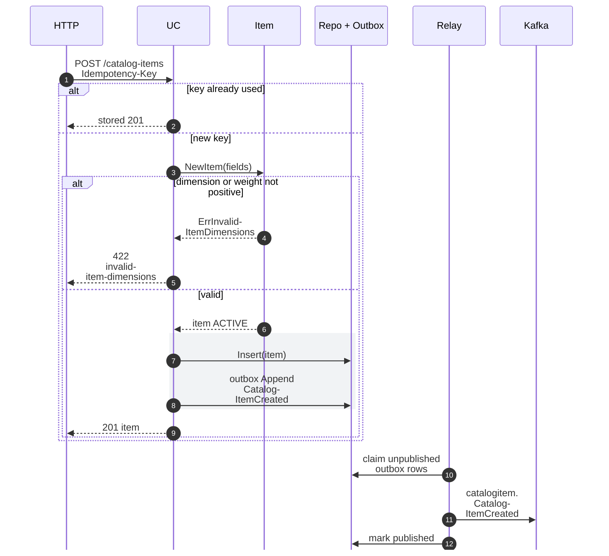
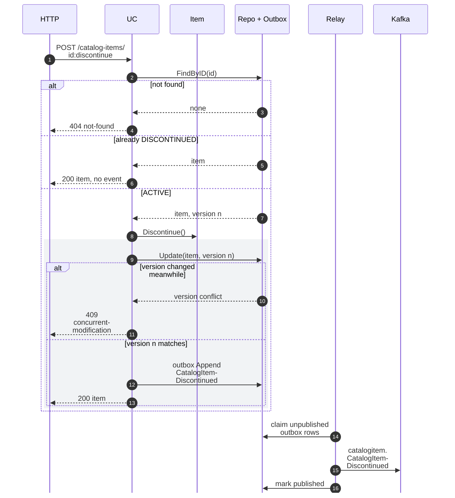
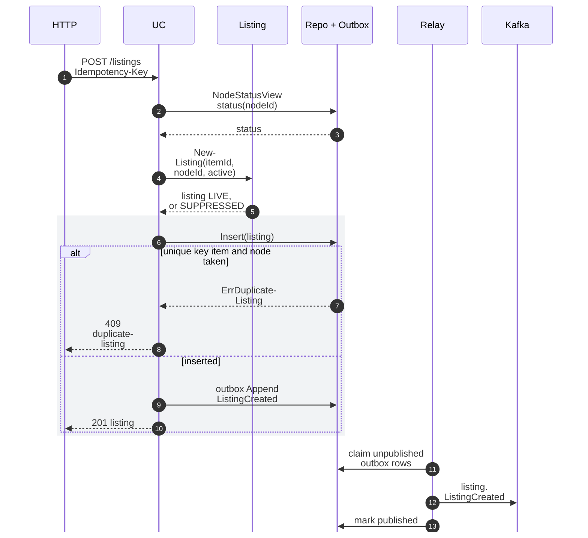
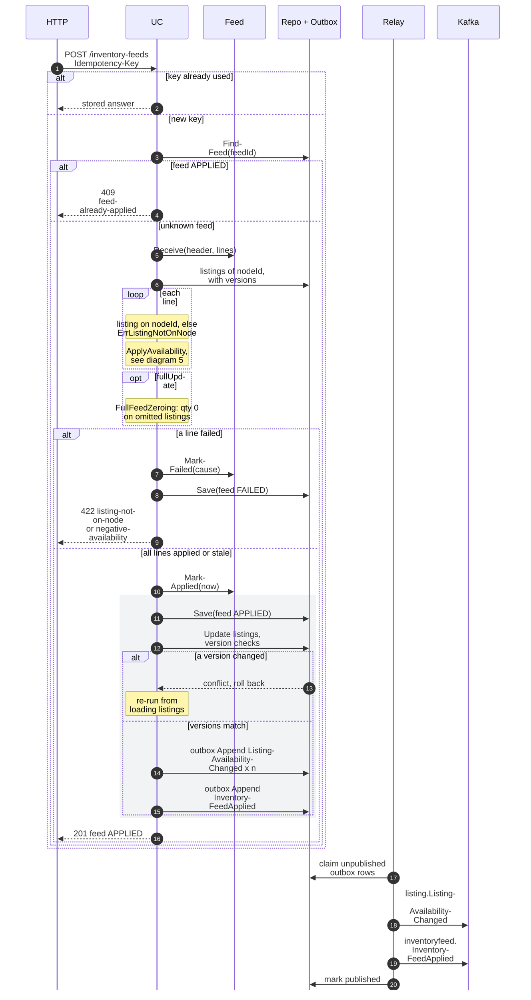
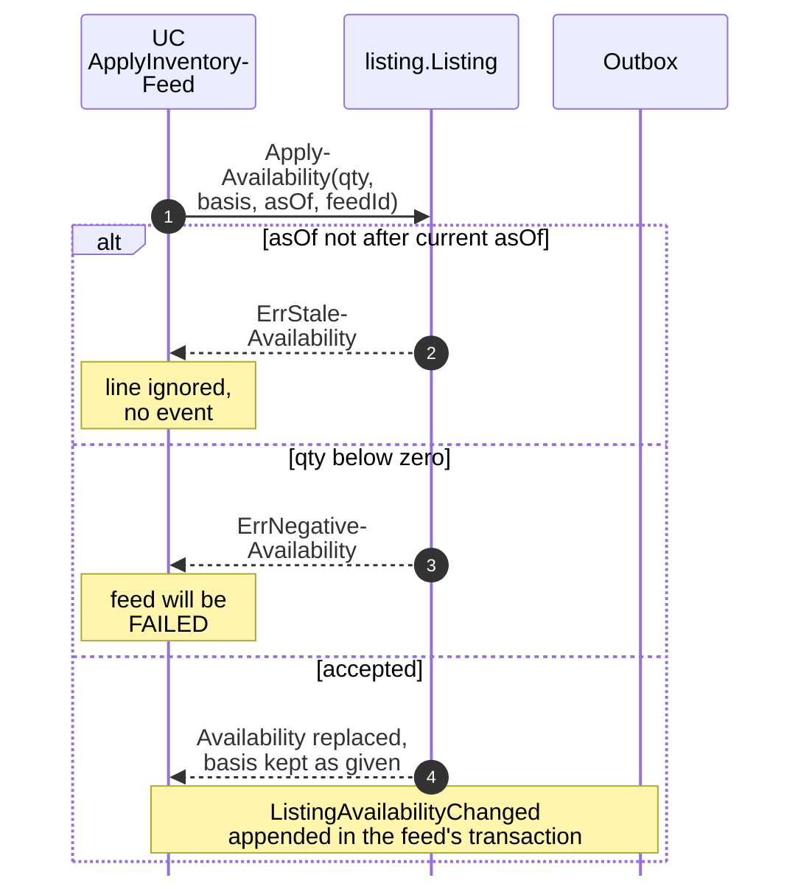
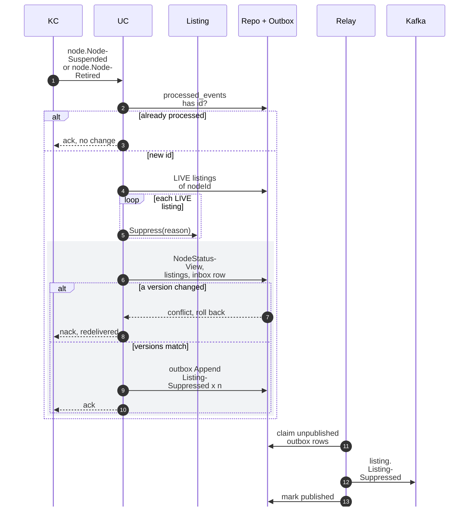
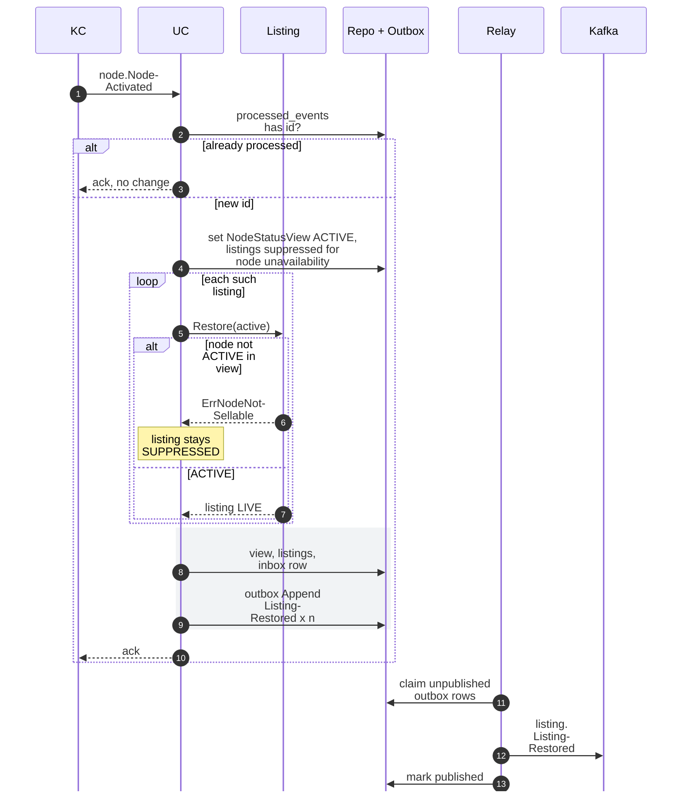

# Sequence Diagrams

:::info[As built]
Derived from [`network/model/model.yaml`](https://github.com/IQVO/warehouse-docs/blob/main/network/model/model.yaml). This context's service is built; the model carries its as-built contracts, and identifiers (`Err...` names, routes, CloudEvents types) are the names the service uses.
:::

One UML sequence diagram per command use case of
[Use Cases](/network/contexts/offer-availability/use-cases). Participants, in
order: the inbound adapter (`HTTP` or the Kafka consumer `KC`), the use
case (`UC`), the aggregate (`Item` = `catalog.Item`, `Listing` =
`listing.Listing`, `Feed` = `feed.InventoryFeed`), the Postgres database (`DB`): the
repository and the transactional outbox (the `outbox_events` table), shown
as one participant because the outbox row is written in the same
transaction as the aggregate; then the outbox relay (`Relay`) and Kafka.
Messages to `DB` that start with "outbox" are outbox writes; the others
are repository calls. Inside the diagrams, a hyphen before a line break
splits a long name to keep the diagram narrow (`CatalogItem-Created` is
`CatalogItemCreated`); it is not part of the name.
The grey `rect` is one database transaction. Event arrows to Kafka name
`<entity>.<EventName>` on `retailnetwork.offer-availability.events`; the
full type is `com.retailnetwork.commerce.offer-availability.<entity>.<EventName>`.

Common to every diagram: the relay runs on its own loop, claims
unpublished rows, publishes them as CloudEvents keyed by the aggregate
root id, and marks them published. It is drawn once per diagram.

## 1. CreateCatalogItem

Derived from: `model.yaml → contexts[offer-availability].aggregates[CatalogItem]`
(`invariants`, `commands`, `events`), `.rest`, `conventions.integration_rules`.

Omitted: the idempotency-key store write (inside the same transaction);
logging and metrics.

## 2. DiscontinueItem

Derived from: `model.yaml → contexts[offer-availability].aggregates[CatalogItem].transitions`,
`.events`, `.rest`.

Omitted: the `Idempotency-Key` replay branch (as in diagram 1). The
`404` and the `409 concurrent-modification` have no `Err...` identifier in
the model; they are proposed HTTP behaviour.

## 3. CreateListing

Derived from: `model.yaml → contexts[offer-availability].aggregates[Listing]`
(`invariants[ErrDuplicateListing]`, `invariants[ErrNodeNotSellable]`),
`.read_models[NodeStatusView]`, `.publishes[ListingCreated]`.

Omitted: the `Idempotency-Key` replay branch. Starting `SUPPRESSED` on a
non-`ACTIVE` node is the proposed reading of `ErrNodeNotSellable` (model
gap H3). A failed insert rolls the transaction back, so no outbox row
exists for it.

## 4. ApplyInventoryFeed

Derived from: `model.yaml → contexts[offer-availability].aggregates[InventoryFeed]`
(`states`, `transitions`, `invariants`), `.aggregates[Listing].invariants`,
`.policies[FullFeedZeroing]`, `.publishes`, `.rest`;
`contexts[vendor-connectivity].sync_calls`.

Omitted: the case of a `FAILED` `feedId` sent again (proposed: replay the
stored `422`). `ListingAvailabilityChanged` is written once per changed
listing; stale lines write nothing. The `RECEIVED` state exists only
inside the apply: the feed row is first written as `APPLIED` or `FAILED`.

## 5. ApplyAvailability

Derived from: `model.yaml → contexts[offer-availability].aggregates[Listing]`
(`value_objects`, `invariants[ErrNegativeAvailability]`,
`invariants[ErrStaleAvailability]`), `.business_decisions`.

Omitted: the inbound adapter, repository, relay and Kafka: this command
has no adapter of its own and commits inside diagram 4's transaction.

## 6. SuppressListing

Derived from: `model.yaml → contexts[offer-availability].policies[SuppressOnNodeUnavailable]`,
`.consumes`, `.read_models[NodeStatusView]`, `.aggregates[Listing]`,
`.publishes[ListingSuppressed]`; `conventions.integration_rules`.

Omitted: the consumer dispatches on the full type
(`com.retailnetwork.logistics.node-topology.node.NodeSuspended`,
`com.retailnetwork.logistics.node-topology.node.NodeRetired`).
`NodeRegistered` only inserts the view row and is not drawn.

## 7. RestoreListing

Derived from: `model.yaml → contexts[offer-availability].policies[SuppressOnNodeUnavailable]`,
`.aggregates[Listing].invariants[ErrNodeNotSellable]`,
`.publishes[ListingRestored]`; `conventions.integration_rules`.

Omitted: the version-conflict branch (as in diagram 6). The consumer
dispatches on `com.retailnetwork.logistics.node-topology.node.NodeActivated`.
Which suppression reasons count as "node unavailability" is model gap H6.
