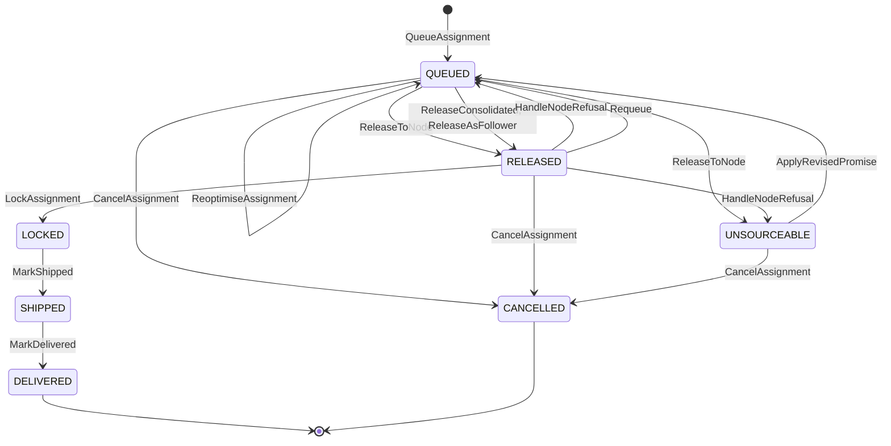

# Aggregate Design Canvas

:::info[As built]
Derived from [`network/model/model.yaml`](https://github.com/IQVO/warehouse-docs/blob/main/network/model/model.yaml). This context's service is built; the model carries its as-built contracts, and identifiers (`Err...` names, routes, CloudEvents types) are the names the service uses.
:::

Following the ddd-crew [Aggregate Design Canvas v1.1](https://github.com/ddd-crew/aggregate-design-canvas).
The context has two aggregate roots: **FulfillmentAssignment**, and the small
versioned **SourcingPolicy** document (below). Everything else it holds is a
read model fed by sibling events.

## FulfillmentAssignment

### 1. Name

`FulfillmentAssignment` (proposed package `internal/domain/assignment`,
`assignment.FulfillmentAssignment`), identified by `assignmentId`.

### 2. Description

One shipment group of one customer order, its promise constraints, the
current candidate node and path, and the history of releases. From release
until the end of its life, or until the merge is dissolved, it may be a member
of a consolidation merge: the **carrier** (the due assignment) or a
**follower** absorbed into the carrier's release.

It carries:

| Part | Shape (model `value_objects` and event data) |
| --- | --- |
| Identity and correlation | `assignmentId`; `orderId`, `groupNo` |
| Destination | `destinationPostalPrefix`, from `CustomerOrderPlaced`; needed to find the delivery station of a candidate path. The model's value objects do not list it (open question on the [canvas](/network/contexts/order-sourcing/bounded-context-canvas)) |
| Promise constraint | `PromiseConstraint{promiseId, tier (five values, `CONSOLIDATED` included), deliverByEarliest (optional), deliverByLatest, witnessNodeId}` |
| Lines | `lines(catalogItemId, listingId, quantity)`, as released; `listingId` is resolved per node from `AvailabilityView` |
| Current candidate | `Candidate{nodeId, pickupDepartureId, legs[], deliveryWaveId, eta, cost, estimatedCostCents, effectiveCostCents, policyVersion}` |
| Consolidation | `ConsolidationLink{consolidationKey, consolidatedInto (follower), members (carrier)}`; the key is optional and never exposed on REST |
| Release point | `releaseAt` (`VirtualQueue`) |
| Release history | `Release{releaseNo, nodeId, releasedAt, requiredShipBy, outcome(ACCEPTED, REJECTED, EXPIRED, PENDING, WITHDRAWN), reasonCode}` |
| Exclusions | `ExcludedNode{nodeId, reason}` |
| Concurrency | `assignmentVersion` (strictly increasing) |
| Lock and outcome facts | `lockedAt`, `lockReason`, `trackingNumbers`, `shippedAt`, `deliveredAt` (from the event data) |

It owns no stock and no capacity. It does not compute the promise, and it does
not run the purchase-order clock (`ackBy` belongs to `vendor-connectivity`).

### 3. State Transitions

Derived from: model.yaml → `contexts[order-sourcing].aggregates[FulfillmentAssignment].states`,
`.transitions`, `.commands` (the initial `QueueAssignment` edge, which the
`transitions` list does not spell out).

Omitted: `DELIVERED` and `CANCELLED` are drawn as final because no transition
leaves them; the model does not name terminal states for this aggregate.
`UNSOURCEABLE` is not final: `ApplyRevisedPromise` re-queues it. A merge is not a state: the carrier and its followers are all `RELEASED` (then `LOCKED`, `SHIPPED`, `DELIVERED`), and `Requeue` returns every member of a dissolved merge to `QUEUED`. The
self-transition `QUEUED → QUEUED` covers both a change of candidate and a
re-optimisation that keeps the same one. In `RELEASED` exactly one release
is `PENDING` (a purchase order sits at the node); from `LOCKED` on, the node
never changes.

### 4. Enforced Invariants

| Invariant | Enforced by |
| --- | --- |
| A released candidate's `eta <= deliverByLatest` | `ReleaseToNode`, `HandleNodeRefusal` (re-queue), `ReoptimiseAssignment` → `ErrCandidateBreaksPromise` |
| No change of node after `LOCKED` | `ReoptimiseAssignment`, `HandleNodeRefusal` on a locked assignment → `ErrAssignmentLocked` |
| A node that refused this group is never released to again for the same promise revision | `ReleaseToNode`, `ReoptimiseAssignment` (candidate selection) → `ErrNodeExcluded` |
| At most one release `PENDING` at a time | `ReleaseToNode` while `RELEASED`; `ReoptimiseAssignment` while `RELEASED` → `ErrReleaseInFlight` |
| `assignmentVersion` strictly increases | every save (optimistic concurrency) → `ErrStaleAssignmentVersion` |
| Cancel only before `LOCKED`; a request on a locked assignment is refused with `FulfillmentCancelRefused` | `CancelAssignment` → `ErrCancelAfterLock`, then `RefuseCancel` |
| A member of a live merge (carrier or follower, `RELEASED`, not yet `LOCKED`) is not cancelled: the cancel is refused with reason `CANCEL_WHILE_MERGED`, the state does not change and the merge stays intact | `CancelAssignment` → `ErrCancelWhileMerged`, then `RefuseCancel` |

Derived from: model.yaml → `aggregates[FulfillmentAssignment].invariants`.
Which command checks which invariant is this pack's reading of the rule text;
the model attaches each rule to the aggregate, not to a command.

### 5. Corrective Policies

Own policies (`contexts[order-sourcing].policies`):

- **VirtualQueue**: `releaseAt = pickup cutoff of the best candidate - node
  handling time - vendor ack budget`; release immediately for `SAME_DAY`. A
  re-optimisation that changes the best candidate moves `releaseAt` with it.
- **AssignmentCost**: money first (`effectiveCostCents`, see **RegionalBudget**),
  then `legs + crossRegionPenalty + scorecardPenalty + bookPressurePenalty` as
  tie-breakers; ties go to the witness node. Only candidates with
  `eta <= deliverByLatest` that are not excluded are ranked.
- **RegionalBudget** (`SourcingPolicy`): `effectiveCostCents = estimatedCostCents +
  crossRegionSurchargeCents` for a cross-region candidate. Among candidates within
  `cheapest + floor(cheapest x maxCostDeviationPercent / 100)` an in-region one beats
  a cross-region one; the rule is active only when the percent is above 0, so with
  nothing published the ordering is the one before the policy.
- **ConsolidatedHold**: a `CONSOLIDATED` group is searched with `NotBefore =
  deliverByEarliest` and released at the LATEST pickup that still reaches the chosen
  wave (after money, before the ordinal penalties), so the queue holds it as long as
  the shopper's day allows.
- **ConsolidationAtRelease**: at release the due carrier absorbs compatible QUEUED
  `CONSOLIDATED` groups of the same key and destination (the pure `sourcing.Merge`,
  rules c1 identity, c2 node, c3 window overlap, c4 one covering owner per summed
  item, c5 caps), up to `consolidationMaxAssignments`; otherwise it releases alone.
- **ConsolidationDissolution**: a refused or expired carrier release re-searches
  every member on its own; a promise revision that excludes the merged `eta`
  withdraws the release (`FulfillmentReleaseWithdrawn`) and re-queues every member.
  After the lock nothing dissolves.
- **ReassignOnRefusal**: on `PurchaseOrderRejected` or `PurchaseOrderExpired`,
  exclude the node and re-queue; if no candidate meets `deliverByLatest`,
  `UNSOURCEABLE`.
- **LockOnCommit**: on `PurchaseOrderAccepted` the assignment is `LOCKED`
  (the vendor-node equivalent of the item being picked).

Neighbours' reactions that close the loops:

| Neighbour policy | Trigger from this aggregate | Effect |
| --- | --- | --- |
| `vendor-connectivity` **IssueOnRelease** | `FulfillmentReleasedToNode` | Issues a purchase order; `poNumber` is idempotent on `assignmentId + releaseNo`. |
| `vendor-connectivity` **ExpireUnacknowledged** | (its own sweep) | `ISSUED` past `ackBy` → `PurchaseOrderExpired`, which drives `HandleNodeRefusal`. |
| `vendor-connectivity` **CancelOnSourcingCancel** | `FulfillmentCancelled` | Cancels the `ISSUED` purchase order of that release. |
| `delivery-promise` **RepromiseOnRisk** | `FulfillmentUnsourceable` | Recomputes and revises the promise (`PromiseRevised` → `ApplyRevisedPromise`); if nothing is feasible even at `STANDARD`, reports `PromiseBroken` at judgement time. |
| `vendor-connectivity` **CancelOnReleaseWithdrawn** | `FulfillmentReleaseWithdrawn` | Cancels the `ISSUED` purchase order of that `releaseNo` (never the latest release). |
| `linehaul-transportation` **BookOnLock** | `FulfillmentLocked`; `FulfillmentCancelled` or reassignment | Books one package on the pickup departure; releases it on cancel or reassignment. |
| `linehaul-transportation` **FollowerLockBooksNothing** | `FulfillmentLocked` with `consolidatedInto` | A follower's lock books nothing; the carrier's lock books the one package. |
| `customer-ordering` **CancelOnUnfulfillable** | `FulfillmentUnsourceable` and no feasible revision | Cancels the group (`CustomerOrderCancelled`); an `UNSOURCEABLE` assignment can be cancelled. |

### 6. Handled Commands

| Command | Transition | Issued by |
| --- | --- | --- |
| `QueueAssignment` | `[*] → QUEUED` | Kafka consumer of `CustomerOrderPlaced`, one per group |
| `ReoptimiseAssignment` | `QUEUED → QUEUED` | re-optimisation sweep over `QUEUED` rows (scheduler); planner `POST /assignments/{assignmentId}/reoptimisations` |
| `ReleaseToNode` | `QUEUED → RELEASED` or `QUEUED → UNSOURCEABLE` | release timer at `releaseAt`; at once for `SAME_DAY`, right after `QueueAssignment` |
| `ReleaseConsolidated` | `QUEUED → RELEASED` (the carrier) | `ReleaseToNode`, when the policy is on and a follower fits |
| `ReleaseAsFollower` | `QUEUED → RELEASED` (each follower, at the carrier's candidate) | the same unit of work |
| `Requeue` | `RELEASED → QUEUED` (every member of a dissolved merge) | Kafka consumer of `PromiseRevised` |
| `HandleNodeRefusal` | `RELEASED → QUEUED` or `RELEASED → UNSOURCEABLE` | Kafka consumer of `PurchaseOrderRejected`, `PurchaseOrderExpired` |
| `LockAssignment` | `RELEASED → LOCKED` | Kafka consumer of `PurchaseOrderAccepted` |
| `MarkShipped` | `LOCKED → SHIPPED` | Kafka consumer of `VendorShipmentConfirmed` |
| `MarkDelivered` | `SHIPPED → DELIVERED` | Kafka consumer of `PackageDelivered` |
| `CancelAssignment` | `QUEUED → CANCELLED`, an unmerged `RELEASED → CANCELLED` or `UNSOURCEABLE → CANCELLED` | Kafka consumer of `CustomerOrderCancelled`, per `groupNos` |
| `RefuseCancel` | `LOCKED`, `SHIPPED`, `DELIVERED`, or a merged `RELEASED` member, unchanged (version + 1) | same consumer, when `CancelAssignment` hits `ErrCancelAfterLock` or `ErrCancelWhileMerged` |
| `ApplyRevisedPromise` | `UNSOURCEABLE → QUEUED` (a revision that dissolves a merge goes through `Requeue`) | Kafka consumer of `PromiseRevised` |

### 7. Created Events

All are published as `com.retailnetwork.commerce.order-sourcing.assignment.<EventName>`
on `retailnetwork.order-sourcing.events` (the analytics-only ones on
`retailnetwork.order-sourcing.analytics`), subject `assignmentId`.

| Event | Raised when | Full CloudEvents type |
| --- | --- | --- |
| `FulfillmentQueued` | `QueueAssignment` saved | `com.retailnetwork.commerce.order-sourcing.assignment.FulfillmentQueued` |
| `FulfillmentReassigned` | the candidate node changes: `ReoptimiseAssignment` picks another node, or `HandleNodeRefusal` re-queues on another node | `com.retailnetwork.commerce.order-sourcing.assignment.FulfillmentReassigned` |
| `FulfillmentReleasedToNode` | `ReleaseToNode` → `RELEASED` | `com.retailnetwork.commerce.order-sourcing.assignment.FulfillmentReleasedToNode` |
| `FulfillmentUnsourceable` | `ReleaseToNode` or `HandleNodeRefusal` → `UNSOURCEABLE` | `com.retailnetwork.commerce.order-sourcing.assignment.FulfillmentUnsourceable` |
| `FulfillmentLocked` | `LockAssignment` | `com.retailnetwork.commerce.order-sourcing.assignment.FulfillmentLocked` |
| `FulfillmentShipped` | `MarkShipped` | `com.retailnetwork.commerce.order-sourcing.assignment.FulfillmentShipped` |
| `FulfillmentDelivered` | `MarkDelivered` | `com.retailnetwork.commerce.order-sourcing.assignment.FulfillmentDelivered` |
| `FulfillmentCancelled` | `CancelAssignment` | `com.retailnetwork.commerce.order-sourcing.assignment.FulfillmentCancelled` |
| `FulfillmentCancelRefused` | `RefuseCancel` | `com.retailnetwork.commerce.order-sourcing.assignment.FulfillmentCancelRefused` |
| `FulfillmentReleaseWithdrawn` | `Requeue` after a promise revision dissolved a merge | `com.retailnetwork.commerce.order-sourcing.assignment.FulfillmentReleaseWithdrawn` |
| `AssignmentsConsolidated` | `ReleaseConsolidated` (analytics only) | `com.retailnetwork.commerce.order-sourcing.assignment.AssignmentsConsolidated` |
| `AssignmentsDeconsolidated` | a merge ends before the lock (analytics only) | `com.retailnetwork.commerce.order-sourcing.assignment.AssignmentsDeconsolidated` |

Derived from: model.yaml → `aggregates[FulfillmentAssignment].events`,
`.transitions`; `publishes[*].data`. The model lists the events but not which
command raises which; the pairing above follows the transitions and each
event's data (`FulfillmentReassigned` carries `fromNodeId`, `toNodeId`).
`ApplyRevisedPromise` has **no** event in the model (open question on the
[canvas](/network/contexts/order-sourcing/bounded-context-canvas)); a
`ReoptimiseAssignment` that keeps the same node raises nothing.

### 8. Throughput

*Estimate.* The model says "medium-high; re-optimisation sweeps touch QUEUED
rows only". One `QueueAssignment` per shipment group at the order rate; one
release, one lock, one shipment and one delivery per group on the happy path.
The sweeps dominate writes while the queue is long (`STANDARD` groups wait
the longest). Contention points: a sweep and a purchase-order outcome on the
same assignment, and the planner's re-optimise. `assignmentVersion` turns
every such race into `ErrStaleAssignmentVersion` and a retry from a fresh
load. Kafka keys by `assignmentId`, so one assignment's events are ordered.

### 9. Size

*Estimate.* The model says "one row per shipment group + releases". A
group has a handful of lines; releases are usually one and are bounded by the
number of candidate nodes, because each refusal excludes a node; exclusions
grow by one per refusal. Lifetime: from checkout to delivery (days), then a
closed record. Events per instance on the happy path: `FulfillmentQueued`,
zero or more `FulfillmentReassigned`, `FulfillmentReleasedToNode`,
`FulfillmentLocked`, `FulfillmentShipped`, `FulfillmentDelivered`; each
refusal adds `FulfillmentReassigned` (or `FulfillmentUnsourceable`) and
another `FulfillmentReleasedToNode`.

## SourcingPolicy

A single versioned document, copied from `delivery-promise`'s `PromisePolicy`: one
current version, every publish creates version n + 1, versions are kept, and version
0 is the built-in default (nothing published). The search reads it once per search
through the repository and takes it as an input; the domain makes no call.

| Part | Content |
| --- | --- |
| Fields (all integers) | `crossRegionSurchargeCents` 0 to 100000 (default 0), `maxCostDeviationPercent` 0 to 200 (default 0), `consolidationMaxAssignments` 0 to 10 (default 0; 0 and 1 mean consolidation is off) |
| Invariants | a publish is version current + 1 (`ErrVersionNotNext`; a lost race is retried once, then 409 `concurrent-update`); every field inside its range (`ErrValidation`, 422 `validation-failed`) |
| Command | `PublishSourcingPolicy`: `PUT /sourcing-policy`, the WHOLE document (an omitted field is 0, an empty body is 400), behind the `Idempotency-Key` middleware; `GET /sourcing-policy` reads the current version or the defaults with `version: 0` |
| Event | `SourcingPolicyPublished`, analytics only, in the same transaction as the save |
| Not built | the split surcharge and the single-node-beats-split preference of the first contract: this context never splits an order, because `customer-ordering` forms the groups and each group is assigned on its own |

## Read models

These hold state but are not aggregates: they enforce no invariant of this
context, they are derived only from other contexts' events, and each can be
rebuilt by replaying its topics. They are local because the model forbids a
synchronous call on this path.

| Read model | Source events (model `read_models`) | Used by | Why it is not an aggregate |
| --- | --- | --- | --- |
| `NodeProfileView` | `node-topology` `NodeRegistered`, `NodeOperationalProfileDeclared`, `NodeActivated`, `NodeSuspended`, `NodeRetired` | candidate search (only `ACTIVE` nodes with `OUTBOUND`), handling time and cutoffs for `releaseAt` | `node-topology` owns the node; this is a copy keyed by `nodeId`, newest `profileRevision` wins. |
| `NetworkGraphView` | `node-topology` `LaneOpened`, `LaneClosed`, `ServiceAreaAssigned`, `RegionDefined`; `linehaul-transportation` `DepartureScheduled`, `DepartureCapacityChanged`, `DepartureCancelled`; `last-mile-delivery` `DeliveryWaveScheduled`, `DeliveryWaveCapacityChanged` | candidate paths, `legs`, `eta`, `crossRegionPenalty` | Lanes, departures and waves belong to three other contexts; the graph is a projection, not a decision. |
| `AvailabilityView` | `offer-availability` `ListingCreated`, `ListingAvailabilityChanged`, `ListingSuppressed`, `ListingRestored`, `CatalogItemDiscontinued` | which nodes can ship every line in full; the `listingId` per (`catalogItemId`, `nodeId`) for the release | The quantity is the vendor's claim, owned by `offer-availability`; nothing is reserved here. |
| `ScorecardView` | `node-performance` `NodeScorecardUpdated` | `scorecardPenalty` | Measured by `node-performance`; read only. |
| `PromiseBookPressureView` | `delivery-promise` `PromiseBookExhausted` | `bookPressurePenalty` | The book is `delivery-promise`'s aggregate; this view only remembers which `bookId`s were exhausted. |

Derived from: model.yaml → `contexts[order-sourcing].read_models`,
`.policies[AssignmentCost]`, `node_types` (only `FULFILLMENT_CENTER` has
`OUTBOUND`).

The **virtual queue** is not a separate store: it is the set of
`FulfillmentAssignment` rows in `QUEUED`, ordered by `releaseAt` (see
[Entity Relationship](/network/contexts/order-sourcing/entity-relationship)).
