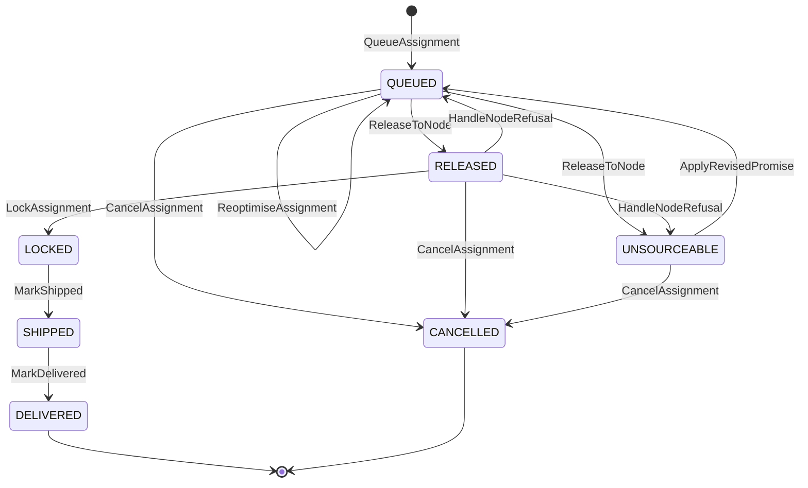

# Aggregate Design Canvas

:::info[As built]
Derived from [`model/model.yaml`](https://github.com/IQVO/retail-network-docs/blob/main/model/model.yaml). This context's service is built; the model carries its as-built contracts, and identifiers (`Err...` names, routes, CloudEvents types) are the names the service uses.
:::

Following the ddd-crew [Aggregate Design Canvas v1.1](https://github.com/ddd-crew/aggregate-design-canvas).
The context has one aggregate root, **FulfillmentAssignment**. Everything else
it holds is a read model fed by sibling events.

## FulfillmentAssignment

### 1. Name

`FulfillmentAssignment` (proposed package `internal/domain/assignment`,
`assignment.FulfillmentAssignment`), identified by `assignmentId`.

### 2. Description

One shipment group of one customer order, its promise constraints, the
current candidate node and path, and the history of releases.

It carries:

| Part | Shape (model `value_objects` and event data) |
| --- | --- |
| Identity and correlation | `assignmentId`; `orderId`, `groupNo` |
| Destination | `destinationPostalPrefix`, from `CustomerOrderPlaced`; needed to find the delivery station of a candidate path. The model's value objects do not list it (open question on the [canvas](/network/contexts/order-sourcing/bounded-context-canvas)) |
| Promise constraint | `PromiseConstraint{promiseId, tier, deliverByLatest, witnessNodeId}` |
| Lines | `lines(catalogItemId, listingId, quantity)`, as released; `listingId` is resolved per node from `AvailabilityView` |
| Current candidate | `Candidate{nodeId, pickupDepartureId, legs[], deliveryWaveId, eta, cost}` |
| Release point | `releaseAt` (`VirtualQueue`) |
| Release history | `Release{releaseNo, nodeId, releasedAt, requiredShipBy, outcome(ACCEPTED, REJECTED, EXPIRED, PENDING), reasonCode}` |
| Exclusions | `ExcludedNode{nodeId, reason}` |
| Concurrency | `assignmentVersion` (strictly increasing) |
| Lock and outcome facts | `lockedAt`, `lockReason`, `trackingNumbers`, `shippedAt`, `deliveredAt` (from the event data) |

It owns no stock and no capacity. It does not compute the promise, and it does
not run the purchase-order clock (`ackBy` belongs to `vendor-connectivity`).

### 3. State Transitions

Derived from: model.yaml → `contexts[order-sourcing].aggregates[FulfillmentAssignment].states`,
`.transitions`, `.commands` (the initial `QueueAssignment` edge, which the
`transitions` list does not spell out).

Omitted: `DELIVERED` and `CANCELLED` are drawn as final because no transition
leaves them; the model does not name terminal states for this aggregate.
`UNSOURCEABLE` is not final: `ApplyRevisedPromise` re-queues it. The
self-transition `QUEUED → QUEUED` covers both a change of candidate and a
re-optimisation that keeps the same one. In `RELEASED` exactly one release
is `PENDING` (a purchase order sits at the node); from `LOCKED` on, the node
never changes.

### 4. Enforced Invariants

| Invariant | Enforced by |
| --- | --- |
| A released candidate's `eta <= deliverByLatest` | `ReleaseToNode`, `HandleNodeRefusal` (re-queue), `ReoptimiseAssignment` → `ErrCandidateBreaksPromise` |
| No change of node after `LOCKED` | `ReoptimiseAssignment`, `HandleNodeRefusal` on a locked assignment → `ErrAssignmentLocked` |
| A node that refused this group is never released to again for the same promise revision | `ReleaseToNode`, `ReoptimiseAssignment` (candidate selection) → `ErrNodeExcluded` |
| At most one release `PENDING` at a time | `ReleaseToNode` while `RELEASED`; `ReoptimiseAssignment` while `RELEASED` → `ErrReleaseInFlight` |
| `assignmentVersion` strictly increases | every save (optimistic concurrency) → `ErrStaleAssignmentVersion` |
| Cancel only before `LOCKED`; a request on a locked assignment is refused with `FulfillmentCancelRefused` | `CancelAssignment` → `ErrCancelAfterLock`, then `RefuseCancel` |

Derived from: model.yaml → `aggregates[FulfillmentAssignment].invariants`.
Which command checks which invariant is this pack's reading of the rule text;
the model attaches each rule to the aggregate, not to a command.

### 5. Corrective Policies

Own policies (`contexts[order-sourcing].policies`):

- **VirtualQueue**: `releaseAt = pickup cutoff of the best candidate - node
  handling time - vendor ack budget`; release immediately for `SAME_DAY`. A
  re-optimisation that changes the best candidate moves `releaseAt` with it.
- **AssignmentCost**: `cost = legs + crossRegionPenalty + scorecardPenalty +
  bookPressurePenalty`; ties go to the witness node. Only candidates with
  `eta <= deliverByLatest` that are not excluded are ranked.
- **ReassignOnRefusal**: on `PurchaseOrderRejected` or `PurchaseOrderExpired`,
  exclude the node and re-queue; if no candidate meets `deliverByLatest`,
  `UNSOURCEABLE`.
- **LockOnCommit**: on `PurchaseOrderAccepted` the assignment is `LOCKED`
  (the vendor-node equivalent of the item being picked).

Neighbours' reactions that close the loops:

| Neighbour policy | Trigger from this aggregate | Effect |
| --- | --- | --- |
| `vendor-connectivity` **IssueOnRelease** | `FulfillmentReleasedToNode` | Issues a purchase order; `poNumber` is idempotent on `assignmentId + releaseNo`. |
| `vendor-connectivity` **ExpireUnacknowledged** | (its own sweep) | `ISSUED` past `ackBy` → `PurchaseOrderExpired`, which drives `HandleNodeRefusal`. |
| `vendor-connectivity` **CancelOnSourcingCancel** | `FulfillmentCancelled` | Cancels the `ISSUED` purchase order of that release. |
| `delivery-promise` **RepromiseOnRisk** | `FulfillmentUnsourceable` | Recomputes and revises the promise (`PromiseRevised` → `ApplyRevisedPromise`); if nothing is feasible even at `STANDARD`, reports `PromiseBroken` at judgement time. |
| `linehaul-transportation` **BookOnLock** | `FulfillmentLocked`; `FulfillmentCancelled` or reassignment | Books one package on the pickup departure; releases it on cancel or reassignment. |
| `customer-ordering` **CancelOnUnfulfillable** | `FulfillmentUnsourceable` and no feasible revision | Cancels the group (`CustomerOrderCancelled`); an `UNSOURCEABLE` assignment can be cancelled. |

### 6. Handled Commands

| Command | Transition | Issued by |
| --- | --- | --- |
| `QueueAssignment` | `[*] → QUEUED` | Kafka consumer of `CustomerOrderPlaced`, one per group |
| `ReoptimiseAssignment` | `QUEUED → QUEUED` | re-optimisation sweep over `QUEUED` rows (scheduler); planner `POST /assignments/{assignmentId}:reoptimise` |
| `ReleaseToNode` | `QUEUED → RELEASED` or `QUEUED → UNSOURCEABLE` | release timer at `releaseAt`; at once for `SAME_DAY`, right after `QueueAssignment` |
| `HandleNodeRefusal` | `RELEASED → QUEUED` or `RELEASED → UNSOURCEABLE` | Kafka consumer of `PurchaseOrderRejected`, `PurchaseOrderExpired` |
| `LockAssignment` | `RELEASED → LOCKED` | Kafka consumer of `PurchaseOrderAccepted` |
| `MarkShipped` | `LOCKED → SHIPPED` | Kafka consumer of `VendorShipmentConfirmed` |
| `MarkDelivered` | `SHIPPED → DELIVERED` | Kafka consumer of `PackageDelivered` |
| `CancelAssignment` | `QUEUED → CANCELLED`, `RELEASED → CANCELLED` or `UNSOURCEABLE → CANCELLED` | Kafka consumer of `CustomerOrderCancelled`, per `groupNos` |
| `RefuseCancel` | `LOCKED`, `SHIPPED` or `DELIVERED`, unchanged (version + 1) | same consumer, when `CancelAssignment` hits `ErrCancelAfterLock` |
| `ApplyRevisedPromise` | `UNSOURCEABLE → QUEUED` | Kafka consumer of `PromiseRevised` |

### 7. Created Events

All are published as `com.retailnetwork.commerce.order-sourcing.assignment.<EventName>`
on `retailnetwork.order-sourcing.events`, subject `assignmentId`.

| Event | Raised when | Full CloudEvents type |
| --- | --- | --- |
| `FulfillmentQueued` | `QueueAssignment` saved | `com.retailnetwork.commerce.order-sourcing.assignment.FulfillmentQueued` |
| `FulfillmentReassigned` | the candidate node changes: `ReoptimiseAssignment` picks another node, or `HandleNodeRefusal` re-queues on another node | `com.retailnetwork.commerce.order-sourcing.assignment.FulfillmentReassigned` |
| `FulfillmentReleasedToNode` | `ReleaseToNode` → `RELEASED` | `com.retailnetwork.commerce.order-sourcing.assignment.FulfillmentReleasedToNode` |
| `FulfillmentUnsourceable` | `ReleaseToNode` or `HandleNodeRefusal` → `UNSOURCEABLE` | `com.retailnetwork.commerce.order-sourcing.assignment.FulfillmentUnsourceable` |
| `FulfillmentLocked` | `LockAssignment` | `com.retailnetwork.commerce.order-sourcing.assignment.FulfillmentLocked` |
| `FulfillmentShipped` | `MarkShipped` | `com.retailnetwork.commerce.order-sourcing.assignment.FulfillmentShipped` |
| `FulfillmentDelivered` | `MarkDelivered` | `com.retailnetwork.commerce.order-sourcing.assignment.FulfillmentDelivered` |
| `FulfillmentCancelled` | `CancelAssignment` | `com.retailnetwork.commerce.order-sourcing.assignment.FulfillmentCancelled` |

Derived from: model.yaml → `aggregates[FulfillmentAssignment].events`,
`.transitions`; `publishes[*].data`. The model lists the events but not which
command raises which; the pairing above follows the transitions and each
event's data (`FulfillmentReassigned` carries `fromNodeId`, `toNodeId`).
`ApplyRevisedPromise` has **no** event in the model (open question on the
[canvas](/network/contexts/order-sourcing/bounded-context-canvas)); a
`ReoptimiseAssignment` that keeps the same node raises nothing.

### 8. Throughput

*Estimate.* The model says "medium-high; re-optimisation sweeps touch QUEUED
rows only". One `QueueAssignment` per shipment group at the order rate; one
release, one lock, one shipment and one delivery per group on the happy path.
The sweeps dominate writes while the queue is long (`STANDARD` groups wait
the longest). Contention points: a sweep and a purchase-order outcome on the
same assignment, and the planner's re-optimise. `assignmentVersion` turns
every such race into `ErrStaleAssignmentVersion` and a retry from a fresh
load. Kafka keys by `assignmentId`, so one assignment's events are ordered.

### 9. Size

*Estimate.* The model says "one row per shipment group + releases". A
group has a handful of lines; releases are usually one and are bounded by the
number of candidate nodes, because each refusal excludes a node; exclusions
grow by one per refusal. Lifetime: from checkout to delivery (days), then a
closed record. Events per instance on the happy path: `FulfillmentQueued`,
zero or more `FulfillmentReassigned`, `FulfillmentReleasedToNode`,
`FulfillmentLocked`, `FulfillmentShipped`, `FulfillmentDelivered`; each
refusal adds `FulfillmentReassigned` (or `FulfillmentUnsourceable`) and
another `FulfillmentReleasedToNode`.

## Read models

These hold state but are not aggregates: they enforce no invariant of this
context, they are derived only from other contexts' events, and each can be
rebuilt by replaying its topics. They are local because the model forbids a
synchronous call on this path.

| Read model | Source events (model `read_models`) | Used by | Why it is not an aggregate |
| --- | --- | --- | --- |
| `NodeProfileView` | `node-topology` `NodeRegistered`, `NodeOperationalProfileDeclared`, `NodeActivated`, `NodeSuspended`, `NodeRetired` | candidate search (only `ACTIVE` nodes with `OUTBOUND`), handling time and cutoffs for `releaseAt` | `node-topology` owns the node; this is a copy keyed by `nodeId`, newest `profileRevision` wins. |
| `NetworkGraphView` | `node-topology` `LaneOpened`, `LaneClosed`, `ServiceAreaAssigned`, `RegionDefined`; `linehaul-transportation` `DepartureScheduled`, `DepartureCapacityChanged`, `DepartureCancelled`; `last-mile-delivery` `DeliveryWaveScheduled`, `DeliveryWaveCapacityChanged` | candidate paths, `legs`, `eta`, `crossRegionPenalty` | Lanes, departures and waves belong to three other contexts; the graph is a projection, not a decision. |
| `AvailabilityView` | `offer-availability` `ListingCreated`, `ListingAvailabilityChanged`, `ListingSuppressed`, `ListingRestored`, `CatalogItemDiscontinued` | which nodes can ship every line in full; the `listingId` per (`catalogItemId`, `nodeId`) for the release | The quantity is the vendor's claim, owned by `offer-availability`; nothing is reserved here. |
| `ScorecardView` | `node-performance` `NodeScorecardUpdated` | `scorecardPenalty` | Measured by `node-performance`; read only. |
| `PromiseBookPressureView` | `delivery-promise` `PromiseBookExhausted` | `bookPressurePenalty` | The book is `delivery-promise`'s aggregate; this view only remembers which `bookId`s were exhausted. |

Derived from: model.yaml → `contexts[order-sourcing].read_models`,
`.policies[AssignmentCost]`, `node_types` (only `FULFILLMENT_CENTER` has
`OUTBOUND`).

The **virtual queue** is not a separate store: it is the set of
`FulfillmentAssignment` rows in `QUEUED`, ordered by `releaseAt` (see
[Entity Relationship](/network/contexts/order-sourcing/entity-relationship)).
